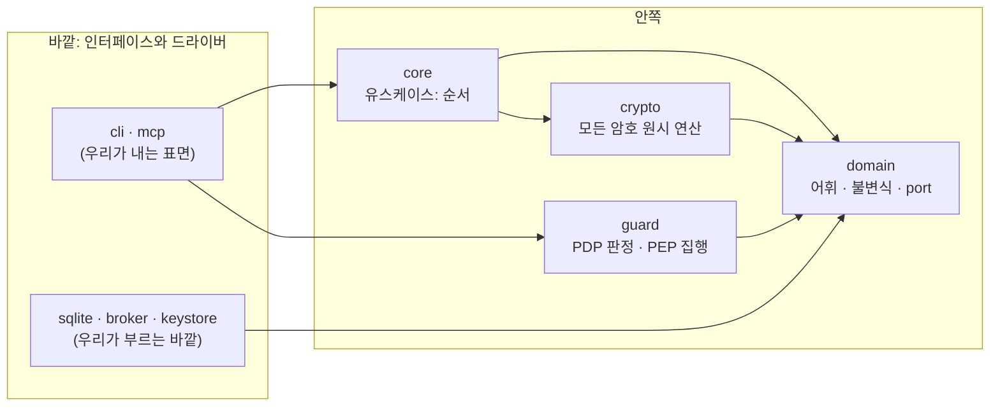
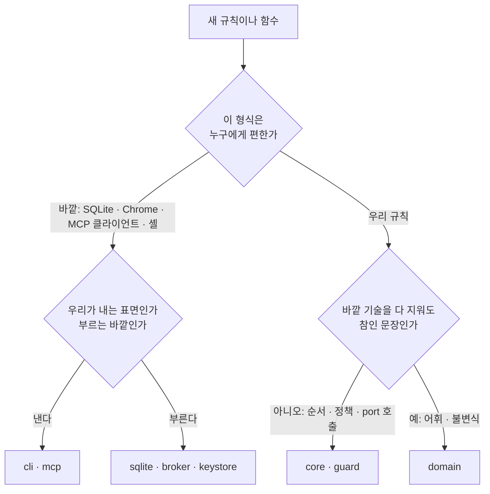

# 코드를 쓰는 원칙

Clean Architecture, SOLID, Clean Code를 KeyHarbor에 맞게 정리했다. 원전 링크는 맨 아래에 있다. 여기 없는 것은 원전을 본다.
이 레포의 계층 결정은 [ADR-0014](../../docs/design/adr/0014-hexagonal-guard-layer.md)가 정본이고, 이 문서는 코드를 쓸 때 매번 확인할 판단 기준이다.

## 의존은 안쪽으로만

> "Source code dependencies can only point inwards."

- **경계는 trait로 넘는다.** 안쪽(domain)이 port를 정의하고 바깥(adapter)이 구현한다.
- **경계를 넘는 것은 우리 말로 된 단순한 값이다.** Diesel row, CDP JSON, MCP 요청 구조체, 브라우저 cookie 객체를 안쪽으로 넘기지 않는다. 어댑터가 번역한다.
- **제어 흐름은 아무 방향이나 간다.** 안쪽으로만 가야 하는 것은 소스 의존뿐이다.

| 원전 | 이 레포 | 무엇이 들어가나 |
|---|---|---|
| Entities | `keyharbor-domain` | 기술이 없어도 참인 규칙과 그 규칙이 다루는 것, port trait |
| Use Cases | `keyharbor-core`, `keyharbor-guard` | 요청 하나에 무슨 순서로 일이 벌어지나, 쓰게 할지 말지 |
| Interface Adapters | `keyharbor-cli`, `keyharbor-mcp`, 각 어댑터의 mapper | 안팎의 모양을 바꾸는 변환 |
| Frameworks & Drivers | `keyharbor-sqlite`(Diesel), `keyharbor-broker`(CDP·Chrome), keystore(Keychain) | 바깥 기술 |

`scripts/check-layers.sh`가 이 방향을 강제한다. 규칙을 새로 정하면 스크립트에 먼저 넣고, 위반 예시로 실패하는 것을 확인한다.

## 비즈니스 로직과 인터페이스를 나눈다

**판정·순서·정책은 안쪽, 직렬화·전송·프로세스·파일은 바깥이다.**

- CLI와 MCP는 같은 유스케이스를 부르는 두 얼굴이다. 같은 규칙이 CLI와 MCP에 따로 있으면 하나가 틀린 것이다. 둘 다 core·guard를 부르고, 자기 일은 인자 파싱과 출력 모양뿐이다.
- 네트워크·IPC(MCP stdio, control socket, CDP 파이프, Native Messaging)의 메시지 형식은 어댑터의 wire 타입(`*Wire`, `*Request`, `*Response`)이다. 안쪽 타입에 wire 필드 이름이 보이면 누수다.
- 어댑터는 이름을 번역만 한다. 판정하지 않고, 오류를 우리 말(`VaultError`, `Denial`)로 옮긴다.
- 유스케이스는 결과 값을 돌려주고, 출력·로그·사용 기록 그리기는 바깥이 한다.

## 새 코드를 어디에 둘지

- **규칙은 다루는 것 옆에 둔다.** `rules/` 폴더를 파지 않고 값 객체의 메서드로 붙인다(`ItemKind::default_origin_binding`, `Origin::parse`).
- **평문은 guard를 거친다.** 평문 값이 필요한 코드는 `PlaintextAccess`를 받는 guard 경로 안에 있어야 한다. 새 평문 경로를 만들면 그것은 설계 변경이고 03 백서와 ADR을 먼저 고친다.
- **암호는 `keyharbor-crypto` 한 곳이다.** AEAD·KDF·MAC·난수·봉투 형식·age 내보내기를 다른 crate에서 직접 부르지 않는다. 새 키는 `KeyPurpose`에 한 줄, 새 형식은 envelope에 한 버전이다. 알고리즘을 직접 구현하지 않는다.

## 확장 지점은 이렇게 연다

새 경우를 더할 때 **기존 코드를 고치지 않고 하나를 더해서** 끝나야 하는 곳은 아래 패턴을 쓴다. 그 밖에는 추측으로 추상화하지 않는다.

| 확장 지점 | 패턴 | 더하는 방법 |
|---|---|---|
| 항목 종류와 필드 | 데이터 레지스트리 (`KINDS`/`KindSpec`/`FieldSpec`) | 표에 한 줄. CLI·MCP에 종류별 `match`를 더하지 않는다 |
| 쓰게 할지 말지 검사 (정책·만료·run 허용·origin·필드 종류·grant) | Chain of Responsibility / Specification (`trait Check`) | `pdp/checks/<검사>.rs` 하나 + 등록 순서 한 줄 |
| 거부 사유 | enum `DenialReason` | 변형 하나. 표시 문자열은 한 곳 |
| 마스킹 변형 (JSON 이스케이프, URL 인코딩, 카드 공백…) | Strategy + Registry (`trait Variant`) | `pep/mask/variants/<변형>.rs` 하나 + 등록 |
| 사람 확인 (터미널, 관리 앱) | Port + Adapter (`trait Confirm`) | 어댑터 하나. 약화 작업 목록은 `WeakeningOp` 표 한 곳 |
| 브라우저 연결 (전용 프로필, 이후 다른 방식) | Port + Adapter (`BrowserPort`, `FrameInspector`, `PageInput`) | 어댑터 하나 |
| 평문을 다루는 브라우저 호출 | Decorator (`GuardedBrowser`) | guard가 감싸고 어댑터는 모른다 |
| 저장 | Repository + Data Mapper, 바운디드 컨텍스트(vault·session·access·audit·config) | 컨텍스트 안에 `schema`·`models`·`mappers`·`repo`·새 마이그레이션. 컨텍스트끼리 models·repo를 가져다 쓰지 않는다 |
| 암호 용도 | 용도 enum (`KeyPurpose`) + suite 표 | 한 줄 |
| 디자인 검사 규칙 | Strategy + Registry (`trait Rule`) | `rules/<규칙>.rs` 하나 + 등록 |
| 브라우저 확장 대상 (Chrome, Firefox, 이후 Edge) | Ports + Adapters, manifest base + 오버레이 | 어댑터 폴더 + 오버레이 + 빌드 대상 등록 |

**값은 만들 때 검사한다.** 이름 있는 값은 newtype(`ItemName`, `Origin`, `Description`, `Expiry`)으로 만들고 생성자에서 불변식을 검사한다. 어긴 값은 존재하지 않아야 뒤 단계가 다시 확인하지 않는다.

**의존은 주입받는다.** 유스케이스와 어댑터는 port를 생성자 인자로 받고 자기 안에서 만들지 않는다. 조립은 composition root(각 바이너리의 `main`과 서버 시작부) 한 곳에서 한다. DI 라이브러리는 쓰지 않는다.

## SOLID

| | 원전 | 이 레포에서 |
|---|---|---|
| S | "Gather together the things that change for the same reasons." | 파일 하나가 여러 이유로 바뀌면 쪼갠다. 위 배치 규칙이 이것이다 |
| O | "Open for extension but closed for modification." | 위 확장 지점 표. 새 종류·검사·변형은 하나를 더해서 끝난다 |
| L | "A program that uses an interface must not be confused by an implementation." | port 구현은 port 문서가 약속한 대로 군다. 테스트 대역도 같은 약속을 지킨다 |
| I | "Keep interfaces small." | port는 부르는 쪽이 실제로 쓰는 메서드만 갖는다(`FrameInspector`와 `PageInput`을 나눈 이유) |
| D | "Depend in the direction of abstraction." | core·guard는 `Store`·`BrowserPort`를 알고 Diesel·CDP를 모른다 |

## 함수와 타입

- 함수는 작게, 하나만 하게 쓴다. 인자는 적게. 플래그 인자(`bool`)를 받지 않고 함수를 둘로 나누거나 enum을 받는다.
- 매직 넘버에는 이름을 붙인다. **바꿀 여지가 있는 값은 상수로 박지 않고 설정(`settings`)으로 뺀다**: 만료 기본값, 대기 시간, 상한. 고정이면 왜 고정인지 한 줄 남긴다.
- `if`/`match` 사슬이 종류마다 늘어나면 레지스트리나 trait로 바꾼다.
- 직접 가진 것만 부른다(Law of Demeter). `a.b().c().d()`는 냄새다.
- 오류는 `thiserror` enum(안쪽)과 `anyhow`(바이너리 경계)로 나눈다. 오류 메시지에 평문을 넣지 않는다.
- `unsafe`는 이유를 `// SAFETY:` 한 줄로 쓰고 가장 바깥(프로세스 시작부)에만 둔다.

## 폴더와 파일

**최상위는 계층이다.** crate가 계층이고, crate 안은 책임별 모듈이다. 기술 이름(`utils`, `helpers`, `common`, `models.rs` 단독)으로 나누지 않는다. 열기 전에 무엇이 들었는지 이름으로 알 수 있어야 한다.

- 같은 개념의 파일이 셋이 되고 그 개념을 한 단어로 부를 수 있으면 폴더로 올린다. 파일 하나짜리 폴더는 만들지 않는다.
- `mod.rs`(또는 `lib.rs`)의 `pub use`가 공개면이다. 바깥이 실제로 쓰는 이름만 `pub`, crate 안에서만 쓰면 `pub(crate)`, 모듈 안에서만 쓰면 비공개.
- 테스트 폴더는 소스 구조를 그대로 비춘다. 단위 테스트는 같은 파일의 `#[cfg(test)] mod tests`, 바깥에서 보는 동작은 `tests/`.

| 무엇 | 찾아볼 선 | 쪼개는 선 |
|---|---|---|
| 함수 본문 (주석 제외) | 30줄 | **50줄** |
| 파일 (테스트 모듈 제외) | 250줄 | **400줄** |
| 폴더 직속 파일 수 | 6개 | **8개** |

이 선은 검사가 아니라 리뷰의 기준이다. 넘으면 쪼개거나, 왜 안 쪼갰는지 한 줄 남긴다. [이 숫자는 Rust 코드에 맞춰 lead가 정했다. heymoa-ai의 Python 기준(30/250/8)보다 넉넉하다]

## 이름

| 무엇 | 규칙 | 예 |
|---|---|---|
| port | 역할 명사. 기술을 말하지 않는다 | `Store`, `BrowserPort`, `FrameInspector`, `Confirm` |
| 구현 | 기술 접두사 + 역할 | `SqliteStore`, `CdpBrowser`, `TtyConfirm`, `KeychainKeystore` |
| wire 모양 | 바깥 형식임을 접미사로 | `ReceiveSiteWire`, `CdpCookieParam`, `ToolResponse` |
| 안쪽 타입 | 접미사 없이 우리 말 | `Item`, `Origin`, `Grant`, `Denial` |
| 동작 메서드 | 동사 + 목적어 | `seal_field`, `record_denial`, `hand_off_site` |
| 읽기 메서드 | I/O가 있으면 `load_`·`find_`·`read_`, 순수 계산이면 명사 | `load_item`, `find_grant`, `masker` |
| 판정 메서드 | `is_`·`has_`·`can_`·`allows_` | `allows_frame`, `is_expired` |
| 변환 | `to_x` · `from_x` · `parse_x` · `as_x` | `to_cookie_param`, `parse_agent` |

한 관심사의 이름은 하나다. 같은 것을 두 이름으로 부르지 않는다(`item`과 `entry`, `origin`과 `site`를 섞지 않는다. 사이트는 사람에게 보이는 말, origin은 코드의 말).

## 언어별 도구

- 저장소 검사·테스트는 **Rust 테스트**(`cargo test`) 또는 **npm**(확장·웹 쪽)으로 쓴다. Python으로 저장소 도구를 만들지 않는다. 셸 스크립트는 얇게 두고 일을 Rust·npm에 넘긴다. [사용자 결정]
- TypeScript(확장): `domain`(브라우저 API 없음) ← `app`(유스케이스, 포트 주입) ← `adapters/<브라우저>`, `ui`. 메시지는 판별 유니온 타입 하나와 검증 한 곳. 전역 상태 없이 순수 함수 우선.
- CSS(디자인 시스템): `tokens/primitives` ← `tokens/semantic` ← `components` ← `patterns` ← 페이지. 색 값은 primitives에만, 컴포넌트는 의미 토큰만. 규칙은 [ADR-0015](../../docs/design/adr/0015-design-system-layers.md)와 design-check가 강제한다.

## 주석

> "Explain yourself in code."

| 남기는 것 | 지우는 것 |
|---|---|
| 왜 이렇게 했는지, 관련 결정 번호(J-·R-·ADR) | 코드가 이미 말하는 것 |
| 실수했을 때 비용이 큰 함정 (특히 평문·암호) | 주석 처리된 코드 |
| 되돌리는 조건 | 중복 설명 |

설명이 코드보다 길어지면 06 결정 기록이나 ADR로 옮기고 코드에는 번호 한 줄만 남긴다. 공개 항목의 `///` 문서는 port의 약속(무엇을 보장하고 무엇을 하지 않는지)을 쓴다.

## 테스트

- 테스트가 명세다. 동작을 바꾸려는 경우에만 테스트를 바꾸고, 그렇다고 말한다.
- 고치기 전에 재현 테스트를 쓰고 실패를 본다.
- 한 테스트는 한 동작. 이름이 동작을 말한다(`bound_items_need_an_exact_origin`).
- 빠르고 독립적이고 몇 번 돌려도 같다. 실제 Chrome 테스트는 `KEYHARBOR_TEST_CHROME`이 있을 때만 돌고 없으면 이유를 출력하고 건너뛴다.
- 평문 누출 테스트는 지우지 않는다. 새 출력 경로를 만들면 누출 테스트를 같이 만든다.
- 테스트 대역은 규칙을 복사하지 않고 domain을 부른다.

## 냄새

| 이름 | 무엇 |
|---|---|
| 경직 | 작은 변경이 여러 crate로 번진다 |
| 취약 | 한 곳을 고쳤는데 관계없는 곳이 깨진다 |
| 부동 | 떼어내 다시 쓸 수 없다 |
| 불필요한 복잡함 | 지금 필요 없는 추상화가 있다 |
| 불필요한 반복 | 같은 규칙·같은 암호 호출이 두 벌 있다 |
| 불투명 | 읽어도 무슨 뜻인지 모른다 |

## 원전

- [The Clean Architecture](https://blog.cleancoder.com/uncle-bob/2012/08/13/the-clean-architecture.html)
- [Solid Relevance](https://blog.cleancoder.com/uncle-bob/2020/10/18/Solid-Relevance.html)
- [Clean Code 요약](https://gist.github.com/wojteklu/73c6914cc446146b8b533c0988cf8d29)
- 참고한 규칙: HeyMoa `heymoa-ai/.claude/rules/writing-code.md`
