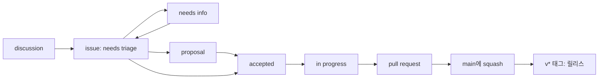

# 기여 안내

관심 가져 주셔서 고맙습니다. KeyHarbor는 관리자 한 명이 운영하는 초기 단계 프로젝트입니다. 코드뿐 아니라 "에이전트와 써 보니 이런 게 막혔다"는 보고도 큰 도움이 됩니다.

- [도울 수 있는 방법](#도울-수-있는-방법)
- [아이디어에서 릴리스까지](#아이디어에서-릴리스까지)
- [설계를 바꾸는 제안](#설계를-바꾸는-제안)
- [이슈 맡기](#이슈-맡기)
- [준비](#준비)
- [변경 만들기](#변경-만들기)
- [Pull request](#pull-request)
- [AI 에이전트와 함께](#ai-에이전트와-함께)

## 도울 수 있는 방법

| 가진 것 | 할 일 |
|---|---|
| 질문, 아직 다듬지 않은 아이디어 | [Discussions](https://github.com/LeeSwallow/KeyHarbor/discussions) |
| 고장 난 것 | [버그 리포트](https://github.com/LeeSwallow/KeyHarbor/issues/new?template=bug.yml) — 비밀 값은 붙여 넣지 마세요 |
| 작은 기능 요청 | [기능 요청](https://github.com/LeeSwallow/KeyHarbor/issues/new?template=feature.yml) |
| 동작·형식·보안 모델을 바꾸는 변경 | [제안(proposal)](https://github.com/LeeSwallow/KeyHarbor/issues/new?template=proposal.yml) |
| 직접 만들 시간 | `accepted` 라벨이 붙은 이슈, 또는 `good first issue` |
| 보안 문제 | 비공개로: [SECURITY.md](SECURITY.md) |

## 아이디어에서 릴리스까지

관리자를 포함해 모두 같은 단계를 거칩니다. 라벨이 지금 어디에 있는지를 말해 줍니다.



| 라벨 | 뜻 | 누가 다음으로 옮기나 |
|---|---|---|
| `needs triage` | 새 이슈. 모든 이슈가 여기서 시작 | 관리자, 일주일 안에 |
| `needs info` | 연 사람에게 질문이 남아 있음 | 연 사람이 답하면 |
| `proposal` | 만들기 전에 논의할 큰 변경 | 모두 논의, 관리자가 결정 |
| `accepted` | 합의됨. 누구나 만들어도 됨 | 맡는 사람 |
| `in progress` | 누군가 맡음(담당자 확인) | 담당자가 PR을 열면 |
| `wontfix`, `duplicate` | 사유와 함께 닫힘 | |

## 설계를 바꾸는 제안

파일·암호문 형식, CLI 명령, MCP 도구, 보안 모델, 권한 정책을 바꾸는 변경은 proposal로 시작합니다. 실제 사례로 문제를 설명하고, 제안과 대안, 바뀌는 것을 적습니다. 합의되면 `accepted`가 붙고, 구현 PR에는 [ADR](docs/design/adr/README.md)을 하나 추가합니다. 기준은 [VISION.md](VISION.md)입니다.

버그 수정, 문서, 형식을 바꾸지 않는 작은 추가는 proposal이 필요 없습니다.

## 이슈 맡기

1. `accepted` 이슈나 직접 연 이슈를 고릅니다.
2. 맡겠다고 댓글을 남깁니다. 같은 일을 두 사람이 하지 않게 하려는 것입니다.
3. 방향에 대한 의견이 필요하면 초안 PR을 일찍 여세요.
4. 2주 동안 소식이 없으면 다시 비어 있는 이슈가 됩니다. 시간이 더 필요하면 말해 주세요.

## 준비

Rust stable(1.85 이상, edition 2024), git, macOS가 필요합니다(Keychain을 씁니다. 다른 OS에서는 빌드와 대부분의 테스트만 됩니다).

```sh
git clone https://github.com/LeeSwallow/KeyHarbor
cd KeyHarbor
git config core.hooksPath .githooks       # 한 번만: 커밋 검사
cargo build && cargo test --workspace
```

CI와 같은 검사:

```sh
cargo fmt --all --check
cargo clippy --workspace --all-targets -- -D warnings
cargo test --workspace --locked           # 테스트가 명세입니다
cargo deny check                          # 의존성 라이선스·취약점
sh scripts/check-docs.sh && sh scripts/test-scripts.sh
```

코드 구조와 결정의 근거는 [docs/design/](docs/design/README.md)에 있습니다. 테스트는 실제 Keychain을 쓰지 않습니다(`insecure-test-keystore` 기능으로 파일 저장소를 씁니다). 실제 Keychain 테스트는 `--ignored`이고 확인 창이 뜰 수 있습니다.

## 변경 만들기

- **브랜치**는 최신 `main`에서: `scripts/issue.sh 12`가 이슈 종류에 맞춰 `fix/12-short-title`을 만듭니다.
- **커밋**은 [Conventional Commits](https://www.conventionalcommits.org/): `feat: …`, `fix: …`, `docs: …`, `refactor: …`, `chore: …`, 호환성을 깨면 `!`. 훅을 켜 두면 이슈 브랜치의 모든 커밋에 `Refs: #12`가 붙습니다.
- **테스트**는 변경과 함께. 비밀 값이 출력·로그·DB로 나가지 않는지 확인하는 누출 테스트를 깨지 마세요.
- **문서**: 동작이 바뀌면 README·`crates/README.md`·docs/design의 해당 절을 함께 고칩니다.
- **의존성**: 표준 라이브러리와 이미 쓰는 crate를 먼저. 새 의존성은 PR에 이유를 적고 `cargo deny check`를 통과해야 합니다. 암호 알고리즘을 직접 구현하지 않습니다.

## Pull request

`scripts/pr.sh`가 브랜치를 push하고 `Closes #12`와 이슈의 종류 라벨을 붙여 PR을 엽니다. CI가 확인하는 것:

- macOS와 Ubuntu에서 fmt·clippy·테스트, 프로토타입 테스트, `cargo deny`, 릴리스 dry-run
- 제목이 Conventional Commit이고 릴리스 노트 한 줄로 읽힐 것(squash 후 `main`의 커밋 제목이 됩니다)
- 본문이 이슈를 닫거나, 작은 수정이면 `no-issue` 라벨
- 종류 라벨 하나: `feature`, `enhancement`, `bug`, `breaking change`, `docs`, `plugin`, `chore`, `security`
- 어떤 커밋도 AI 도구를 저자로 적지 않을 것

관리자가 일주일 안에 리뷰합니다. PR은 `main`에 squash되고, `v*` 태그가 `main`에서 릴리스를 만듭니다.

릴리스 전에 관리자는 실제 Keychain으로 `sh scripts/smoke-test.sh`를 한 번 실행합니다. 임시 폴더에서 init·add·rotate·export·import를 돌리고, 비밀 값이 출력이나 DB에 나오지 않는지 확인한 뒤, 만든 Keychain 항목을 지웁니다.

## AI 에이전트와 함께

KeyHarbor는 에이전트와 함께 쓰려고 만든 도구이고, 에이전트로 작성한 기여도 환영합니다. PR을 열기 전에 diff를 직접 읽고, 무엇을 확인했는지 PR에 적어 주세요. 에이전트가 읽는 안내는 [AGENTS.md](AGENTS.md)입니다.

커밋한 사람이 저자입니다. 그래서 커밋에 AI 도구를 공동 저자로 적거나 "생성됨"이라고 쓰지 않습니다. commit-msg 훅이 그런 줄을 지우고 사람 공동 저자는 남기며, CI가 모든 PR을 확인합니다.

기여하면 그 기여가 프로젝트의 [MIT](LICENSE-MIT) 또는 [Apache-2.0](LICENSE-APACHE) 라이선스로 제공되는 데 동의하고, [행동 강령](CODE_OF_CONDUCT.md)을 따르는 것입니다.
