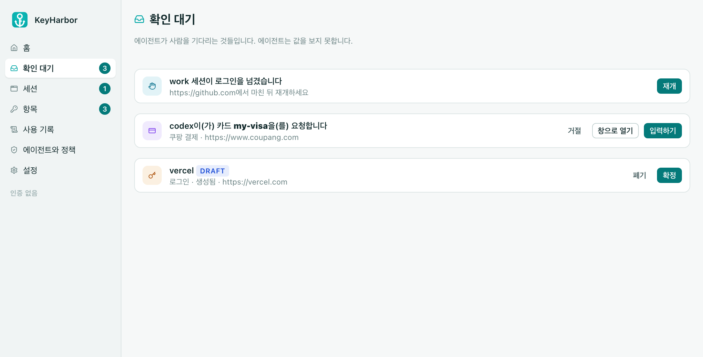
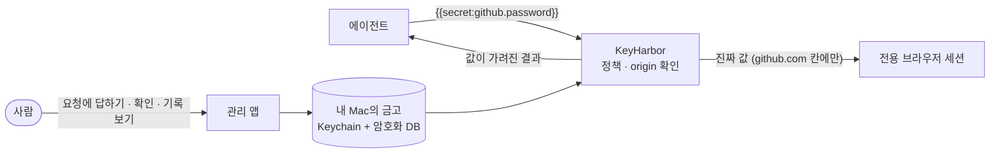
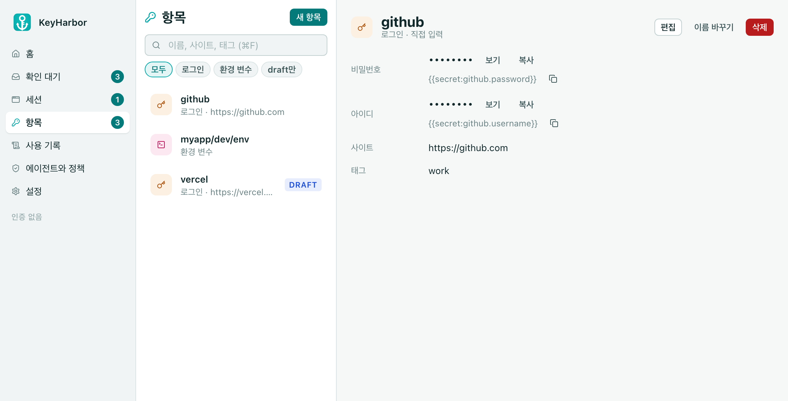
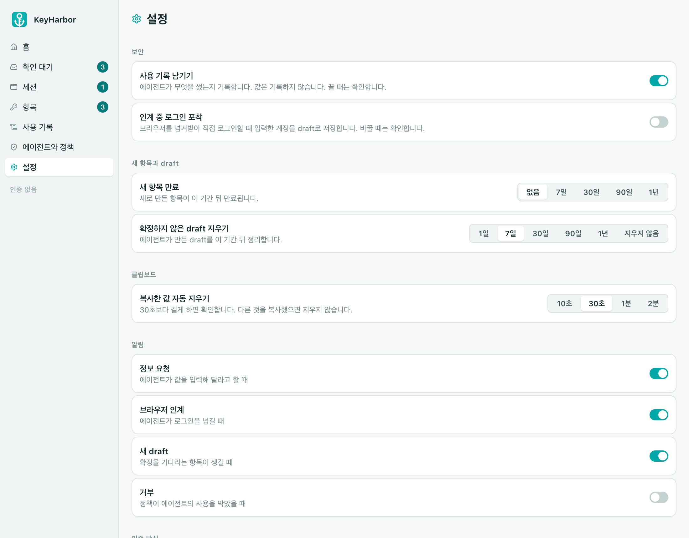
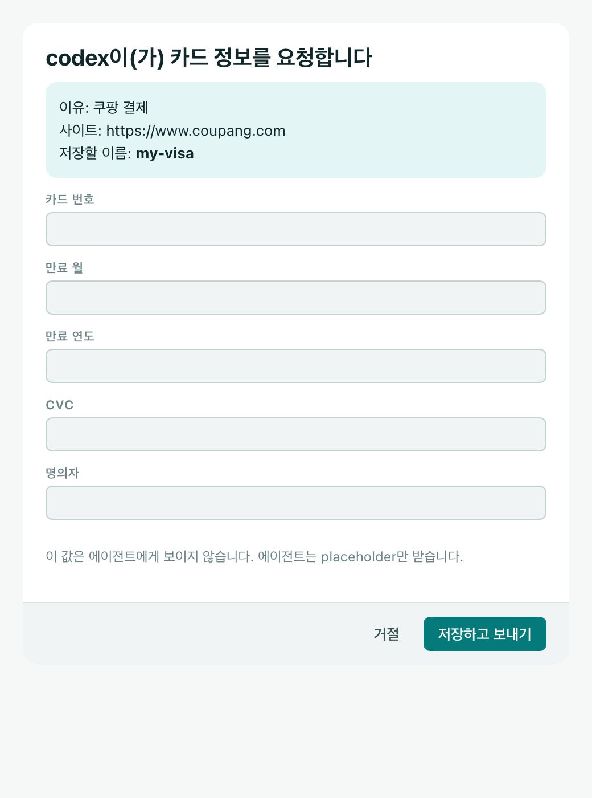
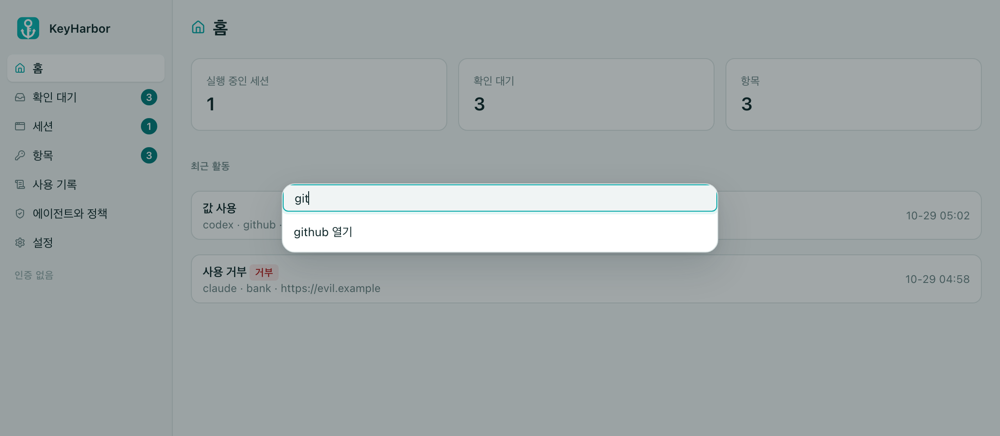
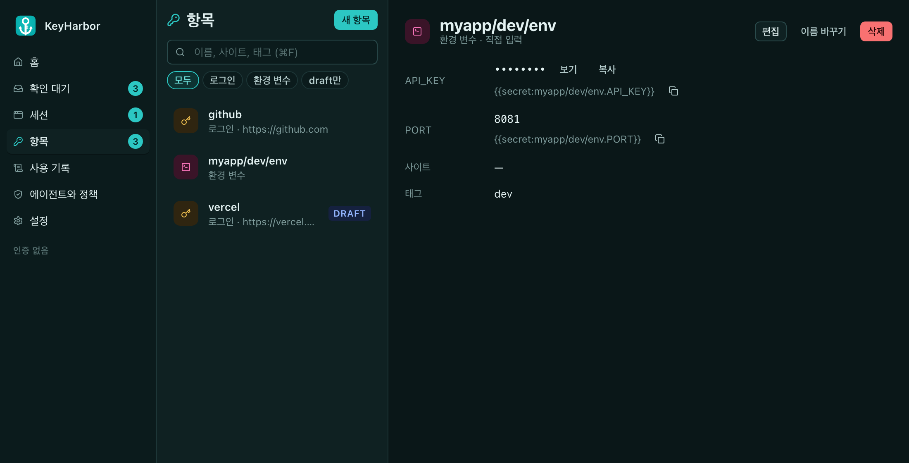
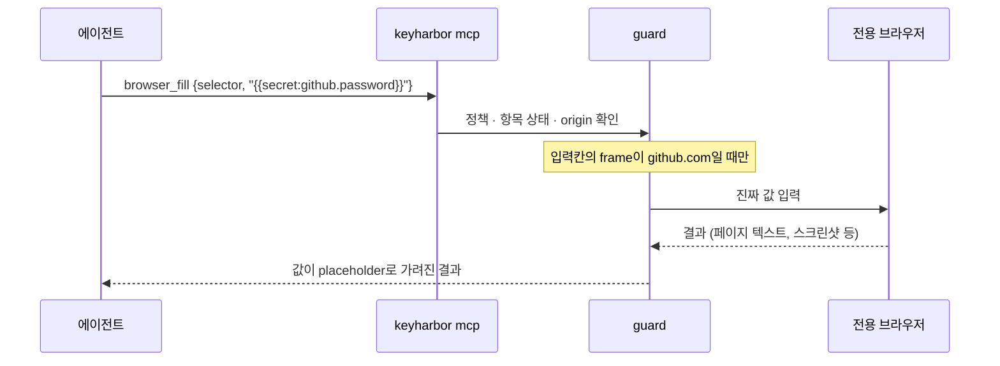

<p align="center"></p>

<h1 align="center">KeyHarbor</h1>

<p align="center"><b>에이전트가 로그인에서 멈추지 않게. 비밀번호는 내 Mac에.</b></p>

<p align="center">
  <a href="https://github.com/LeeSwallow/KeyHarbor/actions/workflows/ci.yml"></a>
  <a href="https://github.com/LeeSwallow/KeyHarbor/releases"></a>
  
  
  <a href="LICENSE-MIT"></a>
</p>

<p align="center">
  
  
  
  
  
</p>



[소개](#소개) · [설치](#설치) · [시작하기](#시작하기) · [관리 앱](#관리-앱) · [동작 방식](#동작-방식) · [명령](#명령) · [알아 둘 것](#알아-둘-것) · [자주 묻는 질문](#자주-묻는-질문) · [문서](#문서)

## 소개

에이전트에게 로그인을 맡기려면 비밀번호를 대화에 붙여 넣거나 `.env`를 통째로 보여 줘야 했습니다. 그러면 값이 모델의 문맥과 기록에 남습니다. KeyHarbor는 값을 **내 Mac의 금고**에 두고, 에이전트에게는 `{{secret:github.password}}` 같은 이름(placeholder)만 줍니다. 에이전트가 그 이름으로 입력하면 KeyHarbor가 **등록된 사이트의 입력칸에서만** 진짜 값으로 바꿔 넣고, 에이전트가 받는 결과에서는 값을 다시 이름으로 가립니다.



외부 금고도, 클라우드 계정도 필요 없는 무료 오픈소스입니다.

> **상태: v0.1.1 (macOS).** 금고 CLI, 브라우저 세션 MCP 도구, 치환·마스킹·정책·사용 기록, `keyharbor run`, Claude Code·Codex 플러그인, 관리 앱이 들어 있습니다. 사람용 자동 완성은 7단계에서 만들고 있습니다([로드맵](ROADMAP.md)).

## 설치

| | |
|---|---|
|  | `brew install --cask leeswallow/tap/keyharbor` (CLI) |
|  | [Releases](https://github.com/LeeSwallow/KeyHarbor/releases/latest)의 `keyharbor-app-<버전>-arm64.dmg`를 열어 `KeyHarbor.app`을 응용 프로그램으로 끌어다 놓기. CLI가 앱 안(`Contents/Helpers/keyharbor`)에 들어 있습니다. Apple silicon |
|  | `keyharbor_<버전>_darwin_<arm64·amd64>.tar.gz`를 풀어 `keyharbor`를 PATH에 두기 |
|  | `cargo build --release -p keyharbor` → `target/release/keyharbor` |

아직 서명·공증하지 않았습니다. Homebrew는 설치할 때 격리 표시를 지웁니다. 직접 받은 CLI나 앱은 처음 한 번 `xattr -dr com.apple.quarantine <경로>`를 실행하거나, Finder에서 앱을 우클릭 → 열기로 엽니다. 받은 파일은 함께 올린 `checksums.txt`·`.sha256`로 확인할 수 있습니다. 설치는 `keyharbor --version`으로 확인합니다.

## 시작하기

**1. 금고를 만듭니다.** 루트 키가 로그인 Keychain에 들어가고, macOS가 확인 창을 띄울 수 있습니다.

```sh
keyharbor vault init
```

**2. 로그인 하나를 넣습니다.** 값은 숨김 프롬프트나 `--stdin`으로만 받습니다(명령행 인자로는 받지 않습니다). 관리 앱의 [항목] → [새 항목]에서도 됩니다.

```sh
printf '{"username":"me","password":"…"}' | \
  keyharbor vault add github --kind login --origin https://github.com --stdin
```

Chrome에 저장된 비밀번호가 있으면 한 번에 가져올 수 있습니다: Chrome 설정 → 비밀번호 관리자 → 내보내기 → `keyharbor vault import-chrome ~/Downloads/passwords.csv`.

**3. 에이전트를 연결합니다.** Claude Code에서:

```text
/plugin marketplace add LeeSwallow/KeyHarbor
/plugin install keyharbor@keyharbor
```

Codex와 다른 MCP 클라이언트는 [docs/plugin.md](docs/plugin.md)에 있습니다.

**4. 에이전트에게 맡깁니다.** "github에 로그인해서 이슈 목록을 가져와"처럼 말하면, 에이전트는 세션을 열고 `browser_login {item: "github"}`으로 폼을 채웁니다. 에이전트가 모르는 정보(카드, 처음 보는 사이트의 비밀번호)가 필요하면 `vault_request`로 묻고, 관리 앱의 보안 입력 창에 사람이 답합니다. 에이전트는 값이 아니라 placeholder만 받습니다.

## 관리 앱

메뉴 막대에 사는 앱입니다. 에이전트가 기다리는 것을 보여 주고, 값은 사람만 보고 넣습니다. 창을 닫아도 메뉴 막대에 남고, 새 요청·인계·draft·거부는 macOS 알림으로 알립니다.

| 항목 | 설정 |
|---|---|
|  |  |
| 값은 [보기]를 눌러야 30초 동안 보이고, [복사]는 클립보드에 숨김 표시로 넣었다가 설정한 시간 뒤 지웁니다. 검색(⌘F), 이름 바꾸기, 10초 실행 취소가 있습니다 | 보호를 약하게 하는 변경(기록 끄기, 클립보드 시간 늘리기 등)은 확인 창을 거칩니다 |

| 보안 입력 창 | 명령 팔레트 |
|---|---|
|  |  |
| 에이전트의 정보 요청에 답하는 작은 창입니다. 항상 위에 뜨고, 화면 캡처·화면 공유에 보이지 않습니다. 누가·무엇을·왜·어디에 쓰려는지 먼저 보여 줍니다 | ⌘K로 화면·항목·새 항목을 찾아갑니다. ⌘N은 새 항목입니다 |

다크 모드도 그대로 따릅니다.



## 동작 방식

### 값은 이름으로만 오간다



- 평문을 다루는 코드는 `keyharbor-guard` 한 곳에 있습니다. 에이전트가 쓰는 표면(MCP, CLI)에는 값을 보여 주는 도구나 명령이 없습니다.
- 브라우저는 세션마다 따로 있는 Chrome 프로필이고, 감독 프로세스가 CDP를 소유합니다. 에이전트는 raw CDP를 받지 않습니다(사람이 켤 때만).
- API 키와 `.env`는 `keyharbor run --env myapp -- npm test`처럼 **자식 프로세스에만** 넣고, 그 출력에서 값을 가립니다.

### 금고는 이렇게 기록된다

| 저장 위치 | 들어 있는 것 |
|---|---|
| 로그인 Keychain | 루트 키 32바이트 하나 |
| `~/Library/Application Support/KeyHarbor/keyharbor.sqlite3` | 값의 암호문, 이름·사이트 같은 메타데이터(평문 + 서명), 세션·요청·정책·사용 기록 |
| `…/KeyHarbor/profiles/<세션 id>/` | 세션마다 전용 Chrome 프로필(쿠키·로그인 상태) |

- 루트 키에서 HKDF로 키를 나누고, 도메인(자격 증명·결제·개인정보·개발자)마다 다른 키로 값을 **XChaCha20-Poly1305** 암호화합니다. 암호문은 금고·도메인·항목·필드에 묶여 있어 다른 자리로 옮기면 풀리지 않습니다.
- 메타데이터는 **HMAC**으로 서명합니다. DB를 고쳐 피싱 사이트를 origin에 몰래 더하면 그 항목은 "변조 의심"이 되고 입력에 쓰이지 않습니다.
- 사용 기록에는 누가·무엇을·어디에 썼는지만 남고, 값은 남지 않습니다. 자세한 형식: [docs/design/07](docs/design/07-cryptography-design.md).

### 사람이 끼어드는 곳

| 상황 | 에이전트 | 사람 |
|---|---|---|
| CAPTCHA·2FA | `session_wait_auth`로 넘기고 기다림 | 그 브라우저 창에서 직접 풀고 재개 |
| 평소 Chrome에 이미 로그인됨 | `session_wait_site`로 기다림 | 확장으로 그 사이트를 세션에 보냄 |
| 에이전트가 모르는 정보 | `vault_request`로 묻고 `vault_wait` | 보안 입력 창에서 답하거나 거절 |
| 에이전트가 만든 비밀번호 | `vault_generate` → draft | 로그인이 확인되면 자동 확정, 아니면 앱에서 확정·폐기 |

## 명령

```sh
keyharbor vault list --prefix myapp/ --tag prod          # 이름·종류·사이트만 (값은 보이지 않음)
keyharbor vault import-env myapp ./.env                  # .env 변수 묶음
keyharbor vault mv github work/github                    # 이름 바꾸기·옮기기
keyharbor vault export ~/keyharbor-backup.age            # age 형식 암호화 백업
keyharbor run --env myapp -- npm test                    # 자식에만 변수 주입, 출력의 값은 가려짐
keyharbor policy deny --agent codex --resource domain --target payment
keyharbor grant add <세션 id> https://github.com --ttl 8h # 이 세션이 열 수 있는 사이트
keyharbor receive <세션 id> --origin https://github.com  # 사람이 사이트를 넘길 때까지 기다림
keyharbor audit --limit 20                               # 사용 기록 (값 없음)
keyharbor browser install-host                           # 확장과 연결 (평소 Chrome의 로그인 넘기기)
```

전체 명령과 MCP 도구: [`crates/README.md`](crates/README.md). browser-use와 함께 쓰기: [docs/guides/browser-use.md](docs/guides/browser-use.md).

## 알아 둘 것

- **CLI는 평문을 출력하지 않습니다.** 셸을 쓰는 에이전트가 값을 꺼내지 못하게 하려는 설계입니다. 평문 보기·복사는 관리 앱에서만 합니다.
- **보호를 약하게 하는 변경은 사람이 확인합니다.** 터미널에서는 `yes`를, 앱에서는 확인 창을 거칩니다. 터미널을 흉내 내는 프로그램은 대신 답할 수 있어 강한 경계는 아닙니다([보안 백서 §3.12](docs/design/03-security-whitepaper.md)).
- **Mac이나 Keychain 항목을 잃으면 금고도 잃습니다.** 복구 서비스는 없습니다. `vault export` 백업과 그 비밀번호를 따로 보관하세요.
- 서명하지 않은 빌드라서 업데이트 후 macOS가 Keychain 접근을 다시 물을 수 있습니다. "항상 허용"을 누르면 됩니다.
- `keyharbor run`의 자식 프로세스는 값을 평문으로 갖습니다. 그 프로세스가 값을 밖으로 보내는 것은 막지 못하고, 출력만 가립니다.
- 항목 이름·사이트 같은 메타데이터는 평문입니다. 이름에 비밀을 넣지 마세요. 데이터 위치는 `--data-dir`이나 `KEYHARBOR_HOME`으로 바꿉니다.

## 자주 묻는 질문

**에이전트가 정말 값을 못 보나요?**
MCP와 CLI 어디에도 값을 돌려주는 길이 없고, 브라우저 결과(텍스트·스크린샷·오류)에서 값은 다시 placeholder로 가려집니다. 다만 같은 사용자 권한으로 도는 악성 프로그램과, 사람이 raw CDP를 켠 세션은 지키지 못합니다. 무엇을 지키고 무엇을 지키지 않는지는 [보안 백서](docs/design/03-security-whitepaper.md)에 있습니다.

**다른 사이트에 값이 들어갈 수는 없나요?**
로그인 항목은 등록한 origin에 묶입니다. 입력칸의 frame이 그 origin이 아니면 넣지 않고, 비밀번호는 비밀번호 칸에만 들어갑니다.

**1Password나 Bitwarden과 무엇이 다른가요?**
그 제품들은 사람이 쓰는 금고입니다. KeyHarbor는 에이전트가 값을 보지 않고 쓰는 것에 맞춘 도구입니다: placeholder 치환, 결과 마스킹, 에이전트별 정책, 세션 브라우저, 사람에게 묻는 길이 그것입니다.

**Windows나 Linux는요?**
지금은 macOS만 됩니다. 루트 키를 macOS Keychain에 두기 때문입니다.

## 문서

| 문서 | 내용 |
|---|---|
| [로드맵](ROADMAP.md) | 단계별 계획과 현재 상태 |
| [설계 문서](docs/design/README.md) | 아키텍처, 보안 백서, 암호 설계, ADR, 결정 기록 |
| [플러그인](docs/plugin.md) | Claude Code·Codex 연결, 스킬 |
| [브라우저 확장](integrations/browser-extension/README.md) | 평소 Chrome·Firefox의 사이트 로그인을 세션으로 넘기기 |
| [관리 앱](app/README.md) | 화면, 만들기, 번들 |
| [디자인 시스템](design-system/README.md) | 토큰·컴포넌트·패턴, 아이콘 |
| [보안 정책](SECURITY.md) | 약속하는 것과 하지 않는 것, 취약점 신고 |
| [기여 안내](CONTRIBUTING.md) | 이슈부터 릴리스까지의 흐름 |

## 라이선스

[MIT](LICENSE-MIT) 또는 [Apache-2.0](LICENSE-APACHE) 중 선택.
