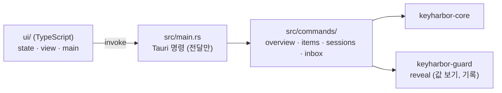

# KeyHarbor 관리 앱 (Tauri)

사람이 Mac에서 금고·세션·확인 대기·사용 기록을 보는 창입니다([09](../docs/design/09-app-ux.md), [ADR-0006](../docs/design/adr/0006-tauri-admin-app.md)). CLI와 같은 core·guard를 직접 링크합니다. Linux CI가 WebKitGTK 없이 돌도록 루트와 다른 워크스페이스입니다([J-89](../docs/design/06-requirements-log.md)).



## 만들기와 실행

```sh
cargo tauri build                                  # KeyHarbor.app과 .dmg (tauri-cli 2 필요: cargo install tauri-cli --locked --version ^2)
npm --prefix ui ci && npm --prefix ui run build    # ui/dist (Tauri가 이것을 넣는다)
cargo test                                         # 명령 계층, 창 없이
KEYHARBOR_HOME=/tmp/kh cargo run                   # 개발용 창 (기본은 ~/Library/Application Support/KeyHarbor)
```

세션을 열고 닫는 감독자는 CLI 바이너리가 띄웁니다: `KEYHARBOR_CLI`, 번들 안 `Contents/Helpers/keyharbor`, PATH 순으로 찾습니다.

`cargo tauri build`는 UI와 CLI 릴리스 빌드를 먼저 하고(`beforeBuildCommand`), CLI를 `KeyHarbor.app/Contents/Helpers/keyharbor`에 넣습니다(R-45). DMG는 `KeyHarbor.app`과 `Applications` 바로가기를 담아 끌어다 놓아 설치합니다. 지금 빌드는 서명·공증하지 않으므로 처음 열 때 macOS가 확인을 묻습니다. 배포(태그·릴리스·서명)는 아직 하지 않았습니다.

## 지금 있는 것

| 화면 | 할 수 있는 것 |
|---|---|
| 홈 | 열린 세션·확인 대기 수, 최근 활동 |
| 확인 대기 | 에이전트의 정보 요청에 보안 입력 폼으로 답하거나 거절, 인계 재개, draft 확정·폐기 |
| 세션 | 상태, 사이트별 로그인 상태, raw CDP 표시, 열기·중지, 복구(브라우저를 닫았다는 확인 뒤) |
| 항목 | 목록(draft·변조 의심·만료 표시), 새 항목(종류별 폼, 로그인은 비밀번호 생성), 편집(비운 칸은 그대로, 약화 변경은 확인 창), 삭제(확인 창), 필드·placeholder, 비밀 아닌 값, 값 보기(30초 뒤나 다른 곳으로 가면 사라짐), 값 복사(가린 표시, 30초 뒤 지움), placeholder 복사 |
| 사용 기록 | 최근 50개 |
| 에이전트와 정책 | 규칙 목록·추가·삭제. allow 추가와 deny 삭제는 확인 창 |
| 설정 | 설정 값 보기·바꾸기. 약화(기록 끄기, 포착 바꾸기, 클립보드 지우는 시간 늘리기)는 확인 창 |

메뉴 막대에 아이콘이 있고(확인 대기 수, 상태, 열기, 종료), 창을 닫아도 앱은 메뉴 막대에 남습니다. 새 정보 요청·인계·draft·거부는 macOS 알림으로 알리고, 종류마다 설정에서 끌 수 있습니다(`notify_*`). 앱은 네트워크 listener를 열지 않습니다. capability는 `core:default`뿐입니다(알림은 Rust에서만 보냅니다).
