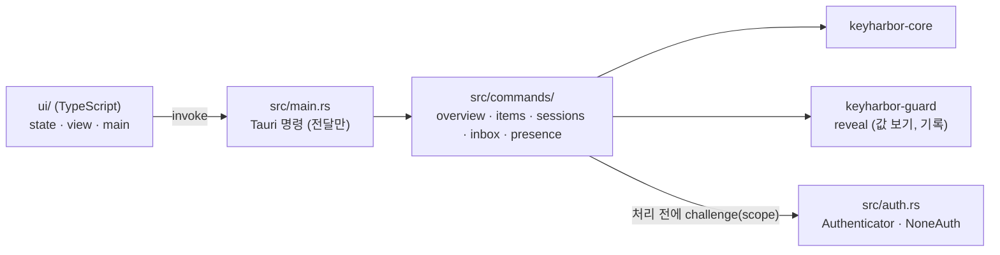
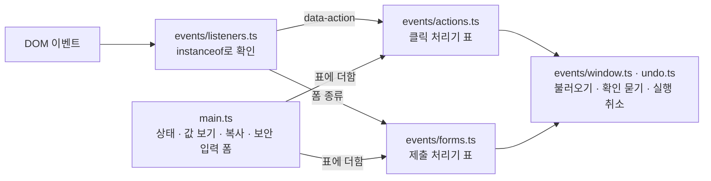

# KeyHarbor 관리 앱 (Tauri)

사람이 Mac에서 금고·세션·확인 대기·사용 기록을 보는 창입니다([09](../docs/design/09-app-ux.md), [ADR-0006](../docs/design/adr/0006-tauri-admin-app.md)). CLI와 같은 core·guard를 직접 링크합니다. Linux CI가 WebKitGTK 없이 돌도록 루트와 다른 워크스페이스입니다([J-89](../docs/design/06-requirements-log.md)).



창 쪽(`ui/src`)에서는 `main.ts`가 상태 하나를 들고 이벤트를 `events/`의 표로 넘깁니다. 클릭은 `data-action` 이름으로 `events/actions.ts`의 표를, 폼 제출은 폼의 data 속성으로 `events/forms.ts`의 표를 찾고, 표에 없는 이름은 아무것도 하지 않습니다. 값 보기·복사와 보안 입력 폼 제출처럼 값을 다루는 처리기만 `main.ts`에 남아 같은 표에 더해집니다([J-210](../docs/design/06-requirements-log.md)).



명령은 판정하지 않습니다. 거부인지, 세션이 실행 중인지·복구가 필요한지, 어떤 필드를 생성할 수 있는지, 어떤 설정 변경이 약화인지는 domain·core가 정하고 명령은 그 결과를 DTO 필드(`AuditDto.denied`, `SessionDto.live`·`recoverable`, `KindForm.generates`, `SettingDto.weakening`)로 화면에 넘깁니다. 화면은 그 필드만 읽고 문구를 고릅니다([J-200–J-204](../docs/design/06-requirements-log.md)). 메뉴 막대 문구와 알림은 `src/commands/presence/`에 있습니다.

앱 열기·값 보기·편집·정책 변경 명령은 처리 전에 `Authenticator::challenge`를 부르고, 거절되면 아무것도 하지 않습니다. 지금 방식은 `NoneAuth`(언제나 통과) 하나이고 `src/main.rs`에서 한 번 주입합니다([03 §3.10](../docs/design/03-security-whitepaper.md#310-관리-앱-인증), [J-126](../docs/design/06-requirements-log.md)). 사이드바와 설정 화면의 "인증 없음"은 그 포트의 `id()`에서 옵니다. 창은 숨긴 채로 뜨고 `OpenApp`을 통과해야 보입니다. 시작할 때 거절되어도 앱은 끝나지 않고 메뉴 막대에 남으며, 메뉴 막대의 "KeyHarbor 열기"가 같은 길(`window::open_main_window`)로 다시 묻습니다([J-177](../docs/design/06-requirements-log.md)).

## 만들기와 실행

```sh
cargo tauri build                                  # KeyHarbor.app과 .dmg (tauri-cli 2 필요: cargo install tauri-cli --locked --version ^2)
npm --prefix ui ci && npm --prefix ui run build    # ui/dist (Tauri가 이것을 넣는다)
cargo test                                         # 명령 계층, 창 없이
KEYHARBOR_HOME=/tmp/kh cargo run                   # 개발용 창 (기본은 ~/Library/Application Support/KeyHarbor)
```

데이터 폴더는 `KEYHARBOR_HOME`, 없으면 `$HOME/Library/Application Support/KeyHarbor`입니다. 둘 다 없거나 `HOME`이 절대 경로가 아니면 앱은 상대 경로에 금고를 만들지 않고 오류로 끝납니다([J-176](../docs/design/06-requirements-log.md)).

세션을 열고 닫는 감독자는 CLI 바이너리가 띄웁니다: `KEYHARBOR_CLI`, 번들 안 `Contents/Helpers/keyharbor`, PATH 순으로 찾습니다.

`cargo tauri build`는 UI와 CLI 릴리스 빌드를 먼저 하고(`beforeBuildCommand`), CLI를 `KeyHarbor.app/Contents/Helpers/keyharbor`에 넣습니다(R-45). DMG는 `KeyHarbor.app`과 `Applications` 바로가기를 담아 끌어다 놓아 설치합니다. 지금 빌드는 서명·공증하지 않으므로 처음 열 때 macOS가 확인을 묻습니다. 태그를 push하면 릴리스 워크플로의 `app` job이 같은 빌드로 `keyharbor-app-<버전>-arm64.dmg`를 만들어 Release에 올립니다(Apple silicon 전용).

## 지금 있는 것

| 화면 | 할 수 있는 것 |
|---|---|
| 홈 | 열린 세션·확인 대기 수, 최근 활동 |
| 확인 대기 | 에이전트의 정보 요청에 보안 입력 폼으로 답하거나 거절(메인 창 안, 또는 "창으로 열기"로 항상 위에 뜨고 화면 캡처에서 빠지는 작은 창), 인계 재개, draft 확정·폐기 |
| 세션 | 상태, 사이트별 로그인 상태, raw CDP 표시, 열기·중지, 복구(브라우저를 닫았다는 확인 뒤), 평소 Chrome의 탭을 카드에 끌어다 놓아 그 사이트 로그인 넘기기(브라우저 알림에서 한 번 더 누름) |
| 항목 | 목록(draft·변조 의심·만료 표시), 검색·필터(⌘F: 이름·사이트·태그, 종류, draft만), 새 항목(종류별 폼, 로그인은 비밀번호 생성), 편집(비운 칸은 그대로, 약화 변경은 확인 창), 이름 바꾸기(placeholder 바뀜 경고, 규칙이 가리키면 거절), 삭제(10초 동안 실행 취소), 필드·placeholder, 비밀 아닌 값, 값 보기(30초 뒤나 다른 곳으로 가면 사라짐), 값 복사(가린 표시, 30초 뒤 지움), placeholder 복사 |
| 사용 기록 | 최근 50개(`ui/src/view.ts`의 `AUDIT_SHOWN`, 화면 문구도 이 값에서 만든다) |
| 에이전트와 정책 | 규칙 목록·추가·삭제. allow 추가와 deny 삭제는 확인 창 |
| 설정 | 설정 값 보기·바꾸기. 약화(기록 끄기, 포착 바꾸기, 클립보드 지우는 시간 늘리기)는 확인 창 |

⌘K로 명령 팔레트(화면·새 항목·항목 이름 검색)를 열고, ⌘N으로 새 항목을 만듭니다. 메뉴 막대에 아이콘이 있고(확인 대기 수, 상태, 정보 요청에 답하기, 열기, 종료), 창을 닫아도 앱은 메뉴 막대에 남습니다. 새 정보 요청·인계·draft·거부는 macOS 알림으로 알리고, 종류마다 설정에서 끌 수 있습니다(`notify_*`). 앱은 네트워크 listener를 열지 않습니다. capability는 `core:default`뿐입니다(알림은 Rust에서만 보냅니다).
