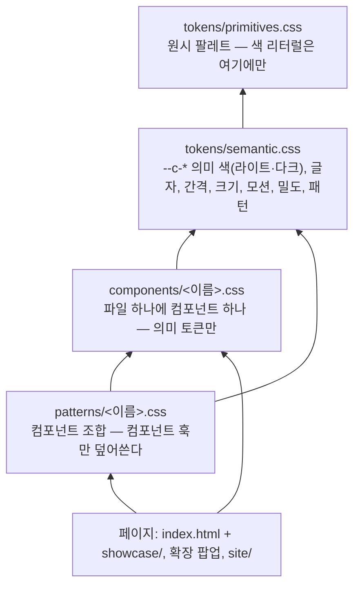

# KeyHarbor 디자인 시스템

관리 앱(5단계, Tauri), 웹 페이지(`site/`), 브라우저 확장([integrations/browser-extension](../integrations/browser-extension/README.md))이 같이 쓰는 토큰·컴포넌트·패턴·아이콘이다. 빌드 도구 없이 CSS와 SVG만으로 쓴다. 페이지는 `keyharbor.css` 하나를 불러온다.

## 계층

폴더가 곧 계층이다. 각 계층은 자기보다 아래 계층만 쓴다. 규칙과 이유는 [ADR-0015](../docs/design/adr/0015-design-system-layers.md).



| 폴더 | 무엇 | 쓸 수 있는 것 | 못 하는 것 |
|---|---|---|---|
| `tokens/primitives.css` | 원시 색 (`--teal-500`, `--neutral-850`, 도메인·상태 색상, 알파) | 리터럴 값 | `var()` 참조 |
| `tokens/semantic.css` | 용도 이름 (`--c-accent-fill`, `--space-3`, `--size-chip` …) | primitives, semantic | 색 리터럴 |
| `components/` | `kh-*` 컴포넌트 25개 | semantic 토큰, 자기 훅 | primitives, 색 리터럴, `1px` 말고 px 리터럴 |
| `patterns/` | `app-shell`, `secure-dialog`, `extension-popup` | semantic 토큰, 컴포넌트 클래스와 훅 | 새 토큰 정의, 색 리터럴 |
| `showcase/` | 쇼케이스 페이지 전용 배치와 ES 모듈 | 패턴과 같다 | 패턴과 같다 |
| `icons/` | Lucide 0.460.0에서 고른 아이콘 41개 (ISC, `icons/LICENSE`) | — | — |

`keyharbor.css`는 이 순서대로 `@import`만 한다.

## 컴포넌트 이름 규칙

- **블록**은 `kh-<이름>` 하나 (`kh-btn`, `kh-row`). 파일 이름은 그 컴포넌트 이름이다(`components/button.css`).
- **요소**는 블록 안의 짧은 자식 클래스로 쓴다: `.kh-row .title`, `.kh-secret .value`. BEM의 `__`는 쓰지 않는다. 자식 클래스는 항상 블록 선택자 아래에서만 스타일이 붙으므로 다른 블록과 부딪치지 않는다.
- **변형**은 수식 클래스: `kh-btn primary`, `kh-chip dev`, `kh-i lg`.
- **상태**는 `is-*`: `is-on`, `is-selected`, `is-hover`(쇼케이스용 강제 상태), `is-disabled`.
- **훅**은 컴포넌트가 열어 둔 사용자 정의 속성이다. 이름은 파일 이름으로 시작한다(`button.css` → `--button-bg`, `panel.css` → `--panel-pad`). 패턴은 컴포넌트 CSS를 고치지 않고 훅만 덮어쓴다.

| 컴포넌트 | 훅 |
|---|---|
| button | `--button-bg`, `--button-fg`, `--button-border`, `--button-hover-bg`, `--button-hover-fg` |
| chip | `--chip-bg`, `--chip-fg`, `--chip-border` |
| icon | `--icon-size` |
| panel | `--panel-pad` |
| dialog | `--dialog-width` |

## 보는 법

ES 모듈과 CSS mask는 `file://`에서 막히므로 로컬 서버로 연다. 저장소 루트에서:

```sh
cargo run -q -p keyharbor-design-check --bin design-serve   # http://127.0.0.1:8765/design-system/index.html
```

서버는 `design-system/`과 쇼케이스 머리말의 앱 아이콘(`docs/design/assets/`)만 내보내고, 심볼릭 링크는 따라가지 않는다.

쿼리로 상태를 고를 수 있다: `?theme=dark&lang=en&density=compact&pattern=dots`.

## 원칙

- **강조색은 하나**: 항구 청록(`--c-accent`). 버튼·포커스·선택에만 쓴다. 주 버튼은 흰 글자가 4.5:1을 넘도록 한 단계 짙은 `--c-accent-fill`을 칠한다.
- **도메인 색은 종류, 상태 색은 상태**: 세션·자격 증명·개발자 비밀·결제·개인 정보는 `--c-dom-*`, 사용 중·곧 만료·만료·거부·변조는 `--c-ok/warn/danger/info`. 색만으로 뜻을 전하지 않고 아이콘이나 낱말을 같이 쓴다.
- **비밀 값은 봉인 표면에만**: 평문이 화면에 그려질 수 있는 곳은 `kh-secret`(`--c-sealed`) 하나다. 관리 앱에서만 보이고, 타이머가 끝나면 다시 가린다. CLI, 에이전트, 브라우저 확장에는 이 컴포넌트에 해당하는 것이 없다(docs/design/03 §3.12).
- **에이전트가 보는 것은 placeholder**: `kh-ph`는 복사해도 안전한 값이라 점선 테두리로 봉인 값과 구분한다.
- **보안 입력 창은 겉모습이 다르다**: `kh-dialog.secure`는 청록 테두리와 바깥 고리를 두르고 누가 요청했는지 먼저 보여 준다. 다른 창이 흉내 내기 어렵게 하려는 표시이지 보안 경계는 아니다.
- **배경은 모눈종이**: 바탕 캔버스(`kh-canvas`)에 패턴을 깐다. 기본은 모눈(8px 잔선 + 40px 굵은 선, `--c-grid`·`--c-grid-major`), 그 밖에 격자(24px)·점(16px)·없음. 판·카드·입력칸은 단색 표면이라 글자가 선 위에 바로 놓이지 않는다.
- **테마·밀도·패턴은 속성으로**: `<html data-theme="light|dark" data-density="comfortable|compact" data-pattern="graph|grid|dots|none">`. `data-theme`이 없으면 시스템 설정을 따른다. 다크 값은 시스템용과 명시용 두 벌이 같아야 한다.
- **컴포넌트가 아니라 토큰을 바꾼다**: 새 색은 primitives에 더하고 semantic에서 이름을 붙인다.

## 아이콘

```html
<span class="kh-i" style="mask-image:url(icons/key-round.svg)"></span>      <!-- 16px -->
<span class="kh-i lg" style="mask-image:url(icons/lock.svg)"></span>        <!-- 20px, sm은 12px, xl은 24px -->
```

`currentColor`로 칠해지므로 부모의 `color`를 따른다. 이미지는 꼭 인라인으로 준다. 사용자 정의 속성 안의 상대 `url()`은 그 속성을 *쓰는* 스타일시트 기준으로 풀려서 `components/` 아래를 가리키게 된다. 아이콘을 더할 때는 같은 Lucide 버전에서 가져와 `icons/`에 두고 `showcase/sections/icons.js`의 `ICONS`에 이름을 넣는다.

## 쇼케이스

`index.html`은 머리글(테마·밀도·패턴·언어 전환)과 빈 `<main>`뿐이다. 내용은 `showcase/sections/`의 정의(데이터)를 `showcase/render.js`가 그린다.

| 파일 | 책임 |
|---|---|
| `showcase/showcase.js` | 진입점: 그리고 전환기를 단다 |
| `showcase/render.js` | 정의 `{ id, title, lead, body, parts }`를 HTML로 |
| `showcase/controls.js` | 테마·밀도·패턴·언어 전환, URL 쿼리 |
| `showcase/html.js` | `icon()`, `t()`, `each()` |
| `showcase/sections/*.js` | 조합 예시, 아이콘, 컴포넌트, 토큰. 새 섹션 = 파일 하나 + `sections/index.js` 한 줄 |
| `showcase/showcase.css` | 쇼케이스 페이지 배치 |

## 구조의 출처

쇼케이스 배치(헤더의 테마·밀도·언어 전환 → 조합 예시 → 아이콘 → 컴포넌트 → 토큰)는 stickypane 디자인 시스템의 구성을 따랐다. 계층(primitive → semantic → component)은 Design Tokens Community Group의 토큰 단계 구분을 따랐다. 색, 모양, 컴포넌트 이름은 KeyHarbor가 따로 정했다.

## 검사

`cargo test --workspace`(또는 `sh scripts/check-design.sh`)가 `crates/design-check`로 위 계층 규칙, 테마 짝, WCAG 대비, 아이콘, 클래스를 검사한다. 규칙 표는 [ADR-0015](../docs/design/adr/0015-design-system-layers.md)에 있다. 규칙을 더하려면 `src/rules/<규칙>.rs`에 `Rule`을 구현하고 `rules::RULES`에 한 줄, `tests/rules.rs`에 테스트 하나를 더한다. 대비를 볼 색 쌍은 `rules/contrast.rs`의 `CONTRAST_PAIRS` 표에 한 줄씩 있다. `KEYHARBOR_TEST_CHROME`을 주면 쇼케이스를 headless Chrome으로 라이트·다크 렌더링해 본다.
