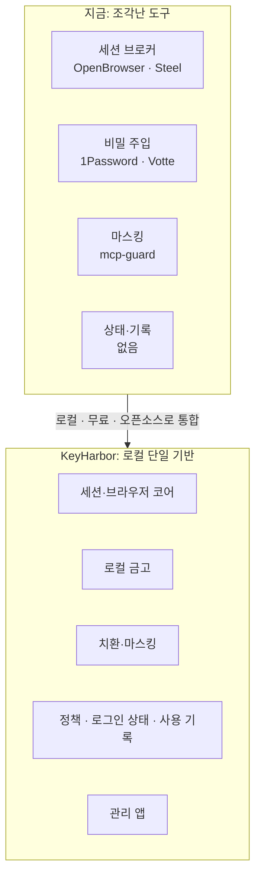
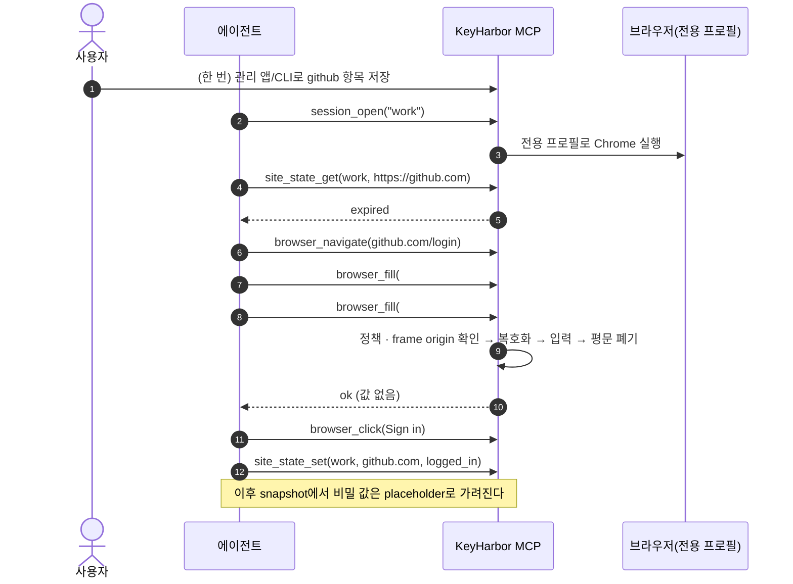
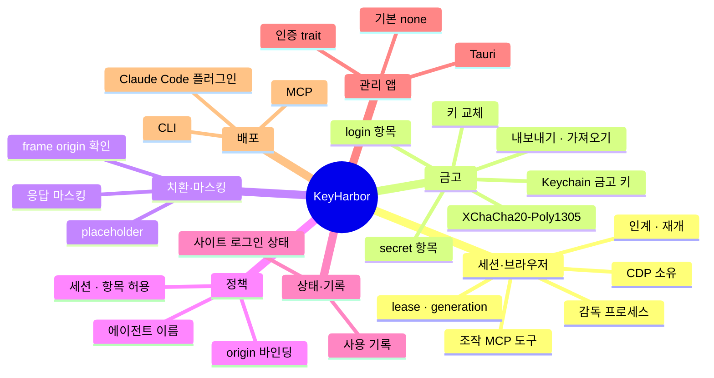

# 01. 제품 개요

> 상태: Draft · 2026-10-28 · 양식: Google Design Doc — *Context and Scope*, *Goals and Non-Goals*

## 1.1 한 문장 요약

**KeyHarbor는 개인이 AI 에이전트를 자신이 정한 권한 정책에 따라 중단 없이 쓰도록, 브라우저 세션·로그인 상태·비밀·권한·사용 기록을 자신의 컴퓨터 안에서만 관리하게 해 주는 무료 오픈소스 로컬 기반이다.** [사용자 결정 R-19]

## 1.2 맥락

Codex, Claude Code 같은 에이전트가 웹 작업을 하려면 다음이 필요하다.

1. 작업마다 섞이지 않는 **브라우저 세션**과, 닫았다 다시 열어도 유지되는 로그인 상태
2. 로그인에 쓸 **비밀번호·API 키**
3. 사람이 개입해야 할 때 **제어를 넘기고 되찾는** 방법
4. 에이전트가 할 수 있는 일의 **경계**

지금은 이것들이 흩어져 있다. 세션 관리는 OpenBrowser·Steel·Browserless 같은 브로커가, 비밀 주입은 1Password·Votte·Infisical이, 마스킹은 mcp-guard가 맡는다. 그리고 그중 상당수가 **클라우드 계정이나 상용 금고**를 전제로 한다. ([04](04-landscape-and-alternatives.md))

KeyHarbor는 이 조각들을 **로컬 하나로** 묶는다. 외부 솔루션 없이 사용자 손안에서 관리하는 것이 오픈소스·로컬 지향의 이유다. [사용자 결정 R-19]

## 1.3 원칙

| # | 원칙 | 의미 | 근거 |
|---|---|---|---|
| P1 | **모든 것은 사용자의 기기 안에** | 필수 외부 서비스·계정·네트워크 의존이 없다 | R-19 |
| P2 | **선택지를 주고 강제하지 않는다** | 인증·정책·기록은 사용자가 켜고 끈다. "인증 없음", "모두 허용"도 고를 수 있다. 위험한 선택에는 한 번 설명만 하고 막지 않는다 | R-20 |
| P3 | **에이전트는 막히지 않는다** | 정책이 허용하면 사람의 승인 없이 진행한다. 거부하면 거부와 기록만 남긴다 | R-17, R-19 |
| P4 | **에이전트는 평문 비밀을 받지 않는다** | 에이전트는 placeholder로 비밀을 *사용*할 뿐 값을 받지 않는다 | R-12, R-15 |
| P5 | **흐름이 아니라 기반을 제공한다** | 로그인·가입 흐름은 에이전트가 하고, KeyHarbor는 그 흐름이 기대는 기본 기능을 준다 | R-13 |
| P6 | **분실·도난 책임은 지지 않는다** | 기기 보호는 OS 몫이다. 키나 기기를 잃으면 데이터도 잃는다고 명시한다 | R-19 |
| P7 | **암호 알고리즘은 만들지 않는다** | 검증된 라이브러리를 쓰고, 그 조합을 설계한다 | R-16 |

## 1.4 목표

| ID | 목표 | 단계 |
|---|---|---|
| G1 | 작업별 브라우저 세션 열기·복원·종료, 독점 사용, 사람에게 넘기기/되찾기 | 1 |
| G2 | 감독 프로세스가 CDP를 소유하고 브라우저 조작을 MCP 도구로 제공 | 1 |
| G3 | 로컬 암호화 금고: 비밀번호·카드번호·신원·주소 등 **자동완성하거나 쓸 수 있는 모든 개인 정보**와 `.env` 환경 변수 묶음 (R-24) | 2 |
| G3a | `.env` 변수 묶음을 자식 프로세스에만 주입하고 출력을 마스킹하는 `keyharbor run` (R-24) | 3 |
| G4 | placeholder 치환 입력과 에이전트 출력 마스킹 | 3 |
| G5 | 사용자 정의 권한 정책과 origin 바인딩 | 3 |
| G6 | 값 없는 사용 기록 | 3 |
| G7 | 세션 × 사이트별 로그인 상태(`logged_in`/`expired`/`unknown`) 기록 | 4 |
| G8 | Google 비밀번호 관리자처럼 저장소를 보고 관리하는 관리 앱 | 5 |
| G9 | CLI · MCP · Claude Code 플러그인으로 제공 | 1–6 |

## 1.5 비목표

| 비목표 | 이유 | 근거 |
|---|---|---|
| 로그인·회원가입·약관 동의 흐름 수행 | 에이전트 몫이다 (P5) | R-13 |
| 이메일·SMS·TOTP 인증 코드 수신 | 에이전트가 알아서 처리 | R-07 |
| KeyHarbor가 직접 사이트에 접속해 만료 확인 | 상태는 에이전트가 기록한다 | R-08 |
| 쿠키 만료 시각 추적, 보관 기한, 백그라운드 주기 확인 | 서버 측 만료를 알 수 없어 신뢰도가 낮다 | R-08 |
| 외부 금고 어댑터 | 외부 솔루션을 쓰지 않는다 (P1) | R-19 |
| 원격 API · 원격 MCP · 프로필 복제본 | 별도 신뢰 모델, 데이터 손실 위험 | [ADR-0007](adr/0007-excluded-capabilities.md) |
| 복구 서비스 · 클라우드 동기화 | P1, P6 | R-19 |
| `none` 외의 관리 앱 인증 구현 | 지금은 기본값 `none`만 만든다. 자리만 둔다 | R-21 |
| macOS 외 OS | 기존 프로토타입과 Keychain 기준 | [설계자 판단] |

## 1.6 반목표

다음 중 하나라도 일어나면, 기술적으로는 동작하더라도 **실패**로 본다.

- 평문 비밀이 모델 문맥, MCP 응답, CLI 표준 출력, 로그, 오류 메시지, SQLite 평문 컬럼에 나타난다.
- 사용자에게 특정 인증 방식이나 정책을 강제한다.
- 클라우드 계정이나 외부 서비스가 있어야 쓸 수 있다.
- identity별 프록시·시간대·언어 위장처럼 사이트의 다중 계정 탐지를 피하는 기능이 들어간다.
- CAPTCHA나 봇 확인을 자동으로 우회한다.

## 1.7 사용 장면

### 장면 A — 에이전트가 GitHub에 로그인해 작업한다

### 장면 B — CAPTCHA를 만나 사람에게 넘긴다

에이전트가 `session_wait_auth`를 호출하면 관리 앱과 CLI(`handoff`)에 요청이 보인다. 사용자가 같은 창에서 처리하고 재개하면 에이전트는 `session_wait_for_resume`에서 깨어나 이어서 진행한다. 우회는 하지 않는다.

### 장면 C — 사용자가 관리 앱에서 금고를 살핀다

사용자는 저장된 계정, 어떤 에이전트가 언제 어느 사이트에서 어떤 항목을 썼는지, 세션별 로그인 상태, 대기 중인 인계 요청을 본다. 인증 방식은 기본값 `none`이며, 설정에서 바꿀 수 있는 자리가 있다.

## 1.8 범위 지도

