# 02. 시스템 아키텍처

> 상태: Draft · 2026-10-28 · 양식: [C4 Model](https://c4model.com/) (Context → Container → Component) + [arc42](https://arc42.org/) (Building Block View, Runtime View, Deployment View, Crosscutting Concepts)

## 2.1 아키텍처 스타일 요약

| 관점 | 선택 | 근거 |
|---|---|---|
| 전체 구조 | **헥사고날(Ports & Adapters) + Clean Architecture 의존 규칙**. 도메인과 포트(trait)는 I/O에 의존하지 않고, 어댑터가 포트를 구현하며, 인터페이스(CLI·MCP)가 조립한다(composition root) | R-30, R-31, [ADR-0014](adr/0014-hexagonal-guard-layer.md) |
| 보안 계층 | 평문을 다루는 판단·집행을 **`keyharbor-guard`** 한 crate에 모은다. PDP(정책 판정)와 PEP(치환·마스킹), 브라우저 데코레이터 `GuardedBrowser`, capability `PlaintextAccess` | 평문 경로를 하나로 만들어 검사 지점을 좁힌다 ([ADR-0014](adr/0014-hexagonal-guard-layer.md)) |
| 영속성 | **Diesel 2.3**(동기 ORM) + Repository/Data Mapper, 바운디드 컨텍스트별 스키마·내장 마이그레이션 | R-32, R-33 ([§2.7.3](#273-영속성-컨텍스트-맵-r-32-r-33)) |
| 실행 모델 | **서버 없는 CLI + 세션별 감독 프로세스**. 상시 데몬은 필수가 아니다 | 기존 프로토타입에서 검증한 모델 ([ADR-0004](adr/0004-supervisor-owns-cdp.md)) |
| 저장소 | **SQLite (WAL)** 하나에 메타데이터·암호문·정책·기록을 둔다 | [`architecture-proposal.md`](../history/architecture-proposal.md)의 DB 비교 |
| 브라우저 제어 | 감독 프로세스가 **CDP를 소유**하고, 에이전트에는 도구만 준다 | 마스킹·정책을 강제할 수 있는 유일한 위치 ([ADR-0004](adr/0004-supervisor-owns-cdp.md)) |
| 비밀 보관 | **앱 소유 로컬 금고** + macOS Keychain의 금고 키 | [ADR-0002](adr/0002-own-local-vault.md), [ADR-0003](adr/0003-keychain-vault-key.md) |
| 사용자 UI | **Tauri 데스크톱 앱**. localhost 웹 서버를 열지 않는다 | [ADR-0006](adr/0006-tauri-admin-app.md) |

## 2.2 C4 Level 1 — 시스템 컨텍스트

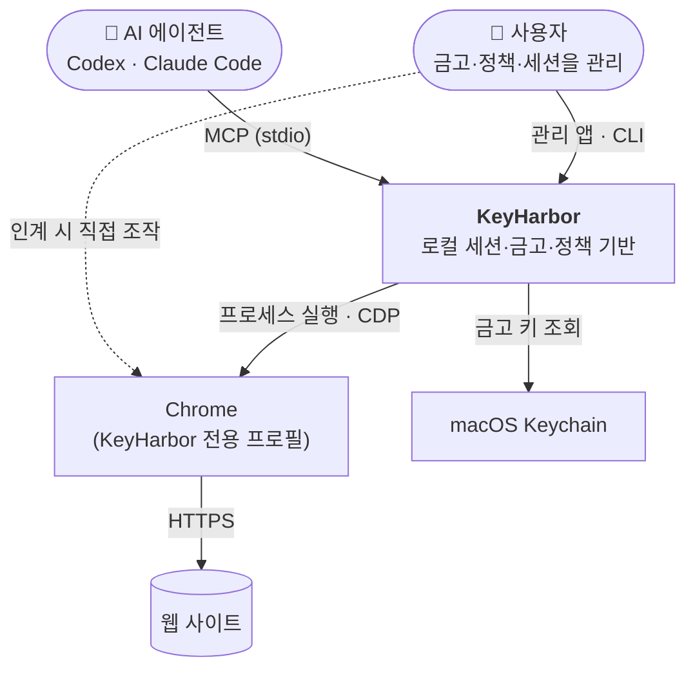

외부 네트워크로 나가는 것은 **Chrome의 사이트 접속뿐**이다. KeyHarbor 자체는 네트워크 listener를 열지 않고, 외부 서비스도 호출하지 않는다. (P1)

## 2.3 C4 Level 2 — 컨테이너

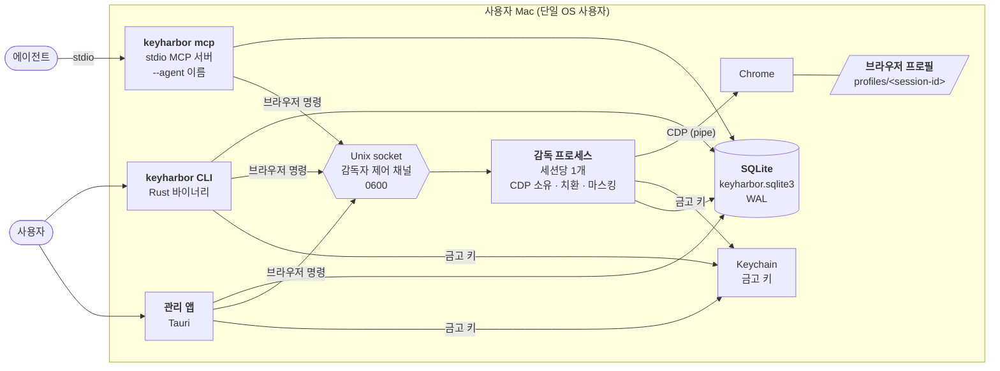

| 컨테이너 | 책임 | 수명 |
|---|---|---|
| `keyharbor` CLI | 사용자 명령, 세션 생성·열기, 금고·정책 편집, 인계 재개 | 명령 1회 |
| `keyharbor mcp` | 에이전트에 MCP 도구 제공. 정책은 여기서 1차, 감독자에서 최종 적용 | 에이전트 연결 동안 |
| 감독 프로세스 | 브라우저 실행·감시, **CDP 소유**, placeholder 치환, 응답 마스킹, 상태 기록 | 브라우저 실행 동안 |
| 관리 앱 | 금고·세션·정책·기록 UI, 인증 trait | 사용자가 여는 동안 |
| SQLite | 세션, 인계, 금고 항목(암호문), 정책, 로그인 상태, 사용 기록 | 영구 |
| 브라우저 프로필 | 쿠키·저장소 등 Chrome 데이터 | 영구 |

**감독자 제어 채널** — CDP 소유를 감독자로 옮기면서, MCP 서버가 브라우저 명령을 감독자에게 전달할 통로가 필요해진다. 세션별 Unix domain socket(`run/<session-id>.sock`, 권한 0600, 데이터 디렉터리 안)을 쓴다. 이 채널은 같은 OS 사용자 프로세스를 막지 못하며, 보안 경계가 아니라 **프로세스 간 통로**다. [설계자 판단]

**CDP 연결 방식** — 감독자는 Chrome을 `--remote-debugging-pipe`로 실행해 포트를 열지 않는다. 사용자가 raw CDP를 켠 세션만 기존처럼 `--remote-debugging-port`를 쓴다. ([ADR-0004](adr/0004-supervisor-owns-cdp.md))

## 2.4 C4 Level 3 — 컴포넌트 (crate 구조)

헥사고날 구조에 의존 규칙(바깥 → 안쪽만)을 더했다. 화살표는 정상 의존(dev 제외)이다. [사용자 결정 R-30, R-31, ADR-0014]

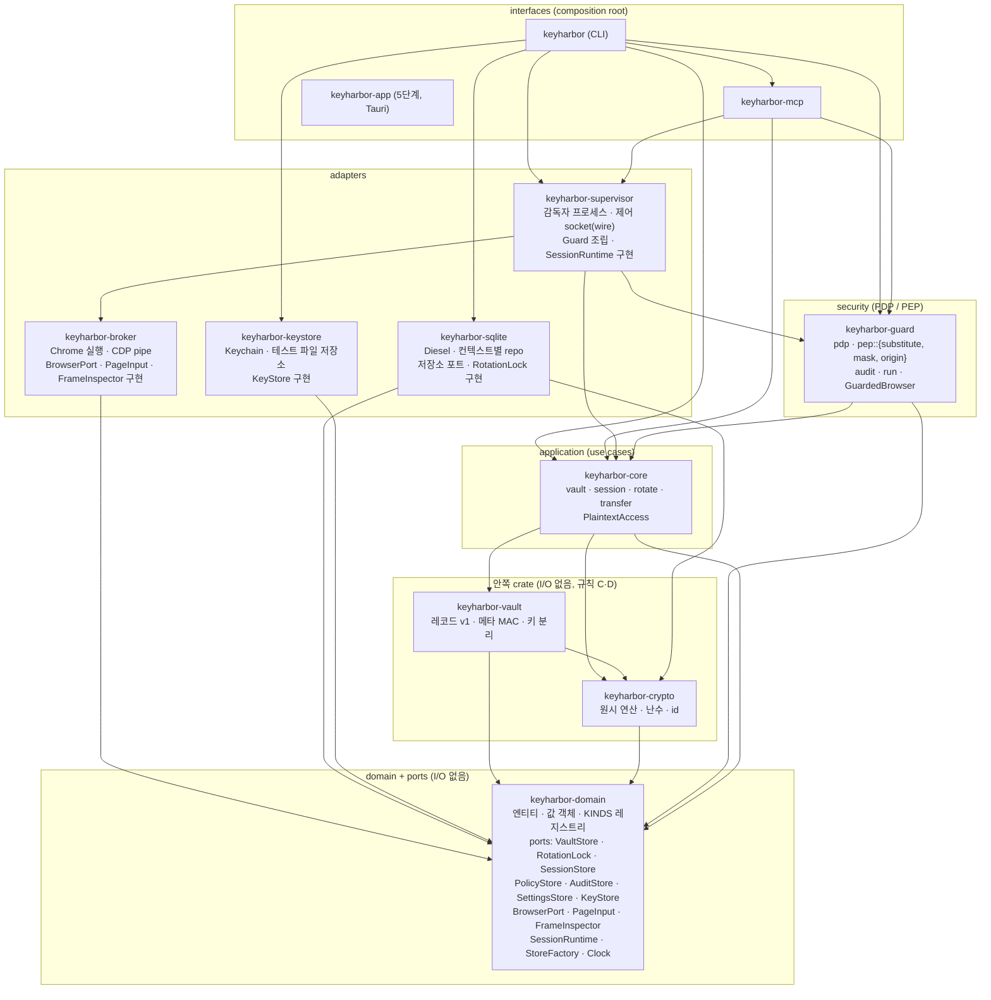

| crate | 계층 | 의존 가능 (정상 의존) | 핵심 타입·책임 |
|---|---|---|---|
| `keyharbor-domain` | domain + ports | 없음 | `SessionId`·`State`·`Generation`(만들기는 `crypto::random::id`), `vault`(`ItemKind`, `KINDS`, `Origin`, placeholder 문법 `PLACEHOLDER_OPEN`·`Display for PlaceholderRef`), `policy`(`Rule`, 요청자 `AgentName`), `settings`(`SETTINGS`), `audit`, `secret`(`SecretKey`, `VaultError`), `ports`(trait; 브라우저 대상 `Target`·`FillOutcome`, 시계 `Clock`·`ManualClock`, `RotationLock`) |
| `keyharbor-crypto` | crypto | domain | 모든 암호 원시 연산과 난수, v4 id(`random::{uuid_v4, id}`) ([ADR-0016](adr/0016-crypto-crate.md)) |
| `keyharbor-vault` | 안쪽 (형식) | domain, crypto | 레코드 seal/open, 키 분리, 메타 MAC, 키 ID(I/O 없음) |
| `keyharbor-keystore` | adapter | domain | `KeyStore` 구현: `KeychainKeyStore`(macOS login keychain, 다른 OS는 오류만 내는 자리), 테스트용 `FileKeyStore`, `test_keystore_dir`(기능 `insecure-test-keystore`일 때만). security-framework는 여기에만(규칙 G) |
| `keyharbor-core` | application | domain, vault(레코드 함수만), crypto | `Vault` 유스케이스(`vault/{open, items, summary, resolve}`, 에이전트용 `catalog`), `session/{manage, lifecycle, handoff}`, `policy`, `audit`, `settings`, `rotate`, `transfer`, `PlaintextAccess` |
| `keyharbor-guard` | security | domain, core | `pdp::decide`, `pep::substitute`, `pep::mask::Masker`, `pep::origin`, `audit`, `run`, `items`(항목 add/edit 순서), `session`(세션 작업 → 정책 Action 표), `Guard`, `GuardedBrowser` |
| `keyharbor-sqlite` | adapter | domain, crypto(id 난수만) | `SqliteStore`(저장소 포트 전부, `RotationLock` = 데이터 폴더의 `vault.lock`), `SqliteStores`(`StoreFactory`), 컨텍스트 레지스트리 |
| `keyharbor-broker` | adapter (Chrome) | domain | `chrome`(Chrome 실행, CDP pipe `CdpLink`, `DevToolsActivePort` 해석), `CdpBrowser`(`BrowserPort`·`PageInput`·`FrameInspector`). supervisor만 의존한다(규칙 B) |
| `keyharbor-supervisor` | adapter (프로세스) | domain, core, guard, broker | `run`(감독자 프로세스: 잠금, 준비, `CdpBrowser`를 `GuardedBrowser`로 감싸 제어 socket 처리), `control::{wire, client}`(제어 프로토콜 한 곳, 규칙 K), `SuperviseArgs`(`__supervise` argv 계약), `ProcessRuntime`(`SessionRuntime`), `lock_mcp_scope` |
| `keyharbor-mcp` | interface | domain, core, guard, supervisor | `server`, `scope`, `tools/{session, browser, vault}`. 저장소·금고 opener·런타임·시계는 생성자로 받는다(`Deps`) |
| `keyharbor` (CLI) | interface | domain, core, guard, sqlite, keystore, supervisor, mcp | `compose`(composition root: `SystemClock`, `keystore_from_env`), clap 명령, 파일 읽기·쓰기(`vault_cmd::files`, `run`의 `--env-file`), 감독자 조립(`__supervise`) |

`scripts/check-layers.sh`가 이 표와 다음 규칙을 CI(repo-checks)에서 검사한다: 암호 원시 crate(`chacha20poly1305`·`hkdf`·`hmac`)는 crypto만, rusqlite 금지, 운영 코드의 `sql_query`·`batch_execute` 금지(마이그레이션과 테스트만), `PlaintextAccess::issue` 호출은 guard·core export·테스트만, broker의 raw CDP 모듈 비공개, 영속성 컨텍스트끼리 models·mappers·repo를 가져다 쓰지 않음, 표면(CLI `*_cmd`·MCP)은 저장소를 열거나 저장소 포트를 부르지 않음(규칙 A), 세션 수준 `Action`은 guard의 표만 고름(규칙 J), placeholder 문법은 domain에만(규칙 H), 요청자 이름 `*` 금지는 domain `AgentName`에만(규칙 I), broker는 domain에만 의존하고 supervisor만 broker에 의존(규칙 B), 제어 요청의 `"op"`은 `supervisor::control::wire`에만(규칙 K), 안쪽 crate(domain·crypto·vault·core·guard)는 파일·프로세스·socket·환경 변수·시계·sleep·출력을 쓰지 않음(규칙 C)과 드라이버 crate에 의존하지 않음(규칙 D), domain의 `serde_json`은 `ports/browser.rs`의 페이지 결과에만(규칙 E), 난수는 crypto만이고 uuid `v4` 기능은 아무도 켜지 않음(규칙 F), security-framework·rmcp·clap은 각자 어댑터 crate에만(규칙 G). `scripts/test-scripts.sh`가 규칙마다 위반을 심은 사본(`CHECK_LAYERS_ROOT`)으로 검사가 실패하는지 확인한다.

### 2.4.0 표면과 composition root

CLI와 MCP는 같은 유스케이스를 부르는 두 얼굴이다. 바이너리마다 조립하는 곳은 하나다: `cli/src/compose.rs`의 `App`이 SQLite 저장소, 키 저장소(`keystore_from_env`: `KEYHARBOR_TEST_KEYSTORE_DIR`를 읽는 곳도 여기다), 시계(`SystemClock`), 감독자 런타임(`ProcessRuntime`), 감독자 어댑터, MCP 서버의 `Deps`를 만든다. 안쪽 crate가 쓰는 시간·잠금·파일은 포트로 들어간다: `Clock`(지금·대기), `RotationLock`(키 교체 잠금), 내보내기·가져오기와 `run`의 env 파일은 바이트로 받는다(J-75). 명령 모듈은 포트를 받아 core·guard를 부르고, 인자 파싱과 출력 모양만 갖는다. MCP 서버는 저장소 하나(`SharedStore`, 호출마다 잠금)를 생성자로 받고 요청마다 저장소를 열지 않는다. [J-71, J-72]

| 무엇 | 유스케이스 |
|---|---|
| 세션 만들기(설명까지 한 번에 쓰기)·설명 바꾸기·목록 | `core::session::{create, describe, list}` |
| 사람의 재개 기다리기(한 번 보기, 폴링, 1–300초 한도) | `core::session::{resume_check, wait_for_resume, ResumeWait}` |
| 정책 목록·설정·제거(약화 확인, `policy_changed` 기록) | `core::policy::{list, set, remove}` |
| 사용 기록 읽기 | `core::audit::list` |
| 설정 읽기·쓰기(목록, 기본값, 검증, 약화 확인) | `core::settings::{get, set}` |
| 항목 add/edit(설명 값 검사 → 약화 확인 → 저장) | `guard::items::{add, edit}` |
| 세션 작업마다 필요한 정책 Action | `guard::session::{SessionOp, authorize}` |
| 에이전트가 보는 항목 목록(메타 MAC 검증, 변조 항목은 이름만) | `core::catalog`, `Vault::catalog` |

### 2.4.1 PDP / PEP와 평문 경로

평문 값이 만들어지는 곳은 두 군데뿐이다: `Vault::resolve`와 `Vault::mask_values`. 둘 다 `&PlaintextAccess`를 요구하고, 그 값은 guard가 검사를 마친 뒤에만 발급한다(예외: 사용자가 요청한 age 내보내기). core는 guard를 알 수 없으므로 생성자는 `#[doc(hidden)] pub`이고, 호출 위치를 스크립트가 제한한다(Rust에서 crate 사이 sealed 생성자의 가장 단순한 근사).

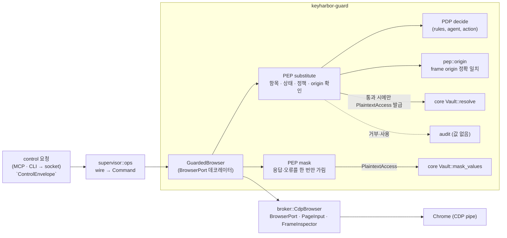

- **데코레이터**: `GuardedBrowser<'a, B: BrowserPort + PageInput + FrameInspector>`는 그 자신이 `BrowserPort`다. placeholder가 있는 `fill`·`type_text`는 `PageInput` 단계(포커스 → 검사 → 비우기 → 포커스 재확인 → 입력)를 직접 밟고, 나머지는 raw 어댑터에 위임한 뒤 결과와 오류 메시지를 마스킹한다. 요청마다 `Guard::browser(&mut raw, agent)`로 만든다. [J-44, J-45]
- broker는 `CdpBrowser`만 공개하고 `cdp`·`browser` 모듈은 숨긴다. broker에 의존하는 crate는 supervisor 하나이고(규칙 B) supervisor는 `CdpBrowser`를 `ops`에서 `GuardedBrowser`로만 쓴다. 그래서 MCP·CLI가 브라우저에 닿는 길은 제어 socket → `ops` → `GuardedBrowser` 하나뿐이다.
- `keyharbor run`은 같은 PDP·origin 규칙을 `guard::run`에서 쓰고, 프로세스 실행과 출력 펌프만 CLI에 남는다.

### 2.4.2 세션 유스케이스와 런타임 포트

세션 열기·멈추기·인계·복구·endpoint의 순서와 오류 메시지는 `keyharbor-core::session`에 있고 프로세스·OS 잠금·socket·`DevToolsActivePort` 파일은 `SessionRuntime` 포트 뒤(`keyharbor-supervisor`의 `ProcessRuntime`)에 있다. 감독자가 자기 실행에 기록하는 상태(예약 확인, `starting → running/failed`, 브라우저 종료 뒤 `stopped/failed`)의 규칙은 `core::session::supervision`에 있고 감독자는 그것을 부른다. 감독자 프로세스는 `StoreFactory`(SQLite 어댑터), 금고 opener, headless 여부를 composition root에게서 받는다(`keyharbor_supervisor::Adapters`). 감독자 argv는 `SuperviseArgs` 하나가 쓰고 읽는다. [J-47, J-74]

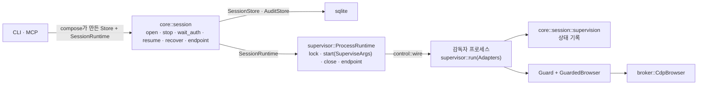

## 2.5 런타임 뷰

### 2.5.1 세션 열기

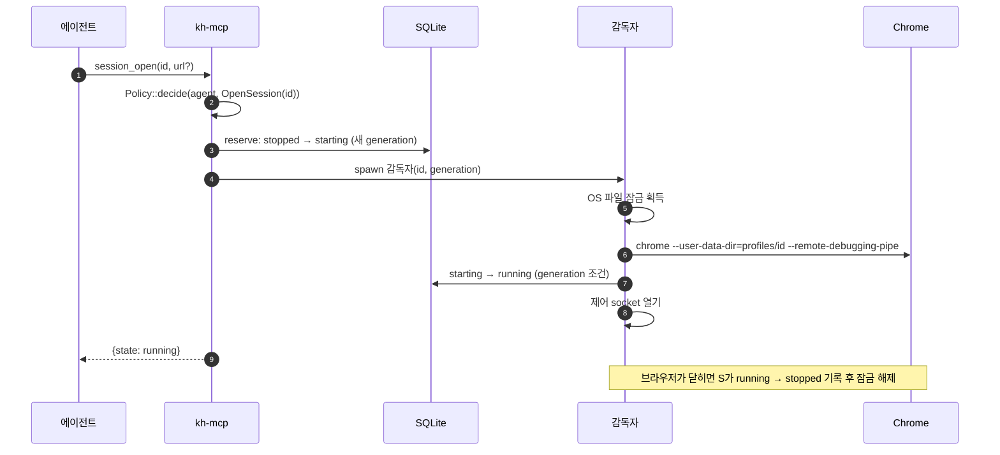

### 2.5.2 placeholder 치환 입력

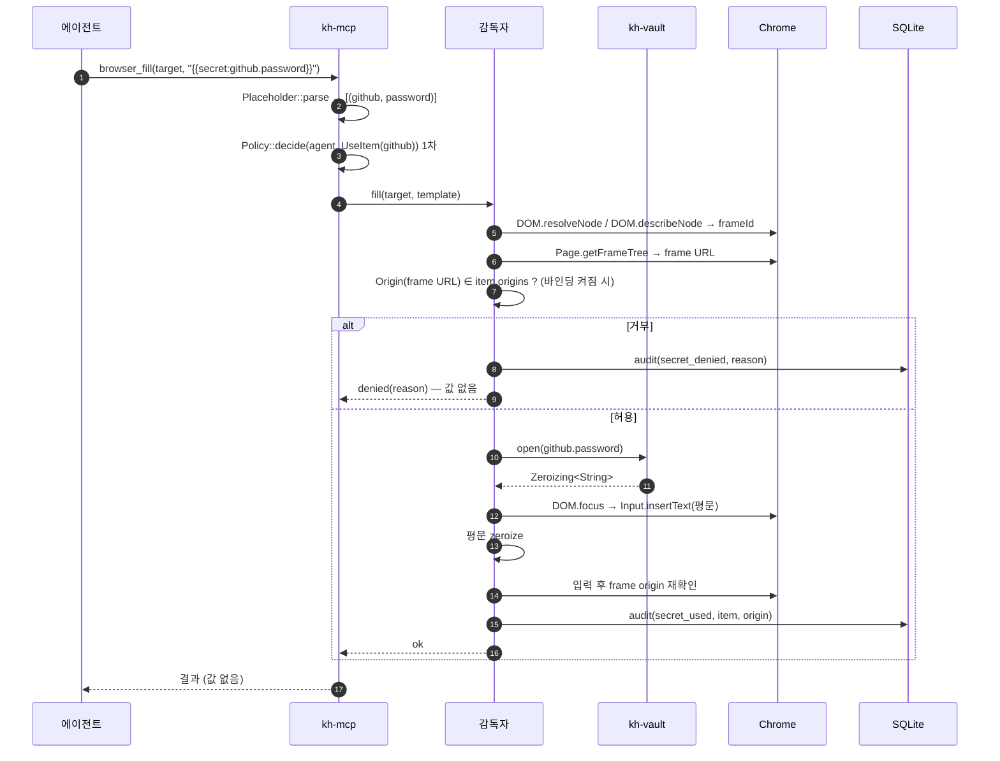

### 2.5.3 응답 마스킹

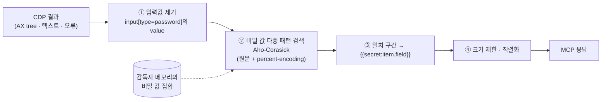

알고리즘 세부와 한계는 [03 §3.7](03-security-whitepaper.md#37-마스킹-알고리즘)에 있다.

### 2.5.4 사람에게 넘기기

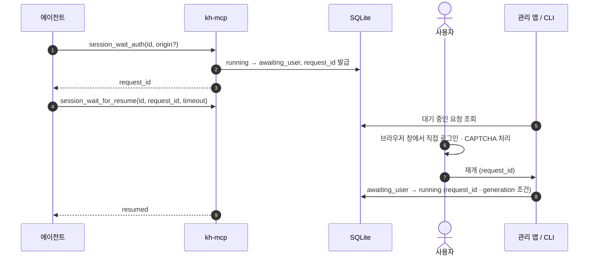

### 2.5.5 `.env` 변수 주입 실행 (`keyharbor run`)

에이전트가 셸 명령을 실행할 때 `.env` 값이 필요하면, 평문 `.env` 파일 대신 금고의 `env` 항목을 자식 프로세스에만 주입한다. 1Password CLI의 `op run` 방식과 같다. [R-24, [ADR-0010](adr/0010-env-run-injection.md)]

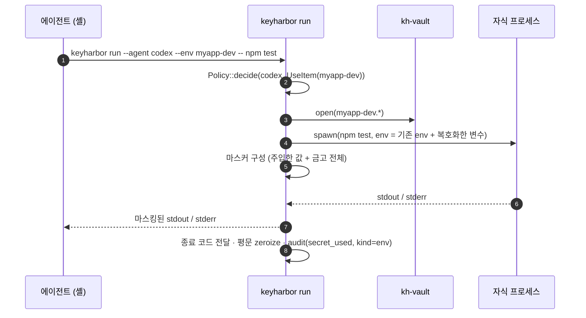

- `.env` 형식 가져오기(`keyharbor vault import-env <name> <path>`)를 제공한다. 가져온 뒤 원본 파일을 지울지는 사용자가 정한다.
- 템플릿 모드: `.env.keyharbor` 파일에 `DATABASE_URL={{secret:myapp-dev.DATABASE_URL}}`처럼 placeholder를 적어 두면 `keyharbor run --env-file .env.keyharbor -- ...`가 치환한다. 이 파일은 비밀이 없으므로 저장소에 커밋해도 된다.
- **한계**: 자식 프로세스는 평문을 갖는다. 그 프로세스가 값을 파일에 쓰거나 네트워크로 보내는 것은 막지 못한다. 마스킹은 **출력 경로만** 보호한다. ([03 §3.9](03-security-whitepaper.md#39-위협-모델-stride) T13)

## 2.6 상태 기계

기존 `kh-domain::State::permits`의 전이를 그대로 유지한다. `recovery_required`는 **저장하는 상태가 아니라** 프로토타입처럼 조회 시점에 계산하는 표시값이다. DB 상태가 `starting`·`running`·`awaiting_user`·`stopping`인데 감독자 잠금을 잡은 프로세스가 없으면 `recovery_required`로 보여 준다. 복구(`recover --confirm-browser-closed`)는 generation 조건으로 DB 상태를 `stopped`로 되돌린다.

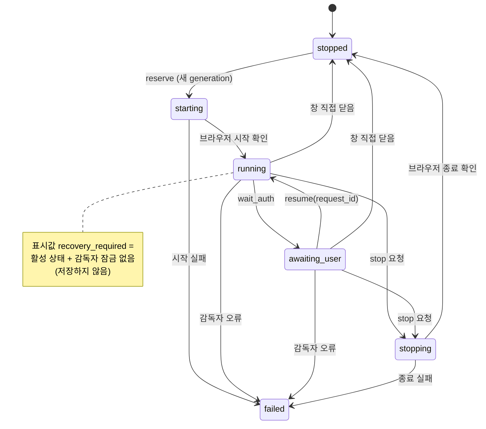

기존 프로토타입처럼 `failed`·`recovery_required`에서 `stopped`로 돌아가는 것은 `recover` 명령이 generation 조건으로 수행하는 **관리 작업**이다. 그래서 일반 전이표(`permits`)에는 넣지 않는다.

### 2.6.1 세션 동시 접근

- 세션 독점(lease)과 기존 `--session` 범위 지정 MCP 서버, "범위 지정 서버는 세션당 하나" 규칙을 유지한다.
- 범위를 지정하지 않은 MCP 서버가 여럿이면, 같은 세션의 감독자 socket에 동시에 명령할 수 있다. 감독자는 명령을 **한 줄로 세워 차례로 실행**한다. 브라우저 상태가 섞이는 건 에이전트들이 같은 세션을 고른 결과이며, 정책으로 세션을 나눠 막을 수 있다. [설계자 판단]

## 2.7 데이터 모델

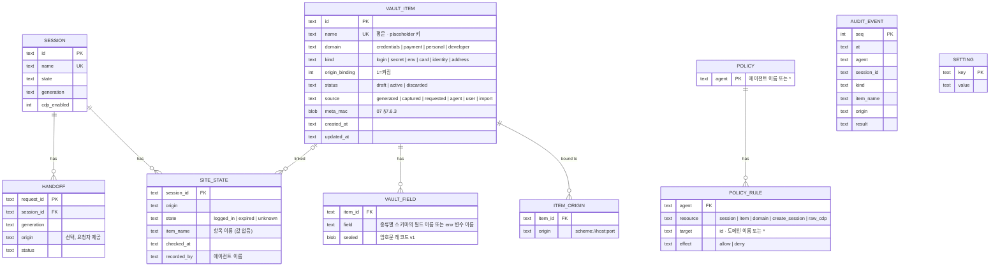

### 2.7.1 도메인 분할 (R-24, R-25)

관리 대상을 **다섯 개의 도메인**(bounded context)으로 나눈다. 세션은 금고 밖에 있고, 금고는 네 도메인으로 나뉜다. 분류는 Chrome 자동완성 설정의 *비밀번호 관리자 / 결제 수단 / 주소 및 기타*와, 사용자가 제안한 "기본 정보(세션·아이디·비밀번호) / 결제 정보 / 개인정보" 구분을 따른다. [사용자 결정 R-25, 세부는 설계자 판단] API 키와 환경 변수(`secret`·`env`)는 처음에 자격 증명에 있었지만, 사이트 입력칸이 아니라 프로세스·도구로 주입되는 값이라 개발자 도메인으로 나눴다. [사용자 결정 R-40, J-54]

```mermaid
flowchart TB
  subgraph SES["① 세션 도메인 Session<br/>(금고 밖 · 비밀 아님)"]
    s1["브라우저 세션 · lease · generation"]
    s2["인계 요청"]
    s3["사이트별 로그인 상태"]
  end
  subgraph VAULT["금고"]
    subgraph CRED["② 자격 증명 도메인 Credentials<br/>'사이트에 나임을 증명하는 것'"]
      c1["login: 아이디 · 비밀번호 · totp_seed"]
    end
    subgraph DEV["⑤ 개발자 도메인 Developer<br/>'도구가 서비스를 부르는 열쇠'"]
      d1["secret: API 키 · 토큰"]
      d2["env: .env 변수 묶음"]
    end
    subgraph PAY["③ 결제 도메인 Payment<br/>'돈이 나가는 것'"]
      p1["card: 번호 · 유효기간 · CVC · 명의자"]
    end
    subgraph PER["④ 개인정보 도메인 Personal<br/>'나에 대한 사실'"]
      r1["identity: 이름 · 이메일 · 전화 · 생년월일"]
      r2["address: 배송 · 청구 주소"]
    end
  end
  POL["정책 · 사용 기록<br/>(도메인을 가로지르는 지원 도메인)"]
  s3 -.->|"연결된 login 항목"| c1
  p1 -.->|"청구 주소 참조"| r2
  POL --- SES & CRED & PAY & PER & DEV
```

**왜 나누는가**

| 관점 | 자격 증명 | 결제 | 개인정보 | 개발자 |
|---|---|---|---|---|
| 유출 시 피해 | 계정 탈취 | **금전 손실** | 신원 도용 · 프라이버시 | 외부 서비스 과금 · 데이터 접근 |
| 쓰는 곳 | 특정 서비스 한두 곳 | 상점 + 결제사 iframe | 여러 사이트의 가입·주문 폼 | 프로세스·도구 주입 (`keyharbor run`) |
| origin 바인딩 기본 | 켜짐 | 켜짐 (상점 + 결제사 origin) | 꺼짐 | `secret` 꺼짐 → 브라우저 입력은 origin 목록이 있어야 함(R-36) · `env` 해당 없음 |
| 마스킹 특이점 | — | 번호 공백·하이픈 변형 | 짧은 값(우편번호 등) 오탐 주의 | — |
| 도메인 키 | `DK_cred` | `DK_pay` | `DK_personal` | `DK_dev` |
| 관리 앱 화면 | 비밀번호 | 결제 수단 | 개인정보 · 주소 | API 키 · 환경 변수 |

- **정책의 단위가 된다.** 규칙의 target으로 항목 이름뿐 아니라 도메인 전체(`--resource domain --target payment`, `… developer`)를 쓸 수 있다. 예를 들어 "codex는 결제 도메인 거부"를 규칙 하나로 건다. 기본값은 여전히 모두 허용이다(P2).
- **키의 단위가 된다.** 도메인마다 별도 키를 둔다([03 §3.3](03-security-whitepaper.md#33-키-계층)). 이후 "결제 도메인 평문 보기는 인증 필요" 같은 선택지를 도메인 단위로 붙일 수 있다.
- **코드의 단위가 된다.** `kh-domain` 안에 `session`, `credentials`, `payment`, `personal`, `developer`, `policy`, `audit` 모듈을 둔다. 도메인 사이 참조는 ID로만 한다(예: 카드의 `billing_address` = address 항목 ID).
- 독립 `note` 종류는 두지 않는다. 모든 항목에 `note` 필드가 있다. [설계자 판단]
- placeholder 형식은 도메인과 상관없이 `{{secret:<항목 이름>.<필드>}}` 하나다. 항목 이름은 금고 전체에서 유일하다. [설계자 판단]

### 2.7.2 항목 종류와 필드 스키마

| 도메인 | 종류 | 필드 | 주 사용처 | origin 바인딩 기본 |
|---|---|---|---|---|
| 자격 증명 | `login` | `username`, `password`, `totp_seed`(선택, 저장만), `note` | 로그인 폼 | 켜짐 |
| 개발자 | `secret` | `value`, `note` | API 키 등 단일 값 | 꺼짐 (브라우저 입력은 origin 목록 필요, R-36) |
| 개발자 | `env` | 사용자가 정한 변수 이름들 (`DATABASE_URL`, `OPENAI_API_KEY` …), `note` | `keyharbor run` | 해당 없음 |
| 결제 | `card` | `holder`, `number`, `exp_month`, `exp_year`, `cvc`, `billing_address`(address ID), `note` | 결제 폼 (대개 결제사 iframe) | 켜짐 — 결제사 origin을 함께 등록 |
| 개인정보 | `identity` | `full_name`, `given_name`, `family_name`, `email`, `phone`, `birth_date`, `note` | 가입·주문 폼 | 꺼짐 |
| 개인정보 | `address` | `recipient`, `line1`, `line2`, `city`, `region`, `postal_code`, `country`, `phone`, `note` | 배송·청구 주소 | 꺼짐 |

- 종류마다 필드 스키마를 정해 두되, 사용자가 **사용자 정의 필드**를 더할 수 있다. 모든 필드는 소속 도메인의 키로 암호화한다.
- `identity`·`address`의 origin 바인딩 기본값을 끈 이유는 여러 사이트에서 쓰는 정보이기 때문이다. 켤 수 있다. [설계자 판단]
- `totp_seed`는 저장만 하고 코드 생성·입력은 하지 않는다. 인증 코드 처리는 범위 밖이다(R-07). [설계자 판단]
- `username`도 암호화한다. 계정 이름도 민감한 정보이기 때문이다. [설계자 판단]
- 항목 이름, 종류, origin, 시각은 정책 판정과 목록 표시를 위해 **평문**이다. 이 메타데이터도 민감하다는 점을 문서와 관리 앱에 적는다. ([03 §3.5](03-security-whitepaper.md#35-저장-데이터-분류))
- `AUDIT_EVENT`에는 값 컬럼이 **존재하지 않는다**. 스키마 수준에서 값 기록을 막는다.

설정은 `keyharbor_domain::settings::SETTINGS` 한 표에 있다. 저장소는 문자열만 저장하고, 기본값·형식 검사·약화 방향은 표가 정한다. [J-73]

| 설정 | 기본값 | 형식 | 약화(사람 확인) |
|---|---|---|---|
| `audit_enabled` | `true` | `true`·`false` | `false`로 바꿀 때. 값이 없거나 `false`가 아니면 기록은 켜져 있다 |
| `capture_enabled` | `false` | `true`·`false` | 바꿀 때마다 |
| `default_item_ttl` | `none` | `<N>d`·`none` | 없음 |

### 2.7.3 영속성 컨텍스트 맵 (R-32, R-33)

`keyharbor-sqlite`는 기술 계층(models/·repos/)이 아니라 **바운디드 컨텍스트**로 나눈다. 컨텍스트마다 `schema.rs`(Diesel `table!`)·`models.rs`(저장 형태)·`mappers.rs`(저장 형태 ↔ 도메인)·`repo.rs`(포트 구현)와 자기 마이그레이션 디렉터리를 가진다. `contexts::CONTEXTS` 레지스트리 순서대로 각 컨텍스트의 `embed_migrations!`를 실행한다. 스키마 내용은 바꾸지 않았다. [사용자 결정 R-32, R-33, 세부는 J-48, J-49]

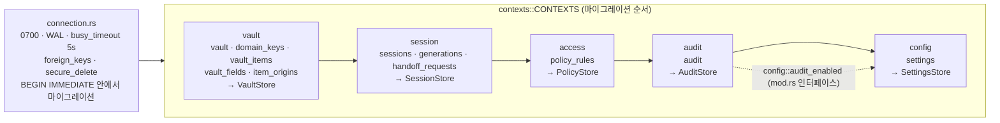

- 마이그레이션 디렉터리: `crates/sqlite/migrations/<context>/<timestamp>_<context>_<name>/up.sql`. 버전(타임스탬프)은 모든 컨텍스트에서 유일해야 한다. 초기 마이그레이션은 `CREATE TABLE IF NOT EXISTS`라 마이그레이션 이전에 만든 DB도 그대로 열리고, `__diesel_schema_migrations`만 더해진다.
- 쓰기는 모두 `immediate_transaction`(BEGIN IMMEDIATE). generation CAS는 `UPDATE … WHERE state = from AND EXISTS(generation)`의 영향 행 수, 금고 키 교체는 `version = expected` 조건의 영향 행 수로 판정한다.
- 컨텍스트끼리는 models·mappers·repo를 가져다 쓰지 않는다. 다른 컨텍스트의 데이터가 필요하면 그 컨텍스트의 `mod.rs` 인터페이스를 부른다(예: audit → `config::audit_enabled`). 테이블을 한 쿼리에 섞는 `allow_tables_to_appear_in_same_query!`는 컨텍스트 안에서 실제로 join하는 곳(vault, session)에만 둔다.
- **컨텍스트 추가**(예: 4단계 `vault_requests`): 모듈 하나 + 마이그레이션 디렉터리 하나 + `CONTEXTS`에 한 줄. 포트는 `keyharbor-domain::ports`에 더한다.
- 원시 SQL은 `migrations/`에만 있다. 운영 코드에서 `sql_query`는 금지이고 테스트 전용 도우미(`#[cfg(test)]`, `test-support` 기능)만 쓴다. [J-50]

### 2.7.4 항목 종류 레지스트리 (R-33)

항목 종류는 흩어진 `match` 대신 `keyharbor_domain::vault::KINDS` 표 하나로 정의한다. 스키마(`ItemKind::schema`), 도메인, origin 바인딩 기본값, CLI가 명령행 인자(`--set`)를 거부하는 비밀 필드, 마스킹 대상이 모두 이 표를 읽는다. [J-51]

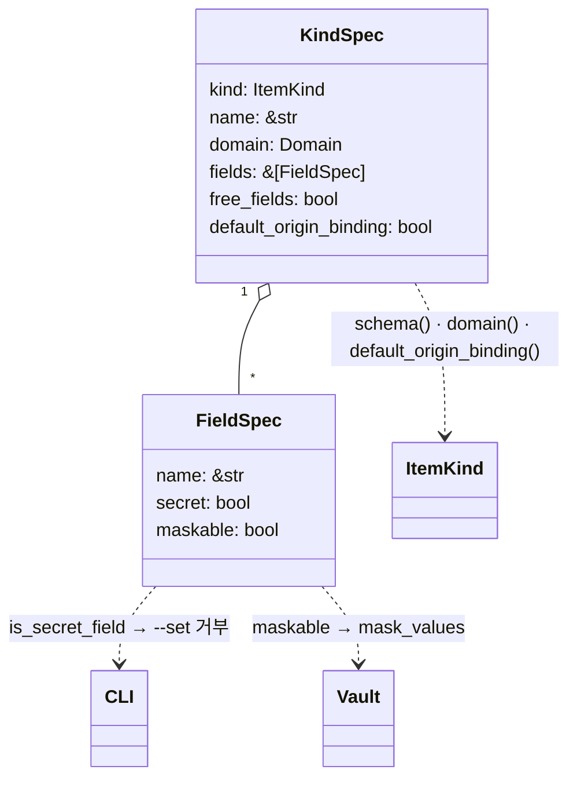

- 비밀 필드: `password`, `totp_seed`, `value`, `number`, `cvc`, `note`, 그리고 `env`의 모든 필드(`free_fields` → `FREE_FIELD`). 종류에 없는 필드 이름은 다른 종류가 비밀로 선언했으면 비밀로 본다(이전 `SECRET_FIELDS` 상수와 같은 동작).
- 지금은 모든 필드가 `maskable`이다. 알 수 없는 종류의 값은 전부 가린다(가리는 쪽으로 실패).
- 종류 추가: `ItemKind` 변형 하나 + `KINDS` 항목 하나.

## 2.8 정책 판정

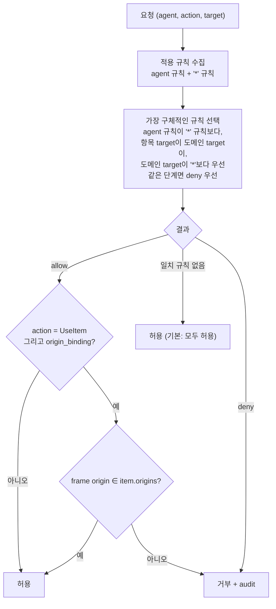

- `'*'` 규칙은 **모든 에이전트에 적용**된다. 에이전트별 규칙이 있어도 사라지지 않으며, 더 구체적인 규칙이 있을 때만 그 규칙이 이긴다. 예를 들어 `'*'`에 `bank` 거부를 걸고 `claude`에 `bank` 허용을 걸면, claude만 허용된다.

- **기본값은 모두 허용**이다(P2, P3). 사용자가 규칙을 추가하면 그때부터 제한된다. [설계자 판단]
- origin 바인딩은 정책과 별개로 **항목 속성**이다. 기본값은 켜짐이고, 항목마다 끌 수 있다. [설계자 판단]
- 세션 수준 검사는 guard `session::SessionOp` 표 하나가 정한다. 세션 하나에 대한 작업(`session_open`, 모든 `browser_*`, `session_stop`, `session_wait_auth`, `session_wait_for_resume`, `site_state_get`, `site_state_set`)은 `session` 규칙을, `session_create`는 `create_session`을, `cdp: true`로 열기와 `session_endpoint`는 `session`과 `raw_cdp`를 본다. `session_list`는 이름·상태·설명만 보이므로 검사하지 않는다. CLI는 사람(`cli`)이 쓰므로 세션 정책을 보지 않는다. [J-71]
- `--agent` 이름은 MCP 등록 인자로 정한다. 같은 OS 사용자는 이름을 사칭할 수 있으므로, 이것은 **오작동 방지와 기록용 경계이지 보안 경계가 아니다**.

## 2.9 MCP 도구 표면

| 분류 | 도구 | 비고 |
|---|---|---|
| 세션 | `session_list`, `session_create`, `session_open`, `session_stop`, `session_wait_auth`, `session_wait_for_resume` | 기존 유지 |
| 세션 (선택) | `session_endpoint` | raw CDP가 켜진 경우에만. 마스킹 우회 경고 |
| 브라우저 | `browser_navigate`, `browser_snapshot`, `browser_screenshot`, `browser_click`, `browser_fill`, `browser_type`, `browser_press`, `browser_tabs`, `browser_new_tab`, `browser_switch_tab`, `browser_wait` | 신규. `fill`·`type`은 placeholder 지원 |
| 금고 | `vault_list` | 이름·종류·필드 이름·origin·draft 여부·출처만. 메타 MAC이 맞지 않는 항목은 `{"name", "tampered": true}`만 보인다. **값 조회 도구 없음** |
| 금고 등록 | `vault_generate`, `vault_put` ✅, `vault_request`, `vault_wait` | [08](08-registration-flows.md). 반환값에 값 없음. 에이전트가 더한 항목은 draft이고 기존 항목을 바꾸지 않는다 [J-77] |
| CLI 전용 | `keyharbor run --env …` | MCP 도구가 아니라 에이전트가 셸로 실행 ([§2.5.5](#255-env-변수-주입-실행-keyharbor-run)) |
| 상태 | `site_state_get`, `site_state_set` | 세션 정책(`SessionOp::SiteState`)을 따른다. 상태는 에이전트의 메모이고 확인하지 않는다 |

`session_account`(기존 OpenKeylet 이름 참조)는 `vault_list`와 `site_state`로 대체한다.

## 2.10 배포 뷰

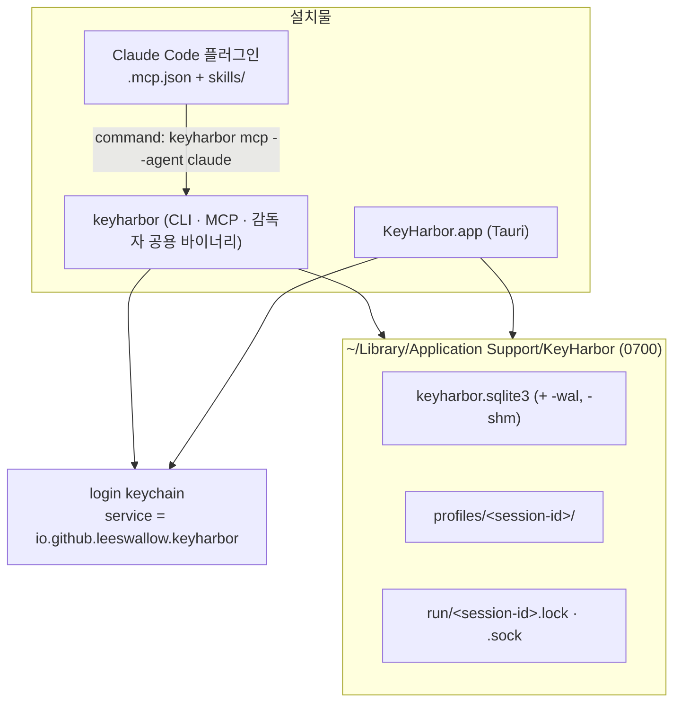

- 기본 데이터 경로는 `~/Library/Application Support/KeyHarbor`(macOS 표준, 0700)이고 `--data-dir`·`KEYHARBOR_HOME`으로 바꿀 수 있다. 프로토타입(`~/.keyharbor`)과 겹치지 않는다. [사용자 결정 B3, J-33]
- CLI·MCP·감독자는 **하나의 바이너리**다. Keychain의 앱별 접근 목록(ACL)에 바이너리 하나만 등록되도록 하기 위해서다. ([03 §3.4](03-security-whitepaper.md#34-금고-키-보관-macos-keychain))
- 관리 앱은 Keychain에 **직접 접근하지 않는다**. 금고 키가 필요한 작업은 앱 번들에 넣은 같은 `keyharbor` 바이너리를 Tauri sidecar로 호출한다. 그래야 ACL에 등록되는 바이너리가 하나로 유지된다. [설계자 판단]

## 2.11 교차 관심사

| 관심사 | 방침 |
|---|---|
| 오류 메시지 | 값·placeholder 치환 결과를 담지 않는다. 항목 이름과 이유 코드만 |
| 로깅 | `tracing` 사용. 비밀 타입은 `Debug`/`Display`를 구현하지 않거나 `[REDACTED]`를 출력 |
| 동시성 | SQLite 짧은 트랜잭션 + generation CAS. 브라우저 대기 중 트랜잭션을 잡고 있지 않는다 |
| 마이그레이션 | 컨텍스트별 Diesel 내장 마이그레이션을 `BEGIN IMMEDIATE` 하나 안에서 실행(동시에 연 프로세스는 기다렸다가 할 일이 없음을 확인). 실패하면 롤백되어 원본이 남는다 ([§2.7.3](#273-영속성-컨텍스트-맵-r-32-r-33)) |
| 테스트 | 합성 비밀(`KH-SYNTH-<uuid>`)로 모든 출력 채널을 스캔하는 누출 검사 |
