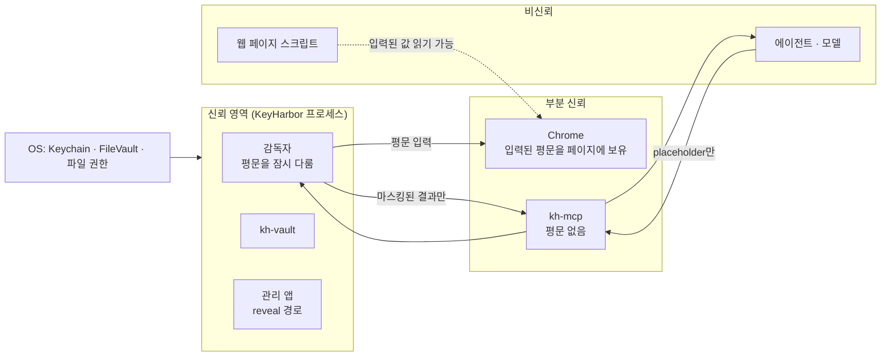
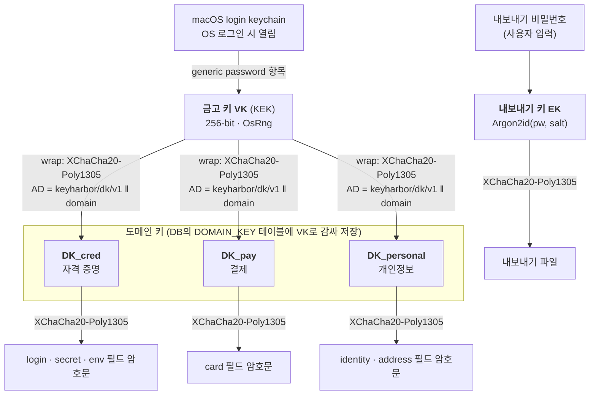
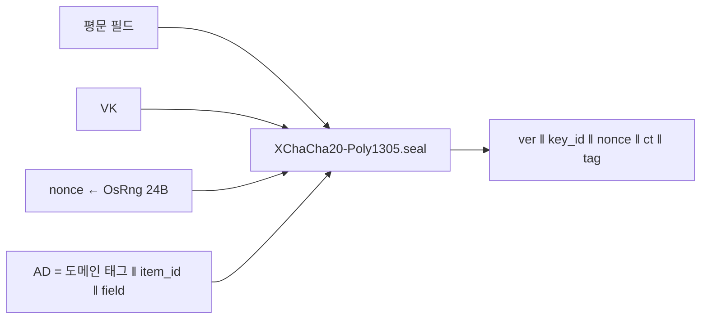
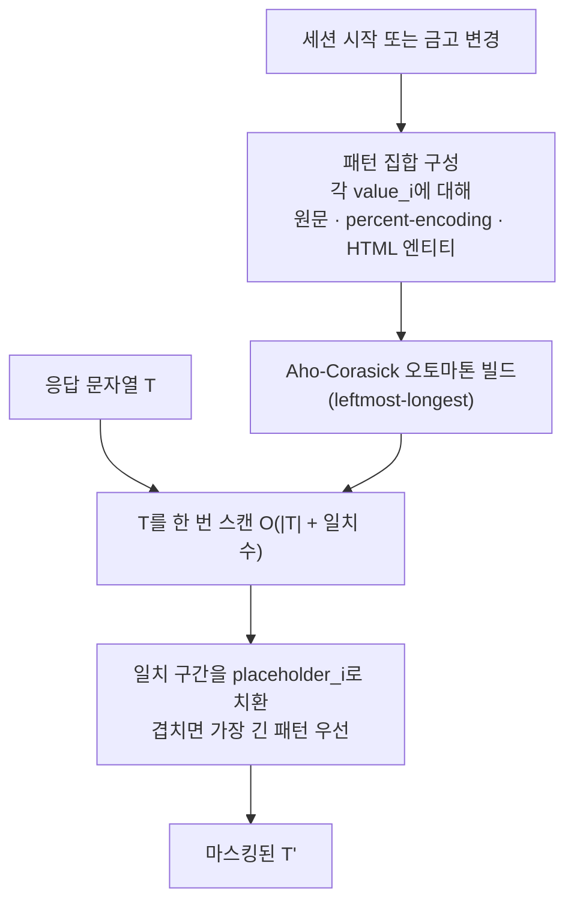
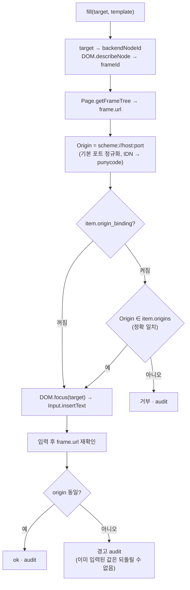
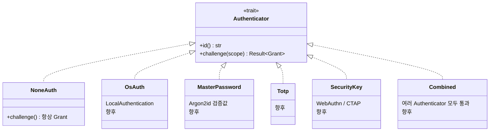

# 03. 보안 화이트페이퍼

> 상태: Draft · 2026-10-28 · 양식: [1Password Security Design White Paper](https://1passwordstatic.com/files/security/1password-white-paper.pdf), [Bitwarden Security Whitepaper](https://bitwarden.com/help/bitwarden-security-white-paper/)의 구성(신뢰 모델 → 키 계층 → 암호화 → 데이터 흐름 → 위협 → 한계)을 따른다.
>
> 이 문서는 보안 감사 결과가 아니다. 설계 의도와, 의도적으로 지키지 **않는** 것을 함께 적는다.

## 3.1 보안 목표와 비목표

| 구분 | 내용 |
|---|---|
| **지킨다** | (S1) 에이전트·모델 문맥으로 평문 비밀이 흐르지 않는다. (S2) 디스크의 비밀 필드는 암호문이다. (S3) 금고 파일만 복사해 가서는 복호화할 수 없다. 금고 키는 login keychain에 있고, login keychain 파일은 사용자의 macOS 로그인 암호로 암호화된다. (S4) origin 바인딩이 켜진 항목은 다른 origin의 프레임에 입력되지 않는다. (S5) 기록이 켜져 있으면 값 없는 사용 기록이 남는다. |
| **지키지 않는다** | (N1) 같은 OS 사용자 권한으로 실행되는 악성 프로세스. (N2) 잠금 해제된 Mac에 물리적으로 접근한 사람. (N3) 기기·키 분실 후 복구. (N4) 브라우저 프로필(쿠키 등) 자체의 암호화. (N5) 사용자가 raw CDP를 켠 세션의 마스킹. (N6) 사용자가 "인증 없음"을 고른 관리 앱의 접근 통제. |

N1·N2·N6은 **사용자가 고른 결과**이거나 OS의 몫이다(P2, P6). KeyHarbor는 이를 숨기지 않고 설정 화면과 README에 쓴다.

## 3.2 신뢰 모델



- **에이전트는 비신뢰**다. 프롬프트 인젝션에 걸릴 수 있다고 가정한다. 그래서 값 조회 도구 자체를 두지 않는다(S1).
- **웹 페이지는 비신뢰**다. 입력된 값은 페이지가 읽을 수 있다. 그래서 *어느 페이지에* 넣는지(origin 바인딩, S4)가 핵심 방어다.
- **Chrome은 부분 신뢰**다. 입력 이후의 값은 Chrome 프로필과 메모리에 남을 수 있다(N4).

## 3.3 키 계층

> **갱신**: 최종 키 계층·레코드 형식·내보내기 형식은 [07 암호화 설계](07-cryptography-design.md)가 정본이다. 이 절은 개요이며, 다른 부분이 있으면 07을 따른다.



**설계 선택 — 도메인 단위 envelope encryption.** 1Password는 볼트마다, Bitwarden은 조직·항목마다 키를 둔다. 둘 다 공유·동기화가 이유다. KeyHarbor는 공유가 없지만, 관리 대상을 세 도메인으로 나눴으므로([02 §2.7.1](02-system-architecture.md#271-도메인-분할-r-24-r-25)) **도메인마다 데이터 키(DK)**를 두고 VK는 DK를 감싸는 키(KEK)로만 쓴다. 항목마다 키를 두지는 않는다. [설계자 판단, [ADR-0011](adr/0011-domain-split.md)]

| 효과 | 설명 |
|---|---|
| VK 교체가 가볍다 | VK를 바꾸면 DK 세 개만 다시 감싼다. 필드 재암호화가 없다 |
| 도메인 단위 교체 | 결제 정보만 의심스러우면 `DK_pay`만 교체하고 card 필드만 재암호화한다 |
| 도메인 단위 선택지 | 이후 "결제 도메인은 인증을 통과해야 복호화" 같은 모드를 도메인 하나에만 붙일 수 있다(P2) |
| 메모리 노출 축소 | 감독자는 그 세션에서 실제로 쓰는 도메인의 DK만 풀 수 있다. 단, 마스킹은 금고 전체 값이 필요하므로(§3.7) 기본 동작에서는 세 DK를 모두 푼다 |

필드마다 무작위 nonce와 associated data를 쓰므로 필드 간 바꿔치기도 막힌다. 필드 레코드의 `key_id`는 해당 DK의 ID다.

**마스터 비밀번호가 금고 키를 감싸지 않는 이유.** 마스터 비밀번호로 VK를 감싸면, 사용자가 해제하기 전에는 에이전트가 금고를 쓸 수 없다. 이는 P3(막히지 않음)과 충돌한다. 그래서 관리 앱의 인증은 **UI 접근 통제**로 두고, VK는 OS 로그인으로 보호한다. 사용자가 더 강한 보호를 원하면 이후 "에이전트 사용 전 해제 필요" 모드를 선택지로 추가할 수 있다(P2). [설계자 판단]

## 3.4 금고 키 보관 (macOS Keychain)

| 속성 | 값 | 이유 |
|---|---|---|
| 항목 종류 | generic password | 32바이트 키를 그대로 저장 |
| `service` | `dev.keyharbor.vault` | |
| `account` | 데이터 디렉터리별 vault ID | 데이터 디렉터리마다 다른 키 |
| Keychain 종류 | 파일 기반 **login keychain** | Data Protection Keychain은 entitlement와 유료 Apple Developer 서명이 필요해 "무료·직접 빌드" 원칙과 맞지 않는다. login keychain은 iCloud로 동기화되지 않는다 |
| 접근성 속성 | 지정하지 않음 | `kSecAttrAccessible*`는 Data Protection Keychain에서만 의미가 있다. S3의 근거는 접근성 속성이 아니라 **login keychain 파일 자체의 암호화**다 |
| 생체 인증 조건 | 없음 | P3. 에이전트가 승인 없이 써야 한다 |
| 라이브러리 | `security-framework` crate | Apple Security.framework 바인딩 |

**수명 규칙**
1. 금고 초기화(`vault init`) 때만 키를 만든다. 같은 account의 키가 이미 있으면 **덮어쓰지 않고** 오류를 낸다.
2. 키를 찾을 수 없으면 **새 키를 만들지 않는다**. 기존 암호문을 읽을 수 없는 상태를 조용히 덮어쓰지 않기 위해서다.
3. DB에는 `key_id`만 저장한다. Keychain의 키와 `key_id`가 다르면 오류를 낸다.

**[부분 검증] 실무 위험** — 2026-10-28 실험: 항목을 만든 테스트 바이너리가 같은 항목을 읽고·교체·삭제할 때는 확인 창 없이 0.06초에 끝났다(`keystore` ignored 테스트 2회). **재빌드한 다른 바이너리가 기존 항목을 읽는 경우는 아직 확인하지 않았다.** 서명되지 않은 바이너리가 파일 기반 login keychain에 접근하면 macOS가 앱별 ACL 확인 창("keyharbor이(가) 키체인에 접근하려고 합니다")을 띄울 수 있다. 바이너리를 다시 빌드하면 서명이 바뀌어 또 묻는다. 에이전트 사용 중에 이 창이 뜨면 P3에 어긋난다. 1단계에서 (a) 사용자 로컬 빌드의 ad-hoc 서명과 (b) "항상 허용" 1회 설정으로 해결되는지 실제로 확인한다. 둘 다 안 되면 확인 창은 **재빌드·업데이트 직후 한 번** 뜨는 것으로 받아들이고 문서에 적는다. 유료 서명이 필요한 Data Protection Keychain은 쓰지 않는다. [설계자 판단]

이 ACL은 부수 효과로 **다른 바이너리**가 금고 키를 꺼내는 것을 막는다. 예를 들어 에이전트가 `security find-generic-password -w`를 실행하면 확인 창이 뜬다. 하지만 `keyharbor` 바이너리 자체를 실행하는 것은 막지 못한다. 이 점은 §3.12의 열린 질문과 연결된다.

## 3.5 저장 데이터 분류

| 데이터 | 위치 | 보호 | 민감도 |
|---|---|---|---|
| 모든 항목의 모든 필드 — 비밀번호, 카드번호·CVC, 신원·주소, env 변수 값, 메모 | SQLite `VAULT_FIELD.sealed` | AEAD (도메인 키 DK) | 높음 (결제·개인정보는 최고) |
| 도메인 키 DK × 3 | SQLite `DOMAIN_KEY.wrapped` | AEAD (VK) | 최고 |
| env 변수 **이름** | `VAULT_FIELD.field` 평문 | 파일 권한 | 낮음–중간 (어떤 서비스 키를 갖는지 드러남) |
| 항목 이름, 종류, origin 목록 | SQLite 평문 | 파일 권한 0600 · FileVault | 중간 (어떤 서비스를 쓰는지 드러남) |
| 세션 이름, 상태, 인계 origin | SQLite 평문 | 동일 | 중간 |
| 사이트 로그인 상태 | SQLite 평문 | 동일 | 중간 |
| 사용 기록 | SQLite 평문, **값 컬럼 없음** | 동일 | 중간 |
| 쿠키·localStorage 등 | 브라우저 프로필 | Chrome·OS 기본 보호 (N4) | 높음 |
| VK | Keychain | OS | 최고 |
| 내보내기 파일 | 사용자 지정 경로 | AEAD (EK) | 높음 — 보관은 사용자 책임 |

## 3.6 암호 프리미티브와 포맷

### 3.6.1 프리미티브

| 용도 | 알고리즘 | 라이브러리 | 선택 이유 |
|---|---|---|---|
| 필드 암호화 | **XChaCha20-Poly1305** (AEAD) | `chacha20poly1305` (RustCrypto) | 192-bit nonce → 무작위 nonce 충돌 걱정이 없음. AES-NI 의존 없이 일정한 성능. OpenKeylet 선례 |
| 난수 | OS CSPRNG | `rand_core::OsRng` / `getrandom` | |
| 내보내기 키 유도 | **Argon2id** | `argon2` (RustCrypto) | 메모리 하드. RFC 9106 권고 |
| 비밀 메모리 정리 | — | `zeroize`, `secrecy` | 평문·키의 drop 시 덮어쓰기 |
| 비밀번호 생성 (관리 앱) | 균등 무작위 선택 | `rand` + `OsRng` | |

알고리즘은 **직접 구현하지 않는다**(P7).

### 3.6.2 필드 암호문 레코드 v1

```text
 0        1                 17                        41                 41+n+16
 +--------+-----------------+-------------------------+--------------------+
 | ver=1  | key_id (16 B)   | nonce (24 B)            | ciphertext ‖ tag   |
 +--------+-----------------+-------------------------+--------------------+
 AD = "keyharbor/field/v1" ‖ 0x00 ‖ item_id(16 B) ‖ field_name(UTF-8)
```



- **AD에 item_id·field를 넣는 이유**: 공격자가 DB에서 `github.password`의 암호문을 `bank.password` 자리로 옮기면 복호화가 실패한다(바꿔치기 방지).
- **ver·key_id를 앞에 두는 이유**: 키 교체와 포맷 변경 중에 레코드마다 어떤 키·포맷인지 알 수 있다.
- 복호화 실패는 하나의 오류 종류로만 보고한다(어느 단계에서 실패했는지 드러내지 않는다).

### 3.6.3 내보내기 파일

> **대체됨**: 내보내기는 [age 형식](07-cryptography-design.md#77-내보내기가져오기-age-형식)을 쓴다. 아래 자체 형식은 검토 기록으로 남긴다.

```text
magic "KHEXPORT" ‖ ver=1 ‖ argon2id params (m, t, p) ‖ salt (16 B) ‖ nonce (24 B) ‖ ciphertext ‖ tag
plaintext = JSON { items: [...], policies: [...] }   (세션·프로필·기록은 제외)
AD = 헤더 전체
```

- Argon2id 기본 파라미터: **m = 64 MiB, t = 3, p = 4** (RFC 9106 §4의 두 번째 권고 설정). 헤더에 기록하므로 나중에 바꿔도 이전 파일을 읽을 수 있다.
- 브라우저 프로필은 내보내지 않는다(N4). 로그인은 다시 해야 한다.

## 3.7 마스킹 알고리즘

**입력**: 에이전트로 보낼 문자열(snapshot·텍스트·오류) `T`, 감독자 메모리의 비밀 집합 `{(placeholder_i, value_i)}`



| 결정 | 내용 | 이유 |
|---|---|---|
| 알고리즘 | Aho-Corasick 다중 패턴 (`aho-corasick` crate) | 비밀이 많아도 응답 길이에 선형. 정규식 OR보다 예측 가능 |
| 매칭 | leftmost-longest | `abc`와 `abcdef`가 함께 있을 때 긴 쪽을 가림 |
| 변형 | 원문, percent-encoding, HTML 엔티티 | 페이지 텍스트·URL에서 흔한 형태. [설계자 판단] |
| 카드번호 변형 | 숫자만, 4자리마다 공백, 4자리마다 `-`, 앞 6·뒤 4만 남긴 형태는 **가리지 않음**(사이트가 보여 주는 마스킹 표기라서) | 결제 페이지는 번호를 다양하게 끊어 보여 준다 |
| 대상 범위 | **금고 전체**의 모든 필드 값 (정책상 그 에이전트가 쓸 수 없는 항목 포함) | 다른 항목의 값이 페이지에 우연히 나타나도 가려야 한다 |
| 최소 길이 | 4자 미만 값(예: 카드 유효기간 `12`, 국가 코드)은 **가리지 않는다** | 짧은 값은 거의 모든 텍스트에서 일치해 응답을 망가뜨린다. CVC(3–4자리)는 4자리만 가린다. [설계자 판단] |
| 갱신 | DB의 `vault_version` 카운터를 응답마다 확인하고, 바뀌었으면 오토마톤을 다시 만든다 | CLI·관리 앱은 다른 프로세스라서 감독자가 변경을 알 방법이 필요하다. 카운터 조회는 가볍다 |
| 적재 시점 | 감독자가 **첫 브라우저 도구 응답** 직전에 한 번 복호화 | 세션 시작만으로 Keychain에 접근하지 않게 한다 |
| 짧은 비밀 | 길이와 상관없이 가린다 | 오탐(일반 단어가 가려짐)이 누출보다 낫다 |
| 구조적 제거 | snapshot 생성 시 `input[type=password]`의 value는 항상 제외 | 금고 밖 비밀(사용자가 직접 친 값)도 막음 |
| 메모리 | 패턴 집합은 감독자 메모리에만, `Zeroizing`으로 보관 | |

**한계 (명시)**
- 스크린샷 픽셀 속 비밀은 가리지 못한다. `type=password` 필드는 브라우저가 가리지만, 일반 텍스트로 화면에 보이는 비밀은 그대로 찍힌다.
- base64 등 다른 인코딩, 여러 노드에 쪼개진 비밀은 놓칠 수 있다.
- 금고에 **없는** 새 비밀(사이트가 발급한 API 토큰 등)은 알 수 없다. 이후 패턴 기반 탐지(gitleaks 규칙 등)를 선택 기능으로 둘 수 있다.
- raw CDP를 켠 세션은 모두 우회된다(N5).

## 3.8 치환 입력의 origin 확인



- **정확 일치**: `https://github.com`은 `https://gist.github.com`과 다르다. 서브도메인 와일드카드는 1차 범위에 넣지 않는다. [설계자 판단]
- **최상위 문서가 아니라 대상 요소의 프레임**을 본다. 교차 출처 iframe에 넣는 것을 막기 위해서다.
- **TOCTOU**: 확인과 입력 사이에 프레임이 이동할 수 있다. 입력 후 재확인은 *탐지*이지 *예방*이 아니다. 이 한계를 문서에 남긴다.
- **카드와 결제사 iframe**: 결제 폼은 대개 결제사 도메인의 iframe 안에 있다(예: Stripe Elements는 `https://js.stripe.com`). 그래서 `card` 항목의 origin 목록에는 상점 origin과 결제사 origin을 **함께** 등록한다. 관리 앱은 카드를 처음 쓸 때 거부된 origin을 사용 기록에 보여 주고, 사용자가 한 번에 추가할 수 있게 한다.

## 3.9 위협 모델 (STRIDE)

| # | 범주 | 위협 | 완화 | 남는 위험 |
|---|---|---|---|---|
| T1 | Information disclosure | 인젝션된 에이전트가 비밀 값을 출력하게 유도 | 값 조회 도구 없음, 응답 마스킹 | 스크린샷·인코딩 변형 |
| T2 | Information disclosure | 에이전트가 피싱 페이지에 `{{secret:bank.password}}` 입력 | origin 바인딩(기본 켜짐), 프레임 단위 확인 | 바인딩을 끈 항목, TOCTOU |
| T3 | Information disclosure | 에이전트가 placeholder를 검색창 등에 입력한 뒤 snapshot으로 읽기 | 마스킹이 응답에서 값을 다시 가림 | 페이지가 값을 외부로 전송하는 것은 막지 못함 (T2 완화에 의존) |
| T4 | Information disclosure | DB 파일 탈취 | 비밀 필드 AEAD, VK는 Keychain(`ThisDeviceOnly`) | 평문 메타데이터 노출 |
| T5 | Tampering | DB에서 암호문을 다른 항목으로 바꿔치기 | AD에 item_id·field | — |
| T6 | Tampering | DB에서 origin 목록을 조작 | 같은 OS 사용자만 가능 (N1) | 보호하지 않음 |
| T7 | Spoofing | 다른 프로그램이 `--agent` 이름을 사칭 | 기록용 식별자임을 명시 | 보호하지 않음 (N1) |
| T8 | Spoofing | 로컬 프로세스가 감독자 socket에 명령 | 0600 권한, 데이터 디렉터리 0700 | 같은 OS 사용자 (N1) |
| T9 | Elevation | raw CDP로 정책·마스킹 우회 | 기본 꺼짐, 세션별 선택, 경고 표시 | 켠 세션은 보호하지 않음 (N5) |
| T10 | Repudiation | 누가 비밀을 썼는지 모름 | 사용 기록 | 사용자가 기록을 끌 수 있음 (P2) |
| T11 | DoS | Keychain 확인 창으로 에이전트 정지 | 단일 바이너리, 서명 고정 검토 (§3.4) | [미검증] |
| T12 | Information disclosure | 로그·패닉 메시지에 평문 | 비밀 타입의 `Debug` 비구현, 합성 비밀 누출 검사 | 의존성 내부 로그 |
| T13 | Information disclosure | `keyharbor run`의 자식 프로세스가 env 값을 파일·네트워크로 내보냄 (`sh -c 'curl …?k=$KEY'`) | 출력 마스킹, 정책으로 env 항목별 허용 에이전트 제한, 사용 기록 | **막지 못함**. 환경 변수 주입 방식의 본질적 한계 |
| T14 | Information disclosure | 셸을 가진 에이전트가 `keyharbor` CLI의 평문 출력 경로를 직접 실행 | CLI에 평문 출력 경로 없음 (§3.12 A) | 관리 앱 GUI 자동화·프로세스 메모리 (N1) |
| T15 | Information disclosure | 카드번호가 상점 페이지 텍스트로 다시 표시됨 | 카드번호 변형 마스킹 | 사이트 고유 표기 |

## 3.10 관리 앱 인증



- **이번 구현은 `NoneAuth`만** 만들고 기본값으로 쓴다. [사용자 결정 R-21]
- `scope`는 `OpenApp`, `Reveal`, `Edit`, `Export`, `PolicyChange`로 나눈다. 사용자가 어떤 scope에 인증을 걸지 고르는 설정은 자리만 둔다.
- 설정 화면은 "현재: 인증 없음 — 이 Mac 사용자 계정으로 접근할 수 있는 누구나 금고를 볼 수 있습니다"를 보여 준다. 막지 않는다(P2).
- 관리 앱 인증은 **UI 통제**이며 VK를 보호하지 않는다(§3.3). CLI에서 `vault show`도 같은 trait을 거친다.

## 3.11 알려진 한계 요약

1. 같은 OS 사용자의 악성 프로세스로부터는 보호하지 않는다.
2. 스크린샷·인코딩 변형·금고 밖 비밀은 마스킹하지 못한다.
3. 입력된 비밀은 페이지와 Chrome 프로필에 남는다.
4. origin 확인에는 TOCTOU 구간이 있다.
5. 키·기기를 잃으면 복구할 수 없다. 내보내기 파일 보관은 사용자 책임이다.
6. 이 설계는 감사받지 않았다.
7. `keyharbor run`으로 주입한 env 값은 자식 프로세스가 자유롭게 쓸 수 있다.

## 3.12 열린 질문 — 셸을 가진 에이전트와 CLI 평문 경로

Claude Code·Codex 같은 에이전트는 MCP뿐 아니라 **셸**도 쓴다. 같은 OS 사용자로 실행되므로, KeyHarbor CLI에 평문을 출력하는 명령(`vault show`, 평문 `export`)이 있으면 에이전트가 직접 실행해 값을 얻을 수 있다. 인증 기본값이 `none`이라 이 경로를 막을 것이 없다. 그러면 P4가 무너진다.

| 선택지 | 내용 | P4 | 사용자 편의 |
|---|---|---|---|
| (A) CLI 평문 출력 없음 | 평문 보기는 관리 앱 GUI에서만. `export`는 암호화 파일만. CLI에는 `vault add/edit/rm/list`만 | 셸 경로로는 유지 (프로세스 메모리 덤프 등 의도적 공격은 N1) | CLI로 값을 꺼내 쓰는 스크립트는 불가 |
| (B) CLI 평문 출력 허용 | 지금 문서대로 | 셸 에이전트에게는 무너짐 | 높음 |
| (C) CLI 평문 출력은 인증 방식이 `none`이 아닐 때만 | 사용자가 인증을 켜면 CLI `show`도 열림 | 인증을 켜면 유지 | 중간 |

**결정: (A) CLI 평문 출력 없음.** [설계자 판단 — 사용자가 질문에 답하지 않고 구현 진행을 요청해 추천안으로 확정, 2026-10-28. 사용자가 뒤집을 수 있다.] CLI는 `vault add/edit/rm/list/import/import-env/export(age 파일)/rotate-*`만 제공한다. 평문 보기·복사는 관리 앱 GUI에서만 한다.
