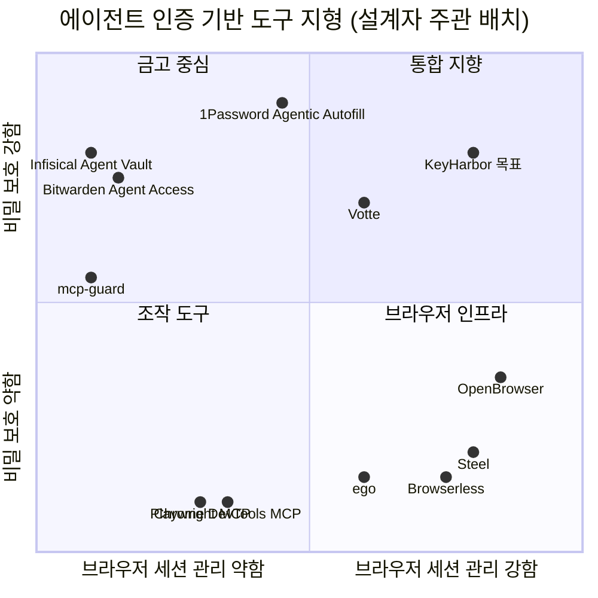

# 04. 선행 사례와 대안

> 상태: Draft · 2026-10-28 · 양식: Google Design Doc — *Alternatives Considered*
>
> 2026-10-28 웹 검색과 각 프로젝트 README·문서로 조사했다. OpenBrowser·OpenKeylet은 소스까지 읽었다([`open-source-research.md`](../open-source-research.md)). 나머지는 **[미검증]** — 실행하거나 코드를 감사하지 않았다.

## 4.1 지형도

## 4.2 사례별 비교

| 프로젝트 | 오픈소스 | 로컬 단독 | 세션 lease | 비밀 저장 | 평문 비노출 방식 | 마스킹 | KeyHarbor가 가져오는 것 |
|---|---|---|---|---|---|---|---|
| [OpenBrowser](https://github.com/floomhq/openbrowser) | ✅ MIT | 🟡 (원격 API 지향) | ✅ | ❌ (사람 인계) | 사람이 포털에서 입력 | 텔레메트리 정제 | lease·조작 MCP 도구 목록·Take Over·감사 |
| [Votte](https://votte.gitbook.io/votte/secrets-vault) | ✅ (문서상) | ? | ✅ | ✅ | **LLM의 placeholder를 입력 직전 실제 값으로 치환** | ? | 치환 모델 |
| [Infisical Agent Vault](https://infisical.com/blog/agent-vault-the-open-source-credential-proxy-and-vault-for-agents.md) | ✅ (preview) | ✅ | ❌ | ✅ | HTTP 요청이 나갈 때 프록시가 붙임 | — | "에이전트 환경 밖에 비밀" 원칙. 이후 API 키 프록시 참고 |
| [1Password Agentic Autofill](https://1password.com/blog/closing-the-credential-risk-gap-for-browser-use-ai-agents) | ❌ 상용 | ❌ | — | ✅ | 확장이 페이지에 직접 입력, 사용자 기기 승인 | — | 사용 기록 항목(에이전트·항목·사이트) |
| Bitwarden Agent Access SDK | ✅ 프로토콜 (alpha) | 🟡 | — | ✅ | 승인 후 **환경 변수로 주입** (평문이 에이전트 프로세스에 감) | — | 반면교사: 프로세스 주입은 P4 위반 |
| [mcp-guard](https://mcpservers.org/servers/sainitish1609/mcp-guard) | ✅ MIT | ✅ | — | — | — | ✅ 도구 결과 비밀 제거 | 응답 마스킹 위치(에이전트 ↔ 도구 사이) |
| [OpenKeylet](https://github.com/omaekumiko2-create/OpenKeylet) | ✅ MIT | ✅ | — | ✅ | 확장 팝업 입력 | — | XChaCha20-Poly1305 · Argon2id · Keychain |
| Steel / Browserless | ✅ | 🟡 | ✅ | ❌ | — | — | CDP 풀·프록시 구조 |
| ego (ego lite) | ❌ 제품 | ✅ | task space | ❌ | — | — | handOff/takeOver UX |

## 4.3 검토한 대안

### A1. 비밀을 어디에 둘 것인가

| 대안 | 장점 | 단점 | 결정 |
|---|---|---|---|
| 외부 금고 어댑터 (OpenKeylet·1Password·Bitwarden) | 암호화 책임을 넘김 | 외부 솔루션 의존(P1 위반), 금고마다 입력 경로가 다름, 상용 금고는 무료가 아님 | ❌ |
| **앱 소유 로컬 금고** | P1 충족, 치환·마스킹과 한 프로세스에서 결합, 학습 목적에 부합 | 암호화 조합 책임을 직접 짐 | ✅ [ADR-0002](adr/0002-own-local-vault.md) |

### A2. 금고 키 보호

| 대안 | 에이전트 무중단 | 파일 복사 공격 | 결정 |
|---|---|---|---|
| 평문 키 파일 0600 | ✅ | ❌ 같이 복사됨 | ❌ |
| 마스터 비밀번호(Argon2id)로 감싸기 | ❌ 해제 전 사용 불가 | ✅ | ❌ (선택 모드로 향후) |
| Secure Enclave + 생체 인증 조건 | ❌ 매번 Touch ID | ✅ | ❌ (관리 앱 인증 선택지로 향후) |
| **Keychain generic password, `ThisDeviceOnly`, 생체 조건 없음** | ✅ | ✅ | ✅ [ADR-0003](adr/0003-keychain-vault-key.md) |

### A3. 브라우저 제어를 누가 쥐는가

| 대안 | 마스킹·정책 강제 | 에이전트 자유도 | 결정 |
|---|---|---|---|
| raw CDP 주소를 에이전트에 줌 (현재 프로토타입) | ❌ | 최고 | 선택 기능으로 유지 |
| CDP 중개 프록시 (명령 필터링) | 🟡 CDP 명령 표면이 넓어 필터가 새기 쉬움 | 높음 | ❌ |
| **감독자가 CDP 소유 + 고수준 MCP 도구** | ✅ | 도구 범위 안 | ✅ [ADR-0004](adr/0004-supervisor-owns-cdp.md) |

### A4. 브라우저 백엔드

| 대안 | 결정 |
|---|---|
| ego를 백엔드로 | ❌ 외부 제품 의존(P1). handOff UX만 참고 |
| 사용자 기존 Chrome에 연결 | ❌ 일반 프로필 노출, Chrome 136+ 기본 프로필 디버깅 제한 |
| **전용 프로필로 Chrome 직접 실행** | ✅ 기존 프로토타입과 동일 |

### A5. 관리 UI

| 대안 | 장점 | 단점 | 결정 |
|---|---|---|---|
| localhost 웹 UI | 구현이 쉬움 | 로컬 웹 페이지·프로세스의 접근 면(CSRF, DNS rebinding), 토큰 관리 필요 | ❌ |
| Swift 네이티브 | OS 인증 통합이 가장 쉬움 | Rust 코어와 FFI 필요, macOS 전용 | ❌ |
| **Tauri** | Rust 코어 직접 링크, 네트워크 listener 없음, 이후 플러그인으로 OS 인증 | 프런트엔드 스택 추가 | ✅ [ADR-0006](adr/0006-tauri-admin-app.md) |

### A6. 마스킹 알고리즘

| 대안 | 결정 |
|---|---|
| 응답마다 비밀별 `str::replace` 반복 | ❌ O(비밀 수 × 길이), 겹침 처리 불명확 |
| 정규식 OR | ❌ 이스케이프 실수 위험, 성능 예측이 어려움 |
| **Aho-Corasick leftmost-longest** | ✅ 선형 시간, 겹침 규칙 명확 |
| 엔트로피·패턴 기반 탐지 (gitleaks류) | 향후 선택 기능 (금고 밖 비밀용) |

### A7. 코드베이스

| 대안 | 결정 |
|---|---|
| 프로토타입 `src/` 위에 계속 | ❌ 단일 crate에 기능이 몰려 있음 |
| **`rebuild/` 워크스페이스로 이식하며 확장** | ✅ [ADR-0008](adr/0008-build-on-rebuild-workspace.md) — 사용자가 뒤집을 수 있음 |

## 출처

- [Infisical Agent Vault](https://infisical.com/blog/agent-vault-the-open-source-credential-proxy-and-vault-for-agents.md)
- [Votte Secrets Vault](https://votte.gitbook.io/votte/secrets-vault)
- [Notte Vaults](https://docs.notte.cc/concepts/vaults)
- [1Password: Closing the credential risk gap for browser-use AI agents](https://1password.com/blog/closing-the-credential-risk-gap-for-browser-use-ai-agents)
- [Browserbase × 1Password](https://www.browserbase.com/1password)
- [How AI agents can log in without seeing your passwords](https://flaviocopes.com/ai-agent-passwords/) (Bitwarden Agent Access 내용)
- [mcp-guard](https://mcpservers.org/servers/sainitish1609/mcp-guard)
- [OpenBrowser README](https://github.com/floomhq/openbrowser)
