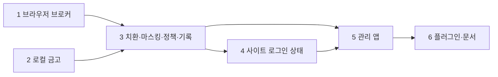
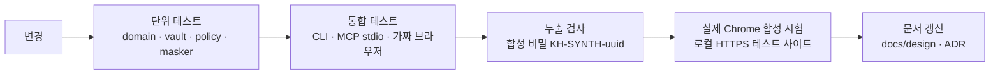

# 05. 로드맵과 검증

> 상태: Draft · 2026-10-28 · 양식: 기술 리포트의 *Evaluation* 절. 각 단계는 **범위 → 완료 조건 → 검증 방법**으로 쓴다.

## 5.1 단계 개요

```mermaid
gantt
  title KeyHarbor 구현 단계 (순서만 표시, 일정 아님)
  dateFormat X
  axisFormat %s
  section 기반
  1 브라우저 브로커        :p1, 0, 1
  2 로컬 금고              :p2, after p1, 1
  section 보호
  3 치환 · 마스킹 · 정책 · 기록 :p3, after p2, 1
  4 사이트 로그인 상태      :p4, after p3, 1
  section 사용자
  5 관리 앱 (인증 none)     :p5, after p4, 1
  6 플러그인 · 문서 정리     :p6, after p5, 1
```

1과 2는 서로 독립적이라 병렬로 진행할 수 있다. 3은 둘 다 필요하다.

## 5.2 단계별 범위와 완료 조건

### 1단계 — 브라우저 브로커

| 범위 | 완료 조건 |
|---|---|
| 프로토타입 세션 수명(lease·generation·감독자·잠금·복구·인계)을 `rebuild/`로 이식 | 기존 `tests/session_lifecycle.rs`, `sqlite_contention.rs`, `mcp_stdio.rs`, `mcp_scope.rs`의 시나리오가 재구현에서 통과 |
| Chrome `--remote-debugging-pipe` 실행, 감독자의 CDP 클라이언트 | 포트 없이 navigate·snapshot 성공 |
| 감독자 제어 socket | MCP → 감독자 명령 왕복, 감독자 소실 시 명확한 오류 |
| 브라우저 조작 MCP 도구 11종 ([02 §2.9](02-system-architecture.md#29-mcp-도구-표면)) | 로컬 테스트 페이지에서 각 도구 동작 |
| raw CDP 선택 기능 유지 | `--allow-cdp` + `cdp: true` 세션만 endpoint 반환 |
| Keychain 접근 확인창 실험 ([03 §3.4](03-security-whitepaper.md#34-금고-키-보관-macos-keychain)) | 재빌드 후에도 에이전트 경로에서 창이 뜨지 않는 방법 확정 |

### 2단계 — 로컬 금고 ✅ 구현됨 (2026-10-28, 브랜치 `feat/phase2-local-vault`)

테스트: `keyharbor-vault`(record·meta·keystore·KAT), `keyharbor-sqlite::vault_repo`, `keyharbor-core`(init·open·schema·tamper·동시 추가·누출·rotate·dotenv·transfer), `keyharbor` CLI `tests/vault_cli.rs`(누출 스캔 `no_command_prints_plaintext` 포함). 실제 Keychain 수동 확인은 사용자 확인 대기.

| 범위 | 완료 조건 |
|---|---|
| `kh-vault`: 레코드 v1 seal/open, Keychain 어댑터 | 왕복 테스트, AD 바꿔치기 시 실패, 잘못된 key_id 시 실패 |
| 항목 종류 6가지(`login`·`secret`·`env`·`card`·`identity`·`address`, 모든 종류에 `note` 필드) | 종류별 스키마 검증, 모든 필드 암호화. 사용자 정의 필드는 `env`에서만 (나머지는 이후 단계) |
| `vault init / add / list / edit / rm`, `vault import-env` | CLI에는 평문 출력 명령이 없다 ([03 §3.12](03-security-whitepaper.md#312-열린-질문--셸을-가진-에이전트와-cli-평문-경로) A안) |
| 데이터 이전 | 프로토타입 데이터는 **이전하지 않는다**. 재구현은 새 데이터 경로에서 시작 [설계자 판단] |
| `vault export / import` (age 형식, [07 §7.7](07-cryptography-design.md#77-내보내기가져오기-age-형식)) | 다른 데이터 디렉터리로 가져오기 성공, 틀린 비밀번호 실패, `age -d`로 열림 |
| `vault rotate-root` · `vault rotate-domain <domain>` | 중간 중단(프로세스 kill) 후 전부 읽힘 ([07 §7.8](07-cryptography-design.md#78-키-수명-주기)) |
| 키 부재 시 동작 | Keychain 항목을 지운 뒤 실행하면 새 키를 만들지 않고 오류 |

### 3단계 — 치환·마스킹·정책·기록

| 범위 | 완료 조건 |
|---|---|
| placeholder 파서 | 잘못된 형식·없는 항목·없는 필드는 거부, 이스케이프 규칙 정의 |
| `browser_fill`/`browser_type` 치환 | 로컬 HTTPS 테스트 사이트 로그인 성공 |
| frame origin 확인 | 교차 출처 iframe, 다른 포트, 서브도메인 입력 거부 |
| 응답 마스킹 | 금고 값이 페이지 텍스트·속성·URL에 있을 때 placeholder로 치환 |
| 정책 저장·판정 | [02 §2.8](02-system-architecture.md#28-정책-판정) 흐름도의 모든 분기 단위 테스트 |
| 사용 기록 | 이벤트 종류별 기록, 기록 끄기 설정. 끄면 거부·경고를 포함해 **모두** 기록하지 않음(P2) [설계자 판단] |
| `keyharbor run --env` / `--env-file` | 자식 프로세스에 변수 주입, stdout·stderr 마스킹, 종료 코드 전달, 정책 거부 시 실행하지 않음 |
| 카드 입력 | 결제사 iframe을 흉내 낸 교차 origin 테스트 페이지에서 등록된 origin만 입력 |
| 등록 경로 ([08](08-registration-flows.md)) | `vault_generate`·`vault_put`·로그인 포착이 draft를 만들고, `logged_in` 기록으로 확정. 기존 항목 덮어쓰기 거부 |
| 메타데이터 MAC ([07 §7.6.3](07-cryptography-design.md#763-메타데이터-mac)) | DB에서 origin 목록을 바꾸면 입력 거부 |

### 4단계 — 사이트 로그인 상태

| 범위 | 완료 조건 |
|---|---|
| `SITE_STATE` 테이블, `site_state_get/set` | 세션·origin별 왕복, 잘못된 origin 거부 |
| `session_account` 대체 | 기존 도구 제거와 README 이전 안내 |

### 5단계 — 관리 앱

| 범위 | 완료 조건 |
|---|---|
| Tauri 앱 골격 | `kh-core` 직접 호출, 네트워크 listener 없음 확인 |
| 금고·세션·정책·기록·설정 화면 | 각 화면의 CRUD, 평문 보기, 비밀번호 생성 |
| 인증 trait + `NoneAuth` | 설정 화면에 현재 방식과 안내 문구 |
| 대기 중인 인계 재개 | CLI `resume`과 같은 조건 |
| 보안 입력 창 · `vault_request`/`vault_wait` | 요청 → 창 → 저장 → placeholder 반환, 거절 경로 |
| 메뉴 막대 · 알림 · 명령 팔레트 | [09 §9.8](09-app-ux.md#98-전체-동작-목록)의 동작 목록을 체크리스트로 사용 |
| 클립보드 | ConcealedType 표시, 30초 자동 지우기 |

### 6단계 — 플러그인·문서

| 범위 | 완료 조건 |
|---|---|
| Claude Code 플러그인 (`.mcp.json` + 사용법 skill) | 임시 설정에서 `Connected`, 도구 발견 |
| README·이 문서 세트 갱신 | 구현된 것과 문서의 차이 없음 |

## 5.3 검증 게이트 (모든 단계 공통)

### 누출 검사 (반목표 자동화)

각 테스트 실행마다 무작위 합성 비밀 `KH-SYNTH-<uuid>`를 금고에 넣고, 다음 채널 **전부**에서 그 문자열(원문·percent-encoding·base64)이 나오지 않는지 확인한다.

| 채널 | 방법 |
|---|---|
| MCP 응답 | stdio 전사 전체 |
| CLI stdout/stderr | 모든 명령 |
| SQLite | DB·WAL 파일 바이트 스캔 |
| 로그 | `tracing` 출력 |
| 오류 메시지 | 실패 경로 테스트 |
| 내보내기 파일 | 바이트 스캔 (암호문이어야 함) |
| `keyharbor run` 출력 | 자식 프로세스가 변수를 그대로 출력해도 마스킹되는지 |

합성 비밀은 종류마다 하나씩 만든다. 카드번호는 Luhn 검사를 통과하는 테스트 번호(예: `4242 4242 4242 4242` 형식)에 무작위 접미사를 붙여 공백·하이픈 변형까지 검사한다.

예외: 관리 앱의 `reveal` 결과와 브라우저 페이지 내부(입력 대상).

## 5.4 측정하지 않은 것

- 성능(동시 세션 수, 마스킹 처리량) 목표치는 정하지 않았다. 3단계 후 측정해 이 절에 기록한다.
- 실제 서비스(GitHub 등) 로그인은 테스트 계정으로만, 자동화 테스트에는 넣지 않는다.
