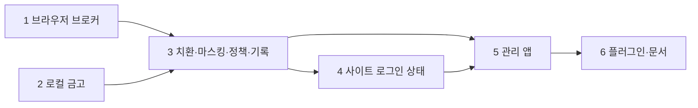
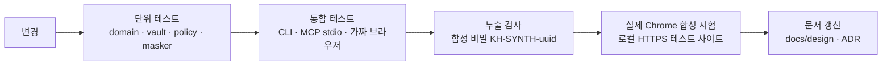

# 05. 로드맵과 검증

> 상태: Draft · 2026-10-28 · 양식: 기술 리포트의 *Evaluation* 절. 각 단계는 **범위 → 완료 조건 → 검증 방법**으로 쓴다.

## 5.1 단계 개요

```mermaid
gantt
  title KeyHarbor 구현 단계 (순서만 표시, 일정 아님)
  dateFormat X
  axisFormat %s
  section 기반
  1 브라우저 브로커        :p1, 0, 1
  2 로컬 금고              :p2, after p1, 1
  section 보호
  3 치환 · 마스킹 · 정책 · 기록 :p3, after p2, 1
  4 사이트 로그인 상태      :p4, after p3, 1
  section 사용자
  5 관리 앱 (인증 none)     :p5, after p4, 1
  6 플러그인 · 문서 정리     :p6, after p5, 1
```

1과 2는 서로 독립적이라 병렬로 진행할 수 있다. 3은 둘 다 필요하다.

## 5.2 단계별 범위와 완료 조건

### 1단계 — 브라우저 브로커 ✅ 구현됨 (2026-10-28, 브랜치 `feat/phase1-browser-broker`)

테스트: `keyharbor-sqlite::session_repo`(인계 요청·대체·재개·취소, 동시 요청, `force_stopped` 펜싱), `keyharbor-broker`(`cdp` 가짜 파이프 직렬화·순서 섞인 응답·이벤트·타임아웃, 접근성 트리 렌더링), `keyharbor` CLI `tests/session_cli.rs`(가짜 브라우저: 이중 `open`, 감독자 `kill -9` 뒤 `recovery_required`·복구, 브라우저 자체 종료, 인계, 프로필 symlink, `endpoint`), `tests/browser_chrome.rs`(실제 Chrome: 조작 11종·실패 응답 뒤 `status`, raw CDP), `tests/mcp_stdio.rs`·`tests/mcp_scope.rs`(도구 목록, 인계 대기, 범위 거부, `vault_list`에 값 없음, 실제 Chrome 왕복). 실제 Chrome 테스트는 `KEYHARBOR_TEST_CHROME`이 있을 때만 돈다.

| 범위 | 완료 조건 |
|---|---|
| 프로토타입 세션 수명(lease·generation·감독자·잠금·복구·인계)을 재구현 워크스페이스(`crates/`)로 이식 | 프로토타입 `prototype/tests/session_lifecycle.rs`, `sqlite_contention.rs`, `mcp_stdio.rs`, `mcp_scope.rs`의 시나리오가 재구현에서 통과 ✅ |
| Chrome `--remote-debugging-pipe` 실행, 감독자의 CDP 클라이언트 | 포트 없이 navigate·snapshot 성공 ✅ |
| 감독자 제어 socket | MCP → 감독자 명령 왕복, 감독자 소실 시 명확한 오류 ✅ (`supervisor is not running`) |
| 브라우저 조작 MCP 도구 11종 ([02 §2.9](02-system-architecture.md#29-mcp-도구-표면)) | 로컬 테스트 페이지에서 각 도구 동작 ✅ |
| raw CDP 선택 기능 유지 | `--allow-cdp` + `cdp: true` 세션만 endpoint 반환 ✅ |
| Keychain 접근 확인창 실험 ([03 §3.4](03-security-whitepaper.md#34-금고-키-보관-macos-keychain)) | 재빌드 후에도 에이전트 경로에서 창이 뜨지 않는 방법 확정 — **미완**: 1단계 MCP 도구는 Keychain을 읽지 않는다(`vault_list`는 SQLite 메타데이터만). 실험은 Keychain을 쓰는 3단계 치환과 함께 한다 |

구현하며 정한 것:

- 잠금 파일(`run/<id>.lock`)은 감독자가 끝나도 지우지 않는다. 지우면 기존 잠금을 쥔 프로세스와 새 파일을 잠근 프로세스가 동시에 소유자가 될 수 있다. socket은 지운다.
- 인계 요청은 요청마다 행을 남긴다(`pending`·`resumed`·`superseded`·`cancelled`). `awaiting_user`에서 다시 `wait-auth`하면 이전 대기 요청은 `superseded`가 되고, 세션이 멈추거나 복구되면 대기 요청은 `cancelled`가 된다. `session_wait_for_resume`은 `resumed`이고 세션이 지금 `running`일 때만 성공한다.
- `recover`는 generation을 지운다(이전 실행의 모든 조건부 쓰기가 실패한다). `failed`도 같은 명령으로 되돌린다.
- `browser_navigate`는 http(s)와 `about:blank`만 받는다. `open --url`은 프로토타입 규칙(HTTPS 또는 localhost HTTP, query·fragment 없음)을 유지한다. 명령행 인자는 `ps`에 보이기 때문이다.
- macOS Chrome은 창을 다 닫아도 프로세스가 남으므로, 감독자는 마지막 탭이 닫히면 브라우저를 닫는다.

### 2단계 — 로컬 금고 ✅ 구현됨 (2026-10-28, 브랜치 `feat/phase2-local-vault`)

테스트: `keyharbor-vault`(record·meta·KAT), `keyharbor-keystore`(파일 저장소 규칙), `keyharbor-sqlite::vault_repo`, `keyharbor-core`(init·open·schema·tamper·동시 추가·누출·rotate·dotenv·transfer), `keyharbor` CLI `tests/vault_cli.rs`(누출 스캔 `no_command_prints_plaintext` 포함). 실제 Keychain 수동 확인은 사용자 확인 대기.

| 범위 | 완료 조건 |
|---|---|
| `kh-vault`: 레코드 v1 seal/open, Keychain 어댑터 | 왕복 테스트, AD 바꿔치기 시 실패, 잘못된 key_id 시 실패 |
| 항목 종류 6가지(`login`·`secret`·`env`·`card`·`identity`·`address`, 모든 종류에 `note` 필드) | 종류별 스키마 검증, 모든 필드 암호화. 사용자 정의 필드는 `env`에서만 (나머지는 이후 단계) |
| `vault init / add / list / edit / rm`, `vault import-env` | CLI에는 평문 출력 명령이 없다 ([03 §3.12](03-security-whitepaper.md#312-열린-질문--셸을-가진-에이전트와-cli-평문-경로) A안) |
| 데이터 이전 | 프로토타입 데이터는 **이전하지 않는다**. 재구현은 새 데이터 경로에서 시작 [설계자 판단] |
| `vault export / import` (age 형식, [07 §7.7](07-cryptography-design.md#77-내보내기가져오기-age-형식)) | 다른 데이터 디렉터리로 가져오기 성공, 틀린 비밀번호 실패, `age -d`로 열림 |
| `vault rotate-root` · `vault rotate-domain <domain>` | 중간 중단(프로세스 kill) 후 전부 읽힘 ([07 §7.8](07-cryptography-design.md#78-키-수명-주기)) |
| 키 부재 시 동작 | Keychain 항목을 지운 뒤 실행하면 새 키를 만들지 않고 오류 |

### 3단계 — 치환·마스킹·정책·기록 ✅ 구현됨 (2026-10-28, 브랜치 `feat/phase3-substitution-masking`)

테스트: `keyharbor-domain`(정책 규칙 검증, 사용 기록 종류), `keyharbor-core`(`policy::decide` 전 분기, `mask` 겹침·변형·짧은 값·카드 형식·JSON·바이트, `Vault::masker`, `item_use`, `fill_template`), `keyharbor-sqlite`(정책 upsert, 기록·꺼짐·`audit` 스키마에 값 컬럼 없음), `keyharbor` CLI `tests/policy_cli.rs`, `tests/audit_cli.rs`(금고·정책·세션 이벤트, 기록 끄기), `tests/run_cli.rs`(자식 출력 마스킹·종료 코드·`RLIMIT_CORE`·거부 시 미실행), `tests/substitution_chrome.rs`(실제 Chrome: 허용 입력, 피싱 origin, 교차 출처 iframe, 정책·없는 항목, 페이지에 다시 보이는 값·카드 번호 공백 형식·URL의 percent-encoding 마스킹, 금고 변경 반영), `tests/mcp_stdio.rs`(세션 도구 정책, MCP로 치환·마스킹 왕복).

| 범위 | 완료 조건 |
|---|---|
| placeholder 파서 | 잘못된 형식·없는 항목·없는 필드는 거부 ✅. 이스케이프는 두지 않는다: `{{secret:`는 항상 참조의 시작이다 |
| `browser_fill`/`browser_type` 치환 | 로컬 테스트 사이트 로그인 성공 ✅ (localhost HTTP. HTTPS 테스트 사이트는 쓰지 않았다) |
| frame origin 확인 | 교차 출처 iframe·다른 포트 입력 거부 ✅. 서브도메인은 정확 일치 규칙(`Origin` 단위 테스트)으로 다룬다 |
| 응답 마스킹 | 금고 값이 페이지 텍스트·입력 값·URL에 있을 때 placeholder로 치환 ✅. 오류 메시지도 같은 마스커를 거친다 |
| 정책 저장·판정 | [02 §2.8](02-system-architecture.md#28-정책-판정)의 모든 분기 단위 테스트 ✅ |
| 사용 기록 | 이벤트 종류별 기록, 기록 끄기 ✅. 끄면 거부·경고를 포함해 아무것도 기록하지 않는다 |
| `keyharbor run --env` / `--env-file` | 주입, stdout·stderr 마스킹, 종료 코드 전달, 정책 거부 시 실행 안 함 ✅ |
| 카드 입력 | 같은 프로세스의 교차 출처 iframe에서 등록된 origin만 입력 ✅. **다른 사이트 iframe(OOPIF, 예: 실제 결제사 도메인)은 미완**: 그 iframe은 별도 CDP target이라 snapshot·ref가 닿지 않는다 |
| 등록 경로 ([08](08-registration-flows.md)) | **미완**: 이번 계획 범위 밖. `vault_generate`·`vault_put`·로그인 포착은 이후 단계에서 |
| 메타데이터 MAC ([07 §7.6.3](07-cryptography-design.md#763-메타데이터-mac)) | DB에서 origin 목록을 바꾸면 입력 거부 ✅ (`denied: <item> (tampered)`) |
| Keychain 접근 확인창 실험 (1단계에서 이월) | **미완**: 자동화 테스트는 파일 키 저장소를 쓴다. 실제 Keychain으로 감독자의 첫 치환·마스킹 때 창이 뜨는지는 사람이 확인해야 한다 |

구현하며 정한 것 ([06 §6.3](06-requirements-log.md#63-설계자-판단-목록) J-34–J-42):

- 감독자는 금고를 첫 치환이나 첫 응답 마스킹 때 연다. `vault_version`이 바뀌면 금고를 다시 열고 마스커를 다시 만든다(키 교체 뒤에도 맞는 키를 쓴다). 금고가 없으면 아무것도 가리지 않고, 값을 읽지 못하면 응답을 보내지 않는다.
- 입력할 frame은 포커스가 있는 요소로 판정한다. 각 frame의 격리 world에서 `document.activeElement`를 읽어 페이지 스크립트가 결과를 바꿀 수 없게 한다.
- 거부 응답은 `denied: <항목> (<이유>)` 하나다. 이유: `policy`, `origin`, `not_found`, `tampered`, `discarded`, `focus`, `frame`, `vault`.
- `keyharbor run`은 origin 바인딩이 켜진 항목을 주입하지 않는다.
- MCP의 세션 도구는 `OpenSession`·`CreateSession`·`RawCdp`를, 감독자는 `UseItem`을 판정한다. 에이전트 이름은 MCP가 제어 요청에 붙이고, 없으면 `cli`다.

### 3단계 보강 — 독립 보안 검토 대응 ✅ 구현됨 (2026-10-29, 브랜치 `feat/phase3-hardening`)

계획: [`docs/superpowers/plans/2026-10-29-phase3-hardening.md`](../superpowers/plans/2026-10-29-phase3-hardening.md). 테스트: `tests/hardening_chrome.rs`(실제 Chrome: 편집 후 재조회·password 칸, shadow root·`<object>` 우회, 마스커 추측·JSON 이스케이프, selector 오라클, 탐색 TOCTOU, API 키 origin, `browser_login`), `tests/weaken_cli.rs`(약화 작업 거부·확인, `run_allowed`, developer 도메인), `tests/expiry_cli.rs`, `tests/description_cli.rs`, guard 단위 테스트(검사 체인·잠금·탐색·거부 상한·로그인), crypto KAT.

| 항목 | 완료 조건 |
|---|---|
| C1 편집 후 재조회 | 치환받은 요소는 세션 동안 `[redacted]`, password는 password 칸에만 ✅ |
| C2 shadow DOM·object | 포커스를 shadow root·frame host 끝까지 추적, 입력 뒤 포커스 변경 시 세션 잠금 ✅ |
| C3 셸 에이전트 (R-35) | `run_allowed`, 약화 작업 터미널 확인 ✅ (약한 경계, 03 §3.1) |
| I1–I5 | 값이 든 요청 거부·잠금, JSON 이스케이프·form-urlencoded 변형, selector 문법, 탐색 정착 ✅ |
| Minor | `*` 에이전트 거부, `RLIMIT_CORE=0`, 거부 기록 상한 ✅ |
| R-36–R-40 | 안전한 기본값, 만료, 설명, `browser_login`, developer 도메인 ✅ |
| 구조 | `keyharbor-crypto`(ADR-0016), 검사 체인·`DenialReason`·마스킹 변형 레지스트리·`Confirm` 포트 ✅ |
| 남은 것 | 저엔트로피 값의 추측(세션당 세 번), 늦게 오는 탐색 이벤트, 페이지가 옮긴 편집 값, 스크린샷 — 03 §3.11 |

### 4단계 — 사이트 로그인 상태

| 범위 | 완료 조건 |
|---|---|
| `SITE_STATE` 테이블, `site_state_get/set` | 세션·origin별 왕복, 잘못된 origin 거부 ✅ (`tests/site_state.rs`) |
| `session_account` 대체 | 기존 도구 제거와 README 이전 안내 |
| `vault_generate`·`vault_put` | draft로만 저장, 같은 이름은 `~draft-N`, 응답에 값 없음, draft를 placeholder로 바로 입력 ✅ (`tests/vault_drafts.rs`) |
| `vault_request`·`vault_wait`, CLI `vault requests/fulfill/decline` | 시간이 다 된 대기는 요청을 남기고, 거절은 `declined`, 답에는 값이 없다 ✅ (`tests/vault_requests.rs`) |
| draft 확정·폐기·정리 | 생성 draft는 `logged_in`에서 확정, 에이전트가 put한 draft는 확정되지 않음, 번호 draft 확정은 원래 항목 대체, `prune-drafts`와 `draft_ttl` ✅ (`tests/vault_drafts.rs`) |
| 로그인 포착 | 인계 중 사람이 친 비밀번호만 draft로 저장(에이전트가 친 값은 아님), 인계 중 에이전트 입력 거절, 기존 값 유지, 로그인 성공 시 확정 ✅ (`tests/capture_chrome.rs`) |

### 5단계 — 관리 앱

| 범위 | 완료 조건 |
|---|---|
| Tauri 앱 골격 | `kh-core` 직접 호출, 네트워크 listener 없음 확인 |
| 금고·세션·정책·기록·설정 화면 | 각 화면의 CRUD, 평문 보기, 비밀번호 생성 |
| 인증 trait + `NoneAuth` | 설정 화면에 현재 방식과 안내 문구 |
| 대기 중인 인계 재개 | CLI `resume`과 같은 조건 |
| 보안 입력 창 · `vault_request`/`vault_wait` | 요청 → 창 → 저장 → placeholder 반환, 거절 경로 |
| 메뉴 막대 · 알림 · 명령 팔레트 | [09 §9.8](09-app-ux.md#98-전체-동작-목록)의 동작 목록을 체크리스트로 사용 |
| 클립보드 | ConcealedType 표시, 30초 자동 지우기 |

### 6단계 — 플러그인·문서

| 범위 | 완료 조건 |
|---|---|
| Claude Code 플러그인 (`.mcp.json` + 사용법 skill) | 임시 설정에서 `Connected`, 도구 발견 |
| README·이 문서 세트 갱신 | 구현된 것과 문서의 차이 없음 |

## 5.3 검증 게이트 (모든 단계 공통)

### 누출 검사 (반목표 자동화)

각 테스트 실행마다 무작위 합성 비밀 `KH-SYNTH-<uuid>`를 금고에 넣고, 다음 채널 **전부**에서 그 문자열(원문·percent-encoding·base64)이 나오지 않는지 확인한다.

| 채널 | 방법 |
|---|---|
| MCP 응답 | stdio 전사 전체 |
| CLI stdout/stderr | 모든 명령 |
| SQLite | DB·WAL 파일 바이트 스캔 |
| 로그 | `tracing` 출력 |
| 오류 메시지 | 실패 경로 테스트 |
| 내보내기 파일 | 바이트 스캔 (암호문이어야 함) |
| `keyharbor run` 출력 | 자식 프로세스가 변수를 그대로 출력해도 마스킹되는지 |

합성 비밀은 종류마다 하나씩 만든다. 카드번호는 Luhn 검사를 통과하는 테스트 번호(예: `4242 4242 4242 4242` 형식)에 무작위 접미사를 붙여 공백·하이픈 변형까지 검사한다.

예외: 관리 앱의 `reveal` 결과와 브라우저 페이지 내부(입력 대상).

## 5.4 측정하지 않은 것

- 성능(동시 세션 수, 마스킹 처리량) 목표치는 정하지 않았다. 3단계 후 측정해 이 절에 기록한다.
- 실제 서비스(GitHub 등) 로그인은 테스트 계정으로만, 자동화 테스트에는 넣지 않는다.
