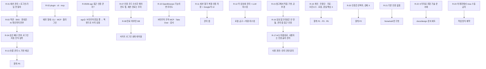

# 06. 요구사항·결정 기록

> 상태: 살아 있는 문서 · 2026-10-28 시작 · 양식: Requirements Traceability Matrix
>
> 사용자가 말한 요구를 **시간순 원문**으로 남기고, 그 요구가 어떤 결정으로 이어졌는지(또는 뒤의 요구로 대체됐는지) 추적한다. 원문은 의미가 바뀌지 않는 범위에서 오타만 고쳤다.

## 6.1 요구의 흐름

## 6.2 요구 목록

| ID | 사용자 원문 (요지) | 해석 | 상태 | 반영 위치 |
|---|---|---|---|---|
| R-01 | "세션 관리 및 로그인 / 회원가입 전 모든 절차를 가능하게 하게끔 하고 싶어" | 외부 사이트 가입·로그인 흐름 지원 | R-13으로 **재정의** | 01 §1.5 |
| R-02 | "plugin, cli, mcp 프로젝트야" | 배포 형태 세 가지 | **반영** | 01 G9, 02 §2.10 |
| R-03 | "약관동의나 sns, 휴대폰 인증, AI 인지 확인 등의 전단계를 전부 수행하도록" | 가입 단계 전체 자동화 | R-13으로 **재정의**. CAPTCHA 자동 우회는 **반목표** | 01 §1.6 |
| R-04 | "승인이 필요한 것 빼고 가능한 그전까지는 전부 다 하도록, 로그인도 바로 인식해서 넣고" | 자동 로그인 | 흐름은 에이전트 몫(R-13). KeyHarbor는 placeholder 입력 제공 | 02 §2.5.2 |
| R-05 | "ego 접근 가능?" | ego-browser 사용 가능 여부 | 확인함 (v2.1.0 설치, task space 생성·종료 성공) | — |
| R-06 | "ego에서 이렇게 웹 서비스 별 인증 관리가 돼?" | ego의 인증 관리 기능 | 없음 → KeyHarbor의 역할로 확인 | 04 A4 |
| R-07 | "이메일 sms totp 수신은 알아서 하도록 하고 웹 세션관리 및 만료를 우리 서비스에서 처리할 수 있지?" | 인증 코드 수신은 범위 밖, 세션·만료는 범위 안 | **반영** | 01 §1.5 |
| R-08 | "안되는건 빼고 만료되었는지 여부만 db에 저장하면 되지" | 쿠키 추적·주기 확인 제외, 상태만 저장 | **반영** | 02 §2.7 `SITE_STATE` |
| R-09 | "cdp를 관리하는 다른 프로젝트 있어?" | 선행 사례 조사 | 조사함 | 04 |
| R-10 | "OpenBrowser 이 되는 기능이면 우리도 해야지" | 기능 동등성 | **부분 반영**: lease·조작 도구·Take Over·감사. 프록시·위장은 **반목표**, 원격 API·복제본은 **비목표** | 02 §2.9, [ADR-0007](adr/0007-excluded-capabilities.md) |
| R-11 | "AI가 세션을 열고 복원하고 인증을 가지고 저장해서 관리하고 적절한 UI를 통해서 Google 처럼 저장소를 UI로 확인할 수 있는 서비스" | 금고 + 관리 UI | **반영** | 01 G3·G8 |
| R-12 | "궁극적인 키 관리 암호화 관리 및 LLM 보안 masking 서비스를 원해" | 키 관리·암호화·마스킹 | **반영** | 03 |
| R-13 | "흐름 관리까지 하는게 아니야 그런 걸 하기위해 필요한 기반을 제공해주는거지" | 흐름이 아닌 기반 | **원칙 P5** | 01 §1.3 |
| R-14 | "다른 오픈소스 서비스에서 그런거 하지 않나?" | 선행 사례 조사 | 조사함 | 04 |
| R-15 | "그걸 레퍼런스해서 보안관련 처리 및 암호화 방식을 직접 구현해보자! 공부도 하는 김에" | 자체 금고, 학습 목적 | **반영** | [ADR-0002](adr/0002-own-local-vault.md) |
| R-16 | "암호화 자체는 만들지 않을거야. 고민인건 이 admin app으로 적당히 소유기반 인증? 처리나 생체 인증으로 접근 권한을 관리했으면 해" | 라이브러리 사용, 관리 앱 접근 통제 | **반영** | 원칙 P7, 03 §3.10 |
| R-17 | "AI 마음대로 써야해. 대신 적절한 인증 절차를 선택해서 사용자가 해당 볼트를 관리할 수 있도록" | 에이전트 무승인 사용, 관리에만 인증 | **반영** | 03 §3.3 |
| R-18 | "솔직히 내가 만드는건 솔루션이 아니야" | — | R-19로 구체화 | — |
| R-19 | "개인이 에이전트를 권한정책에 따라 중단되지 않고 쉽게 쓸 수 있도록 하는 서비스… 분실 도난시의 책임을 도맡고 싶은게 아니야… 오픈소스, 로컬 지향… 모든걸 내 손안에서(외부 솔루션 x) 관리할 수 있도록 무료 도구" | 제품 정의 | **원칙 P1·P3·P6** | 01 §1.1 |
| R-20 | "OS나 비밀번호, 2FA 인증 등(인증 없음도 가능) 인증도 그들에게 선택지를 줄뿐 강제하고 싶지 않다" | 인증은 선택지 | **원칙 P2** | 03 §3.10 |
| R-21 | "일단 지금은 기본 인증 없음으로 구현해줬으면 해" | 기본값 `none`, 이번엔 `none`만 | **반영** | 03 §3.10, [ADR-0005](adr/0005-user-chosen-auth-default-none.md) |
| R-22 | "어떤 솔루션 알고리즘 아키텍처 기반 구조를 사용했는지 아주 자세히 시각자료를 포함해 문서화… 대기업 기술문서나 AI 솔루션 기술 리포트 참고… 말했던 내용 전부 docs에" / "어떤 기술 리포트를 참고할건지 등을 전부 결정해서" | 문서 세트와 양식 | **반영** | 이 문서 세트, [README](README.md) |
| R-23 | "이 레포에서 모아 스킬을 쓰지 않게 해" | 작업 방식 제약 | **반영** (작업자 메모리에 기록) | — |
| R-24 | "관리할건 크게 세션, .env 값으로 쓰이는 환경변수, 그리고 비밀번호, 카드번호 등등 자동완성되거나 쓸 수 있는 모든 개인 정보 저장 가능했으면 해" | 관리 대상 3분류: 세션 / env 변수 / 자동완성 가능한 개인 정보 전반 | **반영**: 항목 종류 7가지, `keyharbor run` | 01 G3·G3a, 02 §2.5.5·§2.7.1, [ADR-0010](adr/0010-env-run-injection.md) |
| R-25 | "도메인을 어떻게 쪼개서 관리할건지 고민하고 설정해줘. session, id, password 와 같은 기본정보와, 결제정보, 사용자 개인정보 정도로 분리해야 할 것 같긴 한데" | 도메인 분할 | **반영**: 세션 / 자격 증명 / 결제 / 개인정보 4도메인, 도메인 키 | 02 §2.7.1, [ADR-0011](adr/0011-domain-split.md) |
| R-26 | "무한한 가능성보다는 최대한 오픈소스와 best practice를 분석하고 암호화를 어떻게 할지 전부 고려해서 설계해봐" | 선행 사례 기반 암호 설계, 발명 최소화 | **반영**: 7개 사례 비교, 내보내기 age 채택, 메타 MAC 추가 | [07](07-cryptography-design.md), [ADR-0012](adr/0012-crypto-scheme.md) |
| R-27 | "등록하지 않은 정보를 등록할 때 어떻게 등록을 시킬지 생각해봐. 로그인 후 keychain에 등록할 수 있으면 best… form을 띄워도 되고 좋은 방법론 추천해줘" | 미등록 정보 저장 방법 | **반영**: 생성 · 포착 · 요청 · 위임 저장 + draft 후 확정 | [08](08-registration-flows.md), [ADR-0013](adr/0013-registration-draft-model.md) |
| R-28 | "그런식으로 앱설계 해서 최종적으로 app UI UX, 아이콘 설계부터 가능한 모든 동작을 계획해봐" | 관리 앱 UX 전체 | **반영**: 표면 · 정보 구조 · 와이어프레임 · 아이콘 · 토큰 · 동작 목록 | [09](09-app-ux.md) |
| R-29 | "어느 정도 구체화 됐으면 goal로 구현하고 싶" | 설계를 승인하고 구현으로 진행 | **반영**: 단계별 구현 계획 작성 시작 | `docs/superpowers/plans/` |
| R-30 | "지금 코드가 겨우 3개로 구현된거야? 제대로 기능별로 모듈화해서 구현해 보안 계층도 나누고" | 기능별 모듈화, 보안 계층 분리 | **반영**: keyharbor-guard (PDP/PEP), 기능별 모듈 | 02 §2.4, [ADR-0014](adr/0014-hexagonal-guard-layer.md) |
| R-31 | "시스템 아키텍쳐에 맞게 모듈화 해서 코드 작성해, 적합한 아키텍쳐 패턴 추천해줘" | 아키텍처 패턴 | **반영**: 헥사고날(Ports & Adapters) + Clean 의존 규칙 + PDP/PEP + GuardedBrowser 데코레이터 + PlaintextAccess capability + composition root | 02 §2.1·§2.4, [ADR-0014](adr/0014-hexagonal-guard-layer.md) |
| R-32 | "쿼리도 제대로 orm 을 쓰든 계층을 추가해서 작성해" | 영속성 계층 | **반영**: Diesel 2.3(동기 ORM) + Repository/Data Mapper + 내장 마이그레이션 | 02 §2.7.3, [ADR-0014](adr/0014-hexagonal-guard-layer.md) |
| R-33 | "스키마도 모듈화하고 확장가능하게 (도메인 혹은 적합한 패턴으로)" | 스키마의 모듈화·확장성 | **반영**: 영속성 바운디드 컨텍스트(vault·session·access·audit·config, 컨텍스트별 마이그레이션과 레지스트리) + 데이터로 정의한 항목 종류 레지스트리 `KINDS` | 02 §2.7.3·§2.7.4, [ADR-0014](adr/0014-hexagonal-guard-layer.md) |
| R-34 | "pglite 쓰는거 맞나?" → "SQLite 그대로 가자" | 저장소 엔진 | **결정**: SQLite 유지(Diesel + bundled libsqlite3-sys). PGlite는 JS/WASM 런타임과 npm이 필요하고, 연결이 하나이며, socket 서버에 SSL이 없어 제외([DB 선택](../architecture-proposal.md)). Postgres 계열이 필요해지면 `domain::ports`를 구현하는 어댑터를 더한다 | [ADR-0014](adr/0014-hexagonal-guard-layer.md) |
| R-40 | "`secret`·`env` 종류를 자격 증명 도메인에서 새 도메인으로 분리" (쓰임새가 다르다: login은 허용된 사이트 입력칸으로, secret·env는 프로세스·도구로 주입. 릴리스 전이라 지금 나눈다) | 도메인 분할 | **반영**: 다섯 번째 도메인 `developer`(byte 4, 키 `DK_dev`). login만 자격 증명에 남는다. 기존 금고는 열 때 한 번, 한 트랜잭션으로 옮긴다 | 02 §2.7.1·§2.7.2, 03 §3.3, 07 §7.5, J-54 |

## 6.3 설계자 판단 목록

사용자가 맡겼거나 아직 말하지 않은 영역에서 설계자가 정한 것. **사용자가 뒤집을 수 있다.**

| # | 판단 | 위치 |
|---|---|---|
| J-01 | 브라우저 백엔드는 직접 띄우는 Chrome (ego 미사용) | [ADR-0009](adr/0009-own-chrome-backend.md) |
| J-02 | 에이전트는 macOS 로그인 후 별도 해제 없이 금고 사용 | [ADR-0003](adr/0003-keychain-vault-key.md) |
| J-03 | 항목별 데이터 키 없이 단일 금고 키 + 필드별 AD | 03 §3.3 |
| J-04 | 항목 이름·origin은 평문, username은 암호화 | 02 §2.7 |
| J-05 | origin 바인딩 기본 켜짐, 항목별로 끌 수 있음 | 02 §2.8 |
| J-06 | 정책 기본값 "모두 허용" | 02 §2.8 |
| J-07 | 사용 기록 기본 켜짐, 끌 수 있음 | 01 G6 |
| J-08 | raw CDP는 선택 기능으로 유지 | [ADR-0004](adr/0004-supervisor-owns-cdp.md) |
| J-09 | 관리 앱은 Tauri | [ADR-0006](adr/0006-tauri-admin-app.md) |
| J-10 | `rebuild/` 워크스페이스 위에 구현 | [ADR-0008](adr/0008-build-on-rebuild-workspace.md) |
| J-11 | macOS만 지원 | 01 §1.5 |
| J-12 | origin 정확 일치, 서브도메인 와일드카드 없음 | 03 §3.8 |
| J-13 | 마스킹 변형: 원문·percent-encoding·HTML 엔티티 | 03 §3.7 |
| J-14 | 감독자 제어 채널은 세션별 Unix socket | 02 §2.3 |
| J-15 | ~~내보내기 Argon2id~~ → 내보내기는 age 형식(scrypt) | 07 §7.7 |
| J-16 | `'*'` 정책은 모든 에이전트에 적용, 더 구체적인 규칙이 이김 | 02 §2.8 |
| J-17 | 같은 세션에 여러 MCP 서버가 명령하면 감독자가 순서대로 실행 | 02 §2.6.1 |
| J-18 | 마스킹 대상은 금고 전체, 4자 미만은 제외, `vault_version`으로 갱신 | 03 §3.7 |
| J-19 | 프로토타입 데이터는 이전하지 않음 | 05 2단계 |
| J-20 | `recovery_required`는 저장하지 않는 표시값 (프로토타입과 동일) | 02 §2.6 |
| J-21 | 파일 기반 login keychain 사용, 유료 서명이 필요한 Data Protection Keychain 미사용 | 03 §3.4 |
| J-22 | 관리 앱은 같은 `keyharbor` 바이너리를 sidecar로 호출해 Keychain 접근 | 02 §2.10 |
| J-23 | 기록을 끄면 거부·경고도 기록하지 않음 | 05 3단계 |
| J-24 | `identity`·`address`는 origin 바인딩 기본 꺼짐, `login`·`card`는 켜짐 | 02 §2.7.1 |
| J-25 | `totp_seed`는 저장만, 코드 생성·입력 없음 | 02 §2.7.1 |
| J-27 | 메타 MAC 입력에 `lp(kind)`·`lp(status)`·origin 중복 제거 추가 | 07 §7.6.3 |
| J-28 | 내보내기·가져오기 비밀번호는 `--passphrase-stdin` 또는 TTY (fd 환경 변수 대신) | rebuild/README.md |
| J-29 | `note`는 비밀 필드로 취급해 `--set` 금지 | rebuild/README.md |
| J-30 | 루트 키 교체 전 모든 항목의 메타 MAC을 검증하고, 변조 항목이 있으면 교체·내보내기를 거부 | 07 §7.8 |
| J-31 | `edit`로 이름을 바꾸지 않는다 (placeholder 키) | 02 §2.7.2 |
| J-32 | 사용자 정의 필드는 2단계에서 `env`만 지원 | 05 2단계 |
| J-33 | 기본 데이터 폴더 `~/Library/Application Support/KeyHarbor`, Keychain 서비스 `io.github.leeswallow.keyharbor` (사용자 결정 B3) | 02 §2.10, 03 §3.4 |
| J-26 | CLI 평문 출력 없음 (Q-01 A안) — 사용자가 답하지 않고 구현을 요청해 추천안으로 확정 | 03 §3.12 |
| J-34 | `keyharbor run`은 origin 바인딩이 켜진 항목(login·card 기본)을 주입하지 않는다(`denied: <item> (origin)`). 자식 프로세스는 값을 어디로든 보낼 수 있어 바인딩이 무의미해지기 때문 | rebuild/README.md, 05 3단계 |
| J-35 | 치환 입력의 origin은 **포커스가 있는 요소의 frame**으로 판정한다. `document.activeElement`를 frame마다 격리 world에서 따라 내려가고, `fill`은 그 요소가 대상과 같은지도 확인한다. 값 비우기(페이지 코드 실행) 뒤 다시 확인한다 | 03 §3.8 |
| J-36 | 마스킹에 쓸 값을 읽지 못하면(키 없음·복호화 실패) 응답을 보내지 않고 `response withheld` 오류를 낸다(fail closed). 금고가 없으면 마스킹 없이 통과 | 03 §3.7 |
| J-37 | 계획의 `Vault::all_values_for_masking` 대신 `Vault::masker()`가 `Masker`만 돌려준다. 값 목록이 crate 밖으로 나가지 않는 가장 좁은 노출 | 02 §2.4 |
| J-38 | 에이전트 이름: `mcp --agent`가 없으면 `mcp`, CLI와 제어 socket 직접 호출은 `cli`. `*`는 규칙 전용이라 에이전트 이름으로 쓸 수 없다 | 02 §2.8 |
| J-39 | 정책 우선순위는 사전식: 먼저 에이전트 규칙 > `*` 규칙, 그다음 항목 > 도메인 > `*`. 에이전트 규칙은 대상이 덜 구체적이어도 `*` 규칙을 이긴다 (J-16의 해석) | 02 §2.8 |
| J-40 | 사용 기록은 동작이 끝난 뒤 최선 노력으로 쓴다(기록 실패가 이미 한 변경을 되돌리지 않는다). 거부는 거부 응답 전에 기록한다 | 02 §2.7 |
| J-41 | `discarded` 항목은 입력·주입을 거부한다. `draft`는 쓸 수 있다(등록 흐름에서 로그인 시도용) | 08 |
| J-42 | snapshot은 같은 렌더러 프로세스의 iframe 트리를 `[frame] "<origin>"` 아래에 붙여 ref로 쓸 수 있게 한다. 다른 사이트 iframe(OOPIF)은 아직 다루지 않는다 | 02 §2.5.2 |
| J-43 | 포트는 `anyhow::Result`를 돌려준다. `KeyStore` 포트를 domain으로 옮기면서 `SecretKey`·`VaultError`도 domain(`secret`)으로 옮기고 vault가 같은 경로로 다시 내보낸다. domain은 `anyhow`·`serde_json`·`zeroize`·`getrandom`에 의존한다(I/O 없음) | 02 §2.4 |
| J-44 | 계획의 `FrameInspector::focused_frame_origin` 하나 대신 `FrameInspector { focus, frame_origin }`과 `PageInput { page, focus_element, clear_element, insert_text }`로 나눈다. 기존 검사 순서(포커스 확인 → 정책 → 비우기 → 포커스 재확인 → 입력 → origin 재확인)를 그대로 지키려면 단계 사이에 끼어들어야 하기 때문. `prepare_text`는 이미 판정한 frame origin을 받는다. `status`는 브라우저가 아니라 세션 저장소 조회라 `BrowserPort`에 넣지 않았다 | 02 §2.4.1 |
| J-45 | `GuardedBrowser`는 요청마다 `Guard::browser(&mut raw, agent)`로 만드는 짧은 수명의 데코레이터다. 마스킹은 결과·오류마다 정확히 한 번(두 번 가리면 placeholder 안의 항목 이름이 다시 가려질 수 있다). 브라우저에 가지 않는 요청(`status`, 잘못된 요청)은 `ops`가 같은 `Guard`로 가린다 | 02 §2.4.1 |
| J-46 | `PlaintextAccess`는 core에 두고 생성자는 `#[doc(hidden)] pub fn issue()`. 호출 위치는 check-layers가 guard·`core/src/transfer.rs`(사용자 요청 age 내보내기)·테스트로 제한. 계획의 "마스킹 값 목록"은 `Vault::mask_values`로 두고, 목록은 guard의 `masker()` 밖으로 나가지 않는다(J-37 유지). core 테스트는 `TestVault` 래퍼로 단언을 그대로 둔다 | 02 §2.4.1 |
| J-47 | broker는 core에 의존할 수 없으므로 세션 유스케이스 전체(open·stop·wait_auth·handoff·resume·recover·endpoint)를 `core::session`으로 옮기고, 프로세스·잠금·socket·`DevToolsActivePort`는 새 포트 `SessionRuntime`(broker `ProcessRuntime`) 뒤에 둔다. 감독자는 `StoreFactory`와 금고 opener를 인터페이스에게서 받는다. 계획에서는 5단계에 하던 일이지만 4단계 커밋에 넣었다. 저장소는 호출자가 먼저 열므로, DB를 열 수 없을 때는 URL 검사보다 그 오류가 먼저 나온다 | 02 §2.4.2 |
| J-48 | Diesel 저장소는 `RefCell<SqliteConnection>` 하나(스레드마다 store를 연다, 이전과 같음). 쓰기·마이그레이션은 `immediate_transaction`. 사용 기록은 한 IMMEDIATE 트랜잭션에서 `audit_enabled`를 읽고 `strftime` SQL 함수(`define_sql_function!`)로 삽입한다(이전의 `INSERT … SELECT … WHERE`와 같은 결과). 데이터 경로는 UTF-8이어야 한다(Diesel 연결 문자열) | 02 §2.7.3 |
| J-49 | 영속성 컨텍스트는 다섯 개(vault·session·access·audit·config). 다른 컨텍스트의 값은 그 컨텍스트 `mod.rs`의 함수로만 읽는다(audit → `config::audit_enabled`). 마이그레이션 버전은 타임스탬프로 전역 유일 | 02 §2.7.3 |
| J-50 | KeyHarbor는 아직 릴리스 전이라 보존할 사용자 DB가 없다. 그래서 호환용 shim(열 때 `generations.cdp`를 `ALTER`로 더하던 코드)을 두지 않고 그 열을 session 초기 마이그레이션에 넣었다. 운영 코드의 원시 SQL(`sql_query`·`batch_execute`, 연결 PRAGMA 제외)은 check-layers가 막는다 | 02 §2.7.3 |
| J-51 | 항목 종류 레지스트리: `ItemKind::schema()`는 `Option<Vec<&str>>`를 돌려준다. 종류에 없는 필드 이름은 다른 종류가 비밀로 선언했으면 비밀로 본다(이전 `SECRET_FIELDS`와 같은 동작). 모든 필드가 `maskable`이고, 알 수 없는 종류의 값은 전부 가린다 | 02 §2.7.4 |
| J-52 | 다른 crate 테스트의 변조용 원시 SQL은 sqlite의 `test-support` 기능(dev-dependency로만 켬)에 둔다. `check-release-features.sh`가 릴리스 빌드에 이 기능이 없는지도 확인한다 | rebuild/README.md |
| J-53 | 로컬 사용자 에이전트 이름 `cli`(`LOCAL_AGENT`)는 broker도 쓰므로 `domain::policy`로 옮기고 core가 다시 내보낸다 | 02 §2.8 |
| J-54 | R-40 구현. (1) 요청은 `DK_dev`를 "HKDF info 라벨만 새로" 만들라고 했지만 이 설계의 도메인 키는 RK에서 유도하지 않고 CSPRNG로 만들어 KEK로 감싼다(07 §7.5). 그래서 `DK_dev`도 같은 방식(무작위 32B, `keyharbor/dk/v1` envelope, AD의 domain 바이트 = 4)이고 새 HKDF 라벨은 없다. 기존 KAT(HKDF·자격 증명 필드 레코드)는 그대로이고 developer 필드 레코드 KAT를 더했다. (2) 정책 target은 다른 도메인과 같은 문법(`--resource domain --target developer`)이다. (3) SQLite는 CHECK를 바꿀 수 없어 vault 마이그레이션 `000007`이 `domain_keys`·`vault_items`(와 자식 표)를 한 트랜잭션에서 다시 만든다. 자식 표를 먼저 옆으로 복사하고 지워 `ON DELETE CASCADE`가 아무것도 지우지 않게 한다. (4) 값 이동은 키가 필요해 SQL이 아니라 `Vault::open`이 한다: `vault.lock`을 잡고, 자기 도메인에서 MAC이 맞는 secret·env 항목만 `DK_dev`로 다시 봉인하고 다시 서명해 새 키와 함께 `add_domain` 한 트랜잭션(버전 CAS)으로 커밋한다. `DK_dev`가 있으면 이전은 끝난 것이다(멱등). 변조된 항목은 옮기지 않아 계속 tampered로 남는다 | 02 §2.7.1, 07 §7.5 |
| J-55 | 사용 검사는 guard `pdp/checks/`의 작은 검사 객체 체인이다(`trait Check`, 파일 하나에 검사 하나). 브라우저 체인 `BROWSER`(폐기 → 정책 → origin/no-origin → 필드 존재 → 필드 종류 → 포커스)와 프로세스 체인 `PROCESS`(폐기 → 정책 → 바인딩 → run 허용 → 필드 존재)를 등록 순서대로 돌리고 첫 거부가 이긴다. 항목 존재·MAC 검증은 검사가 아니라 검사가 읽는 `ItemUse`를 만드는 단계다. 거부 사유는 domain의 `DenialReason` enum 하나이고 표시 문자열(`not_found`, `field-kind` …)은 그 enum에만 있다. 포커스 검사가 항목마다 돌므로 여러 항목을 쓴 템플릿에서는 둘째 항목의 정책보다 포커스 거부가 먼저 나올 수 있다(기존 단일 항목 결과는 같다) | 02 §2.5.2 |
| J-56 | 마스킹 변형은 `pep/mask/variants/`의 `trait Variant` 레지스트리다. 요청은 `expand(&[u8]) -> Vec<Vec<u8>>`였지만 값이 UTF-8 문자열이고 만든 형태를 지워야 하므로 `expand(&str) -> Vec<Zeroizing<String>>`로 했다. 최소 길이와 중복 제거는 레지스트리 함수 한 곳에서 한다 | 03 §3.7 |
| J-57 | 사람 확인은 domain 포트 `Confirm`(답 `Yes`/`No`/`Unavailable`)이고 CLI 어댑터 `TtyConfirm`(`cli/src/adapters/`)이 stdin·stderr가 모두 터미널일 때만 `/dev/tty`에 묻는다. 무엇이 약화인지와 그 표시는 core `weaken::WeakeningOp` 한 곳이다. 계획은 C3에서 env만 기본 run 허용이라 했지만 뒤의 R-36이 secret도 허용하라고 해 `KindSpec::default_run_allowed`를 secret·env 참으로 했다. 실행 중인 브라우저 입력의 검사 상한(탐색 대기 3 초, probe 3회, 초당 거부 기록 10건)은 설정이 아니라 고정값이다: 에이전트가 바꿀 수 있으면 안 되고, 높이면 추측에 답을 더 준다 | 03 §3.12 |
| J-58 | R-36의 "origin 목록이 있을 때만 브라우저 입력 허용"을 개발자 도메인 항목은 브라우저에서 언제나 origin에 묶인 것으로 다루는 것으로 구현했다: 목록이 비면 `no-origin`, 프레임이 목록에 없으면 `origin`. `origin_binding` 값은 `keyharbor run`(바인딩된 항목은 주입하지 않음)에만 쓰인다. identity·address의 첫 사용 origin은 access 컨텍스트 `origin_uses` 표로 판정한다(사용 기록을 끄면 기록이 남지 않아도 판정은 된다) | 03 §3.8 |
| J-59 | 암호 원시 연산을 `keyharbor-crypto`로 모은다([ADR-0016](adr/0016-crypto-crate.md)). 요청과 다른 점: (1) `KeyPurpose`에 도메인 키(`DK_cred`·`DK_pay`·`DK_personal`·`DK_dev`)를 넣지 않았다. 도메인 키는 유도하지 않고 무작위로 만들어 KEK로 감싸기 때문이다(07 §7.5). (2) 필드·도메인 키 레코드의 AD 내용과 메타 MAC 입력은 금고의 형식이라 vault에 남기고 crypto의 `envelope`·`mac`만 부른다. 그래서 KAT도 HKDF만 crypto로 옮기고(기대값 그대로) 레코드·메타 KAT는 vault에 둔다. (3) `SecretKey`·`VaultError`는 KeyStore 포트가 쓰므로 domain에 두고 crypto가 다시 내보내며, `SecretKey::generate`는 `crypto::random::key`로 옮겼다. (4) DK_dev 커밋 뒤에 했다(요청은 가능하면 먼저) | 07 §7.12 |

## 6.4 열린 질문

| # | 질문 | 위치 |
|---|---|---|
| Q-01 | ~~셸을 가진 에이전트가 CLI로 평문을 꺼내는 경로~~ → **A(없음)로 확정** (J-26) | 03 §3.12 |

## 6.5 2단계 최종 검토에서 보류한 사소한 문제

2026-10-28 브랜치 검토(별도 에이전트)의 Minor 판정. 수정하지 않았고, 이후 단계에서 판단한다.

| # | 내용 |
|---|---|
| M1 | `MacKeychain::create`가 조회 후 쓰기라 짧은 경쟁 구간이 있다 (`SecItemAdd`로 원자화 가능) |
| M2 | 실수로 넣은 위치 인자(비밀일 수 있음)를 clap이 오류 메시지에 그대로 보여 준다 |
| M3 | `--stdin` JSON의 중복 키가 마지막 값으로 조용히 덮인다 |
| M4 | 카드 명의자·유효기간, 신원 필드가 `--set`으로 들어가 `ps`에 보인다 |
| M5 | `vault edit`이 터미널에서 프롬프트를 띄우지 않는다 |
| M6 | age 가져오기가 항목 단위로 원자적이지 않다 |
| M7 | `.env`의 여러 줄 따옴표 값, BOM, `export`+탭을 받지 않는다 |
| M8 | DB에 알 수 없는 종류·출처 값이 있으면 `list` 전체가 실패한다 |
| M9 | 스택 복사본·serde 문자열 등 메모리 정리 빈틈 |
| M10 | 복호화 전에 레코드의 KEK ID를 비교하지 않는다 |
| M11 | 필드 레코드 KAT를 독립 구현으로 계산해 확인하지 않았다 |
| M12 | 항목 이름을 NFC로 정규화하지 않는다 |
| M13 | 변조 항목을 다시 서명하거나 건너뛸 방법이 없다 |
