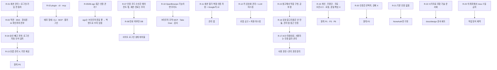

# 06. 요구사항·결정 기록

> 상태: 살아 있는 문서 · 2026-10-28 시작 · 양식: Requirements Traceability Matrix
>
> 사용자가 말한 요구를 **시간순 원문**으로 남기고, 그 요구가 어떤 결정으로 이어졌는지(또는 뒤의 요구로 대체됐는지) 추적한다. 원문은 의미가 바뀌지 않는 범위에서 오타만 고쳤다.

## 6.1 요구의 흐름

## 6.2 요구 목록

| ID | 사용자 원문 (요지) | 해석 | 상태 | 반영 위치 |
|---|---|---|---|---|
| R-01 | "세션 관리 및 로그인 / 회원가입 전 모든 절차를 가능하게 하게끔 하고 싶어" | 외부 사이트 가입·로그인 흐름 지원 | R-13으로 **재정의** | 01 §1.5 |
| R-02 | "plugin, cli, mcp 프로젝트야" | 배포 형태 세 가지 | **반영** | 01 G9, 02 §2.10 |
| R-03 | "약관동의나 sns, 휴대폰 인증, AI 인지 확인 등의 전단계를 전부 수행하도록" | 가입 단계 전체 자동화 | R-13으로 **재정의**. CAPTCHA 자동 우회는 **반목표** | 01 §1.6 |
| R-04 | "승인이 필요한 것 빼고 가능한 그전까지는 전부 다 하도록, 로그인도 바로 인식해서 넣고" | 자동 로그인 | 흐름은 에이전트 몫(R-13). KeyHarbor는 placeholder 입력 제공 | 02 §2.5.2 |
| R-05 | "ego 접근 가능?" | ego-browser 사용 가능 여부 | 확인함 (v2.1.0 설치, task space 생성·종료 성공) | — |
| R-06 | "ego에서 이렇게 웹 서비스 별 인증 관리가 돼?" | ego의 인증 관리 기능 | 없음 → KeyHarbor의 역할로 확인 | 04 A4 |
| R-07 | "이메일 sms totp 수신은 알아서 하도록 하고 웹 세션관리 및 만료를 우리 서비스에서 처리할 수 있지?" | 인증 코드 수신은 범위 밖, 세션·만료는 범위 안 | **반영** | 01 §1.5 |
| R-08 | "안되는건 빼고 만료되었는지 여부만 db에 저장하면 되지" | 쿠키 추적·주기 확인 제외, 상태만 저장 | **반영** | 02 §2.7 `SITE_STATE` |
| R-09 | "cdp를 관리하는 다른 프로젝트 있어?" | 선행 사례 조사 | 조사함 | 04 |
| R-10 | "OpenBrowser 이 되는 기능이면 우리도 해야지" | 기능 동등성 | **부분 반영**: lease·조작 도구·Take Over·감사. 프록시·위장은 **반목표**, 원격 API·복제본은 **비목표** | 02 §2.9, [ADR-0007](adr/0007-excluded-capabilities.md) |
| R-11 | "AI가 세션을 열고 복원하고 인증을 가지고 저장해서 관리하고 적절한 UI를 통해서 Google 처럼 저장소를 UI로 확인할 수 있는 서비스" | 금고 + 관리 UI | **반영** | 01 G3·G8 |
| R-12 | "궁극적인 키 관리 암호화 관리 및 LLM 보안 masking 서비스를 원해" | 키 관리·암호화·마스킹 | **반영** | 03 |
| R-13 | "흐름 관리까지 하는게 아니야 그런 걸 하기위해 필요한 기반을 제공해주는거지" | 흐름이 아닌 기반 | **원칙 P5** | 01 §1.3 |
| R-14 | "다른 오픈소스 서비스에서 그런거 하지 않나?" | 선행 사례 조사 | 조사함 | 04 |
| R-15 | "그걸 레퍼런스해서 보안관련 처리 및 암호화 방식을 직접 구현해보자! 공부도 하는 김에" | 자체 금고, 학습 목적 | **반영** | [ADR-0002](adr/0002-own-local-vault.md) |
| R-16 | "암호화 자체는 만들지 않을거야. 고민인건 이 admin app으로 적당히 소유기반 인증? 처리나 생체 인증으로 접근 권한을 관리했으면 해" | 라이브러리 사용, 관리 앱 접근 통제 | **반영** | 원칙 P7, 03 §3.10 |
| R-17 | "AI 마음대로 써야해. 대신 적절한 인증 절차를 선택해서 사용자가 해당 볼트를 관리할 수 있도록" | 에이전트 무승인 사용, 관리에만 인증 | **반영** | 03 §3.3 |
| R-18 | "솔직히 내가 만드는건 솔루션이 아니야" | — | R-19로 구체화 | — |
| R-19 | "개인이 에이전트를 권한정책에 따라 중단되지 않고 쉽게 쓸 수 있도록 하는 서비스… 분실 도난시의 책임을 도맡고 싶은게 아니야… 오픈소스, 로컬 지향… 모든걸 내 손안에서(외부 솔루션 x) 관리할 수 있도록 무료 도구" | 제품 정의 | **원칙 P1·P3·P6** | 01 §1.1 |
| R-20 | "OS나 비밀번호, 2FA 인증 등(인증 없음도 가능) 인증도 그들에게 선택지를 줄뿐 강제하고 싶지 않다" | 인증은 선택지 | **원칙 P2** | 03 §3.10 |
| R-21 | "일단 지금은 기본 인증 없음으로 구현해줬으면 해" | 기본값 `none`, 이번엔 `none`만 | **반영** | 03 §3.10, [ADR-0005](adr/0005-user-chosen-auth-default-none.md) |
| R-22 | "어떤 솔루션 알고리즘 아키텍처 기반 구조를 사용했는지 아주 자세히 시각자료를 포함해 문서화… 대기업 기술문서나 AI 솔루션 기술 리포트 참고… 말했던 내용 전부 docs에" / "어떤 기술 리포트를 참고할건지 등을 전부 결정해서" | 문서 세트와 양식 | **반영** | 이 문서 세트, [README](README.md) |
| R-23 | "이 레포에서 모아 스킬을 쓰지 않게 해" | 작업 방식 제약 | **반영** (작업자 메모리에 기록) | — |
| R-24 | "관리할건 크게 세션, .env 값으로 쓰이는 환경변수, 그리고 비밀번호, 카드번호 등등 자동완성되거나 쓸 수 있는 모든 개인 정보 저장 가능했으면 해" | 관리 대상 3분류: 세션 / env 변수 / 자동완성 가능한 개인 정보 전반 | **반영**: 항목 종류 7가지, `keyharbor run` | 01 G3·G3a, 02 §2.5.5·§2.7.1, [ADR-0010](adr/0010-env-run-injection.md) |
| R-25 | "도메인을 어떻게 쪼개서 관리할건지 고민하고 설정해줘. session, id, password 와 같은 기본정보와, 결제정보, 사용자 개인정보 정도로 분리해야 할 것 같긴 한데" | 도메인 분할 | **반영**: 세션 / 자격 증명 / 결제 / 개인정보 4도메인, 도메인 키 | 02 §2.7.1, [ADR-0011](adr/0011-domain-split.md) |
| R-26 | "무한한 가능성보다는 최대한 오픈소스와 best practice를 분석하고 암호화를 어떻게 할지 전부 고려해서 설계해봐" | 선행 사례 기반 암호 설계, 발명 최소화 | **반영**: 7개 사례 비교, 내보내기 age 채택, 메타 MAC 추가 | [07](07-cryptography-design.md), [ADR-0012](adr/0012-crypto-scheme.md) |
| R-27 | "등록하지 않은 정보를 등록할 때 어떻게 등록을 시킬지 생각해봐. 로그인 후 keychain에 등록할 수 있으면 best… form을 띄워도 되고 좋은 방법론 추천해줘" | 미등록 정보 저장 방법 | **반영**: 생성 · 포착 · 요청 · 위임 저장 + draft 후 확정 | [08](08-registration-flows.md), [ADR-0013](adr/0013-registration-draft-model.md) |
| R-28 | "그런식으로 앱설계 해서 최종적으로 app UI UX, 아이콘 설계부터 가능한 모든 동작을 계획해봐" | 관리 앱 UX 전체 | **반영**: 표면 · 정보 구조 · 와이어프레임 · 아이콘 · 토큰 · 동작 목록 | [09](09-app-ux.md) |
| R-29 | "어느 정도 구체화 됐으면 goal로 구현하고 싶" | 설계를 승인하고 구현으로 진행 | **반영**: 단계별 구현 계획 작성 시작 | `docs/superpowers/plans/` |

## 6.3 설계자 판단 목록

사용자가 맡겼거나 아직 말하지 않은 영역에서 설계자가 정한 것. **사용자가 뒤집을 수 있다.**

| # | 판단 | 위치 |
|---|---|---|
| J-01 | 브라우저 백엔드는 직접 띄우는 Chrome (ego 미사용) | [ADR-0009](adr/0009-own-chrome-backend.md) |
| J-02 | 에이전트는 macOS 로그인 후 별도 해제 없이 금고 사용 | [ADR-0003](adr/0003-keychain-vault-key.md) |
| J-03 | 항목별 데이터 키 없이 단일 금고 키 + 필드별 AD | 03 §3.3 |
| J-04 | 항목 이름·origin은 평문, username은 암호화 | 02 §2.7 |
| J-05 | origin 바인딩 기본 켜짐, 항목별로 끌 수 있음 | 02 §2.8 |
| J-06 | 정책 기본값 "모두 허용" | 02 §2.8 |
| J-07 | 사용 기록 기본 켜짐, 끌 수 있음 | 01 G6 |
| J-08 | raw CDP는 선택 기능으로 유지 | [ADR-0004](adr/0004-supervisor-owns-cdp.md) |
| J-09 | 관리 앱은 Tauri | [ADR-0006](adr/0006-tauri-admin-app.md) |
| J-10 | `rebuild/` 워크스페이스 위에 구현 | [ADR-0008](adr/0008-build-on-rebuild-workspace.md) |
| J-11 | macOS만 지원 | 01 §1.5 |
| J-12 | origin 정확 일치, 서브도메인 와일드카드 없음 | 03 §3.8 |
| J-13 | 마스킹 변형: 원문·percent-encoding·HTML 엔티티 | 03 §3.7 |
| J-14 | 감독자 제어 채널은 세션별 Unix socket | 02 §2.3 |
| J-15 | ~~내보내기 Argon2id~~ → 내보내기는 age 형식(scrypt) | 07 §7.7 |
| J-16 | `'*'` 정책은 모든 에이전트에 적용, 더 구체적인 규칙이 이김 | 02 §2.8 |
| J-17 | 같은 세션에 여러 MCP 서버가 명령하면 감독자가 순서대로 실행 | 02 §2.6.1 |
| J-18 | 마스킹 대상은 금고 전체, 4자 미만은 제외, `vault_version`으로 갱신 | 03 §3.7 |
| J-19 | 프로토타입 데이터는 이전하지 않음 | 05 2단계 |
| J-20 | `recovery_required`는 저장하지 않는 표시값 (프로토타입과 동일) | 02 §2.6 |
| J-21 | 파일 기반 login keychain 사용, 유료 서명이 필요한 Data Protection Keychain 미사용 | 03 §3.4 |
| J-22 | 관리 앱은 같은 `keyharbor` 바이너리를 sidecar로 호출해 Keychain 접근 | 02 §2.10 |
| J-23 | 기록을 끄면 거부·경고도 기록하지 않음 | 05 3단계 |
| J-24 | `identity`·`address`는 origin 바인딩 기본 꺼짐, `login`·`card`는 켜짐 | 02 §2.7.1 |
| J-25 | `totp_seed`는 저장만, 코드 생성·입력 없음 | 02 §2.7.1 |
| J-26 | CLI 평문 출력 없음 (Q-01 A안) — 사용자가 답하지 않고 구현을 요청해 추천안으로 확정 | 03 §3.12 |

## 6.4 열린 질문

| # | 질문 | 위치 |
|---|---|---|
| Q-01 | ~~셸을 가진 에이전트가 CLI로 평문을 꺼내는 경로~~ → **A(없음)로 확정** (J-26) | 03 §3.12 |
