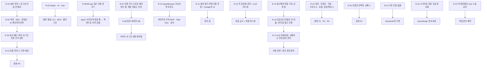

# 06. 요구사항·결정 기록

> 상태: 살아 있는 문서 · 2026-10-28 시작 · 양식: Requirements Traceability Matrix
>
> 사용자가 말한 요구를 **시간순 원문**으로 남기고, 그 요구가 어떤 결정으로 이어졌는지(또는 뒤의 요구로 대체됐는지) 추적한다. 원문은 의미가 바뀌지 않는 범위에서 오타만 고쳤다.

## 6.1 요구의 흐름

## 6.2 요구 목록

| ID | 사용자 원문 (요지) | 해석 | 상태 | 반영 위치 |
|---|---|---|---|---|
| R-01 | "세션 관리 및 로그인 / 회원가입 전 모든 절차를 가능하게 하게끔 하고 싶어" | 외부 사이트 가입·로그인 흐름 지원 | R-13으로 **재정의** | 01 §1.5 |
| R-02 | "plugin, cli, mcp 프로젝트야" | 배포 형태 세 가지 | **반영** | 01 G9, 02 §2.10 |
| R-03 | "약관동의나 sns, 휴대폰 인증, AI 인지 확인 등의 전단계를 전부 수행하도록" | 가입 단계 전체 자동화 | R-13으로 **재정의**. CAPTCHA 자동 우회는 **반목표** | 01 §1.6 |
| R-04 | "승인이 필요한 것 빼고 가능한 그전까지는 전부 다 하도록, 로그인도 바로 인식해서 넣고" | 자동 로그인 | 흐름은 에이전트 몫(R-13). KeyHarbor는 placeholder 입력 제공 | 02 §2.5.2 |
| R-05 | "ego 접근 가능?" | ego-browser 사용 가능 여부 | 확인함 (v2.1.0 설치, task space 생성·종료 성공) | — |
| R-06 | "ego에서 이렇게 웹 서비스 별 인증 관리가 돼?" | ego의 인증 관리 기능 | 없음 → KeyHarbor의 역할로 확인 | 04 A4 |
| R-07 | "이메일 sms totp 수신은 알아서 하도록 하고 웹 세션관리 및 만료를 우리 서비스에서 처리할 수 있지?" | 인증 코드 수신은 범위 밖, 세션·만료는 범위 안 | **반영** | 01 §1.5 |
| R-08 | "안되는건 빼고 만료되었는지 여부만 db에 저장하면 되지" | 쿠키 추적·주기 확인 제외, 상태만 저장 | **반영** | 02 §2.7 `SITE_STATE` |
| R-09 | "cdp를 관리하는 다른 프로젝트 있어?" | 선행 사례 조사 | 조사함 | 04 |
| R-10 | "OpenBrowser 이 되는 기능이면 우리도 해야지" | 기능 동등성 | **부분 반영**: lease·조작 도구·Take Over·감사. 프록시·위장은 **반목표**, 원격 API·복제본은 **비목표** | 02 §2.9, [ADR-0007](adr/0007-excluded-capabilities.md) |
| R-11 | "AI가 세션을 열고 복원하고 인증을 가지고 저장해서 관리하고 적절한 UI를 통해서 Google 처럼 저장소를 UI로 확인할 수 있는 서비스" | 금고 + 관리 UI | **반영** | 01 G3·G8 |
| R-12 | "궁극적인 키 관리 암호화 관리 및 LLM 보안 masking 서비스를 원해" | 키 관리·암호화·마스킹 | **반영** | 03 |
| R-13 | "흐름 관리까지 하는게 아니야 그런 걸 하기위해 필요한 기반을 제공해주는거지" | 흐름이 아닌 기반 | **원칙 P5** | 01 §1.3 |
| R-14 | "다른 오픈소스 서비스에서 그런거 하지 않나?" | 선행 사례 조사 | 조사함 | 04 |
| R-15 | "그걸 레퍼런스해서 보안관련 처리 및 암호화 방식을 직접 구현해보자! 공부도 하는 김에" | 자체 금고, 학습 목적 | **반영** | [ADR-0002](adr/0002-own-local-vault.md) |
| R-16 | "암호화 자체는 만들지 않을거야. 고민인건 이 admin app으로 적당히 소유기반 인증? 처리나 생체 인증으로 접근 권한을 관리했으면 해" | 라이브러리 사용, 관리 앱 접근 통제 | **반영** | 원칙 P7, 03 §3.10 |
| R-17 | "AI 마음대로 써야해. 대신 적절한 인증 절차를 선택해서 사용자가 해당 볼트를 관리할 수 있도록" | 에이전트 무승인 사용, 관리에만 인증 | **반영** | 03 §3.3 |
| R-18 | "솔직히 내가 만드는건 솔루션이 아니야" | — | R-19로 구체화 | — |
| R-19 | "개인이 에이전트를 권한정책에 따라 중단되지 않고 쉽게 쓸 수 있도록 하는 서비스… 분실 도난시의 책임을 도맡고 싶은게 아니야… 오픈소스, 로컬 지향… 모든걸 내 손안에서(외부 솔루션 x) 관리할 수 있도록 무료 도구" | 제품 정의 | **원칙 P1·P3·P6** | 01 §1.1 |
| R-20 | "OS나 비밀번호, 2FA 인증 등(인증 없음도 가능) 인증도 그들에게 선택지를 줄뿐 강제하고 싶지 않다" | 인증은 선택지 | **원칙 P2** | 03 §3.10 |
| R-21 | "일단 지금은 기본 인증 없음으로 구현해줬으면 해" | 기본값 `none`, 이번엔 `none`만 | **반영** | 03 §3.10, [ADR-0005](adr/0005-user-chosen-auth-default-none.md) |
| R-22 | "어떤 솔루션 알고리즘 아키텍처 기반 구조를 사용했는지 아주 자세히 시각자료를 포함해 문서화… 대기업 기술문서나 AI 솔루션 기술 리포트 참고… 말했던 내용 전부 docs에" / "어떤 기술 리포트를 참고할건지 등을 전부 결정해서" | 문서 세트와 양식 | **반영** | 이 문서 세트, [README](README.md) |
| R-23 | "이 레포에서 모아 스킬을 쓰지 않게 해" | 작업 방식 제약 | **반영** (작업자 메모리에 기록) | — |
| R-24 | "관리할건 크게 세션, .env 값으로 쓰이는 환경변수, 그리고 비밀번호, 카드번호 등등 자동완성되거나 쓸 수 있는 모든 개인 정보 저장 가능했으면 해" | 관리 대상 3분류: 세션 / env 변수 / 자동완성 가능한 개인 정보 전반 | **반영**: 항목 종류 7가지, `keyharbor run` | 01 G3·G3a, 02 §2.5.5·§2.7.1, [ADR-0010](adr/0010-env-run-injection.md) |
| R-25 | "도메인을 어떻게 쪼개서 관리할건지 고민하고 설정해줘. session, id, password 와 같은 기본정보와, 결제정보, 사용자 개인정보 정도로 분리해야 할 것 같긴 한데" | 도메인 분할 | **반영**: 세션 / 자격 증명 / 결제 / 개인정보 4도메인, 도메인 키 | 02 §2.7.1, [ADR-0011](adr/0011-domain-split.md) |
| R-26 | "무한한 가능성보다는 최대한 오픈소스와 best practice를 분석하고 암호화를 어떻게 할지 전부 고려해서 설계해봐" | 선행 사례 기반 암호 설계, 발명 최소화 | **반영**: 7개 사례 비교, 내보내기 age 채택, 메타 MAC 추가 | [07](07-cryptography-design.md), [ADR-0012](adr/0012-crypto-scheme.md) |
| R-27 | "등록하지 않은 정보를 등록할 때 어떻게 등록을 시킬지 생각해봐. 로그인 후 keychain에 등록할 수 있으면 best… form을 띄워도 되고 좋은 방법론 추천해줘" | 미등록 정보 저장 방법 | **반영**: 생성 · 포착 · 요청 · 위임 저장 + draft 후 확정 | [08](08-registration-flows.md), [ADR-0013](adr/0013-registration-draft-model.md) |
| R-28 | "그런식으로 앱설계 해서 최종적으로 app UI UX, 아이콘 설계부터 가능한 모든 동작을 계획해봐" | 관리 앱 UX 전체 | **반영**: 표면 · 정보 구조 · 와이어프레임 · 아이콘 · 토큰 · 동작 목록 | [09](09-app-ux.md) |
| R-29 | "어느 정도 구체화 됐으면 goal로 구현하고 싶" | 설계를 승인하고 구현으로 진행 | **반영**: 단계별 구현 계획 작성 시작 | `docs/superpowers/plans/` |
| R-30 | "지금 코드가 겨우 3개로 구현된거야? 제대로 기능별로 모듈화해서 구현해 보안 계층도 나누고" | 기능별 모듈화, 보안 계층 분리 | **반영**: keyharbor-guard (PDP/PEP), 기능별 모듈 | 02 §2.4, [ADR-0014](adr/0014-hexagonal-guard-layer.md) |
| R-31 | "시스템 아키텍쳐에 맞게 모듈화 해서 코드 작성해, 적합한 아키텍쳐 패턴 추천해줘" | 아키텍처 패턴 | **반영**: 헥사고날(Ports & Adapters) + Clean 의존 규칙 + PDP/PEP + GuardedBrowser 데코레이터 + PlaintextAccess capability + composition root | 02 §2.1·§2.4, [ADR-0014](adr/0014-hexagonal-guard-layer.md) |
| R-32 | "쿼리도 제대로 orm 을 쓰든 계층을 추가해서 작성해" | 영속성 계층 | **반영**: Diesel 2.3(동기 ORM) + Repository/Data Mapper + 내장 마이그레이션 | 02 §2.7.3, [ADR-0014](adr/0014-hexagonal-guard-layer.md) |
| R-33 | "스키마도 모듈화하고 확장가능하게 (도메인 혹은 적합한 패턴으로)" | 스키마의 모듈화·확장성 | **반영**: 영속성 바운디드 컨텍스트(vault·session·access·audit·config, 컨텍스트별 마이그레이션과 레지스트리) + 데이터로 정의한 항목 종류 레지스트리 `KINDS` | 02 §2.7.3·§2.7.4, [ADR-0014](adr/0014-hexagonal-guard-layer.md) |
| R-34 | "pglite 쓰는거 맞나?" → "SQLite 그대로 가자" | 저장소 엔진 | **결정**: SQLite 유지(Diesel + bundled libsqlite3-sys). PGlite는 JS/WASM 런타임과 npm이 필요하고, 연결이 하나이며, socket 서버에 SSL이 없어 제외([DB 선택](../history/architecture-proposal.md)). Postgres 계열이 필요해지면 `domain::ports`를 구현하는 어댑터를 더한다 | [ADR-0014](adr/0014-hexagonal-guard-layer.md) |
| R-35 | 독립 보안 검토 C3: 셸을 가진 에이전트가 `run`과 약화 작업으로 보호를 우회 | 셸 에이전트 경계 | **반영**: 항목 속성 `run_allowed`(메타 MAC v2에 서명), `run`은 허용 안 된 항목 거부(`run-not-allowed`). 약화 작업은 터미널의 사람 확인(약한 경계임을 명시) | 03 §3.1·§3.12.1, T13·T14, J-57, J-60 |
| R-36 | "OPENAI_KEY 같은 것도 넣을 수 있게 하는 게 목적" | 안전한 기본값 | **반영**: secret·env는 `run` 기본 허용, 브라우저 입력은 origin 목록이 있을 때 그 origin에만(`no-origin`). card는 바인딩 유지, identity·address는 어디든 되 첫 사용 origin 기록 | 03 §3.8, J-58 |
| R-37 | "적당히 만료주기까지 설정 가능하게, 기본은 무한으로" | 항목 만료 | **반영**: `expires_at`(메타 MAC 서명), `default_item_ttl`, `--expires`·`--expires-in`·`--no-expiry`. 만료 뒤 값은 남고 사용은 거부(`expired`). 연장·제거는 사람 확인 | 02 §2.7.2, J-61 |
| R-38 | 설명 필드 (에이전트가 언제 무엇을 쓸지) | 설명 | **반영**: 항목·필드(FieldSpec 기본값 + 항목별)·세션 설명, 500자. 항목·필드 설명은 메타 MAC 서명. 금고 값이 든 설명은 거부. env 항목 계층은 만들지 않는다(이름 규칙과 설명으로 구분) | J-63, J-64 |
| R-39 | `browser_login` MCP 도구 | 로그인 도구 | **반영**: username·password 칸을 찾아 기존 PEP 경로(`fill`)로 입력, 선택적 Enter | 02 §2.5.2, J-65 |
| R-40 | "`secret`·`env` 종류를 자격 증명 도메인에서 새 도메인으로 분리" (쓰임새가 다르다: login은 허용된 사이트 입력칸으로, secret·env는 프로세스·도구로 주입. 릴리스 전이라 지금 나눈다) | 도메인 분할 | **반영**: 다섯 번째 도메인 `developer`(byte 4, 키 `DK_dev`). login만 자격 증명에 남는다. 기존 금고는 열 때 한 번, 한 트랜잭션으로 옮긴다 | 02 §2.7.1·§2.7.2, 03 §3.3, 07 §7.5, J-54 |
| R-41 | "환경변수를 어떻게 쓸지(실행 스크립트나 명령어에 붙여넣을지 등)는 사용하기 나름", "python keyring이나 aws secretmanager를 확인해봐" | 개발자 비밀의 성격 | **결정**: 이름·메타·값만 아는 범용 저장소, 꺼내는 통로(환경 변수·파일·참조 치환)는 `run` 안에서만 연다. 통로 ④(실행 중 로컬 조회)는 처음에 미정이었다가 `run`이 자식에게만 여는 일회용 socket과 토큰으로 구현했다(J-122). [설계 2판](../superpowers/specs/2026-10-29-developer-secrets-design.md) |
| R-42 | "전용 프로필에서 드래그같은걸로 쓸수 있는 권한 복사 가능한 느낌으로" | 평소 브라우저의 로그인 넘기기 | **일부 반영**: Chrome·Firefox 확장(`integrations/browser-extension`)이 사이트 하나의 쿠키를 넘긴다. 받는 native host와 감독자 쪽은 4단계. [설계](../superpowers/specs/2026-10-29-site-handoff-and-grants-design.md) |
| R-43 | "해당 도메인/환경변수 안에서 수행하면 되니까" | 권한 범위 | **결정**: grant(누구에게·어디까지·언제까지) 하나로 브라우저 사이트와 개발자 비밀을 다룬다. 4단계 |
| R-44 | "rust 테스트 모듈이나 npm 써, python은 기존 패턴과 너무 안맞지 않아?" | 저장소 도구 언어 | **반영**: 디자인 검사는 dev 전용 crate `keyharbor-design-check`, 확장은 npm·TypeScript. 저장소 도구에 Python을 쓰지 않는다 |
| R-45 | "다끝나면 릴리즈하고 stickypane처럼 dmg 설치까지 제대로 구성해봐" | 배포 | **결정**: 5단계 관리 앱 뒤에 릴리스하고, 앱 번들 안에 CLI를 넣은 DMG로 설치하게 한다 |
| R-46 | "사용자가 편한 방식으로 결정해줘" (7단계와 남은 일 네 가지를 위임) | 사람용 자동 완성·저장, 릴리스, 끌어다 놓기 | **결정(위임)**: (1) 자동 완성 통로를 연다. 잠금 해제는 Touch ID(LocalAuthentication, 없으면 macOS가 로그인 암호로 대신 묻는다)이고, **채울 때마다** 한 번 묻는다 — 잠금 해제 시간을 어딘가에 저장하지 않아도 된다. (2) 저장을 넣되 확장 팝업의 [이 로그인 저장]을 누를 때만 그 탭을 읽는다(`activeTab`, 이미 있는 권한). 저장한 것은 draft이고 사람이 앱에서 확정한다. (3) v0.1.1을 지금 낸다. (4) 끌어다 놓기와 `session receive`도 넣는다. 처음에는 "팝업으로 이미 넘긴다"며 빼려 했으나 사용자가 "없는 게 사용자에게 편해?"라고 되물었다. 둘 다 편하다: `session receive`(와 같은 MCP 도구)는 에이전트가 사람이 사이트를 넘길 때까지 기다렸다 이어 가게 하고, 끌어다 놓기는 탭을 앱의 세션에 놓는 것으로 끝난다. 끌어다 놓기는 앱이 확장에 사이트를 청할 길(확장이 native host에 연결을 열어 두고, 앱은 로컬 socket으로 host에 전한다)이 필요해 자동 완성 다음에 한다. [ADR-0017](adr/0017-human-autofill-channel.md) |
| R-47 | "ego lite browser를 쓴다면 그걸 쓰고 없다면 chrome으로도 ego lite처럼 가능하도록" · "받아들일 수 있어" · "ego-browser server가 낫지 않아? 최대한 언어 최적화" · "관용어 위주의 cli 명령어" · "chrome, firefox 익스텐션 배포 방법을 찾아보고 가능하면 배포" | 채용 지원 사용 사례, ego lite, CLI 이름, 확장 배포 | **결정**: (1) 브라우저 자동 선택(ego lite, 없으면 Chrome)이고 업로드·드롭다운은 두 쪽에서 같은 도구 (2) ego 세션의 낮은 보호를 비밀번호까지 받아들인다 (3) Node는 세션당 하나 띄우는 얇은 중계기, 판단은 Rust (4) 새 CLI 이름은 git·docker·gh 관용어 (5) 스토어 배포 파이프라인을 만들고 계정·첫 업로드는 사람이 한다. [spec](../superpowers/specs/2026-11-02-job-applications-and-ego-lite-design.md), [ADR-0018](adr/0018-ego-lite-browser.md) |
| R-48 | "① 모든 종류에 직접 붙인 필드" · "② 새 종류 '자격 증명'" · "③ 에이전트가 OTP 코드 쓰기"를 고름 · "다 할 수 있게 두고 설정에서 추가/제거할 수 있도록 하는게 맞지" | 틀 없는 자격 증명(은행·학교 포털 2차 비밀번호, 회원번호, 보안 질문 답, 공동인증서 비밀번호), 인증 코드 | **결정**: 세 가지 모두. (1) env를 뺀 모든 종류에 직접 붙인 필드를 두고 필드마다 비밀/일반을 고른다. 기존 필드 이름과 겹치는 이름은 거부한다 (2) 새 종류 `credential`(자격 증명): 고정 필드는 메모뿐이고 필드는 사람이 붙인다. **설정 → 자격 증명 틀**(이름 + 필드 목록, 필드마다 비밀/일반)을 추가·제거하고, 새 credential을 만들 때 틀을 고르면 필드가 채워진다. 틀을 지워도 만든 항목은 남는다. 틀은 설정(config 컨텍스트)에 두고 kind 표는 정적이다 (3) 에이전트가 OTP 코드를 쓰게 한다. (1)(2)는 #205(J-280–J-285), (3)은 #206 |

## 6.3 설계자 판단 목록

사용자가 맡겼거나 아직 말하지 않은 영역에서 설계자가 정한 것. **사용자가 뒤집을 수 있다.**

| # | 판단 | 위치 |
|---|---|---|
| J-01 | 브라우저 백엔드는 직접 띄우는 Chrome (ego 미사용) | [ADR-0009](adr/0009-own-chrome-backend.md) |
| J-02 | 에이전트는 macOS 로그인 후 별도 해제 없이 금고 사용 | [ADR-0003](adr/0003-keychain-vault-key.md) |
| J-03 | 항목별 데이터 키 없이 단일 금고 키 + 필드별 AD | 03 §3.3 |
| J-04 | 항목 이름·origin은 평문, username은 암호화 | 02 §2.7 |
| J-05 | origin 바인딩 기본 켜짐, 항목별로 끌 수 있음 | 02 §2.8 |
| J-06 | 정책 기본값 "모두 허용" | 02 §2.8 |
| J-07 | 사용 기록 기본 켜짐, 끌 수 있음 | 01 G6 |
| J-08 | raw CDP는 선택 기능으로 유지 | [ADR-0004](adr/0004-supervisor-owns-cdp.md) |
| J-09 | 관리 앱은 Tauri | [ADR-0006](adr/0006-tauri-admin-app.md) |
| J-10 | 재구현 워크스페이스(지금 저장소 루트 `crates/`) 위에 구현 | [ADR-0008](adr/0008-build-on-rebuild-workspace.md) |
| J-11 | macOS만 지원 | 01 §1.5 |
| J-12 | origin 정확 일치, 서브도메인 와일드카드 없음 | 03 §3.8 |
| J-13 | 마스킹 변형: 원문·percent-encoding·HTML 엔티티 | 03 §3.7 |
| J-14 | 감독자 제어 채널은 세션별 Unix socket | 02 §2.3 |
| J-15 | ~~내보내기 Argon2id~~ → 내보내기는 age 형식(scrypt) | 07 §7.7 |
| J-16 | `'*'` 정책은 모든 에이전트에 적용, 더 구체적인 규칙이 이김 | 02 §2.8 |
| J-17 | 같은 세션에 여러 MCP 서버가 명령하면 감독자가 순서대로 실행 | 02 §2.6.1 |
| J-18 | 마스킹 대상은 금고 전체, 4자 미만은 제외, `vault_version`으로 갱신 | 03 §3.7 |
| J-19 | 프로토타입 데이터는 이전하지 않음 | 05 2단계 |
| J-20 | `recovery_required`는 저장하지 않는 표시값 (프로토타입과 동일) | 02 §2.6 |
| J-21 | 파일 기반 login keychain 사용, 유료 서명이 필요한 Data Protection Keychain 미사용 | 03 §3.4 |
| J-22 | 관리 앱은 같은 `keyharbor` 바이너리를 sidecar로 호출해 Keychain 접근 | 02 §2.10 |
| J-23 | 기록을 끄면 거부·경고도 기록하지 않음 | 05 3단계 |
| J-24 | `identity`·`address`는 origin 바인딩 기본 꺼짐, `login`·`card`는 켜짐 | 02 §2.7.1 |
| J-25 | `totp_seed`는 저장만, 코드 생성·입력 없음 | 02 §2.7.1 |
| J-26 | CLI 평문 출력 없음 (Q-01 A안) — 사용자가 답하지 않고 구현을 요청해 추천안으로 확정 | 03 §3.12 |
| J-27 | 메타 MAC 입력에 `lp(kind)`·`lp(status)`·origin 중복 제거 추가 | 07 §7.6.3 |
| J-28 | 내보내기·가져오기 비밀번호는 `--passphrase-stdin` 또는 TTY (fd 환경 변수 대신) | crates/README.md |
| J-29 | `note`는 비밀 필드로 취급해 `--set` 금지 | crates/README.md |
| J-30 | 루트 키 교체 전 모든 항목의 메타 MAC을 검증하고, 변조 항목이 있으면 교체·내보내기를 거부 | 07 §7.8 |
| J-31 | `edit`로 이름을 바꾸지 않는다 (placeholder 키) | 02 §2.7.2 |
| J-32 | 사용자 정의 필드는 2단계에서 `env`만 지원 | 05 2단계 |
| J-33 | 기본 데이터 폴더 `~/Library/Application Support/KeyHarbor`, Keychain 서비스 `io.github.leeswallow.keyharbor` (사용자 결정 B3) | 02 §2.10, 03 §3.4 |
| J-34 | `keyharbor run`은 origin 바인딩이 켜진 항목(login·card 기본)을 주입하지 않는다(`denied: <item> (origin)`). 자식 프로세스는 값을 어디로든 보낼 수 있어 바인딩이 무의미해지기 때문 | crates/README.md, 05 3단계 |
| J-35 | 치환 입력의 origin은 **포커스가 있는 요소의 frame**으로 판정한다. `document.activeElement`를 frame마다 격리 world에서 따라 내려가고, `fill`은 그 요소가 대상과 같은지도 확인한다. 값 비우기(페이지 코드 실행) 뒤 다시 확인한다 | 03 §3.8 |
| J-36 | 마스킹에 쓸 값을 읽지 못하면(키 없음·복호화 실패) 응답을 보내지 않고 `response withheld` 오류를 낸다(fail closed). 금고가 없으면 마스킹 없이 통과 | 03 §3.7 |
| J-37 | 계획의 `Vault::all_values_for_masking` 대신 `Vault::masker()`가 `Masker`만 돌려준다. 값 목록이 crate 밖으로 나가지 않는 가장 좁은 노출 | 02 §2.4 |
| J-38 | 에이전트 이름: `mcp --agent`가 없으면 `mcp`, CLI와 제어 socket 직접 호출은 `cli`. `*`는 규칙 전용이라 에이전트 이름으로 쓸 수 없다 | 02 §2.8 |
| J-39 | 정책 우선순위는 사전식: 먼저 에이전트 규칙 > `*` 규칙, 그다음 항목 > 도메인 > `*`. 에이전트 규칙은 대상이 덜 구체적이어도 `*` 규칙을 이긴다 (J-16의 해석) | 02 §2.8 |
| J-40 | 사용 기록은 동작이 끝난 뒤 최선 노력으로 쓴다(기록 실패가 이미 한 변경을 되돌리지 않는다). 거부는 거부 응답 전에 기록한다 | 02 §2.7 |
| J-41 | `discarded` 항목은 입력·주입을 거부한다. `draft`는 쓸 수 있다(등록 흐름에서 로그인 시도용) | 08 |
| J-42 | snapshot은 같은 렌더러 프로세스의 iframe 트리를 `[frame] "<origin>"` 아래에 붙여 ref로 쓸 수 있게 한다. 다른 사이트 iframe(OOPIF)은 아직 다루지 않는다 | 02 §2.5.2 |
| J-43 | 포트는 `anyhow::Result`를 돌려준다. `KeyStore` 포트를 domain으로 옮기면서 `SecretKey`·`VaultError`도 domain(`secret`)으로 옮기고 vault가 같은 경로로 다시 내보낸다. domain은 `anyhow`·`zeroize`·`uuid`(`v4` 없음)·`url`·`serde_json`에 의존한다(I/O 없음). `serde_json`은 `ports/browser.rs`의 페이지 결과(snapshot·tabs·navigate의 JSON)에만 남는다: guard가 결과를 통째로 마스킹하므로 값 타입으로 옮겨도 얻는 것이 없다. 브라우저 대상은 `Target`, guard가 정하는 결과는 값(`FillOutcome`)이다. (#19에서 지금 코드에 맞게 고침: 예전 본문은 `getrandom`이라 했고 target도 JSON이었다, J-75) | 02 §2.4 |
| J-44 | 계획의 `FrameInspector::focused_frame_origin` 하나 대신 `FrameInspector { focus, frame_origin }`과 `PageInput { page, focus_element, clear_element, insert_text }`로 나눈다. 기존 검사 순서(포커스 확인 → 정책 → 비우기 → 포커스 재확인 → 입력 → origin 재확인)를 그대로 지키려면 단계 사이에 끼어들어야 하기 때문. `prepare_text`는 이미 판정한 frame origin을 받는다. `status`는 브라우저가 아니라 세션 저장소 조회라 `BrowserPort`에 넣지 않았다 | 02 §2.4.1 |
| J-45 | `GuardedBrowser`는 요청마다 `Guard::browser(&mut raw, agent)`로 만드는 짧은 수명의 데코레이터다. 마스킹은 결과·오류마다 정확히 한 번(두 번 가리면 placeholder 안의 항목 이름이 다시 가려질 수 있다). 브라우저에 가지 않는 요청(`status`, 잘못된 요청)은 `ops`가 같은 `Guard`로 가린다 | 02 §2.4.1 |
| J-46 | `PlaintextAccess`는 core에 두고 생성자는 `#[doc(hidden)] pub fn issue()`. 호출 위치는 check-layers가 guard·`core/src/transfer.rs`(사용자 요청 age 내보내기)·테스트로 제한. 계획의 "마스킹 값 목록"은 `Vault::mask_values`로 두고, 목록은 guard의 `masker()` 밖으로 나가지 않는다(J-37 유지). core 테스트는 `TestVault` 래퍼로 단언을 그대로 둔다 | 02 §2.4.1 |
| J-47 | broker는 core에 의존할 수 없으므로 세션 유스케이스 전체(open·stop·wait_auth·handoff·resume·recover·endpoint)를 `core::session`으로 옮기고, 프로세스·잠금·socket·`DevToolsActivePort`는 새 포트 `SessionRuntime`(broker `ProcessRuntime`) 뒤에 둔다. 감독자는 `StoreFactory`와 금고 opener를 인터페이스에게서 받는다. 계획에서는 5단계에 하던 일이지만 4단계 커밋에 넣었다. 저장소는 호출자가 먼저 열므로, DB를 열 수 없을 때는 URL 검사보다 그 오류가 먼저 나온다 | 02 §2.4.2 |
| J-48 | Diesel 저장소는 `RefCell<SqliteConnection>` 하나(스레드마다 store를 연다, 이전과 같음). 쓰기·마이그레이션은 `immediate_transaction`. 사용 기록은 한 IMMEDIATE 트랜잭션에서 `audit_enabled`를 읽고 `strftime` SQL 함수(`define_sql_function!`)로 삽입한다(이전의 `INSERT … SELECT … WHERE`와 같은 결과). 데이터 경로는 UTF-8이어야 한다(Diesel 연결 문자열) | 02 §2.7.3 |
| J-49 | 영속성 컨텍스트는 다섯 개(vault·session·access·audit·config). 다른 컨텍스트의 값은 그 컨텍스트 `mod.rs`의 함수로만 읽는다(audit → `config::audit_enabled`). 마이그레이션 버전은 타임스탬프로 전역 유일 | 02 §2.7.3 |
| J-50 | KeyHarbor는 아직 릴리스 전이라 보존할 사용자 DB가 없다. 그래서 호환용 shim(열 때 `generations.cdp`를 `ALTER`로 더하던 코드)을 두지 않고 그 열을 session 초기 마이그레이션에 넣었다. 운영 코드의 원시 SQL(`sql_query`·`batch_execute`, 연결 PRAGMA 제외)은 check-layers가 막는다 | 02 §2.7.3 |
| J-51 | 항목 종류 레지스트리: `ItemKind::schema()`는 `Option<Vec<&str>>`를 돌려준다. 종류에 없는 필드 이름은 다른 종류가 비밀로 선언했으면 비밀로 본다(이전 `SECRET_FIELDS`와 같은 동작). 모든 필드가 `maskable`이고, 알 수 없는 종류의 값은 전부 가린다 | 02 §2.7.4 |
| J-52 | 다른 crate 테스트의 변조용 원시 SQL은 sqlite의 `test-support` 기능(dev-dependency로만 켬)에 둔다. `check-release-features.sh`가 릴리스 빌드에 이 기능이 없는지도 확인한다 | crates/README.md |
| J-53 | 로컬 사용자 에이전트 이름 `cli`(`LOCAL_AGENT`)는 broker도 쓰므로 `domain::policy`로 옮기고 core가 다시 내보낸다 | 02 §2.8 |
| J-54 | R-40 구현. (1) 요청은 `DK_dev`를 "HKDF info 라벨만 새로" 만들라고 했지만 이 설계의 도메인 키는 RK에서 유도하지 않고 CSPRNG로 만들어 KEK로 감싼다(07 §7.5). 그래서 `DK_dev`도 같은 방식(무작위 32B, `keyharbor/dk/v1` envelope, AD의 domain 바이트 = 4)이고 새 HKDF 라벨은 없다. 기존 KAT(HKDF·자격 증명 필드 레코드)는 그대로이고 developer 필드 레코드 KAT를 더했다. (2) 정책 target은 다른 도메인과 같은 문법(`--resource domain --target developer`)이다. (3) SQLite는 CHECK를 바꿀 수 없어 vault 마이그레이션 `000007`이 `domain_keys`·`vault_items`(와 자식 표)를 한 트랜잭션에서 다시 만든다. 자식 표를 먼저 옆으로 복사하고 지워 `ON DELETE CASCADE`가 아무것도 지우지 않게 한다. (4) 값 이동은 키가 필요해 SQL이 아니라 `Vault::open`이 한다: `vault.lock`을 잡고, 자기 도메인에서 MAC이 맞는 secret·env 항목만 `DK_dev`로 다시 봉인하고 다시 서명해 새 키와 함께 `add_domain` 한 트랜잭션(버전 CAS)으로 커밋한다. `DK_dev`가 있으면 이전은 끝난 것이다(멱등). 변조된 항목은 옮기지 않아 계속 tampered로 남는다 | 02 §2.7.1, 07 §7.5 |
| J-55 | 사용 검사는 guard `pdp/checks/`의 작은 검사 객체 체인이다(`trait Check`, 파일 하나에 검사 하나). 브라우저 체인 `BROWSER`(폐기 → 정책 → origin/no-origin → 필드 존재 → 필드 종류 → 포커스)와 프로세스 체인 `PROCESS`(폐기 → 정책 → 바인딩 → run 허용 → 필드 존재)를 등록 순서대로 돌리고 첫 거부가 이긴다. 항목 존재·MAC 검증은 검사가 아니라 검사가 읽는 `ItemUse`를 만드는 단계다. 거부 사유는 domain의 `DenialReason` enum 하나이고 표시 문자열(`not_found`, `field-kind` …)은 그 enum에만 있다. 포커스 검사가 항목마다 돌므로 여러 항목을 쓴 템플릿에서는 둘째 항목의 정책보다 포커스 거부가 먼저 나올 수 있다(기존 단일 항목 결과는 같다) | 02 §2.5.2 |
| J-56 | 마스킹 변형은 `pep/mask/variants/`의 `trait Variant` 레지스트리다. 요청은 `expand(&[u8]) -> Vec<Vec<u8>>`였지만 값이 UTF-8 문자열이고 만든 형태를 지워야 하므로 `expand(&str) -> Vec<Zeroizing<String>>`로 했다. 최소 길이와 중복 제거는 레지스트리 함수 한 곳에서 한다 | 03 §3.7 |
| J-57 | 사람 확인은 domain 포트 `Confirm`(답 `Yes`/`No`/`Unavailable`)이고 CLI 어댑터 `TtyConfirm`(`cli/src/tty_confirm.rs`)이 stdin·stderr가 모두 터미널일 때만 `/dev/tty`에 묻는다. 무엇이 약화인지와 그 표시는 core `weaken::WeakeningOp` 한 곳이다. 계획은 C3에서 env만 기본 run 허용이라 했지만 뒤의 R-36이 secret도 허용하라고 해 `KindSpec::default_run_allowed`를 secret·env 참으로 했다. 실행 중인 브라우저 입력의 검사 상한(탐색 대기 3 초, probe 3회, 초당 거부 기록 10건)은 설정이 아니라 고정값이다: 에이전트가 바꿀 수 있으면 안 되고, 높이면 추측에 답을 더 준다 | 03 §3.12 |
| J-58 | R-36의 "origin 목록이 있을 때만 브라우저 입력 허용"을 개발자 도메인 항목은 브라우저에서 언제나 origin에 묶인 것으로 다루는 것으로 구현했다: 목록이 비면 `no-origin`, 프레임이 목록에 없으면 `origin`. `origin_binding` 값은 `keyharbor run`(바인딩된 항목은 주입하지 않음)에만 쓰인다. identity·address의 첫 사용 origin은 access 컨텍스트 `origin_uses` 표로 판정한다(사용 기록을 끄면 기록이 남지 않아도 판정은 된다) | 03 §3.8 |
| J-59 | 암호 원시 연산을 `keyharbor-crypto`로 모은다([ADR-0016](adr/0016-crypto-crate.md)). 요청과 다른 점: (1) `KeyPurpose`에 도메인 키(`DK_cred`·`DK_pay`·`DK_personal`·`DK_dev`)를 넣지 않았다. 도메인 키는 유도하지 않고 무작위로 만들어 KEK로 감싸기 때문이다(07 §7.5). (2) 필드·도메인 키 레코드의 AD 내용과 메타 MAC 입력은 금고의 형식이라 vault에 남기고 crypto의 `envelope`·`mac`만 부른다. 그래서 KAT도 HKDF만 crypto로 옮기고(기대값 그대로) 레코드·메타 KAT는 vault에 둔다. (3) `SecretKey`·`VaultError`는 KeyStore 포트가 쓰므로 domain에 두고 crypto가 다시 내보내며, `SecretKey::generate`는 `crypto::random::key`로 옮겼다. (4) DK_dev 커밋 뒤에 했다(요청은 가능하면 먼저) | 07 §7.12 |
| J-60 | 3단계 강화 계획(`docs/superpowers/plans/2026-10-29-phase3-hardening.md`) 구현 기록. C1: 치환받은 요소는 snapshot에서 placeholder가 아니라 `value="[redacted]"`로 보인다(값이 바뀌어도 가리려면 값이 아니라 요소를 가려야 하므로). 기존 테스트 두 곳(`mcp_stdio`·`substitution_chrome`)의 단언을 그에 맞게 바꿨다. password 칸은 예전처럼 값을 아예 보이지 않는다. C2: 입력 뒤 포커스가 바뀌면 경고가 아니라 오류를 돌려주고 세션 치환을 잠근다(origin 변경은 예전처럼 경고). C3: 확인 포트는 `Confirm`, TTY 어댑터는 `TtyConfirm`(J-57). 확인 경로의 통합 테스트는 `script(1)`로 pty를 만들어 `yes`를 친다(`tests/common::on_terminal`). 이 방법이 곧 약한 경계의 증거다. 기존 테스트 중 정책 allow·deny 규칙 삭제·기록 끄기를 하던 곳(`policy_cli`·`audit_cli`·`substitution_chrome`)은 그 명령을 pty로 실행하게 바꿨다 | 03 §3.12.1 |
| J-61 | R-37: 만료일은 UTC 날짜(`YYYY-MM-DD`)이고 그날까지 쓸 수 있다(다음 날부터 만료). 과거 날짜도 설정할 수 있다(단축은 확인 없음). `default_item_ttl`은 config 컨텍스트의 settings 키라 새 마이그레이션이 없다(값 `<N>d` 또는 `none`). 날짜 계산은 domain `date`(순수 함수), 오늘은 `Clock::today`(#19 전에는 core `today()`, J-75) | 02 §2.7.2 |
| J-62 | I1: 응답 placeholder에서 항목 이름을 빼지 않는다. 에이전트가 자기가 넣은 값을 확인하는 데 쓰고, 추측 경로는 요청 거부로 막는다. 거부 오류와 `mask_probe` 기록에는 어느 항목이 맞았는지 쓰지 않는다. I2: 브로커에는 마스커가 없어(ADR-0014) "JSON으로 만들기 전에 마스킹"하지 못하고, JSON 이스케이프 변형으로 같은 효과를 낸다 | 03 §3.7 |
| J-63 | env 항목은 계층(그룹·상속)을 만들지 않는다. 이름 규칙(`myapp-dev`, `myapp-prod`)과 설명으로 구분하고, 필요가 확인되면 다시 본다 [lead 결정, 사용자 미응답]. browser-use 연동은 코드 의존성 없이 문서(`docs/guides/browser-use.md`)로만 둔다 [lead 결정] | docs/guides |
| J-64 | 설명: 금고 값이 든 설명은 같은 항목뿐 아니라 **금고 전체**와 함께 저장할 새 값까지 검사해 거부한다(guard `describe`, 마스커와 같은 변형). 세션 설명은 세션 컨텍스트에 두고 메타 MAC이 없다(세션에는 서명 키 계층이 없다). 세션 설명은 금고 값 검사를 하지 않는다(세션 생성에 Keychain을 열지 않기 위해). 나중에 추가된 다른 항목의 값이 오래된 설명에 우연히 있으면 막지 못한다 | 03 §3.7 |
| J-65 | `browser_login`: username은 `autocomplete=username` → `type=email` → name·id에 user/email/login 순, password는 C1과 같은 판정. 같은 origin의 frame까지 찾는다(`documentURL`의 origin 비교). 항목에 username 필드가 없으면 password만 넣는다. 입력은 `fill`의 검사 경로를 그대로 부른다. login 종류만 받는다 | 02 §2.5.2 |
| J-66 | Minor: 제어 socket의 `agent`가 `*`이면 거부(빈 문자열은 이미 거부). `RLIMIT_CORE=0`은 `keyharbor` 바이너리 시작 시 설정해 감독자(`__supervise`)와 CLI 모두에 적용된다. 거부 기록은 세션당 초당 10건, 넘친 수는 다음 초가 시작되거나 감독자가 끝날 때 `secret_denied_suppressed` 한 건(결과 = 개수)으로 남긴다 | 02 §2.7 |
| J-67 | I4: 탐색 상태는 broker가 `Page.frameRequestedNavigation`·`frameStartedNavigating`·`frameStartedLoading`·`frameScheduledNavigation`(시작), `frameStoppedLoading`·`frameDetached`(끝)으로 판단한다. `frameClearedScheduledNavigation`은 끝으로 보지 않는다(Chrome이 실제 탐색이 시작될 때 보낸다). 정착 대기는 브라우저에 묻지 않는다: 탐색이 대기 중이면 페이지 명령(`Page.getFrameTree` 등)이 새 문서가 올 때까지 멈추기 때문 | 03 §3.8 |
| J-68 | 디자인 시스템: 주 버튼과 개수 배지는 강조색이 아니라 한 단계 짙은 `--c-accent-fill`(라이트 `#047a7a`)을 칠한다. 흰 글자가 `#05a8a8` 위에서 2.93:1이라 AA를 넘지 못한다. 강조색은 포커스·토글·탭에 남긴다. `--c-ink-3`은 보조 글자로 3:1만 약속한다 | ADR-0015 |
| J-69 | 확장의 쿠키 변환: host-only 쿠키는 CDP에 `domain` 없이 `url`로 준다. CDP는 `domain`이 있으면 도메인 쿠키로 넓히기 때문이다. `SameSite=None`인데 `Secure`가 아니면 sameSite를 뺀다. 파티션 쿠키는 최상위 사이트가 이 사이트인 것만 넘긴다 | integrations/browser-extension/README.md |
| J-70 | 확장 권한에 `scripting`을 더한다. 사람이 `localStorage`도 넘기기를 고를 때 그 탭에서 읽는 데만 쓴다. 사이트 접근은 설치 때 받지 않고 넘길 때 그 사이트와 하위 도메인만 `permissions.request`로 묻는다 | integrations/browser-extension/README.md |
| J-71 | #10: 세션 작업이 볼 정책 Action은 guard `session::SessionOp` 표 하나가 정하고 MCP는 작업 이름만 준다(check-layers 규칙 J). 이전에 검사가 없던 `session_stop`·`session_wait_auth`·`session_wait_for_resume`도 그 세션의 `session` 규칙을 본다. 막힌 에이전트가 다른 에이전트의 작업을 끝내거나 사람에게 로그인 요청을 띄우지 못하게 하려는, 더 안전한 쪽의 선택이다(동작 변경, 테스트 `an_agent_denied_a_session_cannot_stop_it_or_ask_the_user_in_it`). `session_list`는 검사하지 않는다(이름·상태·설명만, 범위 지정 서버는 자기 세션만). CLI는 사람의 표면이라 세션 정책을 보지 않는다 | 02 §2.8 |
| J-72 | #10: MCP `vault_list`는 이제 core `catalog`로 금고를 열어 메타 MAC을 검증한다. 변조된 항목은 `{"name", "tampered": true}`만 보이고 검증되지 않은 origin·`run_allowed`·설명·만료일을 내지 않는다(동작 변경, 이전에는 저장된 값을 그대로 냈다). 만료 판정은 core 하나다. 그래서 MCP 프로세스가 `vault_list` 때마다 키 저장소를 읽는다. 감독자도 같은 바이너리로 금고를 열므로 새로 생기는 노출은 없다. 금고가 없으면 빈 목록이다. 조립은 바이너리마다 한 곳(`cli/src/compose.rs`)이고, MCP 서버는 저장소 하나를 `Mutex`로 받아 도구 호출이 저장소를 쓰는 동안 직렬화된다(`session_open`·`session_stop`은 최대 15초). `session_wait_for_resume`은 확인 한 번마다만 잠근다. 세션 생성은 포트 `create_described`로 설명까지 한 번에 쓴다. `run`은 금고가 자기 연결을 가지므로 연결 둘을 연다(J-48) | 02 §2.4.0 |
| J-73 | #18: domain 어휘를 한 곳에 둔다. (1) placeholder 문법은 `domain::vault`의 `PLACEHOLDER_OPEN`·`PLACEHOLDER_CLOSE`·`placeholder()`·`Display for PlaceholderRef`만 쓴다(일곱 군데의 리터럴 제거, check-layers 규칙 H). (2) 요청자 이름은 `policy::AgentName::parse`가 한 번 검사한다(`*`·빈 이름 거부). 규칙의 agent는 여전히 `parse_agent`(`*` 허용)다(규칙 I). (3) 설정은 `domain::settings::SETTINGS`(`SettingSpec`: 이름·기본값·형식·약화 방향) 한 표이고 core `settings`·`weaken`, sqlite, CLI가 이것을 읽는다. 사용 기록은 **값이 없거나 `false`가 아니면 켜짐**이다(`settings::audit_enabled`). 이전에는 port 문서("`false`면 끔"), sqlite("`true`만 켬"), core weaken("`true`가 아니면 약화")이 서로 달랐다. 저장된 값이 이상하면 켜진 쪽으로 실패한다(동작 변경, 테스트 `only_an_explicit_false_turns_the_record_off`). 약화 작업 `AuditOff`·`CaptureChanged`는 `WeakeningOp::Setting { key, value }` 하나가 되었다. 표시 문자열은 같다(`weakening_needs_a_yes_and_nothing_else_asks`는 작업을 만드는 줄만 바꿨고 단언은 그대로). (4) 세션 표시 상태는 `core::session::DisplayState`, 응답의 상태 문자열은 `State::as_str`에서만 온다. TTL을 날짜로 바꾸는 계산은 core `expires_in` 하나이고 CLI가 그것을 부른다 | 02 §2.7.2 |
| J-74 | #11: 감독자를 broker에서 떼어 `keyharbor-supervisor`로 옮긴다. broker는 Chrome 어댑터(`chrome`: 실행·CDP pipe·`DevToolsActivePort` 해석, `CdpBrowser`)만 남고 domain에만 의존하며, broker에 의존하는 crate는 supervisor 하나다(check-layers 규칙 B). supervisor는 감독자 프로세스(잠금·준비·`CdpBrowser`를 `GuardedBrowser`로 감싸기·제어 socket), `ProcessRuntime`, argv 계약 `SuperviseArgs`(쓰기·읽기 한 곳, CLI의 `__supervise`는 인자를 그대로 넘긴다)를 갖는다. 감독자가 기록하는 상태 규칙(예약 확인, `starting → running/failed`, 종료 뒤 `stopped/failed`와 `session_stopped` 기록)은 `core::session::supervision`으로 올렸다. **제어 프로토콜 wire 타입의 자리**: 별도 crate(`keyharbor-control`) 대신 `keyharbor-supervisor::control::wire`에 두고 MCP가 supervisor에 의존한다. 이유: (1) 서버와 client가 같은 이유로 함께 바뀌는 한 프로토콜이라 한 crate에 둔다(공통 폐쇄). (2) 출시물은 바이너리 하나라 client만 떼어도 링크가 줄지 않는다. (3) MCP가 CDP 어댑터에 닿지 못하는 것은 규칙 B(mcp·cli는 broker에 의존하지 않음)와 규칙 5가 지킨다. 프로토콜이 다른 프로세스(관리 앱)에서도 쓰이면 그때 떼어 낸다. `ControlEnvelope { agent, ControlRequest }`, `ControlResponse`, `TargetWire`, `login_submits`(기본값 한 곳)이 wire의 전부이고 손으로 쓴 `"op"`은 이 파일에만 있다(규칙 K). MCP의 scope lock은 `lock_mcp_scope`로 받는다(broker의 paths·lock을 더는 쓰지 않는다). 바뀐 동작: 형식이 틀린 요청의 오류가 `invalid request: <serde 설명>`(마스킹됨)이 된다. 스크린샷 디렉터리(`run/shots/`)는 첫 스크린샷이 아니라 감독자 시작 때 만든다. `KEYHARBOR_BROWSER_HEADLESS`는 composition root가 읽어 `Adapters.headless`로 넘긴다. `mcp_stdio::session_tools_with_fake_browser`는 가짜 브라우저가 `args` 파일을 만든 뒤 쓰기 전에 읽는 경쟁이 있어, 기다리는 조건만 "마지막 줄까지 쓰임"으로 바꿨다(단언은 그대로) | 02 §2.4, ADR-0014 |
| J-75 | #19: 안쪽 crate(domain·crypto·vault·core·guard)는 I/O를 하지 않는다(check-layers 규칙 C·D, 위반 fixture는 `scripts/test-scripts.sh`). (1) **키 저장소**: `vault/src/keystore.rs`를 새 crate `keyharbor-keystore`로 옮겼다(`MacKeychain` → `KeychainKeyStore`, `FileKeyStore`). security-framework는 이 crate만 링크한다(규칙 G, `cargo tree -i security-framework`: keystore → keyharbor). macOS가 아니면 `KeychainKeyStore`가 오류를 돌려준다(예전에는 `keystore_from_env`가 panic). `keystore_from_env`와 `KEYHARBOR_TEST_KEYSTORE_DIR` 읽기는 `cli/src/compose.rs`로 갔고, keystore crate의 `test_keystore_dir(value)`는 기능 `insecure-test-keystore`일 때만 값을 받는 순수 함수다(테스트 `test_keystore_dir_is_ignored_without_the_feature`는 환경 변수 대신 인자를 준다). cli는 더 이상 vault에 의존하지 않는다. (2) **파일**: guard `run::Request.files`는 `--env-file`의 내용(`Zeroizing<String>`)이고 CLI가 읽는다. 그래서 읽을 수 없는 파일은 항목 검사보다 먼저 실패한다. core `export_age`는 age 바이트를 돌려주고 `import_age`는 바이트를 받는다. 0600·`create_new` 쓰기는 CLI `vault_cmd::files`다. 테스트: core `export_is_age_and_contains_no_plaintext`에서 파일 권한 단언을 CLI `export_files_are_private_and_never_overwritten`로 옮겼고, `wrong_passphrase_and_existing_target_fail`은 `wrong_passphrase_fails`(core)와 같은 CLI 테스트(덮어쓰기 거부)로 나눴다. (3) **잠금**: 키 교체 잠금은 포트 `RotationLock { lock_rotation, try_lock_rotation }`이고 SQLite 어댑터가 데이터 폴더의 `vault.lock`으로 구현한다. `VaultStore::root()`를 지웠다. (4) **시계**: domain 포트 `Clock { now, sleep }`(+ `today`·`unix_seconds`·`now_rfc3339`)와 테스트용 `ManualClock`(sleep하면 그만큼 간다). 시스템 시계 `SystemClock`은 composition root에 있다. `sleep`이 포트에 있는 이유: 세션 `open`·`stop`의 대기도 안쪽 crate의 I/O라서(규칙 C). `Vault::{open, init}`, `Guard::new`, `session::{open, stop}`이 시계를 받고 core·guard의 `unix_seconds` 두 벌과 core `today()`를 지웠다. 브라우저 실행 파일 확인은 `SessionRuntime::has_browser`가 한다(순서는 그대로: 예약 전). core·guard 테스트는 2026-10-28에 멈춘 시계를 쓴다. (5) **난수와 ID**: domain의 `SessionId`·`Generation`·`RequestId`는 `new()`·`Default` 대신 `from_bytes`/`From<[u8; 16]>`만 갖고, crypto `random::{uuid_v4, id}`가 만든다. vault의 키 ID도 같다. uuid의 `v4` 기능은 워크스페이스 어디에서도 켜지 않는다(요청은 "crypto만"이었지만 crypto도 자기 `fill`과 `uuid::Builder::from_random_bytes`로 만들어 기능이 필요 없다, 규칙 F). 세션 행·generation·인계 요청을 만드는 sqlite가 crypto에 의존한다(ADR-0016 결정 5). (6) **브라우저 대상**: `BrowserPort`·`PageInput`은 `Target { Ref, Selector }`를 받고, `fill`·`type_text`는 `FillOutcome { origin_changed }`, `close`는 `()`를 돌려준다. guard `login`은 `LoginOutcome`(url은 마스킹)을 돌려준다. guard는 JSON을 파싱하거나 만들지 않고, 제어 응답의 모양(`{"warning": "origin_changed_after_fill"}`, login 결과)은 supervisor `control::wire`의 `FillResultWire`·`LoginResultWire`가 만든다(MCP는 그 결과를 그대로 전한다). guard 단위 테스트 두 곳은 JSON 대신 값으로 단언한다(`json!({})` → `FillOutcome::default()`, login 결과 → `LoginOutcome`, 마스킹 단언은 그대로). 페이지 결과(`Value`)는 남는다(J-43) | 02 §2.4, ADR-0014, ADR-0016 |
| J-76 | #12: 저장소 루트를 계층대로 놓는다. 워크스페이스는 루트 `Cargo.toml`·`crates/`(옛 `rebuild/`), 프로토타입은 따로 빌드하는 `prototype/`(루트 워크스페이스의 `exclude`), 디자인 시스템은 `design-system/`(옛 `design/`, 이름이 `docs/design/`과 겹쳤다), 옛 문서는 `docs/history/`. 로드맵 상태는 `ROADMAP.md`, 체크리스트는 `.sticky/roadmap.md`. 같은 PR에서 `design-serve`는 저장소 전체가 아니라 `design-system/`과 쇼케이스가 쓰는 `docs/design/assets/`만 내보내고 심볼릭 링크를 따라가지 않는다(전에는 `.git`까지 읽을 수 있었다) | [ADR-0008](adr/0008-build-on-rebuild-workspace.md), [design-system/README](../../design-system/README.md) |
| J-77 | 4단계 Task 2: 에이전트가 더하는 항목(`vault_generate`·`vault_put`)은 draft다. 이름이 비어 있으면 그 이름을, 이미 있으면 빈 번호 중 가장 작은 `<이름>~draft-N`을 쓴다. 기존 항목은 바뀌지 않는다(08 §8.3). `ItemName::parse`는 고른 이름과 draft 이름을 모두 받고(저장된 이름·placeholder·확정 명령이 읽는다), `ItemName::parse_new`는 `~`를 거부한다(에이전트가 고르는 이름). `Vault::add`도 draft가 아닌 항목에 draft 모양 이름을 거부한다. 한 이름의 draft는 `MAX_DRAFTS` = 20개까지다. 인젝션된 에이전트가 draft를 무한히 쌓지 못하게 하려는 상한이고, 넘으면 확정하거나 폐기하라는 오류를 낸다. 생성 비밀번호 규칙은 domain `password::PasswordRule`(길이 8–128, 기본 20, 소문자·대문자·숫자·기호 각 하나 이상, `forbid`를 뺀 뒤 10자 이상 남아야 함)이고 문자는 crypto `random::password`가 OS 난수로 고른다(바이트 거부 표본으로 균등). 기호에는 따옴표·백슬래시·공백을 넣지 않는다. 사용 기록 `vault_item_changed`는 이제 추가한 쪽(에이전트 이름)을 남긴다. CLI 추가는 그대로 `cli` | 08 §8.2–§8.3 |
| J-78 | 4단계 Task 3: 정보 요청은 새 컨텍스트 `request`(`vault_requests`)에 이름·에이전트·이유·결과만 남긴다. 값은 사용자가 답할 때 곧바로 금고로 간다. 요청은 하루(`VaultRequest::TTL_SECONDS`) 동안 열려 있고, 지나면 읽을 때 `expired`로 보인다. 설정으로 빼지 않은 이유: 사람이 돌아올 만큼 길고 오래된 창에 잘못 답하지 않을 만큼 짧으면 되고, 더 필요한 에이전트는 다시 요청한다(`ResumeWait`와 같은 판단). 답은 두 가지다. 새 값(요청한 이름의 active 항목, `source=requested`. 그 이름이 있으면 거절하고 `--use`로 기존 항목을 고르게 한다) 또는 같은 종류의 기존 항목이다. 답은 한 번만 이긴다(`pending`에서만 바뀌는 조건부 갱신). `vault_wait`은 인계 대기와 같은 경계(1–300초)와 같은 폴링(`session::poll`, `wait_for_resume`이 이것을 쓰도록 바꿨다)을 쓰고, 시간이 다 되면 오류가 아니라 `pending`을 돌려준다(Review Focus 3). 요청 이유는 에이전트가 쓴 글이라 믿지 않는다. 사용자에게 한 줄로 보이고, 탭·줄바꿈은 공백으로 바꾼다. 사용 기록 `vault_requested`, `vault_request_answered` | 08 §8.2 ③ |
| J-79 | 4단계 Task 5: draft 확정·폐기·정리. **자동 확정은 `generated`·`captured` draft만**이다. 계획(08 §8.3)은 "login draft"였지만, 그러면 인젝션된 에이전트가 `vault_put`으로 공격자 비밀번호를 넣고 `site_state_set(logged_in)`을 불러 정상 항목을 바꿀 수 있다. 값이 에이전트에게서 온 draft는 사람이 `vault confirm`으로 확정한다. 대상: `site_state_set`이 준 `item`이 조건에 맞는 draft면 그것, 아니면 같은 origin의 가장 최근(`updated_at`) draft 하나. 번호 붙은 draft(`github~draft-2`)를 확정하면 원래 항목을 지우고 draft의 이름을 바꾸는 일을 한 트랜잭션에서 한다(포트 `item_replace`). 필드 봉투의 AD는 항목 id에 묶여 있어 다시 봉하지 않고 메타 MAC만 새로 쓴다. 폐기는 상태만 `discarded`로 바꾸고, `prune-drafts`가 폐기된 항목과 `draft_ttl`(새 설정, 기본 `7d`, `none` 가능, 약화 아님)보다 오래 바뀌지 않은 draft를 지운다. 자동 정리는 하지 않는다. `vault list`가 지우는 것은 놀랍기 때문이다. 사용 기록 결과 `confirmed`·`pruned`(폐기는 `updated`) | 08 §8.3 |
| J-80 | 4단계 Task 4: 사용자가 친 로그인 포착. (1) **인계 중에만**: 감독자는 세션이 `awaiting_user`일 때만 포착을 저장하고, 그동안 에이전트 입력 명령(navigate·click·fill·type·press·login·new_tab·switch_tab)을 거절한다(`the browser is with the user until they resume`). 읽기(snapshot·tabs·screenshot·wait)는 된다. 이유: 아니면 인젝션된 에이전트가 비밀번호를 직접 쳐서 제출하면 `captured` draft가 되고, J-79의 자동 확정으로 정상 항목을 바꿀 수 있다. 이것은 동작 변경이다(전에는 인계 중에도 에이전트가 입력할 수 있었다). (2) **신뢰된 submit만**: 스크립트는 isolated world(`keyharbor-capture`)에서 `submit` 이벤트의 `isTrusted`가 참일 때만 보고한다. 페이지 스크립트가 만든 제출로는 draft를 심을 수 없다. 바인딩 `__khCapture`는 그 world에만 있다(`Runtime.addBinding executionContextName`). origin은 그 frame의 `location.origin`을 감독자가 다시 `Origin::parse`한다. (3) **비교**: 같은 origin의 login 항목(draft 포함, 폐기 제외) 가운데 username이 같은 것을 guard가 `PlaintextAccess`로 열어 비교한다. 비밀번호까지 같으면 아무것도 하지 않고(`known`), 다르면 그 이름의 `~draft-N`, 없으면 호스트 이름(`accounts-example-com`)으로 draft를 만든다. 사용 기록은 `credential_captured`(에이전트 이름 `user`). (4) **기본값 꺼짐**: 설정 표(02 §2.7.3)와 같이 `capture_enabled` 기본은 `false`다. 08의 처음 판단(켜짐)을 바꿨다. (5) 한계: 다른 사이트 iframe(OOPIF), submit 이벤트 없이 JS로 보내는 폼은 놓친다. 보고된 값은 감독자 안의 CDP 이벤트 버스(`serde_json::Value`)를 지나가며 그 사본은 지워지지 않는다. 테스트는 raw CDP로 사람의 입력을 흉내 낸다(개발 의존성 `tungstenite`) | 08 §8.2 ②, 03 §3.12 |
| J-81 | 4단계 Task 7: grant(R-43)의 첫 형태는 **세션 × origin**이다. 에이전트 주체와 항목 접두사 범위는 개발자 비밀 통로 때 더한다(표의 `subject_kind`·`scope_kind` 열이 자리를 남긴다). (1) **덮는 범위**: 같은 scheme·port에서 그 호스트와 하위 도메인(`github.com`이 `gist.github.com`을 덮는다). IP는 정확히 같아야 한다. (2) **한 번이라도 grant가 있던 세션은 제한된다**: 만료되거나 회수된 grant도 행으로 남고, 활성 grant가 덮는 문서만 열린다. 끝난 grant가 세션을 다시 무제한으로 여는 일이 없게 닫히는 쪽으로 실패한다. grant가 한 번도 없던 세션은 지금처럼 제한이 없다. (3) **집행**: 감독자가 모든 페이지를 자동 attach하고(`Target.setAutoAttach`, 시작 시 멈춤) `Fetch`로 문서 요청(최상위·frame)만 멈춰 규칙을 묻는다. 규칙 밖이면 `BlockedByClient`로 실패시키고 `navigation_denied`를 남긴다. 링크 클릭·리디렉트·스크립트 이동도 잡힌다. 하위 리소스는 멈추지 않는다. 에이전트의 `browser_navigate`·`browser_new_tab`은 미리 검사해 `denied: navigation (out-of-grant)`를 돌려주고, 시작 URL은 감독자가 브라우저를 띄우기 전에 검사한다. gate를 걸지 못한 새 페이지는 닫는다. 포착(J-80)도 같은 page watcher가 한다. (4) **끝난 grant의 쿠키**: 감독자가 5초마다 끝났지만 정리되지 않은 grant를 찾아 그 호스트와 하위 도메인의 쿠키를 지우고(`Storage.setCookies`에 만료된 쿠키) `cleared`로 표시한다. 쿠키는 port를 구분하지 않으므로 같은 호스트의 다른 port 쿠키도 지워진다. (5) **추가는 약화 작업**이라 터미널 확인(`WeakeningOp::Grant`)을 받는다. 회수와 목록은 묻지 않는다. TTL은 `<N>m`·`<N>h`·`<N>d`(최대 30d)이고 기본값은 회수할 때까지다 | [사이트 넘기기와 grant](../superpowers/specs/2026-10-29-site-handoff-and-grants-design.md) §3 |
| J-82 | 4단계 Task 8: 사이트 넘기기를 받는 쪽. (1) native host는 **별도 바이너리가 아니라 `keyharbor browser host`**다. 계획의 `keyharbor-native-host`보다 배포할 것이 하나 적다. 브라우저는 매니페스트의 실행 파일을 우리 인자 없이 부르므로, `install-host`가 데이터 폴더에 `native-host` 스크립트(0700, `exec keyharbor --data-dir … browser host "$@"`)를 쓰고 매니페스트가 그것을 가리킨다. 매니페스트의 허용 목록은 우리 확장 하나(Chrome ID, Firefox ID)다. (2) host는 메시지(최대 4 MiB)를 읽어 `receive_site` v1인지, origin·세션 이름·TTL(60초–30일)이 맞는지, **모든 쿠키가 그 사이트 것인지**(URL 호스트와 domain이 그 호스트, 하위 도메인, 또는 두 label 이상인 상위 도메인) 검사하고 감독자에게 넘긴다. 감독자도 같은 검사를 다시 한다(domain `handoff_site::check`). stdout은 응답 하나만 싣고, 오류는 코드뿐이다. (3) **grant를 먼저** 기록한다(`created_by = handoff`, 사람 확인 없음: 사람이 자기 브라우저에서 넘긴 것이 확인이다, spec §3). 그래야 gate가 그 origin을 연다. 그다음 쿠키를 브라우저 수준에서 넣고(`Storage.setCookies`) `localStorage`를 넣은 뒤 origin을 연다. 그 세션은 이제 grant가 덮는 사이트만 연다(J-81). (4) 값: 쿠키 값은 감독자가 Chrome에 넘길 뿐 KeyHarbor DB·사용 기록·응답에 없다(테스트가 데이터 폴더의 파일을 바이트로 훑는다). control wire의 `CookieWire`는 `Debug`에 값을 넣지 않는다. 남은 것: `keyharbor session receive`(끌어다 놓기 대기), 관리 앱의 끌어다 놓기 대상(5단계) | [사이트 넘기기와 grant](../superpowers/specs/2026-10-29-site-handoff-and-grants-design.md) §2 |
| J-83 | 개발자 비밀 계획 ② `run`의 신호 전달과 조각 마스킹. (1) **조각 마스킹**: 자식 출력은 읽는 대로 `StreamMasker`(guard)에 넣는다. 끝의 (가장 긴 패턴 − 1)바이트는 붙잡고, 잘라낼 자리가 값 하나를 가로지르면 그 값의 시작으로 당긴다(그보다 앞에서 시작한 값은 이미 버퍼 안에서 끝나므로 확정이다). 100ms 동안 새 출력이 없으면 붙잡은 것을 보여 주되, **끝 조각이 어떤 값의 앞부분일 수 있으면 그 조각은 계속 붙잡는다**(한 글자라도). 처음에는 세 글자 미만은 보여 주게 했다가, 테스트에서 값을 한 글자씩 천천히 찍으면 앞 두 글자가 나간 뒤 나머지가 더는 값과 맞지 않아 통째로 새는 것을 확인하고 한 글자로 바꿨다. 판정을 위해 마스커가 모든 패턴의 모든 앞부분을 키 있는 해시(SipHash, 무작위 키)로 둔다. 끝 조각이 이미 완전한 값이면 붙잡지 않는다. 대가: 프롬프트가 어떤 값의 첫 글자로 끝나면 그 글자는 다음 출력이나 끝까지 늦게 보인다. (2) **신호**: 설계(§3)는 자식을 새 프로세스 그룹에 두자고 했지만, 그러면 자식이 터미널의 전경 그룹이 아니어서 터미널에서 읽을 때(비밀번호 프롬프트, REPL) SIGTTIN으로 멈춘다. 그래서 같은 그룹에 둔다. Ctrl-C(SIGINT)는 터미널이 자식에게 직접 보내고, `keyharbor run` 자신에게 온 SIGTERM·SIGHUP은 한 스레드가 `sigwait`로 받아 자식에게 넘긴다. 자식은 그 신호의 막힘을 풀고 시작한다. `run`은 자식이 끝날 때까지 기다리고 자식의 종료 코드를 돌려준다 | [개발자 비밀 설계](../superpowers/specs/2026-10-29-developer-secrets-design.md) §3 |
| J-84 | 개발자 비밀 계획 ③·④ `run`의 통로 ②(파일)와 ③(참조 치환). (1) `--file VAR=item.field`는 필드 하나를, `--template VAR=PATH`는 placeholder를 채운 파일 사본을 `run`마다 만드는 0700 임시 폴더 안의 0600 파일로 쓰고, 그 경로를 VAR로 넘긴다. 폴더는 `run`이 끝나면(정상·오류·신호 모두, `TempDir` drop) 지운다. 설계(§3)의 템플릿 형태 `SRC:DST`는 사용자가 고른 경로에 평문 파일을 남겨 `run` 뒤에도 디스크에 값이 있게 되므로, 경로를 KeyHarbor가 정하고 변수로 알려 주는 `VAR=PATH`로 바꿨다. (2) 명령 인자의 `{{secret:…}}`도 채운다. 같은 사용자의 다른 프로세스가 `ps`로 인자를 볼 수 있으므로 값이 들어가면 stderr에 경고를 낸다(03 T13a). 프로그램 이름(첫 인자)은 채우지 않는다. (3) 세 통로 모두 `--env`와 같은 guard 검사 사슬(`checks::PROCESS`: 정책·만료·`run_allowed`·origin 바인딩 없음)을 거치고, 하나라도 거부되면 자식을 시작하지 않는다. 변수 이름은 환경 변수 규칙(`FieldName::parse_env`)이고 통로 사이에 겹치면 거부한다. (4) `run_cmd`는 폴더(`mod`·`child`·`files`·`output`·`signals`)로 나눴다 | [개발자 비밀 설계](../superpowers/specs/2026-10-29-developer-secrets-design.md) §3 |
| J-85 | 개발자 비밀 계획 ① 일부: 경로 이름과 태그. (1) 항목 이름은 `myapp/prod/db`처럼 `/`로 나눈 경로일 수 있다(각 조각은 기존 규칙, 빈 조각 금지, 전체 64자). 계층 기능은 없고 목록을 접두사로 거르는 데만 쓴다(`vault list --prefix`, MCP `vault_list {prefix}`). placeholder는 `{{secret:myapp/prod/db.password}}`다. (2) 태그는 1–32자의 소문자·숫자·`-_:.`, 항목당 16개까지, 정렬·중복 제거해 저장한다(`vault_items.tags`, 공백으로 이은 한 열: 태그에 공백이 없으므로 자식 표를 두지 않았다). `vault add --tag`, `vault edit --tag/--untag`, `vault list --tag`, MCP `vault_list {tag}`. (3) 태그는 평문 메타데이터라 DB를 쓸 수 있는 프로세스가 바꿀 수 있으므로 **메타 MAC v3**에 넣었다(07 §7.6.3). 쓰기는 v3로만 서명하고, 태그가 없는 항목은 v2·v1 MAC도 받아 기존 금고를 다시 서명하지 않고 연다. KAT `META_V2_HEX`는 이제 "v2 MAC이 여전히 검증된다"를 단언하고 `META_V3_HEX`가 새 바이트를 고정한다(테스트 변경). 변조된 항목은 태그를 믿지 않으므로 MCP 태그 필터는 변조 항목을 이름 접두사로만 거른다. (4) 내보내기·가져오기에 `tags`를 싣는다(없으면 빈 목록). 남은 것: 필드 `sensitive`와 직전 값 1개(`vault revert`) | [개발자 비밀 설계](../superpowers/specs/2026-10-29-developer-secrets-design.md) §2 |
| J-86 | 개발자 비밀 계획 ① 나머지 중 직전 값: 필드 값을 바꾸면 바뀌기 전 봉투(암호문)를 `vault_fields.previous`에 그대로 둔다(한 단계만, Secrets Manager의 `AWSPREVIOUS`). `vault revert`는 두 봉투를 맞바꾼다. 봉투는 같은 키와 같은 AD(vault·도메인·항목 id·필드 이름)로 봉해져 있어 **값을 열지 않고** 되돌릴 수 있고, 두 번 하면 다시 돌아온다. 직전 값도 아직 어딘가에서 유효할 수 있으므로 마스킹 대상에 넣는다(같은 placeholder). 도메인 키 교체와 개발자 도메인 이전은 직전 값도 새 키로 다시 봉한다. 직전 값은 내보내기에 넣지 않는다(백업은 현재 값만). 자동 교체(rotation)·여러 버전은 하지 않는다(설계 §7). 남은 것: 필드 `sensitive` | [개발자 비밀 설계](../superpowers/specs/2026-10-29-developer-secrets-design.md) §2 |
| J-87 | 개발자 비밀 계획 ① 마지막: 필드 `sensitive`. 설계의 "`sensitive` 기본 true"를 반대 표시로 구현했다. **비밀이 아닌 필드 목록**(`plain_fields`)을 두고 기본은 비어 있다(모든 필드가 비밀). 이런 필드(`PORT=8081`, `SPRING_PROFILES_ACTIVE=dev`)는 목록·MCP `vault_list`에 `plain_values`로 값이 보이고 마스킹에서 빠진다. 짧고 흔한 값이 로그를 가리는 일을 막는다. (1) 값은 그대로 봉투로 둔다. 목록에서 여는 것은 **서명된 표시가 있는 필드만** 여는 core `Vault::plain_values`이고, 비밀 필드는 이 길로 열리지 않으므로 `PlaintextAccess`를 요구하지 않는다(평문 출력 명령을 만들지 않는다는 규칙은 비밀 값에 대한 것이고, 이 값은 사용자가 비밀이 아니라고 정한 것이다). (2) 표시는 평문 메타데이터라 **메타 MAC v4**에 넣었다. 표시가 하나라도 있으면 이전 MAC을 받지 않는다. DB에 표시를 써 넣으면 `tampered`가 되고, 그 항목은 값을 보이지 않으며 계속 가린다. (3) 기존 비밀 필드를 `--plain`으로 바꾸는 것은 약화 작업이다(`WeakeningOp::FieldsPlain`, 터미널 확인). 새 항목을 만들 때 표시하는 것과 `--secret`으로 되돌리는 것은 묻지 않는다. 필드를 지우면 표시도 사라진다. (4) 내보내기·가져오기에 `plain_fields`를 싣는다 | [개발자 비밀 설계](../superpowers/specs/2026-10-29-developer-secrets-design.md) §2 |
| J-88 | 6단계 플러그인. (1) stickypane처럼 플러그인은 `plugin/` 아래에, 마켓플레이스는 저장소 루트(`.claude-plugin/marketplace.json`, `.agents/plugins/marketplace.json`)에 둔다. (2) 계획의 `scripts/selfcheck-plugin.sh`·`scripts/check-skill-names.sh` 대신 Rust 테스트 `crates/cli/tests/plugin.rs` 하나로 검사한다(저장소 도구는 Rust·npm, 셸은 얇게 — R-44). 그래서 CI에 단계를 더하지 않아도 `cargo test`로 돈다. (3) 스킬이 이름을 쓰는 도구는 숨은 `keyharbor mcp --list-tools`로, 명령은 `keyharbor <명령> --help`로 실제와 대조한다. (4) 세션 훅이 쓸 새 명령 `keyharbor status`는 저장소만 읽는다(키 저장소를 열지 않아 키체인 확인창이 뜨지 않는다). 개수만 내고 이름·값은 없다. (5) 사용자 설정을 바꾸는 `claude mcp add`·`/plugin install` 확인은 하지 않았다. 대신 `.mcp.json`의 명령을 그대로 띄워 도구 목록을 받는다 | [6단계 계획](../superpowers/plans/2026-10-28-phase6-plugin-and-skills.md) |
| J-89 | 5단계 관리 앱 골격. (1) **자리**: `app/`의 별도 워크스페이스(루트의 `exclude`). Tauri가 Linux에서 WebKitGTK 시스템 라이브러리를 요구하므로, 루트에 두면 CLI의 Ubuntu CI가 깨진다. 앱은 macOS 전용이고 CI의 macOS `app` job과 `deny`(같은 `deny.toml`)가 검사한다. Linux GTK 경로의 빌드 시 매크로 `proc-macro-error`(RUSTSEC-2024-0370)는 무시 목록에 이유와 함께 넣었다. (2) **구조**: `app/src/commands/`는 Tauri 타입이 없는 함수(core·guard 호출, `*Dto` 반환)이고 테스트는 창 없이 돈다. `main.rs`는 전달만 한다. 조립(`Ctx`)은 데이터 폴더·키 저장소·시계·감독자를 띄울 CLI 경로(`KEYHARBOR_CLI`, 번들의 `Contents/Helpers/keyharbor`, PATH 순, R-45)다. (3) **값 보기**는 새 guard `reveal`(평문을 허가하는 곳은 guard뿐): 항목이 검증돼야 하고 매번 `value_revealed`를 기록한다. MCP·control socket은 부르지 않는다. (4) **프런트엔드**: 09 §9.12는 React·Tailwind·shadcn을 추천했지만, 확장과 같은 TypeScript + esbuild + 디자인 시스템 CSS(`kh-*`, 빌드 때 복사)로 했다. 디자인 시스템이 하나로 유지되고 design-check 규칙과 맞는다. 상태 전이는 순수 함수이고, 보인 값은 `revealed` 하나에만 있다가 다른 화면·항목으로 가거나 30초가 지나면 사라진다. 모든 텍스트는 이스케이프한다. (5) CSP는 `self`와 IPC만 허용하고, capability는 `core:default`뿐이다(셸·파일·네트워크 권한 없음). 남은 것: 편집·추가, 정책·설정 화면, 보안 입력 창, 메뉴 막대, 알림, 클립보드, 번들(`cargo tauri build`) | [5단계 계획](../superpowers/plans/2026-10-28-phase5-admin-app.md), [ADR-0006](adr/0006-tauri-admin-app.md) |
| J-90 | 관리 앱의 사람 확인(R-35)은 `Confirm` 포트의 새 어댑터 `DialogConfirm`이다. 창이 변경을 확인 없이 먼저 보내면, 약화 작업일 때 명령은 하지 않고 질문을 `Outcome::Ask {question}`으로 돌려준다. 창은 그 문장을 확인 창에 보이고, 사람이 [확인]을 눌렀을 때만 `confirmed: true`로 다시 보낸다. 판정(무엇이 약화인가)은 그대로 core `weaken` 하나다. CLI의 `TtyConfirm`처럼 이 경계도 같은 사용자가 흉내 낼 수 있다(창에 `confirmed: true`를 보내는 것). 다만 앱은 listener가 없고 웹뷰는 앱 자신의 페이지뿐이라, 에이전트가 닿는 길은 CLI보다 좁다. 형식이 틀린 값은 질문이 아니라 오류다. 보안 입력 폼은 비밀 필드를 password 입력으로 보이고 자동 완성·맞춤법 검사를 끈다. 보낸 뒤에는 폼을 비우고 화면에서 없앤다. env 요청은 `KEY=VALUE` 줄로 받는다 | [09 §9.4.5](09-app-ux.md#945-보안-입력-창-vault_request), [03 §3.12.1](03-security-whitepaper.md) |
| J-91 | 관리 앱의 클립보드와 세션 조작. (1) **복사**: 값 복사는 guard `reveal`을 거친다(사용 기록 `value_revealed`). `NSPasteboard`에 문자열과 `org.nspasteboard.ConcealedType` 표시를 함께 쓰고, 30초 뒤 `changeCount`가 그대로면 비운다. 지울지 판단할 때 클립보드 내용을 읽지 않는다. 30초는 지금은 상수이고, 09 §9.4.7의 설정은 나중에 한다. placeholder 복사는 값이 아니므로 표시 없이 쓰지만, 정확히 placeholder 하나인 문자열만 받는다(이 길로 임의 텍스트를 옮기지 못하게). (2) **포트**: 클립보드는 `Clipboard` trait이고 `Ctx`가 주입받는다. 테스트는 메모리 대역을 쓴다. 실제 클립보드를 쓰는 테스트는 사람의 클립보드를 덮어쓰므로 `#[ignore]`로 두고, CI macOS `app` job만 `--ignored`로 돌린다. (3) **세션**: 열기·중지는 CLI와 같은 core `session::{open, stop}`(에이전트 이름 `cli`, 기본 브라우저)이다. 복구는 "브라우저 창을 모두 닫았습니다"를 체크해야만 core `recover`를 부른다(09 §9.4.3, CLI의 `--confirm-browser-closed`) | [09 §9.9](09-app-ux.md#99-클립보드-처리) |
| J-92 | 관리 앱의 메뉴 막대(09 §9.4.6). 아이콘은 `docs/design/assets/menubar-icon.svg`를 44×44 템플릿 PNG로 만든 것이다(`app/icons/menubar.png`, 다크·라이트를 macOS가 칠한다). 아이콘 옆에는 확인 대기 수(정보 요청 + draft)만 보이고, 메뉴는 상태 한 줄·확인 대기 수·KeyHarbor 열기(⌘O)·종료(⌘Q)다. 문구는 Tauri가 없는 `commands::menu_text`가 정하고(단위 테스트), `app/src/shell/tray.rs`는 메뉴를 만들기만 한다. 수는 10초마다 다시 읽는다(상수: 한눈에 보는 수라서 알림이 아니다). 창을 닫으면 숨기고 앱은 메뉴 막대에 남는다. 화면 녹화 권한이 없어 메뉴 막대를 스크린샷으로 확인하지는 못했다(앱이 뜨고 listener가 없는 것만 확인). 알림은 남음 | [09 §9.4.6](09-app-ux.md#946-메뉴-막대) |
| J-93 | 관리 앱 번들(R-45). `cargo tauri build`가 `KeyHarbor.app`과 `KeyHarbor_<버전>_aarch64.dmg`를 만든다. `beforeBuildCommand`가 UI(`npm run build`)와 CLI 릴리스 빌드(루트 워크스페이스 `-p keyharbor`)를 먼저 하고, `bundle.macOS.files`가 CLI를 `Contents/Helpers/keyharbor`에 넣는다. 앱은 감독자를 그 CLI로 띄운다(J-89의 탐색 순서). 번들 식별자는 `io.github.leeswallow.keyharbor`다(`.app`으로 끝나면 macOS 번들 확장자와 헷갈린다는 Tauri 경고에 따라 계획의 `….keyharbor.app`에서 바꿨다. 아직 배포 전이라 바꿔도 잃는 것이 없다). 최소 macOS 13. 아이콘은 `app-icon.svg`의 1024px 렌더에서 `cargo tauri icon`으로 만든 macOS용만 둔다. 로컬에서 확인한 것: 번들 구조, 동봉 CLI의 `--version`·`status`, Info.plist, DMG 내용, 번들 앱이 뜨고 listener가 없음. 서명·공증과 릴리스 워크플로 연결은 하지 않았다(릴리스는 사용자 결정). 서명하지 않은 두 바이너리(앱·CLI)는 Keychain ACL에 따로 등록돼 각자 처음 한 번 확인 창을 볼 수 있다 | [R-45](06-requirements-log.md), [5단계 계획](../superpowers/plans/2026-10-28-phase5-admin-app.md) Task 6 |
| J-94 | 관리 앱의 항목 추가·편집·삭제(09 §9.4 금고 항목 표). (1) **폼**: 종류 목록은 core 레지스트리(`KINDS`)에서 받아 그리고(`kinds` 명령), 종류별 `match`를 앱에 두지 않는다. 비밀 필드는 `type=password`·자동완성 끔이고, 환경 변수는 `KEY=VALUE` 줄로 받는다. 값은 폼 제출 때만 명령으로 가고 상태에 남기지 않는다. (2) **추가**: guard `items::add`를 거친다. "비밀번호 생성"은 로그인만 받고, 값은 core `generate_password`(기본 규칙, 난수는 crypto)가 앱 안에서 만든다 — 생성된 값은 창에 돌아오지 않는다. (3) **편집**: 비운 칸은 그대로 두고(값을 지우는 길이 아니다), 사이트는 줄 단위로 바꾼다. guard `items::edit`가 약화 변경으로 판정하면 확인 창 뒤 다시 부른다(J-90 `Outcome`). (4) **삭제**: 확인 창 뒤 지운다. 09의 "실행 취소 10초"·단축키·이동·이름 변경·바인딩 토글은 남음 | [09 §9.4](09-app-ux.md#94-메인-창-레이아웃) |
| J-95 | 클립보드 지우는 시간을 설정 `clipboard_clear_seconds`로 뺐다(J-91의 30초 상수, 09 §9.4.7). 기본 30, 5–300초의 정수만 받는다: 5초보다 짧으면 붙여 넣을 틈이 없고, 5분보다 길면 지우는 의미가 없다. 기본보다 **늘리는** 값은 약화 작업이라 확인 창을 거친다(`SettingWeakening::AboveDefault`), 줄이는 값은 묻지 않는다. 저장소에 범위 밖 값이 있으면(변조) 기본값으로 지운다. 앱은 복사할 때마다 설정을 읽는다 | [09 §9.4.7](09-app-ux.md#947-설정--보안) |
| J-96 | 관리 앱의 macOS 알림(09 §9.3, U2). (1) **무엇을**: 새 정보 요청, 브라우저 인계, draft, 거부(`secret_denied`·`navigation_denied`). 메뉴 막대가 10초마다 읽는 김에 직전과 비교해 새것만 알린다. 앱을 켰을 때 이미 있던 것은 알리지 않는다(홈에 있다). 한 번에 4개 이상이면 "확인할 것 N개" 하나로 묶는다. (2) **문구**: 에이전트·항목 이름·사이트만 쓰고, 값과 에이전트가 쓴 사유(`reason`)는 넣지 않는다 — 사유는 에이전트가 고른 글이라 알림을 사칭할 수 있다. 문구는 Tauri가 없는 `commands::notices`가 정한다(단위 테스트). (3) **끄기**: 종류마다 설정 `notify_requests`·`notify_handoffs`·`notify_drafts`·`notify_denials`(기본 켜짐). 끄는 것은 약화가 아니다: 확인 대기와 메뉴 막대 수는 그대로다. (4) **보내기**: `mac-notification-sys`를 Rust에서만 부른다(macOS 전용 의존성). `tauri-plugin-notification`은 Linux용 `zbus` 계열(unmaintained 경고)을 끌고 와 `cargo deny`를 넘지 못했고, macOS에서는 같은 crate를 쓰므로 직접 부른다. 창의 capability는 `core:default` 그대로다(창 JS는 알림을 못 보낸다). 화면 녹화 권한이 없어 알림이 뜨는 것을 눈으로 확인하지는 못했다 | [09 §9.3](09-app-ux.md) |
| J-97 | 관리 앱의 명령 팔레트(09 U6, §9.4 ⌘K). 명령은 데이터다: 화면 7개로 가기, 새 항목, 항목마다 열기. 입력한 글을 대소문자·공백 없이 포함하는 것만 남기고 8개까지 보인다. Enter는 첫 결과, Esc는 닫기, ⌘N은 새 항목이다. 명령 목록과 그리기는 `views/palette.ts`의 순수 함수(vitest), 키 처리만 `main.ts`에 있다. 팔레트는 값을 다루지 않는다(항목 이름만). 덮개(`kh-scrim`)는 디자인 시스템에서 제자리에 그려지는 쇼케이스 패턴이라, 앱 `app.css`가 창 전체를 덮는 고정 위치로 바꾼다 — 그 전에는 확인 대화상자도 그리드 칸 하나에 끼어 그려졌다. 검색·필터(⌘F), 동작 명령(복사·세션 열기)은 남음 | [09 §9.4](09-app-ux.md#94-메인-창-레이아웃) |
| J-98 | 보안 입력 창(09 §9.4.5). (1) **창**: 레이블 `request`의 따로 뜨는 창, 480×640, 크기 고정, 항상 위, `content_protected`(화면 캡처·화면 공유에 보이지 않는다 — 사람이 값을 치는 자리라서). 같은 UI를 `index.html?request=<id>`로 띄우고 그 요청의 폼만 그린다(옆 메뉴 없음). 보내거나 거절하면 Rust 명령 `close_request_window`가 닫는다. 이미 열려 있으면 새 요청으로 바꿔 연다. (2) **여는 곳**: 메뉴 막대의 "정보 요청에 답하기 (N)"(가장 오래된 요청)과 확인 대기의 "창으로 열기". 에이전트를 막지 않는다는 U2에 따라 요청이 와도 저절로 뜨지 않는다(알림이 알린다). (3) **주소**: `commands::request_window_path`가 id를 파싱하고 아직 대기 중인 요청인지 확인한 뒤 정규형으로만 주소에 넣는다 — 창 주소에 아무 글이나 들어가지 않게. (4) capability는 두 창 모두 `core:default`뿐이다. 실제 창이 항상 위에 뜨고 캡처에서 빠지는지는 화면 녹화 권한이 없어 눈으로 확인하지 못했다(headless Chrome으로 폼만 그려지는 것은 확인) | [09 §9.4.5](09-app-ux.md#945-보안-입력-창-vault_request) |
| J-99 | Chrome 비밀번호 CSV 가져오기(7단계 중 원칙을 바꾸지 않는 부분). `keyharbor vault import-chrome <경로>`: header로 열을 찾고(`url`·`password` 필수), RFC 4180 따옴표를 읽는다(작은 파서를 core `chrome_csv`에 직접 둔다 — 암호가 아니고 의존성을 늘릴 만큼의 일이 아니다). 행마다 login 하나, 이름 `chrome/<호스트>`(영숫자 밖은 `-`, 같은 파일의 같은 호스트는 `-2`…), 사이트는 domain `Origin::of_page`로 얻은 origin에 묶는다(로그인 기본값). 메모는 로그인의 비밀 필드 `note`로 들어간다 — 평문 설명 컬럼에 두지 않는다. 이미 있는 이름은 덮어쓰지 않고, 웹 주소가 아닌 행(`android://`, 평문 HTTP)은 건너뛴다. 출력은 개수뿐이고 오류는 줄 번호만 쓴다(누출 테스트에 넣었다). 자동 완성·저장은 원칙 변경이라 [ADR-0017](adr/0017-human-autofill-channel.md)을 Proposed로 두고 사용자 결정을 기다린다 | [ADR-0017](adr/0017-human-autofill-channel.md) |
| J-100 | 관리 앱 설정 화면을 디자인 시스템으로 다시 그렸다(09 §9.4.7). 그 전에는 저장 키(`audit_enabled`)와 `true`/`false` 글자 입력칸을 그대로 보였고 "기본 …" 글자가 입력칸에 깔렸다 — 사용자 지적. 이제 묶음(보안·새 항목과 draft·클립보드·알림·인증 방식)마다 말로 된 이름과 한 줄 설명, 켜기/끄기는 `kh-toggle`(role=switch), 기간은 `kh-seg` 선택지로 보이고 누르면 바로 저장한다(약화 변경은 그대로 확인 창). CLI로 넣은 다른 값(`45d`)은 선택지 하나로 보인다. 표시 표(`views/settings.ts`)에 없는 설정은 입력칸으로 남아 고칠 수 있다. 무엇이 약화인지는 여전히 domain 레지스트리가 정한다. 항목 화면이 아니면 빈 목록 칸을 접는다. 인증 방식은 "없음"만 고를 수 있고 나머지는 준비 중으로 보인다(R-21) | [09 §9.4.7](09-app-ux.md#947-설정--보안) |
| J-101 | 관리 앱의 모든 화면을 디자인 시스템 부품으로 다시 그렸다(사용자 지적, J-100에 이어). (1) **말**: 저장된 값(`running`, `logged_in`, `card`, `generated`, `deny`, `secret_denied`, 필드 이름)을 `words.ts` 표로 사람의 말로 보인다. 표에 없는 값은 그대로 보인다(새 값이 생겨도 읽을 수는 있다). 환경 변수 이름은 옮기지 않는다. (2) **부품**: `views/parts.ts`의 버튼(primary·secondary·ghost·danger), 아이콘, 종류별 domain glyph, 배지, 카드 줄을 모든 목록이 함께 쓴다. 요청마다 주 동작 하나만 primary, 위험한 확인은 danger. (3) **아이콘**: CSP에 `unsafe-inline`이 없어 디자인 시스템 예시의 인라인 `style="mask-image:…"`를 못 쓴다. 빌드가 `design-system/icons`를 복사하고 그 목록으로 `icons.css`(`.kh-i.i-<이름>`)를 만든다 — 손으로 고치는 목록이 없다. (4) **화면**: 모든 화면에 제목과 한 줄 설명, 홈은 누를 수 있는 수치 카드(옆 메뉴와 같은 방법으로 센다 — 전에는 인계를 빼고 세어 수가 달랐다), 항목 상세는 머리에 종류·출처와 편집·삭제. 테스트(`test/screens.test.ts`)는 화면 글자에 저장 값이 없는지, 버튼마다 변형이 있는지 본다 | [09 §9.4](09-app-ux.md#94-메인-창-레이아웃) |
| J-102 | 관리 앱 아이콘(사용자 지적: "아이콘 만들어 놓은 거 아니었어?"). 화면마다 디자인 시스템 아이콘 하나를 `SCREENS`(state.ts) 한 곳에 둔다 — 홈 `house`, 확인 대기 `inbox`, 세션 `app-window`, 항목 `key-round`, 사용 기록 `scroll-text`, 에이전트와 정책 `shield-check`, 설정 `settings`. 옆 메뉴 탭, 화면 제목(`heading(view)`이 이름과 아이콘을 함께 읽는다), 명령 팔레트가 같은 표를 쓴다. 옆 메뉴 맨 위에 앱 아이콘(`docs/design/assets/app-icon.svg`, 빌드가 복사)과 이름을 둔다. 항목 화면은 목록 칸 위에 제목을 둔다. 팔레트 문구를 "설정로 가기"에서 "설정 화면으로 가기"로 고쳤다(조사가 틀렸다) | [09 §9.6](09-app-ux.md#96-아이콘-체계) |
| J-103 | 관리 앱 항목 검색·필터(09 §9.4 금고 항목 표, ⌘F). 목록 위 검색칸은 이름·사이트·태그를 대소문자 없이 찾고, 칩으로 종류(금고에 있는 종류만)와 draft만을 고른다. 거르기는 상태의 순수 함수 `filterItems`(vitest)다. 필터는 항목 사이를 옮겨도 남고, 다른 화면으로 가면 지워진다. ⌘F는 항목 화면으로 가서 검색칸에 포커스를 준다. 입력마다 다시 그려도 검색칸 포커스를 돌려준다(팔레트와 같은 방식). 선택된 칩은 디자인 시스템 chip의 hook 변수로 칠한다. 09의 "최근 사용" 필터는 화면이 사용 시각을 받지 않아 남음 | [09 §9.4](09-app-ux.md#94-메인-창-레이아웃) |
| J-104 | 항목 이름 바꾸기·옮기기(09 §9.4 "항목 이동 · 이름 변경"). 필드 암호문의 AD에는 이름이 아니라 항목 ID가 들어가므로(07) 값을 다시 봉하지 않고 이름과 메타 MAC만 바꾼다. 이름은 다른 곳에서도 키다: `item <이름>` 정책 규칙은 이름이 바뀌면 조용히 적용되지 않게 된다 — 약화다. 그래서 그런 규칙이 있으면 거절하고 먼저 규칙을 고치게 한다(규칙을 함께 옮기는 것은 access 컨텍스트에 쓰는 일이라 하지 않았다). draft가 기다리는 항목, draft 자체, 이미 있는 이름도 거절한다. 처음 쓰는 사이트 기록(`origin_uses`)은 새 이름으로 다시 "처음"이 되고(더 엄격), 사용 기록은 옛 이름을 그대로 둔다. 규칙 확인은 core `rename::rename_item`에 있고 `Vault::rename`은 crate 밖에서 부를 수 없다. CLI `vault mv`와 앱 "이름 바꾸기"는 placeholder가 바뀐다고 알린다 | [09 §9.4](09-app-ux.md#94-메인-창-레이아웃) |
| J-105 | 항목 삭제는 확인 창 대신 실행 취소 10초다(09 §9.4 "항목 삭제 (실행 취소 10초)"). [삭제]를 누르면 목록과 옆 메뉴 수에서 곧바로 숨기고 아래에 "실행 취소" 알림 막대를 띄운다. 10초가 지나야 `remove_item`을 부른다. 그 사이에 다른 항목을 지우면 앞의 것은 바로 지운다. 앱을 그 전에 끄면 지워지지 않는다 — 지우지 않는 쪽으로 실패한다. 10초는 상수다(설계가 정한 값이고, 늘리면 지운 것이 남아 보이지 않는 시간만 길어진다). 화면만 바뀌고 core의 삭제는 그대로다. headless Chrome에서 실행 취소하면 0번, 기다리면 10초 뒤 1번 불리는 것을 확인했다 | [09 §9.4](09-app-ux.md#94-메인-창-레이아웃) |
| J-106 | `session receive`(CLI)와 `session_wait_site`(MCP, R-46). 사람이 확장에서 세션으로 사이트를 넘기면 감독자가 `created_by: handoff`인 grant를 만든다(J-81·J-82). 기다림은 "기다리기 시작한 뒤 그 세션에 생긴 handoff grant"(origin을 주면 그 origin만)를 1초마다 찾는다 — 사람이 `grant add`로 만든 것은 사이트가 도착한 것이 아니므로 치지 않는다. 기다림 틀은 `vault_wait`와 같은 `poll`·`ResumeWait`(1–300초)다. MCP는 시간이 다 되면 오류가 아니라 `waiting`을 돌려준다(에이전트가 다시 묻거나 기다린다). guard는 새 `SessionOp::WaitSite`로 그 세션을 쓸 권한을 본다. 돌려주는 것은 origin뿐이고 쿠키는 없다. 플러그인 스킬 `handing-off-to-the-user`에 "이미 평소 Chrome에 로그인돼 있으면 보내 달라고 하라"를 더했다 | [사이트 넘기기 spec](../superpowers/specs/2026-10-29-site-handoff-and-grants-design.md) |
| J-107 | 자동 완성·저장의 받는 쪽(ADR-0017, R-46). (1) **guard `autofill`**: `candidates`(그 origin에 정확히 묶인 활성·검증·미만료 login의 이름), `fill`(후보일 때만 `Confirm`에 묻고, Yes이면 username·password를 내주고 `value_autofilled` 기록), `save`(capture의 `store_login`을 그대로 써 같은 것은 `known`, 새 것은 draft, `credential_captured`·`saved` 기록. 사람이 누른 저장이라 `capture_enabled`·인계 상태를 보지 않는다). (2) **Touch ID**는 새 포트가 아니라 `Confirm`의 새 어댑터 `LocalAuthConfirm`(keystore crate, LocalAuthentication `deviceOwnerAuthentication`, 60초)이다. 테스트 대역 `FixedConfirm`은 `KEYHARBOR_TEST_PRESENCE`로 고르고, `insecure-test-keystore` 기능에서만 읽는다. (3) **native host**를 `host/`(틀·분기), `receive.rs`, `autofill.rs`, `caller.rs`로 나눴다. 메시지 `autofill_list`·`autofill_fill`·`save_login`. (4) **셸 에이전트가 host를 직접 띄우는 길**: `autofill_fill`만 부모 프로세스가 브라우저 앱 번들의 실행 파일인지 본다(`proc_pidpath`, 03 §3.12.2). 테스트는 test presence가 있을 때만 이를 건너뛰고, 없을 때 `not_browser`로 Touch ID 전에 거절되는 것을 확인한다. 값은 `Zeroizing`으로 바로 역직렬화한다(복사본이 남지 않게) | [ADR-0017](adr/0017-human-autofill-channel.md), [03 §3.12.2](03-security-whitepaper.md) |
| J-108 | 확장 팝업의 채우기·저장(ADR-0017, R-46, 받는 쪽은 J-107). 팝업을 열면 그 탭 사이트의 로그인 이름을 받아 [채우기]를 보이고, [이 로그인 저장]을 둔다. 팝업은 값을 보지 않는다: 백그라운드가 host에서 받은 값을 곧바로 그 탭 **최상위 frame**에 넣는다(`scripting.executeScript`, 탭 접근은 팝업을 연 클릭의 `activeTab`이라 새 권한이 없다). Touch ID를 기다리는 사이 탭이 다른 사이트로 가면 넣지 않는다: 페이지 안의 함수가 `location.origin`을 다시 보고 `moved`를 돌려주며 팝업은 `page_changed`를 보인다. 채우기는 첫 보이는 비밀번호 칸과 그 앞의 텍스트·이메일 칸에 값 설정자와 `input`·`change` 이벤트로 넣는다(프레임워크가 입력으로 알아듣게). 저장은 채워진 비밀번호 칸과 그 앞 칸을 읽어 `save_login`으로 보낸다. 팝업 → 백그라운드 명령 `list_logins`·`fill_login`(항목 이름 형식 검사, draft 이름 거절)·`save_login`. 실제 Chrome smoke 테스트가 로컬 http 사이트에서 두 함수를 돌린다 | [브라우저 확장](../../integrations/browser-extension/README.md) |
| J-109 | 끌어다 놓아 사이트 넘기기(R-46, [spec](../superpowers/specs/2026-10-31-drag-to-hand-off-design.md)). (1) **길**: 확장이 `connectNative`로 `bridge`를 보내면 host가 `run/extension.sock`(0600, `run/` 0700)을 열고 연결이 끝날 때까지 산다. 앱은 `keyharbor_supervisor::bridge::ask`로 `{session, url}`을 한 줄 보내고, host가 확장에 `request_site {id, session, origin}`을 넘기고 `request_answer`를 돌려준다(한 번에 하나, 2분 10초). 값은 bridge를 지나지 않는다: 넘기기 자체는 기존 `receive_site`다. (2) **동의**: socket에는 같은 사용자의 에이전트도 쓸 수 있으므로, 확장은 청을 받으면 브라우저 알림으로 사이트와 세션을 보이고 사람이 누를 때만 넘긴다. 그 사이트 쿠키 권한이 아직 없으면 묻지도 않고 `no_permission`(팝업에서 한 번 허용). bridge도 부모가 브라우저일 때만 연다(`not_browser`). (3) **앱**: 세션 카드가 `text/uri-list`·`text/plain`의 첫 http(s) 줄을 받고, 기다리는 동안 "브라우저에서 확인하세요"를 보인다. Tauri의 파일 놓기 가로채기를 껐다(`dragDropEnabled: false`). 명령은 사람을 기다리므로 UI 스레드 밖에서 돈다(`#[tauri::command(async)]`). (4) 확장에 `notifications` 권한이 늘었고, 알림 아이콘으로 앱 아이콘 128px을 빌드가 복사한다. 실제 Chrome과 실제 native host를 잇는 끝에서 끝 시험은 사람의 홈 폴더에 host를 등록해야 해서 하지 않았다(host는 통합 테스트, 확장은 가짜 port로 시험) | [spec](../superpowers/specs/2026-10-31-drag-to-hand-off-design.md) |
| J-110 | 세션 지우기와 실패 이유(#115, [spec](../superpowers/specs/2026-11-02-job-applications-and-ego-lite-design.md) §7). (1) `keyharbor rm <세션>… [--force]`(관용어, R-47(4))은 core `session::remove`가 멈춘 세션의 행(인계·사이트 상태는 FK로 함께)과 `SessionRuntime::remove_profile`로 프로필을 지운다. 이름도 받는다(`remove::resolve`). `--force`는 감독자가 있으면 `stop`, 없으면 `recover` 뒤 지운다. grant 행은 남는다: 다른 컨텍스트(access)이고 세션 id는 다시 쓰이지 않아 해가 없다. 사용 기록 `session_removed`. (2) `list`에 `ls` 별칭. (3) 감독자가 시작하지 못하면 `SessionStore::fail`이 `failed`와 이유(오류 사슬 한 줄, 300자까지, 값은 들어가지 않는 경로·grant·실행 오류뿐)를 `sessions.failure`에 남기고 다음 `reserve`가 지운다. `open`의 오류와 MCP `session_list`의 `failure`가 그것을 보인다. (4) socket 경로 길이는 `SessionRuntime::preflight`가 예약 전에 본다: 예전에는 감독자 안에서 실패해 세션이 `failed`로 남고 이유가 보이지 않았다 | [crates/README](../../crates/README.md) |
| J-111 | 채용 지원서 기본정보(#116, spec §5). (1) identity에 `english_name`·`hanja_name`·`gender`·`nationality`·`emergency_phone`(다른 identity 필드처럼 비밀 아님, 마스킹)과 `military_service`·`disability`·`veterans`(민감정보라 secret: 명령행 인자로 받지 않음)를 더했다. (2) `KindSpec.custom_fields`: identity·address는 선언하지 않은 이름도 받고 `CUSTOM_FIELD`(secret, 마스킹, Text)로 다룬다. 의미를 모르는 값이라 가장 엄격하게 둔다. 이름 규칙은 다른 종류와 같은 `FieldName::parse`이고, env의 `free_fields`(대문자 환경 변수 이름만, `keyharbor run`용)와는 따로 둔다. `check_fields`는 이제 `kind.field(name)`이 있는지만 본다: 선언 필드·free·custom을 한 판정으로. (3) 사람이 `--plain`으로 표시한 필드만 에이전트에게 값이 보인다(지금과 같음). 앱 화면은 #123 | [02 §2.7.2](02-system-architecture.md) |
| J-112 | `browser_select`(#117, spec §6). 새 `BrowserPort` 메서드가 아니라 guard의 고유 메서드 `GuardedBrowser::select`(`select.rs`, `login`과 같은 틀)이고, 브라우저 쪽 한 걸음은 `PageInput::select_option`이다: guard 밖에서 부를 길이 없다. 옵션은 `Choice { Value, Label, Index }`. placeholder가 있으면 `fill`의 검사를 그대로 거친다(`settled` → `focus_element` → `checked_focus` → `prepare_text` → `still_there`). 그래서 C2 검사(`TakesText`)가 `<select>`도 받게 했다. `browser_type`이 포커스된 select에 글자를 치면 브라우저가 옵션 이동으로 처리할 뿐이라 새 길이 아니다. 고른 뒤 그 select는 taint되어 snapshot에서 가려지고 `secret_used`가 남는다. 결과는 index만: 옵션 값·글자는 페이지의 것이지만 placeholder로 고른 것이면 무엇을 골랐는지가 곧 값이다. 맞는 옵션이 없을 때는 거부 기록 없이 `no option matches`. 풀어낸 값은 `Zeroizing<Choice>`로 잠깐만 둔다. 실제 Chrome 시험이 placeholder 선택·`change` 이벤트·평문 선택·없는 옵션을 본다 | [crates/README](../../crates/README.md) |
| J-113 | `browser_upload`(#118, spec §6, 03 §3.14). (1) 판정은 domain `upload::UploadPolicy::check`(순수): 허용 폴더가 없으면 거절, 파일 수 상한, 정규 파일, 링크를 푼 경로가 허용 폴더 아래(`starts_with`라 `/ab`는 `/a` 밖). (2) 파일 시스템을 읽는 일(`canonicalize`, `~/`, 없는 폴더 빼기)은 감독자 `upload_files`(바깥)가 하고 결과 값을 guard에 넘긴다. guard는 대상이 포커스를 가진 `<input type=file>`인지, 그 frame origin이 grant 안인지(`allows_document`, 기록 없이) 본 뒤 `PageInput::set_files`(`DOM.setFileInputFiles`)를 부르고 `file_uploaded`(이름·origin)를 남긴다. (3) 설정 `upload_dirs`(`:`로 나눈 폴더, `PATH` 관례)는 **어떤 변경이든** 약화 작업이다: `weakens`는 새 값만 보므로 더하기와 빼기를 가를 수 없고, 무엇이 밖으로 나갈지를 바꾸는 설정이라 엄격한 쪽을 골랐다. `upload_max_files`(1–50, 기본 10)는 기본보다 크면 약화. (4) 업로드는 인계 중 거절(`is_input`). 실제 Chrome 시험: 설정 전 거절, 허용 폴더의 파일이 `change`와 함께 들어감, 밖의 파일 거절 | [03 §3.14](03-security-whitepaper.md#314-파일-올리기-browser_upload) |
| J-114 | `keyharbor mcp --non-interactive`(#119, spec §7). 사람이 없는 예약 실행이 인증 앞에서 영원히 기다리지 않게 한다. 서버 상태 `Interaction { Interactive, NonInteractive }`(bool 대신 enum)를 `Inner::wait` 한 곳이 읽어 기다림을 `ResumeWait::ONCE`(한 번 보고 끝)로 바꾼다. `session_wait_auth`는 인계 요청을 그대로 남기고 `status: needs_user`를 덧붙이며, `session_wait_for_resume`는 시간 초과 오류 대신 `needs_user`를 돌려준다(무인 실행에서는 그것이 정상 결과다). 사람에게 알리는 일은 새로 만들지 않았다: 관리 앱이 이미 10초마다 대기 중인 인계를 읽어 macOS 알림을 띄운다(`notify_handoffs`). 플러그인 스킬 `handing-off-to-the-user`에 "기록하고 멈춰라, 되풀이하지 마라"를 적었다 | [crates/README](../../crates/README.md) |
| J-115 | 세션 브라우저 고르기(#120, R-47(1), ADR-0018). (1) domain `browser_choice`: 사람이 말하는 `BrowserChoice { Auto, Chrome, EgoLite, Path }`와 실제 `BrowserKind { Chrome, EgoLite }`, 그리고 `Protection { Owned, Shared }`(`BrowserKind::protection`). (2) 고르는 일은 port `SessionRuntime::resolve_browser`(감독자가 `DEFAULT_BROWSER`와 ego 탐지 `keyharbor_broker::ego::probe`를 안다)이고, core `resolve_browser`가 설정 `browser`(기본 `auto`)·`ego_probe_seconds`(기본 5, 1–30)를 읽어 부른다. CLI·MCP·앱이 먼저 고른 뒤 `open`에 결과를 넘긴다: MCP가 정책을 브라우저 종류로 볼 수 있어야 하기 때문이다. (3) `auto`의 탐지는 `ego-browser nodejs -e process.exit(0)`이 제한 시간 안에 성공하는지다(캐시하지 않음). (4) 정책 `Resource::Browser`(`chrome`·`ego-lite`·`*`)와 `Action::UseBrowser`: `SessionOp::Open`이 이제 세션·브라우저(·raw CDP)를 함께 본다. SQLite CHECK 제약을 바꾸려고 `policy_rules`를 다시 만드는 마이그레이션. (5) 실행의 브라우저는 `generations.browser`(cdp 옆)에 남고 `SessionRow.browser`, MCP `session_list`·`session_open`의 `browser`·`protection`, `ls`의 `ego-lite` 표시, 사용 기록 `session_opened`의 `running <kind>`로 보인다. (6) MCP는 `browser`에 실행 파일 경로를 받지 않는다(사람만 정한다). `--headless`는 `open`에, 환경 변수는 그대로. (7) 설정 `browser`는 약화 작업이 아니다: 사람이 `auto`를 기본으로 정했고(R-47(1)), 막고 싶으면 정책으로 막는다. ego 세션 자체는 #121 전까지 감독자가 `ego lite support is not built yet`로 실패시킨다 | [ADR-0018](adr/0018-ego-lite-browser.md) |
| J-116 | ego lite 중계기(#121, ADR-0018). (1) **방향**: 감독자가 `run/<id>.ego`(0600)를 듣고 중계기가 붙는다. socket을 만드는 쪽이 권한을 정하고, 연결 하나를 받으면 듣기를 닫고 파일을 지운다. (2) **틀**: CDP pipe와 같은 NUL 종단 JSON이라 `Cdp::new`를 그대로 쓴다. 중계기는 브라우저 수준 `Target.setAutoAttach`·`getTargets`·`attachToTarget`·`createTarget`·`activateTarget`·`Browser.close`를 TaskSpace의 Page로 흉내 내고(sessionId = Page 라벨, 자동 attach와 `attachToTarget`이 같은 id를 돌려준다), 나머지는 `page.cdp`/`task.cdp`로 넘긴다. `Runtime.runIfWaitingForDebugger`는 답만 한다(ego Page는 멈춰 있지 않다). ego 자신의 `Target.*` 이벤트는 넘기지 않는다. 사람이 연 탭(`openedBy` user·unknown)은 가져오지 않는다. (3) **시험으로 바꾼 것**: ego SDK는 한 Page의 `page.cdp`를 하나씩 처리한다(2초 걸리는 명령 뒤의 즉시 명령이 2초 뒤에 끝났다). 그래서 grant 검사를 Fetch 가로채기로 하면 `Page.navigate`가 `Fetch.continueRequest`를, 그것이 다시 탐색을 기다려 교착된다. ego 세션은 `Gate::AfterCommit`: `Page.frameNavigated`의 URL이 grant 밖이면 `about:blank`로 보내고 `navigation_denied`가 남는다. spec §8.2의 '이벤트를 늦게 받아 늦게 막는다'보다 약하다: 막지 못하고 되돌린다. (4) TaskSpace 이름은 `keyharbor-<세션 이름>-<id 앞 8자>`: 같은 이름의 세션 둘이 같은 ego 공간을 쓰지 않게(병렬 시험에서 실제로 부딪혔다). (5) ego 세션은 프로필 폴더를 만들지 않고 raw CDP를 거절한다. 설정 `ego_poll_ms`(5–1000, 기본 20). (6) 실제 ego lite 시험(`KEYHARBOR_TEST_EGO=1`): 탐색·snapshot·새 탭·탭 목록, placeholder 입력과 제출(평문이 응답·DB에 없음), grant 밖 링크가 `about:blank`로 바뀜 | [ADR-0018](adr/0018-ego-lite-browser.md) |
| J-117 | 평소 브라우저 확장을 ego lite에서(#122, spec §9). spec은 manifest를 ego 데이터 폴더(`Citro Labs/ego lite/NativeMessagingHosts`)에 쓰자고 했지만 실제로 시험해 보니 다르다(2026-11-02, ego lite 0.6.2.5): (1) 버린 프로필에 `--load-extension=dist/chrome`으로 띄우면 확장이 실리고 service worker가 돈다(ID 같음). (2) 프로필 폴더의 `NativeMessagingHosts`에 둔 가짜 host는 불리지 않았고, 확장의 `sendNativeMessage`에는 이미 Chromium·Chrome 폴더에 `install-host`가 써 둔 진짜 host가 답했다(`bad_request`, 빈 요청). (3) ego Framework 바이너리에는 Chromium(`/Library/Application Support/Chromium/NativeMessagingHosts`)과 Chrome 시스템 경로만 있다. 그래서 ego lite는 브랜드 없는 Chromium처럼 **Chromium 사용자 폴더**를 읽는다고 판단했다. `install-host --browser ego-lite`는 Chromium 폴더에 쓰고, `all`은 그 폴더를 한 번만 쓴다. Chrome 폴더와 Chromium 폴더를 가려 보는 시험은 사람의 폴더를 건드려야 해서 하지 않았다(`HOME`을 바꿔도 ego는 진짜 홈을 읽는다). host 호출자 검사에 `ego lite.app`을 더했다: 확장이 부를 때 부모는 ego 본체이고, 에이전트의 `ego-browser` CLI는 앱 번들 밖이라 통과하지 못한다 | [확장 README](../../integrations/browser-extension/README.md) |
| J-118 | 설치 위치를 고정하지 않는다(사용자: "경로기반으로 너무 내 컴퓨터에만 최적화되어있는지도 확인해줘"). 점검 결과 고칠 것은 Chrome 하나였다: `/Applications/Google Chrome.app`만 보던 것을 `chrome::locate`가 `/Applications`·`~/Applications`(관리자 없이 설치한 경우)의 Google Chrome·Chromium, 그다음 `PATH`의 Linux 명령 이름 순으로 찾는다. 못 찾으면 어디를 봤는지와 `settings set browser <경로>`를 알려 준다. 나머지 가정(데이터 폴더, socket 길이, ego 위치, native host 폴더, 호출자 검사)은 바꾸는 길이 이미 있거나 닫히는 쪽으로 실패해 [crates/README 환경에 대한 가정](../../crates/README.md#환경에-대한-가정)에 표로 남겼다 | [crates/README](../../crates/README.md) |
| J-119 | 관리 앱(#123, spec §11). (1) **세션**: 실행 중일 때만 브라우저 배지(멈추거나 실패한 세션의 지난 브라우저는 다음 실행을 말하지 않는다), ego lite면 "보호 낮음". 멈춘 세션 [지우기]는 항목처럼 10초 실행 취소(`removingSession`, 앱 명령 `remove_session` → core `session::remove`, `Force::No`). 열기는 설정을 따르고, ego lite가 있을 때만 [Chrome으로]·[ego lite로]. 실패 이유를 보이고 `failed`에도 [복구…]. (2) **ego 확인**: 앱 명령 `browsers`가 3초 안에 `ego-browser`가 답하는지 본다. 프로세스를 띄우므로 창을 열 때 한 번만(다시 읽기마다 하지 않음). (3) **신원 편집**: 묶음은 화면의 표 `FIELD_GROUPS` 한 곳(종류 레지스트리는 의미, 이 표는 보여 주는 순서). 직접 추가한 필드는 `cn:i`/`cv:i` 줄이고, [필드 추가]는 다시 그리지 않고 줄만 붙인다(입력한 값이 남게). 이름이 겹쳐 보이던 `full_name`을 "성명"으로. (4) **설정**: "브라우저"·"파일 올리기" 묶음. `upload_dirs`는 폴더 목록으로 보이고, [빼기]·[추가]는 바뀐 목록 전체를 보내 약화 확인을 그대로 거친다. 실행 중인 브라우저 상태는 브라우저 줄의 도움말에 붙인다(따로 떠 있던 줄을 스크린샷을 보고 옮겼다). (5) **화면 확인 장치**: `app/ui/scripts/shots.mjs`(`npm run shots -- <폴더> [화면…]`)가 빌드한 창을 헤드리스 Chrome에 가짜 `__TAURI__`로 띄우고 라이트·다크를 찍는다. 확인 대기의 "무인 실행에서 멈춤" 표시는 하지 않았다: 인계 요청에 무인 실행인지가 남지 않고, 대기 중인 인계는 이미 같은 자리에 보인다 | [09](09-app-ux.md) |
| J-120 | 확장 스토어 배포(#124, R-47(5), spec §10). (1) `npm run package`: 모든 대상을 빌드한 뒤 Chrome용은 manifest `key`를 뺀 복사본으로 zip(`storeManifest`, 스토어는 `key`를 받지 않고 자기 키를 만든다), Firefox용 zip, AMO가 요구하는 소스 zip(`git archive`, 스크립트가 번들되므로). zip은 이미 쓰는 `web-ext build`로 만든다(새 의존성 없음). (2) 스토어가 요구하는 PNG 아이콘(32·128)을 manifest에 더했다(앱 아이콘 그대로). manifest 설명을 지금 하는 일(넘기기 + 채우기·저장)로 고쳤다. (3) 리스팅(한·영), 권한마다 이유, AMO 메타데이터는 `store/`, 개인정보 처리방침은 `site/privacy.html`(Pages). (4) `extension-release` workflow: 태그 `ext-v*`(package.json 버전과 같아야 함)에서 검사·패키징·실행 결과 첨부, secret이 있으면 Chrome Web Store(`chrome-webstore-upload-cli@3`)와 AMO(`web-ext sign --channel listed`). (5) native host는 개발용 ID와 스토어 ID(`CHROME_STORE_EXTENSION`, 첫 업로드 뒤에 채움)를 모두 받는다. 계정 등록·첫 업로드·secret은 사람이 한다: 이 Mac 밖에 공개되는 일이고 계정이 필요하다 | [확장 README](../../integrations/browser-extension/README.md#스토어에-올리기-124) |
| J-121 | 스크린샷에서 채운 요소를 가린다(#141). (1) guard가 snapshot과 같은 `tainted` 집합을 `PageInput::redacted_screenshot`에 넘긴다. broker는 찍기 직전 그 요소들의 `style`에 `-webkit-text-security: disc !important`(`<select>`는 닫힌 상태에서 이 속성을 무시하므로 `color: transparent`도)를 덧붙이고, 찍은 뒤 원래 `style`로 되돌린다(없었으면 속성을 지운다). (2) 스타일은 `DOM.pushNodesByBackendIdsToFrontend`·`DOM.setAttributeValue`로 바꾼다. 페이지 JS로 바꾸면 페이지가 `CSSStyleDeclaration`을 바꿔 치워 가리기가 조용히 빠질 수 있다. (3) 아직 페이지에 있는 요소를 하나라도 가리지 못하면 이미 가린 것을 되돌리고 찍지 않는다. 사라진 요소(node id 0)는 그릴 것이 없어 건너뛴다. 되돌리기 실패는 화면에 원이 남을 뿐이라 무시한다. (4) 찍는 순간 페이지가 MutationObserver로 스타일을 되돌리는 것은 막지 않는다. 그런 페이지는 값을 다른 요소에 그대로 그릴 수도 있어 §3.11 #11과 같은 한계다. (5) 실제 Chrome 테스트는 길이가 같은 두 카드 번호를 채운 스크린샷이 바이트까지 같고, 금고 밖 평문을 넣은 것과는 다름을 본다(픽셀 해석 의존성 없이) | 03 §3.8, §3.11 |
| J-122 | 개발자 비밀 계획 ⑤ 통로 ④ 실행 중 로컬 조회(#142). (1) **socket**: `run`마다 0700 임시 폴더(`keyharbor-lookup-*`) 안에 Unix socket(`std::os::unix::net`, 새 의존성 없음)을 열고, 경로와 토큰을 자식 환경 변수 `KEYHARBOR_LOOKUP_SOCKET`·`KEYHARBOR_LOOKUP_TOKEN`으로만 넘긴다. 사용자의 변수와 이름이 겹치면 시작하지 않는다. 연결 하나에 요청 하나, JSON 한 줄씩(`{token, item, field}` → `{value}`/`{error}`), 요청 줄 4096바이트·읽기쓰기 2초. 요청은 주 스레드에서 하나씩 답한다: 저장소·금고가 `Send`가 아니어서 다른 스레드로 넘기지 않았고, 자식을 기다리는 스레드가 끝나면 socket에 한 번 붙어 accept를 깨운다. (2) **토큰**: 256비트 무작위 hex, crypto `token::AccessToken`(core가 다시 내보낸다). 비교는 그 토큰마다 만든 키의 HMAC을 `verify_mac`으로 확인해 상수 시간이다(`subtle`을 직접 의존하지 않으려고). (3) **판정은 guard** `run::Lookup`: 토큰 → 범위(`run`에 준 모든 통로의 항목 + `--allow` 패턴) → `checks::PROCESS`. 범위는 항목 단위라 `--env-file`로 필드 하나만 준 항목의 다른 필드도 물을 수 있다. 정책은 요청마다 다시 읽는다(긴 서버도 새 규칙을 따른다). 거부 사유에 `outside-run`·`bad-token`을 더했고 둘 다 `secret_denied`로 남는다. 성공은 `env_injected`에 결과 `lookup`으로 남긴다(새 종류를 만들지 않았다: 같은 "run의 자식에게 값을 건넸다"이고, 시작 때 건넨 것은 `ok`). (4) **패턴** domain `ItemPattern`: 정확한 이름, 또는 끝에만 `*`가 붙은 접두사(`myapp/dev/*`, `*`). (5) **Ctrl-C**: 지금까지 `run`은 SIGINT의 기본 동작으로 바로 죽어 `--file` 폴더가 남을 수 있었다. 이제 SIGINT도 막아 두고 받아서 버린다(자식은 터미널에서 직접 받는다). `run`은 자식이 끝날 때까지 살아 있다가 socket·폴더를 지운다. `run`에만 보낸 SIGINT는 자식에게 가지 않는다. SIGKILL은 여전히 폴더를 남긴다. (6) 토큰은 금고 값이 아니어서 출력에서 가리지 않는다. 자식이 토큰을 찍으면 에이전트가 `run` 동안 socket에 직접 물을 수 있지만, 그 값은 자식이 이미 받은 것(또는 `--allow`로 넓힌 것)이고 자식이 값을 변형해 찍는 것(T13)과 같은 경계다(03 T13b). (7) Python keyring 백엔드 `integrations/python-keyring/`(배포 안 함, CI에 넣지 않음): priority 9, `not_found`는 `None`, 다른 거부는 `KeyringError`, 쓰기·지우기는 거절 | [개발자 비밀 설계](../superpowers/specs/2026-10-29-developer-secrets-design.md) §3, [03 T13b](03-security-whitepaper.md) |
| J-126 | 관리 앱 인증 포트(#147, R-21). (1) **자리**: `Authenticator`(`id`, `challenge(scope)`)·`AuthScope`·`NoneAuth`를 domain이 아니라 `app/src/auth.rs`에 둔다. 기술에 기대지 않는 port지만 부르는 쪽이 관리 앱 하나다: CLI에는 평문 출력이 없고(03 §3.12 (A)) 인증은 VK를 보호하지 않는 UI 통제다(§3.3). domain에 두면 CLI·MCP까지 쓰지 않는 개념을 보게 된다. 두 번째 표면이 생기면 파일 하나를 domain `ports`로 옮긴다. (2) **조립**: `Ctx::new`가 `Arc<dyn Authenticator>`를 받고, `app/src/main.rs`가 `NoneAuth`를 한 번 넣는다. (3) **호출 지점**: 명령이 다른 일을 하기 전에 `ctx.challenge(scope)`를 부르고 거절(`Refused`)이면 그대로 오류로 돌려준다. 값 보기 = `reveal`(`copy_value`도 이것을 거친다), 편집 = 항목 추가·편집·이름 바꾸기·삭제, draft 확정·폐기, 정보 요청 응답·거절(09 §9.8 표), 정책 변경 = 설정·규칙 바꾸기, 앱 열기 = `open_app`(시작할 때와 메뉴 막대 "열기"; 창은 숨긴 채로 뜨고 통과해야 보인다). 내보내기는 앱에 아직 명령이 없어 scope만 있다. 약화 확인으로 다시 보내는 변경은 challenge를 한 번 더 부른다: 기억할지는 어댑터가 정한다. (4) **화면**: overview가 `auth`(포트의 `id`)를 싣고, 사이드바와 설정 "인증 방식"이 그것으로 "인증 없음"과 [없음] 선택을 그린다. 문구는 그대로다. 다른 방식은 만들지 않았다(R-21) | [03 §3.10](03-security-whitepaper.md#310-관리-앱-인증) |
| J-130 | 확장 팝업의 실패 처리와 명령 응답 검증(#149). (1) **팝업**: 상태와 흐름별 핸들러를 `ui/popup/controller.ts`(DOM 없음)로 옮겼다. 백그라운드 호출이 거부되면 `host_unavailable`을 그리고 busy를 푼다(채우기·저장과 같은 코드). 탭을 읽지 못하면 "넘길 수 없는 페이지", 지난 세션을 읽지 못하면 기본 세션 `work`로 그린다. 넘긴 뒤 세션 기억(`saveSession`)이 실패해도 넘긴 결과를 그린다: 넘기기는 이미 끝났고 기억은 편의일 뿐이다. (2) **응답 검증**: `parseCommandAnswer`가 `Result` 모양, 알려진 오류 코드, 명령별 값 모양을 본다. 틀리면 `bad_reply`. 이를 위해 `ErrorCode`를 런타임 목록 `ERROR_CODES`에서 만든다. (3) **명령 검증을 엄격하게**: `parseCommand`가 `String(...)`·`Number(...)`로 바꾸지 않고 `typeof`로 본다. 문자열 `"3600"`, 숫자 세션, 문자열 `includeLocalStorage`는 이제 `bad_command`다(전에는 바꿔 받거나 `false`로 읽었다). 팝업이 만드는 메시지는 바뀌지 않는다. (4) **항목 이름**: 규칙을 `domain/item-name.ts`로 옮기며 바꾸지 않았다. Rust `ItemName::parse_new`와 두 곳이 다르다: 빈 경로 조각(`a//b`, `/a`)을 받고, Rust `is_alphabetic`이 받는 결합 문자(Other_Alphabetic 중 `\p{L}`이 아닌 것)를 받지 않는다. 판정은 host가 하므로 어긋나도 새는 것은 없다. `contracts/`에 항목 이름 fixture가 없어 맞추는 일은 따로 한다 | [확장 README](../../integrations/browser-extension/README.md) |
| J-140 | core 모듈 정리(#152). 동작은 그대로 두고 자리만 옮겼다: `vault/{item, signing}`(어휘 타입, 봉인·서명), `vault/keys/{open, developer, rotate}`, `vault/drafts/{register, settle}`, `transfer/{backup, chrome, dotenv}`. 공개 경로(`keyharbor_core::{Vault, ItemStatus, parse_dotenv, ImportReport …}`)는 lib.rs 재export로 그대로다. 이슈와 다른 이름 셋: (1) 초안 정리는 `drafts/drafts.rs`가 아니라 `drafts/settle.rs`다(clippy `module_inception`). (2) age 내보내기는 `transfer/age.rs`가 아니라 `transfer/backup.rs`다 — `age::`가 check-layers 규칙 2(암호 crate 이름)에 걸린다. 그래서 J-46의 `PlaintextAccess::issue` 허용 위치는 `core/src/transfer/backup.rs`로 옮겼다. (3) 가져오기 레코드 변환은 값을 복사하지 않으려고 `self`를 소비하므로 `to_new_item`이 아니라 `into_new_item`이다. 도메인 키는 `Vault::domain_key`로만 읽는다: 인덱싱 panic 대신 오류이고, `open`이 `ensure_developer_domain`으로 모든 도메인의 키를 채운다는 불변식이 깨졌을 때만 난다. `vault_err`는 `VaultError`를 문자열로 바꾸지 않고 오류 자체로 감싼다(표시 문구는 같다) | [crates/README](../../crates/README.md), [ADR-0014](adr/0014-hexagonal-guard-layer.md) |
| J-145 | 세션 열기와 저장 문자열 정리(#153). (1) `session::open`을 `reserve_run`(브라우저·preflight 확인, 잠금 아래 예약)과 `wait_until_running`(시작 대기)으로 나눴다. 대기 중 저장소 읽기나 감독자 상태 확인이 실패해도 이제 감독자를 `detach`해 거둔다(전에는 `?`로 빠져나가 건너뛰었다). (2) 감사 agent 이름 `session`·`handoff`는 `LOCAL_AGENT` 옆 domain `policy::SESSION_AGENT`·`HANDOFF_AGENT`에, `GrantChanged`·`NavigationDenied`의 result는 domain `audit::grant_change`·`OUT_OF_GRANT`에 모았다. 상태가 이미 enum인 result(`awaiting_user`·`running`, `fulfilled`·`declined`)와 sqlite의 `pending` 조건은 `State`·`VaultRequestStatus`의 `as_str()`을 쓴다. 저장 값은 그대로이고 테스트가 글자를 고정한다. (3) sqlite 권한 행의 `SESSION_SUBJECT`(`subject_kind` 열의 `session`)는 감사 agent 이름과 글자만 같고 뜻이 다르다(무엇에 준 권한인가 대 누가 했나). 한쪽을 바꿀 때 다른 쪽이 따라 바뀌면 안 되어 합치지 않았다 | 02 §2.7 |
| J-150 | guard를 책임별 폴더로 나누고 Masker 생성 panic을 없앴다(#155, 동작은 마스커 실패 처리만 바뀜). (1) **구조**: `guard/{mod, denials, probes, redact}`(Guard 상태·거부 상한·probe 잠금·나가는 마스킹), `browser/{mod, fill, login, select, upload, tests}`(`fill`이 평문이 페이지로 가는 검사 경로 한 곳, 단계 순서는 그대로), `person/{reveal, autofill, capture}`(사람에게 끝나는 평문 경로). 공개 경로 `keyharbor_guard::{reveal, autofill, capture, Guard, GuardedBrowser, LoginOutcome}`는 lib.rs 재export로 유지한다. (2) **사람 이름 하나**: 값이 모두 `"user"`이던 `REVEALER`·`FILLER`·`CAPTURE_AGENT`를 `person::PERSON` 하나로 합쳤다. 기록되는 값은 같다. (3) **fail-closed**: `Masker::build`가 `Result`를 돌려준다. aho-corasick이 자동자를 못 만들면(상태·패턴 id 한도, 패턴 길이) 고정 문구 오류(패턴을 담지 않음)가 되고, guard는 응답을 `response withheld`, 요청을 `request withheld`로 막는다. 전에는 vault Mutex를 잡은 채 panic해 그 세션의 모든 응답이 poison 오류가 됐다. 실패한 생성은 `Loaded::masker`가 다음 요청에서 다시 시도한다. (4) 그 한도는 시험 메모리로 닿을 수 없어 `#[cfg(test)]` 스레드 지역 `pep::mask::fail::next_build`로 다음 생성 하나를 실패시킨다(릴리스 빌드에는 없다). (5) `Guard::lock`의 이유는 `LockReason { MaskProbe, FocusMoved }`, 기록 문자열(`mask_probe`·`focus_moved`)과 거부 문구는 한 글자도 바꾸지 않고 쓰는 파일 머리의 상수로 모았다. (6) 1100줄 테스트를 `browser/tests.rs`로 옮기면서 `check-layers.sh`가 `tests.rs` 파일을 `tests/` 폴더처럼 시험 코드로 본다 | [crates/README](../../crates/README.md) |
| J-155 | broker `browser/`를 폴더로 묶었다(#156). (1) `navigation/`(추적기 + `navigate`·`tabs`·`wait`), `input/`(+ `form`·`login`), `inspect/`(`frames`·`snapshot`·`screenshot`), 새 `dom.rs`. 모두 crate 내부라 check-layers 5의 비공개 규칙은 그대로다. (2) DOM 속성 읽기·문서 순회·`DOM.getDocument {depth:-1, pierce:true}`를 `dom::{attribute, walk, full_document}` 하나로 모았다. 속성 이름은 모든 호출에서 대소문자를 무시한다(screenshot·snapshot은 전에 정확히 비교했지만 DOM agent는 HTML 속성 이름을 소문자로 주므로 HTML 페이지에서 결과는 같다). (3) 순회가 들어갈 프레임은 bool 대신 `Frames::{SameOrigin, All}`로 받는다: login은 최상위 문서와 같은 origin 프레임만(R-39), snapshot의 비밀번호 입력 찾기는 모든 프레임. (4) `press`가 받는 키는 `KEYS` 표 한 곳이고 지원하지 않는 키 오류 문구도 그 표에서 만든다(문구는 그대로, 단위 테스트가 고정한다). 대기 간격은 `WAIT_POLL`(100ms, 매번 브라우저에 묻는다)과 `SETTLE_POLL`(50ms, 추적 상태만 본다)로 나눴다. (5) CDP 이벤트 채널 크기 `EVENT_BACKLOG`(1024)를 넘겨 놓친 이벤트는 닫힌 쪽으로 실패한다: 놓친 `Fetch.requestPaused`는 답하지 않아 그 페이지가 요청을 기다린 채 멈춘다 | [crates/README.md](../../crates/README.md) |
| J-160 | 평문이 지워지지 않은 채 남던 두 자리(#157). (1) **채우기 답**: native host가 `filled`를 `json!`으로 만들어 비밀번호가 `serde_json::Value` 안의 일반 `String`으로 복사됐다. 이제 빌린 값만 담는 `FilledWire`를 `seal`이 직렬화한다. `seal`은 먼저 바이트 수만 세고 그 크기의 `Zeroizing<Vec<u8>>`에 한 번 더 쓴다. 버퍼가 자라지 않으니 재할당 때 지워지지 않은 사본이 남지 않는다. 필드는 `Value`가 쓰던 키 순서(`password`·`type`·`username`·`v`)라서 확장이 받는 바이트는 그대로다(테스트가 예전 방식으로 만든 바이트와 비교한다). 다른 답은 값이 없어서 `Value`를 그대로 쓴다. (2) **제어 요청 `Debug`**: `ControlRequest::ReceiveSite`의 localStorage가 `{:?}`에 값째 나왔다. `LocalStorageWire`(`serde(transparent)`라 JSON 모양은 같다)로 감싸고 `Debug`는 키만 보인다. `CookieWire`가 값을 빼는 것과 같은 방식이다 | 03 §3.12.2 |
| J-165 | 확장 항목 이름 규칙을 Rust와 맞춘다(#161, J-130 (4)를 닫는다). (1) **계약**: `contracts/item-names.json`(받는 이름·거부하는 이름)을 Rust `crates/domain/tests/item_names_contract.rs`와 확장 `test/domain/item-name.test.ts`가 함께 읽는다. 정본은 `ItemName::parse_new`이고 Rust 규칙은 바꾸지 않았다. (2) **확장 쪽이 바뀐 것**: 빈 경로 조각(`a//b`, `/a`, `a/`, `/`)을 이제 거부한다. 글자 판정을 `\p{L}`에서 `\p{Alphabetic}`(u 플래그)으로 바꿔 Rust `char::is_alphanumeric`(Alphabetic 또는 Nd·Nl·No)과 같게 했다: Other_Alphabetic 결합 문자(`\u093f`, `\u0e34`, `\u064e`, `\u0345`)를 받는다. 길이는 UTF-16 단위가 아니라 문자(scalar value) 수로 센다. Unicode 판본이 Rust와 V8에서 다를 수 있는 새 문자는 fixture에 넣지 않았다. (3) 확장 정리: 포트 구현을 `adapters/webext/sources/`로 옮기고, 넘기기 알림 문구를 `consent-text.ts` 표로, 언어 판정은 팝업의 `pickLanguage`를, bool 플래그는 `ConsentGesture`(`button`·`click`)와 `Lang`으로 바꿨다. 두 브라우저의 진입점은 `startBackground(api, traits)`·`startPopup` 하나를 부른다. 함께 바뀐 동작: 알림이 답을 받으면 2분 타이머를 지우고, 이미 끝난 알림의 닫힘·클릭은 무시한다(전에는 알림을 한 번 더 지웠다). 브리지가 답을 보내기 전에 포트가 끊기면 던지지 않고 답을 버린다. 알림 대기 2분은 앱의 `BRIDGE_WAIT`(130초)보다 짧아야 거절이 앱에 닿는다 | [확장 README](../../integrations/browser-extension/README.md) |
| J-170 | domain을 컨텍스트 폴더로 나눴다(#163). (1) **구조**: `vault.rs`(종류 레지스트리·이름·origin·설명·placeholder, 다섯 이유로 바뀌던 531줄)를 `vault/{kind, name, origin, description, placeholder}`로, `tag`·`item_pattern`·`password`도 `vault/`로 옮겼다. `lib.rs`에 있던 세션 어휘는 `session/mod.rs`, URL 검사는 `session/url.rs`, `browser_choice`·`upload`도 `session/`. `site`·`handoff_site`는 `site/`, `policy`·`grant`·`denial`은 `access/`. 루트에는 컨텍스트가 함께 쓰는 `audit`·`date`·`secret`·`settings`·`request`만 남았다. 저장 port와 `Store`·`StoreFactory`는 `ports/store/`로 모았고, `ports/audit.rs`에 끼어 있던 `SettingsStore`는 `ports/store/settings.rs`로 뺐다. (2) **옛 경로**: 루트 `pub use`가 `keyharbor_domain::{policy, grant, denial, site, handoff_site, tag, item_pattern, password, browser_choice, upload, SessionId, State, validate_start_url, …}`를, `ports`의 `pub use`가 `ports::{vault, session, access, …}`와 모든 trait 이름을 그대로 열어 둔다. 다른 crate는 고치지 않았다. 사라진 경로는 `ports::audit::SettingsStore` 하나이고 쓰는 곳이 없었다. (3) **`vault/`는 직속 파일 9개**로 쪼개는 선(8)을 하나 넘는다. 아홉 개념이 서로 묶이지 않아 그대로 두었다. (4) **검사**: check-layers 규칙 H의 예외를 `domain/src/vault.rs`에서 `domain/src/vault/placeholder.rs`로 좁혔다. domain 안의 다른 파일에 placeholder 글자를 쓰면 이제 실패한다(test-scripts에 위반 사례를 더했다). (5) uuid id 넷이 같은 매크로에서 나오면서 `SessionId`·`Generation`·`RequestId`도 `GrantId`처럼 `Hash`를 갖는다. 그 밖의 공개 메서드는 같다 | [crates/README](../../crates/README.md) |
| J-171 | domain의 중복 규칙을 하나로 모았다(#163). (1) **loopback**: "HTTPS, 또는 이 기계(localhost·loopback 주소)의 HTTP"가 `Origin::parse`와 `validate_start_url`에 두 벌 있었다. `vault/origin.rs`의 `is_https_or_local_http`(안에서 `is_loopback_host`) 하나를 둘이 부른다. 오류 문구는 각자 그대로다. (2) **uuid id**: `SessionId`·`Generation`·`RequestId`·`GrantId`를 `uuid_id!` 매크로 하나로 만든다. (3) **길이 상한과 문구**: `InvalidValue`가 `&'static str`이고 `concat!`은 리터럴만 받으므로, `number_text!`가 리터럴 하나에서 연관 상수(`ItemName::MAX_CHARS`, `FieldName::MAX_BYTES`, `SessionName::MAX_BYTES`, `Tag::MAX_BYTES`, `Description::MAX_CHARS`)와 문구를 함께 만든다. 연관할 타입이 없는 URL 상한은 모듈 상수 `START_URL_MAX_BYTES`·`NAVIGATION_URL_MAX_BYTES`, 태그 개수는 `MAX_TAGS`다. `ItemPattern`의 접두사 상한은 `ItemName::MAX_CHARS`를 쓴다. 바깥에 보이는 글자는 바뀌지 않았다. (4) **handoff TTL**: `handoff_site::TTL_SECONDS`와 문구가 `GrantTtl::MIN_SECONDS`·`MAX_SECONDS`에서 나온다. 문구에 숫자를 넣으려고 경계를 `grant.rs`의 매크로 리터럴로 두었다. `GrantTtl::parse`의 하한 검사(`> 0`)를 `MIN_SECONDS`(60) 이상으로 바꿨지만 단위가 분 이상이라 받는 값은 같다. (5) **설정**: 정수 범위 형식 넷(`FileCount`·`ProbeSeconds`·`PollMillis`·`ClearSeconds`)을 `SettingFormat::Range { range, unit }` 하나로 합쳤다. 문구는 `RangeUnit`이 고르고 글자는 같다. 기본값 중 상수와 두 벌이던 것은 `clipboard_clear_seconds`의 `"30"` 하나였고, 이제 `CLEAR_SECONDS_DEFAULT`와 같은 리터럴에서 나온다. `"10"`·`"5"`·`"20"`은 상수가 따로 없어 이미 한 곳이라 그대로 두었다 | [02 §2.4](02-system-architecture.md) |
| J-175 | 관리 앱 화면의 저장 이름 목록을 Rust와 대조한다(#167). 규칙 추가 폼의 `RESOURCES`에 `browser`가 없어 화면에서 브라우저 규칙을 만들 수 없었고, `auditWord`에 `session_removed`·`file_uploaded`가 없었다. 앱이 목록을 받는 명령(`kinds()` 방식)을 두지 않고 fixture `app/ui/test/vocabulary.json`을 두었다: 화면은 목록을 그대로 그릴 뿐 아니라 이름마다 한국어 낱말이 있어야 하는데, 명령으로 받으면 낱말이 빠진 것을 실행해 보기 전에는 모른다. `app/tests/vocabulary.rs`가 그 파일을 domain `Resource::ALL`·`AuditKind::ALL`과 견주고, `ui/test/vocabulary.test.ts`가 `RESOURCES`와 낱말 표(`resourceWords`·`auditWords`)를 그 파일과 견준다. Rust에 이름이 늘면 앞쪽이, fixture만 고치면 뒤쪽이 깨진다. 앱 안에서 끝나고 domain src는 고치지 않는다 | [09 §9.4.4](09-app-ux.md#944-에이전트와-정책) |
| J-176 | 관리 앱은 `HOME`이 없으면 시작하지 않는다(#167). 전에는 `data_dir`가 `HOME` 없음을 `unwrap_or_default()`로 빈 경로로 바꿔, 앱을 띄운 폴더 기준 상대 경로 `Library/Application Support/KeyHarbor`에 금고를 열었다. 이제 `keyharbor_app::data_dir`가 `KEYHARBOR_HOME`, 없으면 절대 경로인 `HOME`만 받고 나머지는 오류이며, `main`이 그 오류를 돌려주고 끝난다(창도 메뉴 막대도 없음). 환경을 읽는 함수를 인자로 받아 창 없이 시험한다. `KEYHARBOR_HOME`은 사람이 정한 값이라 그대로 둔다. CLI의 같은 코드는 따로 고친다 | [app/README](../../app/README.md) |
| J-177 | 시작할 때 `OpenApp`이 거절되어도 앱은 끝나지 않는다(#167). 전에는 Tauri `setup`이 거절을 `Err`로 돌려주고 `.expect`가 panic했다. 이제 시작과 메뉴 막대 "KeyHarbor 열기"가 같은 함수 `keyharbor_app::window::open_main_window`(앱 열기 challenge → 보이기 → 포커스)를 부르고, 셸은 결과를 `shell::log_ignored`로 남긴 뒤 넘어간다. 거절되면 창은 숨긴 채(tauri.conf.json `visible: false`) 메뉴 막대만 남고, "열기"가 다시 묻는다. 창은 port `MainWindow`(`show`·`focus`)로 받아 거절하는 `Authenticator` 대역과 가짜 창으로 시험한다: 거절이면 창을 건드리지 않고, 다음 시도가 통과하면 보인다. 메뉴 막대를 만들지 못하는 등 셸 설치 실패는 여전히 시작 실패이고, `main`이 panic 대신 오류로 끝난다 | [03 §3.10](03-security-whitepaper.md#310-관리-앱-인증) |
| J-178 | 관리 앱 항목 폼의 값은 받자마자 `Zeroizing`으로 감싼다(#167). (1) `edit_item`이 `form.values.clone()`으로 비밀값을 지워지지 않는 `String`으로 한 벌 더 만들었다. `confirmed_by_dialog`는 변경을 한 번만 부르므로(`FnOnce`) 복제할 이유가 없어 move로 바꿨다. (2) `fields`는 값을 하나씩 감싸며 필드 이름을 검사해서, 이름이 틀려 일찍 돌아가면 아직 감싸지 않은 값이 `BTreeMap`과 함께 지워지지 않고 버려졌다. 이제 `add_item`·`edit_item`이 첫 줄에서 `wiped`로 모두 감싼 뒤 challenge·검사를 한다(challenge 거절도 일찍 돌아가는 길이다). 지워지는지는 시험으로 볼 수 없어, 모르는 필드가 섞인 폼이 거절되고 아무것도 저장하지 않으며 오류에 값이 없음을 시험한다. 같은 모양인 `answers.rs`(`fulfill_request`)는 평문 경로라 따로 본다 | [03 §3.10](03-security-whitepaper.md#310-관리-앱-인증) |
| J-180 | 감독자의 제어 명령 해석과 실행, 시작 실패 기록(#169). (1) **구조**: `control/command.rs`가 wire 봉투를 `Command`로 옮기고(`parse`, `document`, `is_input`; `ControlRequest` 타입만 쓰므로 규칙 K의 `"op"` 문자열이 없다), `ops`는 실행만 한다. grant 밖 문서와 인계 중 입력의 거절은 `ops::precheck` 한 곳이다. `process/`는 `mod`(run·supervise·serve·종료 기록), `launch`(`Launch`와 시작 전 검사·조립 `launch_for`), `watch`(페이지 감시·끝난 grant 정리)로 나눴다. "store lock poisoned" 매핑은 guard의 `lock_store` 하나로, 사이트 넘김 기록은 `guard::audit::record`로 쓴다. (2) **동작 변경, 시작 실패**: 전에는 시작 페이지의 grant 확인, 세션 행 읽기, `ego_poll_ms` 읽기·해석, 비동기 런타임 생성이 `?`로 빠져나가 `mark_failed`를 거치지 않았다. 세션은 `starting`에 남고 사유가 없었다. 이제 이 단계들은 `launch_for`(와 런타임 생성)로 묶이고 `run`이 실패를 한 번 `mark_failed`한다. 사유는 J-110처럼 오류 사슬 한 줄이고 값은 들어가지 않는다. 테스트: `a_start_that_cannot_read_its_settings_fails_with_a_reason`. (3) 이름 붙인 상수: 종료 기록 재시도 `EXIT_RECORD_ATTEMPTS`·`EXIT_RECORD_BACKOFF`(40 × 250ms), kill 뒤 마감을 치우는 `AFTER_KILL`, 포착 대기열 `CAPTURE_QUEUE`(16, 가득 차면 페이지 감시가 기다린다), ego 공간 이름의 `SPACE_ID_CHARS` | [02 §2.6](02-system-architecture.md), [crates/README](../../crates/README.md) |
| J-181 | 포착 실패를 사용 기록에 남긴다(#169, 동작 변경). 전에는 감독자가 `spawn_blocking(guard.capture)`의 결과를 `let _`로 버려, 금고 열기·저장소·origin 해석 실패나 작업 panic이 아무 흔적 없이 사라졌다. 이제 `Ok`가 아닌 결과마다 `credential_captured`를 `result = failed`로 기록한다. 에이전트 이름은 감독자가 스스로 한 일에 쓰는 `SESSION_AGENT`(`session`)다: 사람이 친 것은 맞지만 저장에 실패한 것은 감독자다. origin은 `Origin::parse`가 받아들인 것만 넣는다. 오류 문구는 넣지 않는다: guard의 오류는 값을 담지 않지만 그 사슬이 바깥 어댑터(금고 opener)의 문구를 지나므로, 기록할 문자열을 고정 상수(`CAPTURE_FAILED`)로 둔다. 이름·값(username·password)은 이 경로에 없다. 꺼짐(`Off`)과 인계 아님(`NotHandedOff`)은 실패가 아니므로 기록하지 않는다 | [08 §8.2 ②](08-registration-flows.md) |
| J-185 | CLI 명령 모듈 정리(#170). (1) **종류 인자**: `vault add --kind`, `vault edit --status`, `vault rotate-domain`의 값은 CLI 전용 enum(`KindArg`·`StatusArg`·`DomainArg`)과 종류별 `match` 대신 `args::choice(이름 목록, parse)`가 읽는다. 이름은 kind 레지스트리 `KINDS`, `Domain::ALL`에서 오므로 종류가 늘어도 CLI를 고치지 않는다. clap `PossibleValuesParser`를 써서 `--help`의 `[possible values: …]`와 잘못된 값의 오류 문구는 글자 그대로다. 상태는 core에 목록(`ItemStatus::ALL`)이 없어 보이는 순서(active, draft, discarded)를 `vault_cmd::status_parser`에 적었다. core에 목록이 생기면 그것으로 바꾼다(→ J-260에서 바꿨다). (2) **나눔**: `vault_cmd::run`은 명령마다 한 줄씩 핸들러로 보낸다(`items`: add·edit·revert·mv·rm, `files`: import-env·import-chrome·export·import, 새 `keys`: init·rotate-root·rotate-domain). `add`·`edit`의 인자는 `items::{AddArgs, EditArgs}`(clap `Args`)로 옮겼다. `session_cmd`·`site_cmd`·`grant_cmd`는 `session_cmd/{mod, site, grant}`로, `description_args`·`expiry_args`·`main`의 `parse_browser`는 `args/{description, expiry, browser}`로 모았다. 같은 규칙 두 벌이던 세션의 `parse_description`과 grant의 `Description::parse`는 `args::parse_description` 하나다. `Ports::run`은 명령별 메서드로 보내고, `receive`의 대기는 나중에 core로 옮기려고 메서드로만 뺐다. `run_cmd::run`은 인자 해석(`parse_inputs`)과 실행으로 나눴고, 대기 스레드의 `join().expect`는 오류로 바꿨다. (3) **`__supervise`**: `SessionCmd`의 변형이면 `Ports`를 만들기 전에 따로 걸러야 해서 `unreachable!`이 있었다. 숨은 최상위 명령 `Command::Supervise`로 옮겨 `main`이 먼저 보낸다. 명령 이름과 인자는 그대로다. (4) **규칙 A**: `check-layers.sh`의 표면 목록이 `cli/src/*_cmd.rs`와 한 단계 아래뿐이라 `browser_cmd/host/*.rs`가 빠져 있었다. 이제 composition root(`main.rs`, `compose.rs`)를 뺀 `cli/src` 전체를 깊이와 상관없이 본다(`find`). host/에서 걸리는 곳은 없었다. `test-scripts.sh`에 깊은 경로의 위반 두 가지를 더했다 | 02 §2.4, ADR-0014 |
| J-190 | age 가져오기·내보내기의 평문이 지워지지 않고 해제되던 곳을 막았다(#154). (1) **가져오기**: `ItemIn.fields`를 `BTreeMap<String, Zeroizing<String>>`으로 바꾸고 serde `deserialize_with`(`WipedValue`)로 값마다 받자마자 `Zeroizing`에 옮긴다. 파싱이 중간에 실패하든, `into_new_item`이 필드 이름·종류·origin에서 일찍 반환하든 drop 시 지워짐을 타입이 보장한다. zeroize의 `serde` feature를 켜지 않아 의존성·`Cargo.lock`은 그대로다. 복호화한 JSON 버퍼는 이미 `decrypt_age`가 `Zeroizing<Vec<u8>>`로 돌려준다. (2) **내보내기**: `ItemOut`은 `Zeroizing` 값을 빌리기만 해 사본이 없지만, `serde_json::to_vec`의 `Vec`가 자라며 옛 버퍼를 지우지 않고 해제했다. `WipingBuffer`(`io::Write`)가 직접 더 큰 `Zeroizing` 버퍼로 옮겨 옛 것을 지운다. 출력 바이트는 같고 `EXPORT_FORMAT`·JSON 모양은 바꾸지 않았다. (3) **남은 한계**: serde_json은 이스케이프(`\"`, `\u....`)가 든 문자열을 풀 때 내부 작업 버퍼(`scratch`)에 쓰고, 이 버퍼는 지우지 않고 해제된다. 이스케이프가 없는 값은 입력 버퍼에서 바로 한 번 복사된다. age crate 안의 버퍼도 이 변경의 범위 밖이다 | [03 §3.6.1](03-security-whitepaper.md#361-프리미티브) |
| J-195 | MCP 표면의 규칙을 core·guard로 옮겼다(#171, 출력은 그대로). (1) **사이트 넘겨받기 대기**: `since`=지금, `grant::handed_off`를 `poll`하는 순서를 core `grant::wait_handed_off(store, clock, id, origin, wait, sleep)`로 모았다. `store`는 한 번 볼 때마다 부르는 함수라서 MCP는 공유 저장소를 한 번 보는 동안만 잡는다. 이번에는 MCP만 바꿨고 CLI `session receive`는 후속(#170과 겹치지 않게)이다. (2) **변조 항목 필터**: 태그를 믿지 않고 prefix로만 거르는 규칙을 core `ItemFilter::keeps_entry(&CatalogEntry)`로. (3) **브라우저 실행 파일**: 에이전트가 경로를 고를 수 없다는 규칙을 guard `session::parse_agent_browser`로. 문자열 `starts_with('/')` 대신 `BrowserChoice::Path`를 거부한다(같은 값, domain은 #163이 옮기는 중이라 두지 않았다). (4) **생성 로그인**: `Vault::generate_login`이 `GeneratedDraft { name, fields }`를 돌려준다. `fields`는 에이전트가 치는 순서(`username`이 있으면 먼저, 그다음 `password`)이고 MCP placeholder 순서와 같다. (5) **MCP 공통 코드**: 세션 id 확인·정책 검사·실패 응답을 `Server::in_session(id, op, work)`(정책이 해석한 브라우저에 달린 `session_open`은 `with_session`) 하나로, raw CDP 문구는 `RAW_CDP_DISABLED`, 도메인 오류 변환은 `server::invalid` 하나로. 대기 도구는 `request_id`·`timeout_seconds`를 세션 id보다 먼저 확인하므로 둘 다 틀렸을 때 보이는 오류만 달라진다. (6) **스키마 대조 테스트**(`mcp/src/tools/documented.rs`): `kind` 설명 ↔ `KINDS`, `1 to 300; default 120`과 도구 설명의 `(1–300, default 120)` ↔ `ResumeWait`, `browser_wait`의 `at most 15000`·`15 seconds` ↔ broker `WAIT_TIMEOUT`, `browser_press` 키 목록 ↔ broker 키 표. mcp는 broker에 의존할 수 없어(check-layers) broker가 `WAIT_TIMEOUT`·`key_names()`를 내고 supervisor가 `BROWSER_WAIT_TIMEOUT`·`browser_keys`로 다시 낸다(`DEFAULT_BROWSER`와 같은 길). broker는 키 표 `KEYS`(J-155)에서 이름만 내는 `key_names()`를 더했다 |
| J-200 | 관리 앱의 "거부" 판정을 domain `AuditKind::is_denial` 하나로 모았다(#179). 알림(`notices.rs`의 `DENIAL_KINDS = [secret_denied, navigation_denied]`)과 사용 기록 화면(`kind.includes("denied")`)이 서로 달라, 초당 상한을 넘어 묶여 기록된 거부(`secret_denied_suppressed`)를 화면은 거부로 표시하고 알림은 알리지 않았다. 묶인 기록도 에이전트가 거부당한 사실이므로 **화면 쪽이 맞다**고 보고, `is_denial`은 `secret_denied`·`secret_denied_suppressed`·`navigation_denied`다. `AuditDto.denied`가 이 값을 싣고, 알림의 `snapshot`과 화면의 거부 배지가 모두 그 필드만 읽는다. 바뀐 동작: 반복 거부 묶음에도 "거부됨" 알림이 간다. 화면은 이름에 `denied`가 들어간 새 종류를 저절로 거부로 치지 않는다 | [09 §9.2](09-app-ux.md#92-화면-표면) |
| J-201 | 관리 앱 명령에 있던 규칙을 domain·core로 옮겼다(#179). (1) `notify_*` 해석("`false`가 아니면 켜짐")은 `settings::notify_enabled`(`audit_enabled`와 같은 꼴). (2) "로그인만 비밀번호를 생성한다"와 `"password"` 글자는 `KindSpec.generated`(로그인은 `Some("password")`, 나머지 `None`)로 옮기고 `KindForm.generates`로 화면에 내린다. 앱과 UI 편집기에 종류별 `if`가 남지 않는다. (3) `edit_item`은 금고 전체 목록 대신 `Vault::item_use`로 한 항목만 읽는다. 변조 의심 항목은 전처럼 저장 단계가 아니라 여기서 바로 거절된다. (4) 인계 목록은 새 core 함수 `session::find_handoff`(`Result<Option<..>>`)를 쓴다: 감독자가 없거나 요청이 없으면 `None`, 저장소 오류는 오류다. 전에는 `pending_handoff`의 모든 `Err`를 "인계 없음"으로 삼켰다. CLI가 쓰는 `pending_handoff`는 그대로 둔다. (5) 설정 화면의 ego lite 확인이 앱 상수 3초 대신 core `session::ego_lite_answers`를 부른다. `resolve_browser`와 같은 설정 `ego_probe_seconds`(기본 5초)만큼 기다린다 | [09 §9.4.7](09-app-ux.md#947-설정--보안) |
| J-202 | 세션 화면이 Rust 판정을 DTO로 받는다(#179). `SessionDto.live`(`DisplayState::is_live`: starting·running·awaiting_user·stopping)와 `recoverable`(`is_recoverable`: recovery_required·failed)을 UI의 상태 문자열 비교 대신 쓴다. 시작 실패 이유 줄은 전에 "running·stopped가 아닌 모든 상태"에서 보였으나 이제 `recoverable`일 때만 보인다: 시작 중이거나 인계 중인 세션에 지난 실패를 붙이지 않는다. 탭 끌어 넘기기(`request_site`)는 bridge의 wire 타입 `SiteAnswer`를 명령 안에서 앱 타입 `SiteHandOff`(`outcome` 태그)로 옮겨 돌려주고, 한국어 문구는 UI `words.ts`의 `handOffWord` 한 곳에 둔다 | [09 §9.4.3](09-app-ux.md#943-세션) |
| J-203 | 설정 화면의 약화 기준 문장을 Rust 값으로 만든다(#179). `SettingDto.weakening`이 domain `SettingWeakening`을 `{when: set_to\|above\|any_change\|never}`로 싣고, `above`는 기준값(그 설정의 기본값)을 함께 보낸다. "30초보다 길게", "10개보다 많게"의 숫자는 화면이 박지 않고 그 값에서 온다. 문장의 틀(단위, 어순)은 화면 표에 남는다 | [09 §9.4.7](09-app-ux.md#947-설정--보안) |
| J-204 | 관리 앱 명령 계층을 정리했다(#179). `set_policy`는 문자열 네 개 튜플 대신 `Deserialize`하는 `RuleForm`을 받는다(Tauri 인자 `rule`). id·이름 파싱은 `commands/ids.rs` 하나가 하고 오류 문구("invalid request id" 등)는 그대로다. domain 오류는 `?`로 그대로 올려 `map_err(\|e\| anyhow!("{e}"))`를 지웠다. 평문 경로 본문(`copy_placeholder`, `fulfill_request`)의 두 곳은 손대지 않았다. 메뉴 막대 문구와 알림은 `commands/presence/`로 옮기고, 61줄이던 `notices()`를 `waiting_notices`·`denial_notices`·`collapse`로 나눴다 | [app/README](../../app/README.md) |
| J-210 | 관리 앱 창의 이벤트 처리를 표로 나눴다(#182). (1) **구조**: 255줄이던 `mount()`의 클릭 `if` 사슬(액션 35개)을 `events/actions.ts`의 `Record<이름, 처리기>`로, 폼 제출 `if` 사슬을 `events/forms.ts`의 폼 종류별 표로 옮겼다. 리스너는 종류마다 함수 하나(`events/listeners.ts`)이고 `event.target`을 `as` 대신 `instanceof`로 확인한다. 표에 없는 이름(`Object.hasOwn`으로 찾아 `toString` 같은 상속 이름도 없음)은 아무것도 하지 않는다. 값 보기·가리기·복사, 보안 입력 폼 제출, 보안 창 마운트는 본문을 바꾸지 않고 `main.ts`에 남겨 표에 더한다: 평문 경로를 한 파일에서 읽게 하려는 것이다. 항목 삭제와 세션 삭제의 실행 취소 타이머는 `events/undo.ts`의 `undoTimer`와 `Removal` 두 줄로 합쳤다. (2) **값 하나**: `AUDIT_SHOWN`(불러오는 수와 "최근 50개" 문구), `RECENT_ON_HOME`, `ANY`(Rust `policy::ANY`, `vocabulary.json`으로 Rust와 대조), `NO_AUTH`(words.ts), `upload_dirs` 구분자(`parseFolders`·`joinFolders`), 입력 속성 `quiet`(parts.ts). (3) **DTO 모양**: 새 항목 폼의 `KindForm.fields`가 `(이름, 비밀)` 튜플 대신 보안 입력 폼과 같은 `FormField {name, secret}`을 싣는다(Rust `manage.rs`에 하나, `answers.rs`는 그것을 쓴다). 바뀐 동작: 종류 목록을 받기 전의 "새 항목"(버튼, ⌘N, 팔레트)은 `"login"`을 가정한 빈 폼 대신 아무것도 열지 않는다(`editNew`). 종류가 없는 새 항목 폼은 `"undefined"` 종류로 보내지 않고 멈춘다. `upload_dirs`에 폴더를 더할 때 기존 항목의 앞뒤 공백도 지운다(빼기와 같은 규칙). 없는 화면 이름의 `go`는 무시한다 | [app/README](../../app/README.md) |
| J-220 | 잠긴 세션을 사람이 다시 허용한다(#190). 판정(잠금이 걸리는 조건)은 그대로이고 푸는 길만 더했다. (1) **푸는 길은 사람만**: CLI `keyharbor unlock <id>`는 약화 작업(`WeakeningOp::SessionUnlock`)이라 `TtyConfirm`으로 묻고, 관리 앱 세션 카드의 [다시 허용]은 `Authenticator` challenge 뒤 한 번 누른다. MCP에는 도구를 두지 않았다(`no_tool_lifts_a_session_lock`). (2) **에이전트가 보낼 수 없게**: 감독자의 제어 socket은 MCP 서버도 쓰고, 연결한 쪽을 같은 OS 사용자 안에서 구분할 수단이 없다(peer uid는 같고, MCP 서버도 같은 `keyharbor` 실행 파일이다). 기존 약화 작업도 같은 구조다: `grant add`는 core에서 `Confirm`을 거치지만 같은 사용자 프로세스는 DB를 직접 쓸 수 있다(03 §3.11 1번). 그래서 막을 수 있는 것을 막았다: MCP 서버는 모든 요청에 `agent`를 달고(`ControlEnvelope::from_agent`), 감독자는 `agent`가 달린 `unlock`을 `only a person lifts a session's lock`으로 거부한다(`Command::is_for_a_person`). 사람 쪽(CLI 확인 뒤, 앱)은 `SessionRuntime::unlock`이 `agent` 없이 보낸다. socket에 직접 쓰는 프로세스는 03 §3.11 14번에 한계로 남겼다. (3) **상태와 기록**: 잠금 이유는 domain `session::substitution_lock::LockReason`(guard에 있던 것을 옮김, 저장 글자 `mask_probe`·`focus_moved` 그대로)이고, guard는 `AtomicBool` 대신 `Mutex<Option<LockReason>>`로 이유를 기억한다. `status` 결과(`StatusResultWire`)에 `locked`를 더해 core와 앱이 이유를 묻는다. `Guard::unlock`은 잠금과 probe 수를 되돌리고 잠금이 있었을 때만 `substitution_locked`/`unlocked`(새 `AuditKind` 대신 기존 종류에 결과 글자 하나, `UNLOCKED`)를 요청자 이름(`cli`)으로 기록한다. 잠기지 않은 세션이면 core가 묻기 전에 `session is not locked`로 거부한다. (4) **앱의 scope와 확인**: 새 scope를 만들지 않고 `PolicyChange`를 쓴다. 설정·규칙 변경처럼 보호의 세기를 바꾸는 일이라서다. 다른 약화 작업은 확인 창을 한 번 더 띄우지만 [다시 허용]은 버튼 자체가 사람만 보는 창에서 하는 일을 이름으로 말하므로 누름을 확인으로 본다(`DialogConfirm::new(true)`, 이슈의 "한 번 눌러"). (5) **알림**: 잠기면 관리 앱이 세션 이름과 이유를 사람 말로 알린다(값·항목 이름 없음). 끄는 설정은 `notify_locks`(다른 `notify_*`와 같다). 새 잠금은 기록 순번(`seq`)으로 가린다 | [03 §3.8](03-security-whitepaper.md#38-치환-입력의-origin-확인), [09 §9.4.3](09-app-ux.md#943-세션) |
| J-221 | 잠금을 푸는 명령 이름은 `keyharbor session unlock`이 아니라 **`keyharbor unlock <id>`**다. 세션 명령은 `stop`·`resume`·`recover`처럼 최상위에 펼쳐져 있어(#175) 그 관용어를 따랐다(R-47(4)). J-241의 `SESSION_UNLOCK` 한 줄도 `keyharbor unlock <session>`으로 바꿨다 | [crates/README](../../crates/README.md) |
| J-230 | 흔한 말을 비밀 필드에 저장하면 경고한다(#191). (1) **판정**: domain `CommonValueReason::of`가 한 곳이다. 4자 미만(`MIN_MASKED_CHARS`, guard 마스커도 이 상수를 domain에서 가져간다)이면 `TooShortToMask`(가려지지 않아 페이지에 보인다), 앞뒤 공백을 빼고 ASCII 대소문자를 무시해 `COMMON_WORDS`(해당없음·미필·면제·대한민국·none·n/a·yes·male 등)에 들면 `CommonWord`, 한 글자 반복이거나 4자리 이하 숫자면 `TooSimple`(둘 다 다른 곳까지 가려지고 그 말을 치면 거부된다). 목록은 짧게 두고 보고가 오면 더한다. (2) **대상**: kind 표의 비밀 필드 중 plain으로 표시되지 않은 것(edit은 저장된 plain 표시와 `--plain`·`--secret`을 반영). (3) **어디서**: guard `items::add`·`edit`가 저장한 뒤 경고 목록을 돌려주고, 정보 요청 응답(CLI `fulfill`, 앱 `fulfill_request`)은 `common_value_warnings`를 부른다. CLI는 stderr에 한 줄씩(`warning: 항목.필드 is …; a field marked plain is not masked (keyharbor vault edit 항목 --plain 필드)`), 앱은 `Saved`·`Edited`의 `warnings`(`ValueWarningDto`: item·field·reason 코드)로 내리고 창이 한국어 문장과 plain 안내를 보인다. 보안 입력 창은 경고가 있으면 닫히지 않고 [닫기]를 보인다. (4) 경고 타입에는 값 필드가 없다. 저장은 막지 않는다. 카드 CVC는 늘 3–4자리라 늘 경고한다: 사실이고 저장은 되므로 두었다. 소음이 되면 필드별 예외를 kind 표에 더한다 | [03 §3.7](03-security-whitepaper.md#37-마스킹-알고리즘) |
| J-232 | 원래 짧은 필드는 "가려지지 않을 만큼 짧다" 경고에서 뺀다(J-230 후속). 카드 CVC는 늘 3–4자리라 카드를 저장할 때마다 경고가 나서, 매번 나오는 경고가 정작 필요한 경고를 묻히게 했다. `FieldSpec`에 `short`를 두고(kind 표에 한 줄, `short(secret("cvc", …))`), 그 필드에서는 `TooShortToMask`만 생략한다. 흔한 말·단순한 값 경고는 그대로다. 짧은 값이 마스킹되지 않는다는 사실 자체는 03 §3.7에 이미 적혀 있다 | 03 §3.7, J-230 |
| J-240 | 멈춘 이유를 사유별로 묶어 본다(#192). (1) **명령 모양**: 하위 명령 대신 `keyharbor audit --denials [--session <id>] [--since <N>m\|h\|d] [--json]` 플래그다. `audit`가 이미 플래그(`--limit`·`--json`)로 보는 범위를 고르는 명령이고, `git log --since`·`docker logs --since`처럼 같은 기록을 다르게 보는 것은 플래그가 관용어다(R-47(4)). `--session`·`--since`는 `--denials`가 있을 때만, `--limit`와는 함께 쓰지 않는다. `--session`은 기록에 남은 세션 id를 받는다. (2) **멈춘 이유에 넣은 것**: `AuditKind::is_denial()`인 세 종류(항목 거부는 `DenialReason`별, grant 밖 문서 `out-of-grant`, 초당 상한으로 묶인 거부 `suppressed`는 묶인 수만큼 센다)에 더해 세션 치환 잠금(`substitution_locked` → `session-locked`)과 **아직 기다리는** 인계 요청(`awaiting-handoff`)을 넣었다. 잠금 뒤의 거부는 `locked`로 따로 세지만, 잠금 자체가 그 세션의 모든 치환을 멈춘 원인이라 한 줄 보인다. 인계 요청은 사람이 그 세션을 이어 주기(`handoff_resumed`) 전이나 세션이 멈추거나 지워지기 전까지만 멈춤이다: 끝난 인계까지 세면 정상 흐름이 "멈춘 이유" 맨 위에 올라온다. `mask_probe`는 넣지 않았다: 세 번이면 잠금이 남고, 그 전에는 요청 하나가 거부된 것이라 잠금 한 줄이 원인을 말한다. 기록의 사유 글자를 이 빌드가 모르면 세지 않는다. (3) **배치**: 기록 한 건 → 멈춘 이유는 domain `AuditEvent::stop`, 이유의 표시 글자와 푸는 방법 한 줄은 `access/denial.rs`의 `StopCause::{as_str, remedy}`·`DenialReason::remedy` 한 곳(항목 거부는 `DenialReason::as_str`를 그대로 쓴다), 기간 필터·인계 해소·묶기·정렬은 core `audit::stops`, 표와 JSON은 CLI. 기간은 domain `audit::Lookback`(`<N>m\|h\|d`)이고, 기록 시각이 RFC 3339 UTC 고정 꼴이라 경계 시각을 같은 꼴(`date::rfc3339`, `Clock::now_rfc3339`도 이것을 쓴다)로 만들어 글자로 비교한다. (4) **정렬**: 사유는 센 수가 많은 것, 같으면 최근, 같으면 이름 순. 사유 안의 줄(에이전트·세션·항목·origin)도 같은 순서. 출력은 사유 이름·수·마지막 시각 한 줄, 그 아래 줄들, `fix:` 한 줄이고 값은 없다(기록에 값이 없고, 누출 테스트 `denials_are_grouped_by_cause_with_a_fix_and_no_values`가 지킨다) | [crates/README](../../crates/README.md) |
| J-241 | 세션 잠금(`locked`·`session-locked`)의 푸는 방법은 `keyharbor session unlock <session>`으로 적었다. 이 명령은 #190이 만든다. 이 PR이 병합될 때 아직 없으면 문구만 앞서 있는 것이고, #190이 다른 이름을 고르면 `denial.rs`의 `SESSION_UNLOCK` 한 줄을 바꾼다. → #190이 `keyharbor unlock`을 골라 바꿨다(J-221) | [crates/README](../../crates/README.md) |
| J-250 | native host의 메시지를 wire 타입 한 곳으로 모았다(#198). (1) **배치**: 프로토콜 v1은 `crates/cli/src/browser_cmd/host/wire.rs` 하나다. 요청은 `HostRequestWire`(serde `tag = "type"`, `v`는 `RequestEnvelope`가 `flatten`으로 감싼다), 응답은 `HostReplyWire`, bridge가 열린 동안 확장이 보내는 것은 `ExtensionMessageWire`(`request_answer` 말고는 `Other`로 무시)다. 거부 코드 `Refusal`도 여기서 `snake_case`로 직렬화한다. 다른 host 파일에는 `"type"` 글자가 없다. supervisor `control/wire.rs`와 같은 방식이다. (2) **바이트는 그대로**: 예전 응답은 `serde_json::Value`라 키가 알파벳 순서로 나갔다(`preserve_order` 없음). 태그 enum을 바로 쓰면 `type`이 맨 앞에 와서 바이트가 달라지므로 `encode`는 `Value`를 한 번 거친다. 값이 없는 응답이라 괜찮다. 값이 실리는 `filled`는 `HostReplyWire`에 넣지 않고 J-160의 `FilledWire`·`seal`을 그대로 옮겼다(`Value`를 거치지 않고, 정확한 크기의 `Zeroizing` 버퍼에 쓴다. 테스트가 `capacity == len`을 본다). `wire.rs` 테스트가 모든 응답·거부 코드를 예전 방식(`json!` + `v`)으로 만든 바이트와 비교한다. 요청은 태그 enum이라 serde가 필드를 한 번 버퍼에 담지만, `save_login`의 비밀번호 문자열은 버퍼에서 `Zeroizing`으로 옮겨질 뿐 사본이 늘지 않는다. (3) **호출자 검사 한 벌**: bridge와 `autofill_fill`이 따로 쓰던 "테스트 빌드이거나 부모가 브라우저" 검사를 `caller::is_trusted(app)` 하나로 모았다. (4) **후보 검사 한 벌**: host가 거부 종류를 가르려고 guard의 후보 검사를 다시 하던 것을 지웠다. guard `autofill::fill`이 `Result<Result<Fill, AutofillRefusal>>`을 돌려준다. 안쪽 `Err`는 판정(`NotCandidate`·`NotConfirmed`·`Unavailable`), 바깥 `Err`는 금고를 읽지 못한 것이다. 평문 순서(후보 확인 → Touch ID → 값 읽기 → 기록)는 그대로다. host는 `NotCandidate` → `refused`, 나머지 둘 → `not_confirmed`로 옮기기만 한다. (5) **저장소 포트**: host가 `store.vault_get()`을 직접 부르던 것(ADR-0014 결정 1)을 core `open_existing(store, open)`으로 옮겼다. 금고가 없으면 키 저장소를 건드리지 않고 `None`이다. (6) `bridge::run`(89줄)을 `Bridge::{next_ask, serve_ask, await_answer}`로 나눴다. 동작은 같다 | [crates/README](../../crates/README.md) |
| J-251 | J-250 (4)의 결과로 `autofill_fill`에서 사람이 확인한 **뒤** 금고 값을 읽지 못하면 `not_confirmed`가 아니라 `failed`다. 예전에는 guard의 오류를 모두 `not_confirmed`로 옮겨서, 확인하고도 "확인하지 않음"이 보였다. 판정이 아닌 실패는 `failed`가 맞다. 확장은 `not_confirmed`만 따로 보이고 나머지는 `host_refused`로 묶어서 확장 코드는 바뀌지 않는다 | [integrations/browser-extension](../../integrations/browser-extension/README.md) |
| J-255 | guard 잔여 정리(#199, 동작 변경 없음). (1) **잠금 헬퍼**: guard 안에 남아 있던 `"store lock poisoned"` 매핑 셋(`person/capture`, `browser/upload`, `guard/mod`의 `with_vault`·정책 읽기)을 J-180의 `lock_store`로 바꿨다. 문구는 그대로이고, 이제 guard에서 그 문구가 나오는 곳은 `lock_store` 하나다. (2) **시험 분할**: J-150(6)의 1,100줄 `browser/tests.rs`를 `browser/tests/` 폴더로 나눴다. `mod.rs`는 `Fake`와 공용 헬퍼(`guard`, `block`, 시계, `SharedStoreProbe`), 나머지는 동작 묶음 하나에 한 파일이다: `fill`(자리표시자·거부·필드 종류·탐색 중 대입·거부 집계, 6), `select`(5), `upload`(4), `locks`(대입 잠금과 사람의 해제, 4), `redaction`(스냅숏·스크린숏 가림과 마스커 실패, 4), `items`(종류별 origin·만료, 2), `login`(1). 묶음 전용 헬퍼(`select_fake`·`identity`, `upload_fake`·`resume`)는 그 파일로 갔다. 테스트 본문과 단언은 바꾸지 않았고 `#[test]`는 26개 그대로다. `check-layers.sh`는 `*/tests/*` 경로를 이미 시험 코드로 보므로 규칙은 그대로 두고 설명 한 줄과 `test-scripts.sh`의 허용 사례(`browser/tests/mod.rs`에 시계 읽기를 넣어도 통과)를 더했다. (3) **`person/capture.rs`는 나누지 않는다**: 제품 코드는 약 150줄이고 `Guard::capture`(켜짐·인계 상태 확인과 기록)와 `store_login`·`name_for`(기존 항목 대조와 초안 이름)가 모두 "사람이 친 로그인을 어떻게 받아 두나"라는 한 이유로 바뀐다. 나누면 평문 비교와 초안 저장의 순서가 두 파일에 걸쳐 읽기 어려워진다 | [crates/README](../../crates/README.md) |
| J-260 | 저장 port의 오류를 `thiserror` 타입으로 바꿨다(#200). 바깥에 보이는 문구는 그대로다. (1) **`StoreError`**(`domain::ports::store::error`): `Stale(Staleness)`(`KeysRotated` = 키 세대가 바뀜, `VersionMoved` = 버전 비교 실패. 둘 다 "다시 열고 다시 해 보면 된다"), `NotFound`·`AlreadyExists`·`Conflict`(`&'static str` 문구를 싣는다. 변형이 판정용이고 문구는 사람용이다), `NotInitialized`, `Backend`(`#[error(transparent)]`, 안의 오류를 그대로 보이고 `source` 사슬도 넘긴다). 이슈의 예시에 `Conflict`를 더했다: 세션 run이나 인계 요청이 바뀌어 쓰기가 거절된 것(`session is not running under this generation` 등)은 저장 기술의 오류(`Backend`)가 아니기 때문이다. (2) **번역 자리**: sqlite 안의 쿼리와 트랜잭션은 계속 `anyhow`를 쓴다. Diesel의 `immediate_transaction`이 오류 타입에 `From<diesel::result::Error>`를 요구하고, 고아 규칙 때문에 sqlite가 domain의 `StoreError`에 그 `From`을 붙일 수 없다. repo는 뜻이 있는 결과를 `StoreError` 변형으로 직접 내고, `SqliteStore::read`·`write`가 `error::store_error`로 port 경계에서 한 번 번역한다(그 변형이면 그대로, 아니면 `Backend`). 금고·도메인 키 중복은 Diesel의 `UniqueViolation`만 `AlreadyExists`로 옮긴다(`error::unique_clash`). 전에는 그 insert의 모든 오류에 `vault already initialized` 문구를 붙였다. (3) **재시도**: `vault/keys/developer.rs`는 `e.to_string().contains("vault changed")` 대신 `StoreError::is_stale`로 판정한다. 가짜 저장소 테스트 둘: `Stale`을 한 번 돌려주면 다시 해서 성공하고, 문구에 `vault changed`가 든 `Backend`는 다시 하지 않는다. main을 합치며 #205가 더한 `TemplateStore`도 같은 방식으로 옮겼다. (4) **아직 `anyhow`인 곳**: `SettingsStore`는 `core/src/session/lifecycle.rs` 테스트의 대역이 구현하고, 그 파일을 #201이 고치는 중이라 이번에 건드리지 않았다. #201이 들어간 뒤 같은 방식으로 옮긴다. `BrowserPort`·`FrameInspector`·`PageInput`·`SessionRuntime`은 판정하는 쪽이 없어 범위 밖이다. 그래서 domain은 아직 `anyhow`에 의존한다. 유스케이스(core)와 바이너리는 그대로 `anyhow`이고 `?`가 `StoreError`를 감싼다. (5) **`ExportError`**(`crypto::export`): `Encrypt(age::EncryptError)`(문구 `age encryption failed: …`, 사슬을 겹치지 않으려고 `#[source]`를 달지 않았다)와 `WrongPassphraseOrFormat`. 평문·암호문 바이트를 싣지 않는다. crypto는 이제 `anyhow`에 의존하지 않는다. (6) **`request_handoff`**: port가 `Option<&Origin>`을 받는다. sqlite의 `Origin::parse` 재검증과 core `wait_auth`의 `.ok()` 버림을 지우고, `wait_auth`가 한 번 파싱해 저장과 사용 기록에 같은 값을 쓴다. 잘못된 origin의 문구는 같다. sqlite 테스트의 "경로가 든 origin" 단언은 타입이 막으므로 지웠다. (7) **`ItemStatus`·`ItemSource`**는 domain `vault/item.rs`로 옮기고 core가 다시 낸다(`keyharbor_core::ItemStatus` 경로 그대로). `ItemStatus::ALL`은 보이는 순서(active, draft, discarded)이고 `status_parser`가 그것을 읽는다(J-185). `vault/`는 직속 파일 11개로 선(8)을 셋 넘는다. 상태·출처는 다른 개념과 묶이지 않아 그대로 두었다 | [02 §2.4](02-system-architecture.md#24-c4-level-3--컴포넌트-crate-구조), [ADR-0014](adr/0014-hexagonal-guard-layer.md), [crates/README](../../crates/README.md) |
| J-270 | 고정 대기·상한 여섯 개를 설정으로 뺐다(#201). 느린 기기에서 Chrome 첫 실행이 15초에 걸렸다(#183). (1) **설정**: `session_start_seconds`(5–300, 기본 15, 옛 core `START_TIMEOUT`), `session_stop_seconds`(15–300, 기본 15, `STOP_TIMEOUT`), `browser_endpoint_seconds`(5–120, 기본 15, 감독자 `ENDPOINT_WAIT`), `browser_call_seconds`(5–90, 기본 30, broker `DEFAULT_TIMEOUT`과 ego 중계기 `CONNECT_TIMEOUT`, 둘 다 30이었다), `request_ttl_hours`(1–168, 기본 24, `VaultRequest::TTL_SECONDS`), `max_drafts`(1–100, 기본 20, core `MAX_DRAFTS`). 모두 `SettingFormat::Range`이고 기본값은 옛 상수와 같다. 옛 상수는 지웠다. (2) **요청 만료 형식**: 기존 기간 형식(`<N>d`)은 `none`(만료 없음)을 받고 하루 단위라, 시간 단위 `RangeUnit::Hours`를 더해 `request_ttl_hours`로 했다. 정보 요청에 "만료 없음"은 두지 않는다. (3) **읽는 곳**: core `settings::number`·`seconds`가 한 곳이다. 저장된 값이 범위 밖이면(저장소를 직접 고친 경우뿐) 쓰지 않고 `invalid <설정>` 오류를 낸다. `open`은 예약 전에 읽어, 이상한 값이 세션을 `starting`에 남기지 않는다. (4) **broker까지**: broker는 설정 저장소를 모른다. composition root(CLI `App::runtime`, 앱 `Ctx::runtime`)가 `BrowserWaits::load`로 읽어 `ProcessRuntime`에 주고, `ProcessRuntime`이 `SuperviseArgs`의 `--call-seconds N`으로 감독자에 넘기며, 감독자가 `ChromeLaunch`·`EgoLaunch`의 `call_timeout`으로, broker가 `Cdp::new(…, timeout)`으로 쓴다. 값은 세션을 열 때 정해지므로 바꾸면 **새로 여는 세션부터** 적용된다. 앱 `Ctx::runtime()`은 설정을 읽으므로 `Result`를 돌려준다. 테스트: `open_waits_as_long_as_the_start_setting_says`, `stop_waits_as_long_as_the_stop_setting_says`, `the_call_limit_reaches_the_supervisor_as_an_argument`, `endpoint_gives_up_after_the_endpoint_setting`, `a_request_stays_answerable_as_long_as_the_setting_says`, `the_draft_cap_follows_the_setting`, `the_moved_waits_and_limits_keep_their_old_values_as_defaults` | [README](../../README.md), [crates/README](../../crates/README.md) |
| J-271 | `session_stop_seconds`의 하한은 15초다. 감독자는 `close`를 받고 `CLOSE_GRACE`(10초) 뒤에 브라우저를 강제 종료한다. `stop`이 그보다 먼저 포기하면 감독자가 예정대로 닫는 중인데 실패를 보고한다. `CLOSE_GRACE`는 고정이고 테스트 `stop_waits_longer_than_the_close_grace`가 관계를 본다. 기본 15는 하한과 같다 | [crates/README](../../crates/README.md) |
| J-272 | 제어 응답 대기 `ANSWER_TIMEOUT`(120초)과 broker 대기의 관계는 **범위로** 지킨다. 계산하지 않는다. `browser_call_seconds`의 상한 90초에 페이지 대기 `WAIT_TIMEOUT`(15초)을 더해도 120초보다 짧아서, 막힌 CDP 호출은 클라이언트가 듣기를 멈추기 전에 감독자에서 제 사유로 실패한다(`the_answer_wait_outlasts_the_longest_browser_wait`). 계산하지 않은 이유: `ANSWER_TIMEOUT`은 클라이언트(CLI·MCP·앱) 쪽 값이다. 계산하려면 클라이언트가 그 세션을 연 때의 `browser_call_seconds`를 알아야 한다. 설정을 다시 읽으면 열린 뒤 바뀐 값과 어긋나고, 세션마다 저장하면 저장소가 하나 더 는다. `browser_endpoint_seconds`는 제어 요청을 거치지 않고 프로필의 파일을 읽으므로 이 관계와 무관하다 | J-270 |
| J-273 | 약화 판정. 대기 시간 넷(`session_start_seconds`·`session_stop_seconds`·`browser_endpoint_seconds`·`browser_call_seconds`)은 `Never`다. 늘리면 더 기다릴 뿐 막는 것이 줄지 않고, 줄이면 실패가 늘 뿐이다. `request_ttl_hours`는 `AboveDefault`다. 옛 상수의 근거가 "오래된 요청에 실수로 답하지 않을 만큼 짧게"였으므로, 늘리면 그 보호가 준다. `max_drafts`도 `AboveDefault`다. 에이전트가 사람 몫으로 쌓을 수 있는 검토 거리가 늘어나므로 `upload_max_files`와 같은 꼴이다. 둘 다 줄이는 것은 약화가 아니다 | [03 §3.12.1](03-security-whitepaper.md#3121-약화-작업은-사람이-확인한다-r-35) |
| J-274 | 고정으로 둔 값과 앱 화면. (1) **고정**: 보안 상한은 설정으로 빼지 않고 이유를 주석으로 남겼다. `GrantTtl::MAX_SECONDS`(30일: 승인 한 번이 사람이 기억하는 범위를 넘지 않게), `handoff_site::MAX_COOKIES`(믿을 수 없는 확장 메시지가 감독자에게 읽히고 들고 있게 할 수 있는 양), `MAX_FIELD_BYTES`(64 KiB: 봉인·마스킹·페이지 응답 검사의 크기), `MAX_FRAME_DEPTH`(16: 적대적 페이지가 끝없이 만들 수 있는 iframe 탐색), 제어 소켓 `MAX_REQUEST`(1 MiB: 로컬 호출자가 버퍼에 쌓게 할 수 있는 양), `CLOSE_GRACE`(J-271), `ANSWER_TIMEOUT`(J-272). 페이지 대기 `WAIT_TIMEOUT`·`LOAD_TIMEOUT`(15초)은 도구 인자의 상한이고 MCP 스키마가 알리므로 그대로 둔다. (2) **앱**: 설정 화면 맨 아래에 "고급" 묶음을 더했다(09 §9.4.7). (3) **어휘**: `vocabulary.json`에 `settings`(domain `SETTINGS`의 키)를 더했다. 앱 Rust 테스트가 목록을, UI 테스트가 화면 표가 모든 키를 덮는지 본다. 새 설정이 "기타" 입력칸으로 떨어지지 않는다 | [09 §9.4.7](09-app-ux.md#947-설정--보안) |
| J-280 | 새 종류 `credential`(#205, R-48(2)). (1) **kind 표 한 줄**: 도메인 credentials(로그인과 같은 키), 고정 필드 `note`(비밀), `custom_fields: true`, `generated: None`. (2) **origin 묶기 기본은 꺼짐**: 은행 2차 비밀번호처럼 사이트에 쓰는 것도 있지만 공동인증서 비밀번호·회원번호처럼 사이트가 없는 것도 있어 묶기를 강제하지 않는다. 대신 R-36처럼 **브라우저 입력은 origin 목록이 있을 때 그 origin에만**: `KindSpec.browser_needs_origin`을 새로 두고(secret·env·credential이 true), guard `pep::origin::allows_browser`가 도메인 대신 이 값을 받는다(`ItemKind::needs_origin_for_browser`). secret·env의 동작은 그대로다(J-58). 목록이 비면 `no-origin`. (3) `default_run_allowed: false`: 사이트에 로그인하는 값이라 `keyharbor run` 주입은 사람이 켤 때만(R-36). (4) 틀은 credential에만 쓴다(`vault add --template`은 `--kind credential`일 때만) | [02 §2.7.2](02-system-architecture.md#272-항목-종류와-필드-스키마) |
| J-281 | 자격 증명 틀의 저장과 유스케이스(#205, R-48(2)). (1) **domain**: `vault/template.rs`의 `TemplateName`(앞뒤 공백을 빼고 1–40자, 글자·숫자·공백·`-`·`_`), `TemplateField { name: FieldName, secret }`, `CredentialTemplate::new`(필드 1–32개, 이름 한 번씩, credential이 이미 가진 `note`와 겹치면 거부: 한 항목에 같은 이름 필드가 둘일 수 없다). `vault/`는 직속 파일 11개로 쪼개는 선을 셋 넘는다(J-170처럼 묶이지 않는 개념이라 둔다). (2) **port** `TemplateStore`(`ports/store/template.rs`: `template_list`·`template_add`(이름이 있으면 false)·`template_remove`)를 `Store` 묶음에 더했다. (3) **sqlite**: config 컨텍스트에 `credential_templates(name PK, fields TEXT)` 마이그레이션 `2026-11-04-000021`. `fields`는 `second_password=secret member_no=plain`(FieldName에는 공백·`=`이 없다). 매퍼가 읽을 때 domain 생성자로 다시 검사한다. (4) **core** `template::{list, add, remove, find}`: CLI와 앱이 같이 부른다. (5) **약화가 아니다**: 틀에는 값이 없고 무엇을 어디에 쓸 수 있는지도 바꾸지 않는다. 사용 기록도 남기지 않는다. 앱은 설정 화면의 다른 변경처럼 `AuthScope::PolicyChange`를 거친다. (6) 틀을 지워도 항목은 남는다: 항목은 틀을 가리키지 않고, 만들 때 필드와 plain 표시를 복사할 뿐이다 | [02 §2.7.2](02-system-architecture.md#272-항목-종류와-필드-스키마), [09 §9.4.7](09-app-ux.md#947-설정--보안) |
| J-282 | 직접 붙인 필드의 비밀/일반(#205, R-48(1)). (1) **표시는 기존 plain 표시**(`plain_fields`, MAC v4로 서명)를 그대로 쓴다. 직접 붙인 필드는 `CUSTOM_FIELD`(비밀, 마스킹)이고 plain으로 표시하면 목록에 값이 보이고 가려지지 않는다. (2) **약화 판정**: 항목에 **이미 있는** 필드를 plain으로 바꾸는 것만 `FieldsPlain`이다. 이번 변경에서 새로 붙이는 필드를 처음부터 일반으로 두는 것은 드러낼 비밀이 없어 묻지 않는다(`Vault::weakenings`가 `ItemUse.fields`에 있는 것만 센다). (3) **명령행**: `--set`은 지금처럼 비밀이 아닌 선언 필드와, plain으로 표시된(저장된 표시 + `--plain` − `--secret`) 직접 붙인 필드만 받는다. 어떤 종류가 비밀로 선언한 이름(`password`·`cvc`·`number` 등, `ItemKind::is_declared_secret_anywhere`)은 일반으로 표시해도 `--set`을 거부한다. (4) **이름이 겹칠 때**: 종류가 선언한 이름은 그 필드 자체라 별도 필드가 되지 않는다(`ItemKind::is_custom_field`). 앱 편집기는 폼에 이미 있는 이름(선언 필드의 입력칸이나 앞의 줄)을 다시 쓰면 보내지 않는다(`EditorValues.clashes`). 틀은 `note`를 거부한다. 보안 입력 창은 겹치는 줄을 버린다 | [02 §2.7.2](02-system-architecture.md#272-항목-종류와-필드-스키마), [03 §3.12](03-security-whitepaper.md) |
| J-283 | CLI 모양(#205, R-47(4) 관용어). `vault add|edit … --field F`(반복, 숨은 입력으로 묻는다. 종류에 없는 이름이면 직접 붙인 필드가 된다. `--stdin`과 함께 쓰지 않는다), 일반 값만 `--set`, 빼기는 기존 `--unset`, 전환은 기존 `--plain`·`--secret`. `vault add --template NAME`은 틀의 필드를 메모 다음에 차례로 묻고(이미 `--set`으로 준 것은 건너뜀) 틀의 일반 필드를 plain으로 표시한다. 비워 둔 필드는 저장도 표시도 하지 않는다. 틀 관리는 `vault template add <이름> --field F… [--plain F]…`(`vault add --plain`과 같은 뜻), `vault template ls [--json]`(별칭 `list`, 세션의 `ls`와 같은 꼴), `vault template rm <이름>`. `vault fulfill`도 `--field`를 받는다. `vault_cmd/`는 직속 파일 9개로 선을 하나 넘는다: 명령 묶음마다 한 파일이라 둔다 | [crates/README](../../crates/README.md) |
| J-284 | MCP와 정보 요청(#205). (1) `vault_put`은 모든 종류의 직접 붙인 필드를 받고 **항상 비밀**로 둔다: 일반 표시는 값을 드러내는 사람의 결정이라 에이전트에게 열지 않는다. (2) `vault_list`는 지금처럼 필드 이름(직접 붙인 것 포함)과 placeholder를 보이고, `plain_values`에는 사람이 일반으로 둔 필드의 값만 있다. (3) **`vault_request`는 틀 이름을 받지 않는다**: 에이전트에게 틀 목록을 보일 도구가 없고, 틀은 사람의 설정이며, 받으려면 `vault_requests` 저장 형식이 늘어난다. 에이전트는 어떤 필드가 필요한지 `reason`에 쓰고, 사람이 답할 때 필드를 붙인다(앱 보안 입력 창의 "직접 추가하는 필드" 줄 셋, CLI `fulfill --field`·`--stdin`). 답으로 붙인 필드는 비밀이다. 다시 볼 조건: 에이전트가 틀을 고를 일이 잦다는 보고 | [crates/README](../../crates/README.md), [09 §9.4.5](09-app-ux.md#945-보안-입력-창-vault_request) |
| J-285 | 바꾼 테스트(#205, R-48로 동작이 바뀐 것만). login·card·secret가 모르는 필드 이름을 거부하던 것을 확인하던 테스트를 바꿨다: domain `custom_field_is_secret_and_masked`·`kind_registry_is_complete_and_marks_secrets`(card의 `password`가 이제 직접 붙인 필드), core `schema_and_size_are_enforced`(card)·`login_still_rejects_an_unknown_field`(→ login은 받고 env는 여전히 거부), 앱 `a_form_with_an_unknown_field_is_refused_and_stores_nothing`·`the_secure_form_shows_the_request_and_stores_what_the_person_typed`와 CLI `vault_drafts`(거부되는 예를 잘못된 이름 `no-pe`·`p-in`과 env로), guard `bound_items_need_an_exact_origin`(`allows_browser` 인자가 도메인에서 `needs_origin`으로), UI `read field values and sites from the form`(보내는 모양에 plain·secret·remove·clashes). 누출 테스트는 지우지 않았고 더했다: CLI `custom_fields_cli`(직접 붙인 비밀 필드가 인자·출력·MCP 응답에 없음, 숨은 입력), 앱 `custom_fields`(DTO에 값 없음), core `template`·`weaken`, sqlite·domain 틀 단위 테스트, UI `custom-fields.test.ts`, `vocabulary.json`의 `kinds`. 실제 Chrome 테스트 `credential_custom_field_chrome`은 직접 붙인 비밀 필드를 placeholder로 입력하고 응답에서 가려지는지, 일반 필드는 가려지지 않는지 본다 | 테스트 |
