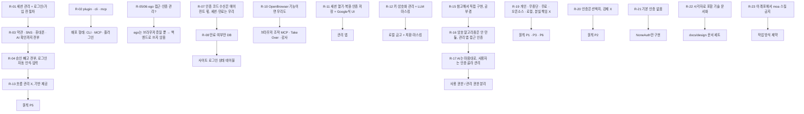

# 06. 요구사항·결정 기록

> 상태: 살아 있는 문서 · 2026-10-28 시작 · 양식: Requirements Traceability Matrix
>
> 사용자가 말한 요구를 **시간순 원문**으로 남기고, 그 요구가 어떤 결정으로 이어졌는지(또는 뒤의 요구로 대체됐는지) 추적한다. 원문은 의미가 바뀌지 않는 범위에서 오타만 고쳤다.

## 6.1 요구의 흐름

## 6.2 요구 목록

| ID | 사용자 원문 (요지) | 해석 | 상태 | 반영 위치 |
|---|---|---|---|---|
| R-01 | "세션 관리 및 로그인 / 회원가입 전 모든 절차를 가능하게 하게끔 하고 싶어" | 외부 사이트 가입·로그인 흐름 지원 | R-13으로 **재정의** | 01 §1.5 |
| R-02 | "plugin, cli, mcp 프로젝트야" | 배포 형태 세 가지 | **반영** | 01 G9, 02 §2.10 |
| R-03 | "약관동의나 sns, 휴대폰 인증, AI 인지 확인 등의 전단계를 전부 수행하도록" | 가입 단계 전체 자동화 | R-13으로 **재정의**. CAPTCHA 자동 우회는 **반목표** | 01 §1.6 |
| R-04 | "승인이 필요한 것 빼고 가능한 그전까지는 전부 다 하도록, 로그인도 바로 인식해서 넣고" | 자동 로그인 | 흐름은 에이전트 몫(R-13). KeyHarbor는 placeholder 입력 제공 | 02 §2.5.2 |
| R-05 | "ego 접근 가능?" | ego-browser 사용 가능 여부 | 확인함 (v2.1.0 설치, task space 생성·종료 성공) | — |
| R-06 | "ego에서 이렇게 웹 서비스 별 인증 관리가 돼?" | ego의 인증 관리 기능 | 없음 → KeyHarbor의 역할로 확인 | 04 A4 |
| R-07 | "이메일 sms totp 수신은 알아서 하도록 하고 웹 세션관리 및 만료를 우리 서비스에서 처리할 수 있지?" | 인증 코드 수신은 범위 밖, 세션·만료는 범위 안 | **반영** | 01 §1.5 |
| R-08 | "안되는건 빼고 만료되었는지 여부만 db에 저장하면 되지" | 쿠키 추적·주기 확인 제외, 상태만 저장 | **반영** | 02 §2.7 `SITE_STATE` |
| R-09 | "cdp를 관리하는 다른 프로젝트 있어?" | 선행 사례 조사 | 조사함 | 04 |
| R-10 | "OpenBrowser 이 되는 기능이면 우리도 해야지" | 기능 동등성 | **부분 반영**: lease·조작 도구·Take Over·감사. 프록시·위장은 **반목표**, 원격 API·복제본은 **비목표** | 02 §2.9, [ADR-0007](adr/0007-excluded-capabilities.md) |
| R-11 | "AI가 세션을 열고 복원하고 인증을 가지고 저장해서 관리하고 적절한 UI를 통해서 Google 처럼 저장소를 UI로 확인할 수 있는 서비스" | 금고 + 관리 UI | **반영** | 01 G3·G8 |
| R-12 | "궁극적인 키 관리 암호화 관리 및 LLM 보안 masking 서비스를 원해" | 키 관리·암호화·마스킹 | **반영** | 03 |
| R-13 | "흐름 관리까지 하는게 아니야 그런 걸 하기위해 필요한 기반을 제공해주는거지" | 흐름이 아닌 기반 | **원칙 P5** | 01 §1.3 |
| R-14 | "다른 오픈소스 서비스에서 그런거 하지 않나?" | 선행 사례 조사 | 조사함 | 04 |
| R-15 | "그걸 레퍼런스해서 보안관련 처리 및 암호화 방식을 직접 구현해보자! 공부도 하는 김에" | 자체 금고, 학습 목적 | **반영** | [ADR-0002](adr/0002-own-local-vault.md) |
| R-16 | "암호화 자체는 만들지 않을거야. 고민인건 이 admin app으로 적당히 소유기반 인증? 처리나 생체 인증으로 접근 권한을 관리했으면 해" | 라이브러리 사용, 관리 앱 접근 통제 | **반영** | 원칙 P7, 03 §3.10 |
| R-17 | "AI 마음대로 써야해. 대신 적절한 인증 절차를 선택해서 사용자가 해당 볼트를 관리할 수 있도록" | 에이전트 무승인 사용, 관리에만 인증 | **반영** | 03 §3.3 |
| R-18 | "솔직히 내가 만드는건 솔루션이 아니야" | — | R-19로 구체화 | — |
| R-19 | "개인이 에이전트를 권한정책에 따라 중단되지 않고 쉽게 쓸 수 있도록 하는 서비스… 분실 도난시의 책임을 도맡고 싶은게 아니야… 오픈소스, 로컬 지향… 모든걸 내 손안에서(외부 솔루션 x) 관리할 수 있도록 무료 도구" | 제품 정의 | **원칙 P1·P3·P6** | 01 §1.1 |
| R-20 | "OS나 비밀번호, 2FA 인증 등(인증 없음도 가능) 인증도 그들에게 선택지를 줄뿐 강제하고 싶지 않다" | 인증은 선택지 | **원칙 P2** | 03 §3.10 |
| R-21 | "일단 지금은 기본 인증 없음으로 구현해줬으면 해" | 기본값 `none`, 이번엔 `none`만 | **반영** | 03 §3.10, [ADR-0005](adr/0005-user-chosen-auth-default-none.md) |
| R-22 | "어떤 솔루션 알고리즘 아키텍처 기반 구조를 사용했는지 아주 자세히 시각자료를 포함해 문서화… 대기업 기술문서나 AI 솔루션 기술 리포트 참고… 말했던 내용 전부 docs에" / "어떤 기술 리포트를 참고할건지 등을 전부 결정해서" | 문서 세트와 양식 | **반영** | 이 문서 세트, [README](README.md) |
| R-23 | "이 레포에서 모아 스킬을 쓰지 않게 해" | 작업 방식 제약 | **반영** (작업자 메모리에 기록) | — |
| R-24 | "관리할건 크게 세션, .env 값으로 쓰이는 환경변수, 그리고 비밀번호, 카드번호 등등 자동완성되거나 쓸 수 있는 모든 개인 정보 저장 가능했으면 해" | 관리 대상 3분류: 세션 / env 변수 / 자동완성 가능한 개인 정보 전반 | **반영**: 항목 종류 7가지, `keyharbor run` | 01 G3·G3a, 02 §2.5.5·§2.7.1, [ADR-0010](adr/0010-env-run-injection.md) |
| R-25 | "도메인을 어떻게 쪼개서 관리할건지 고민하고 설정해줘. session, id, password 와 같은 기본정보와, 결제정보, 사용자 개인정보 정도로 분리해야 할 것 같긴 한데" | 도메인 분할 | **반영**: 세션 / 자격 증명 / 결제 / 개인정보 4도메인, 도메인 키 | 02 §2.7.1, [ADR-0011](adr/0011-domain-split.md) |
| R-26 | "무한한 가능성보다는 최대한 오픈소스와 best practice를 분석하고 암호화를 어떻게 할지 전부 고려해서 설계해봐" | 선행 사례 기반 암호 설계, 발명 최소화 | **반영**: 7개 사례 비교, 내보내기 age 채택, 메타 MAC 추가 | [07](07-cryptography-design.md), [ADR-0012](adr/0012-crypto-scheme.md) |
| R-27 | "등록하지 않은 정보를 등록할 때 어떻게 등록을 시킬지 생각해봐. 로그인 후 keychain에 등록할 수 있으면 best… form을 띄워도 되고 좋은 방법론 추천해줘" | 미등록 정보 저장 방법 | **반영**: 생성 · 포착 · 요청 · 위임 저장 + draft 후 확정 | [08](08-registration-flows.md), [ADR-0013](adr/0013-registration-draft-model.md) |
| R-28 | "그런식으로 앱설계 해서 최종적으로 app UI UX, 아이콘 설계부터 가능한 모든 동작을 계획해봐" | 관리 앱 UX 전체 | **반영**: 표면 · 정보 구조 · 와이어프레임 · 아이콘 · 토큰 · 동작 목록 | [09](09-app-ux.md) |
| R-29 | "어느 정도 구체화 됐으면 goal로 구현하고 싶" | 설계를 승인하고 구현으로 진행 | **반영**: 단계별 구현 계획 작성 시작 | `docs/superpowers/plans/` |
| R-30 | "지금 코드가 겨우 3개로 구현된거야? 제대로 기능별로 모듈화해서 구현해 보안 계층도 나누고" | 기능별 모듈화, 보안 계층 분리 | **반영**: keyharbor-guard (PDP/PEP), 기능별 모듈 | 02 §2.4, [ADR-0014](adr/0014-hexagonal-guard-layer.md) |
| R-31 | "시스템 아키텍쳐에 맞게 모듈화 해서 코드 작성해, 적합한 아키텍쳐 패턴 추천해줘" | 아키텍처 패턴 | **반영**: 헥사고날(Ports & Adapters) + Clean 의존 규칙 + PDP/PEP + GuardedBrowser 데코레이터 + PlaintextAccess capability + composition root | 02 §2.1·§2.4, [ADR-0014](adr/0014-hexagonal-guard-layer.md) |
| R-32 | "쿼리도 제대로 orm 을 쓰든 계층을 추가해서 작성해" | 영속성 계층 | **반영**: Diesel 2.3(동기 ORM) + Repository/Data Mapper + 내장 마이그레이션 | 02 §2.7.3, [ADR-0014](adr/0014-hexagonal-guard-layer.md) |
| R-33 | "스키마도 모듈화하고 확장가능하게 (도메인 혹은 적합한 패턴으로)" | 스키마의 모듈화·확장성 | **반영**: 영속성 바운디드 컨텍스트(vault·session·access·audit·config, 컨텍스트별 마이그레이션과 레지스트리) + 데이터로 정의한 항목 종류 레지스트리 `KINDS` | 02 §2.7.3·§2.7.4, [ADR-0014](adr/0014-hexagonal-guard-layer.md) |
| R-34 | "pglite 쓰는거 맞나?" → "SQLite 그대로 가자" | 저장소 엔진 | **결정**: SQLite 유지(Diesel + bundled libsqlite3-sys). PGlite는 JS/WASM 런타임과 npm이 필요하고, 연결이 하나이며, socket 서버에 SSL이 없어 제외([DB 선택](../history/architecture-proposal.md)). Postgres 계열이 필요해지면 `domain::ports`를 구현하는 어댑터를 더한다 | [ADR-0014](adr/0014-hexagonal-guard-layer.md) |
| R-35 | 독립 보안 검토 C3: 셸을 가진 에이전트가 `run`과 약화 작업으로 보호를 우회 | 셸 에이전트 경계 | **반영**: 항목 속성 `run_allowed`(메타 MAC v2에 서명), `run`은 허용 안 된 항목 거부(`run-not-allowed`). 약화 작업은 터미널의 사람 확인(약한 경계임을 명시) | 03 §3.1·§3.12.1, T13·T14, J-57, J-60 |
| R-36 | "OPENAI_KEY 같은 것도 넣을 수 있게 하는 게 목적" | 안전한 기본값 | **반영**: secret·env는 `run` 기본 허용, 브라우저 입력은 origin 목록이 있을 때 그 origin에만(`no-origin`). card는 바인딩 유지, identity·address는 어디든 되 첫 사용 origin 기록 | 03 §3.8, J-58 |
| R-37 | "적당히 만료주기까지 설정 가능하게, 기본은 무한으로" | 항목 만료 | **반영**: `expires_at`(메타 MAC 서명), `default_item_ttl`, `--expires`·`--expires-in`·`--no-expiry`. 만료 뒤 값은 남고 사용은 거부(`expired`). 연장·제거는 사람 확인 | 02 §2.7.2, J-61 |
| R-38 | 설명 필드 (에이전트가 언제 무엇을 쓸지) | 설명 | **반영**: 항목·필드(FieldSpec 기본값 + 항목별)·세션 설명, 500자. 항목·필드 설명은 메타 MAC 서명. 금고 값이 든 설명은 거부. env 항목 계층은 만들지 않는다(이름 규칙과 설명으로 구분) | J-63, J-64 |
| R-39 | `browser_login` MCP 도구 | 로그인 도구 | **반영**: username·password 칸을 찾아 기존 PEP 경로(`fill`)로 입력, 선택적 Enter | 02 §2.5.2, J-65 |
| R-40 | "`secret`·`env` 종류를 자격 증명 도메인에서 새 도메인으로 분리" (쓰임새가 다르다: login은 허용된 사이트 입력칸으로, secret·env는 프로세스·도구로 주입. 릴리스 전이라 지금 나눈다) | 도메인 분할 | **반영**: 다섯 번째 도메인 `developer`(byte 4, 키 `DK_dev`). login만 자격 증명에 남는다. 기존 금고는 열 때 한 번, 한 트랜잭션으로 옮긴다 | 02 §2.7.1·§2.7.2, 03 §3.3, 07 §7.5, J-54 |
| R-41 | "환경변수를 어떻게 쓸지(실행 스크립트나 명령어에 붙여넣을지 등)는 사용하기 나름", "python keyring이나 aws secretmanager를 확인해봐" | 개발자 비밀의 성격 | **결정**: 이름·메타·값만 아는 범용 저장소, 꺼내는 통로(환경 변수·파일·참조 치환)는 `run` 안에서만 연다. 통로 ④(실행 중 로컬 조회)는 미정. [설계 2판](../superpowers/specs/2026-10-29-developer-secrets-design.md) |
| R-42 | "전용 프로필에서 드래그같은걸로 쓸수 있는 권한 복사 가능한 느낌으로" | 평소 브라우저의 로그인 넘기기 | **일부 반영**: Chrome·Firefox 확장(`integrations/browser-extension`)이 사이트 하나의 쿠키를 넘긴다. 받는 native host와 감독자 쪽은 4단계. [설계](../superpowers/specs/2026-10-29-site-handoff-and-grants-design.md) |
| R-43 | "해당 도메인/환경변수 안에서 수행하면 되니까" | 권한 범위 | **결정**: grant(누구에게·어디까지·언제까지) 하나로 브라우저 사이트와 개발자 비밀을 다룬다. 4단계 |
| R-44 | "rust 테스트 모듈이나 npm 써, python은 기존 패턴과 너무 안맞지 않아?" | 저장소 도구 언어 | **반영**: 디자인 검사는 dev 전용 crate `keyharbor-design-check`, 확장은 npm·TypeScript. 저장소 도구에 Python을 쓰지 않는다 |
| R-45 | "다끝나면 릴리즈하고 stickypane처럼 dmg 설치까지 제대로 구성해봐" | 배포 | **결정**: 5단계 관리 앱 뒤에 릴리스하고, 앱 번들 안에 CLI를 넣은 DMG로 설치하게 한다 |

## 6.3 설계자 판단 목록

사용자가 맡겼거나 아직 말하지 않은 영역에서 설계자가 정한 것. **사용자가 뒤집을 수 있다.**

| # | 판단 | 위치 |
|---|---|---|
| J-01 | 브라우저 백엔드는 직접 띄우는 Chrome (ego 미사용) | [ADR-0009](adr/0009-own-chrome-backend.md) |
| J-02 | 에이전트는 macOS 로그인 후 별도 해제 없이 금고 사용 | [ADR-0003](adr/0003-keychain-vault-key.md) |
| J-03 | 항목별 데이터 키 없이 단일 금고 키 + 필드별 AD | 03 §3.3 |
| J-04 | 항목 이름·origin은 평문, username은 암호화 | 02 §2.7 |
| J-05 | origin 바인딩 기본 켜짐, 항목별로 끌 수 있음 | 02 §2.8 |
| J-06 | 정책 기본값 "모두 허용" | 02 §2.8 |
| J-07 | 사용 기록 기본 켜짐, 끌 수 있음 | 01 G6 |
| J-08 | raw CDP는 선택 기능으로 유지 | [ADR-0004](adr/0004-supervisor-owns-cdp.md) |
| J-09 | 관리 앱은 Tauri | [ADR-0006](adr/0006-tauri-admin-app.md) |
| J-10 | 재구현 워크스페이스(지금 저장소 루트 `crates/`) 위에 구현 | [ADR-0008](adr/0008-build-on-rebuild-workspace.md) |
| J-11 | macOS만 지원 | 01 §1.5 |
| J-12 | origin 정확 일치, 서브도메인 와일드카드 없음 | 03 §3.8 |
| J-13 | 마스킹 변형: 원문·percent-encoding·HTML 엔티티 | 03 §3.7 |
| J-14 | 감독자 제어 채널은 세션별 Unix socket | 02 §2.3 |
| J-15 | ~~내보내기 Argon2id~~ → 내보내기는 age 형식(scrypt) | 07 §7.7 |
| J-16 | `'*'` 정책은 모든 에이전트에 적용, 더 구체적인 규칙이 이김 | 02 §2.8 |
| J-17 | 같은 세션에 여러 MCP 서버가 명령하면 감독자가 순서대로 실행 | 02 §2.6.1 |
| J-18 | 마스킹 대상은 금고 전체, 4자 미만은 제외, `vault_version`으로 갱신 | 03 §3.7 |
| J-19 | 프로토타입 데이터는 이전하지 않음 | 05 2단계 |
| J-20 | `recovery_required`는 저장하지 않는 표시값 (프로토타입과 동일) | 02 §2.6 |
| J-21 | 파일 기반 login keychain 사용, 유료 서명이 필요한 Data Protection Keychain 미사용 | 03 §3.4 |
| J-22 | 관리 앱은 같은 `keyharbor` 바이너리를 sidecar로 호출해 Keychain 접근 | 02 §2.10 |
| J-23 | 기록을 끄면 거부·경고도 기록하지 않음 | 05 3단계 |
| J-24 | `identity`·`address`는 origin 바인딩 기본 꺼짐, `login`·`card`는 켜짐 | 02 §2.7.1 |
| J-25 | `totp_seed`는 저장만, 코드 생성·입력 없음 | 02 §2.7.1 |
| J-27 | 메타 MAC 입력에 `lp(kind)`·`lp(status)`·origin 중복 제거 추가 | 07 §7.6.3 |
| J-28 | 내보내기·가져오기 비밀번호는 `--passphrase-stdin` 또는 TTY (fd 환경 변수 대신) | crates/README.md |
| J-29 | `note`는 비밀 필드로 취급해 `--set` 금지 | crates/README.md |
| J-30 | 루트 키 교체 전 모든 항목의 메타 MAC을 검증하고, 변조 항목이 있으면 교체·내보내기를 거부 | 07 §7.8 |
| J-31 | `edit`로 이름을 바꾸지 않는다 (placeholder 키) | 02 §2.7.2 |
| J-32 | 사용자 정의 필드는 2단계에서 `env`만 지원 | 05 2단계 |
| J-33 | 기본 데이터 폴더 `~/Library/Application Support/KeyHarbor`, Keychain 서비스 `io.github.leeswallow.keyharbor` (사용자 결정 B3) | 02 §2.10, 03 §3.4 |
| J-26 | CLI 평문 출력 없음 (Q-01 A안) — 사용자가 답하지 않고 구현을 요청해 추천안으로 확정 | 03 §3.12 |
| J-34 | `keyharbor run`은 origin 바인딩이 켜진 항목(login·card 기본)을 주입하지 않는다(`denied: <item> (origin)`). 자식 프로세스는 값을 어디로든 보낼 수 있어 바인딩이 무의미해지기 때문 | crates/README.md, 05 3단계 |
| J-35 | 치환 입력의 origin은 **포커스가 있는 요소의 frame**으로 판정한다. `document.activeElement`를 frame마다 격리 world에서 따라 내려가고, `fill`은 그 요소가 대상과 같은지도 확인한다. 값 비우기(페이지 코드 실행) 뒤 다시 확인한다 | 03 §3.8 |
| J-36 | 마스킹에 쓸 값을 읽지 못하면(키 없음·복호화 실패) 응답을 보내지 않고 `response withheld` 오류를 낸다(fail closed). 금고가 없으면 마스킹 없이 통과 | 03 §3.7 |
| J-37 | 계획의 `Vault::all_values_for_masking` 대신 `Vault::masker()`가 `Masker`만 돌려준다. 값 목록이 crate 밖으로 나가지 않는 가장 좁은 노출 | 02 §2.4 |
| J-38 | 에이전트 이름: `mcp --agent`가 없으면 `mcp`, CLI와 제어 socket 직접 호출은 `cli`. `*`는 규칙 전용이라 에이전트 이름으로 쓸 수 없다 | 02 §2.8 |
| J-39 | 정책 우선순위는 사전식: 먼저 에이전트 규칙 > `*` 규칙, 그다음 항목 > 도메인 > `*`. 에이전트 규칙은 대상이 덜 구체적이어도 `*` 규칙을 이긴다 (J-16의 해석) | 02 §2.8 |
| J-40 | 사용 기록은 동작이 끝난 뒤 최선 노력으로 쓴다(기록 실패가 이미 한 변경을 되돌리지 않는다). 거부는 거부 응답 전에 기록한다 | 02 §2.7 |
| J-41 | `discarded` 항목은 입력·주입을 거부한다. `draft`는 쓸 수 있다(등록 흐름에서 로그인 시도용) | 08 |
| J-42 | snapshot은 같은 렌더러 프로세스의 iframe 트리를 `[frame] "<origin>"` 아래에 붙여 ref로 쓸 수 있게 한다. 다른 사이트 iframe(OOPIF)은 아직 다루지 않는다 | 02 §2.5.2 |
| J-43 | 포트는 `anyhow::Result`를 돌려준다. `KeyStore` 포트를 domain으로 옮기면서 `SecretKey`·`VaultError`도 domain(`secret`)으로 옮기고 vault가 같은 경로로 다시 내보낸다. domain은 `anyhow`·`zeroize`·`uuid`(`v4` 없음)·`url`·`serde_json`에 의존한다(I/O 없음). `serde_json`은 `ports/browser.rs`의 페이지 결과(snapshot·tabs·navigate의 JSON)에만 남는다: guard가 결과를 통째로 마스킹하므로 값 타입으로 옮겨도 얻는 것이 없다. 브라우저 대상은 `Target`, guard가 정하는 결과는 값(`FillOutcome`)이다. (#19에서 지금 코드에 맞게 고침: 예전 본문은 `getrandom`이라 했고 target도 JSON이었다, J-75) | 02 §2.4 |
| J-44 | 계획의 `FrameInspector::focused_frame_origin` 하나 대신 `FrameInspector { focus, frame_origin }`과 `PageInput { page, focus_element, clear_element, insert_text }`로 나눈다. 기존 검사 순서(포커스 확인 → 정책 → 비우기 → 포커스 재확인 → 입력 → origin 재확인)를 그대로 지키려면 단계 사이에 끼어들어야 하기 때문. `prepare_text`는 이미 판정한 frame origin을 받는다. `status`는 브라우저가 아니라 세션 저장소 조회라 `BrowserPort`에 넣지 않았다 | 02 §2.4.1 |
| J-45 | `GuardedBrowser`는 요청마다 `Guard::browser(&mut raw, agent)`로 만드는 짧은 수명의 데코레이터다. 마스킹은 결과·오류마다 정확히 한 번(두 번 가리면 placeholder 안의 항목 이름이 다시 가려질 수 있다). 브라우저에 가지 않는 요청(`status`, 잘못된 요청)은 `ops`가 같은 `Guard`로 가린다 | 02 §2.4.1 |
| J-46 | `PlaintextAccess`는 core에 두고 생성자는 `#[doc(hidden)] pub fn issue()`. 호출 위치는 check-layers가 guard·`core/src/transfer.rs`(사용자 요청 age 내보내기)·테스트로 제한. 계획의 "마스킹 값 목록"은 `Vault::mask_values`로 두고, 목록은 guard의 `masker()` 밖으로 나가지 않는다(J-37 유지). core 테스트는 `TestVault` 래퍼로 단언을 그대로 둔다 | 02 §2.4.1 |
| J-47 | broker는 core에 의존할 수 없으므로 세션 유스케이스 전체(open·stop·wait_auth·handoff·resume·recover·endpoint)를 `core::session`으로 옮기고, 프로세스·잠금·socket·`DevToolsActivePort`는 새 포트 `SessionRuntime`(broker `ProcessRuntime`) 뒤에 둔다. 감독자는 `StoreFactory`와 금고 opener를 인터페이스에게서 받는다. 계획에서는 5단계에 하던 일이지만 4단계 커밋에 넣었다. 저장소는 호출자가 먼저 열므로, DB를 열 수 없을 때는 URL 검사보다 그 오류가 먼저 나온다 | 02 §2.4.2 |
| J-48 | Diesel 저장소는 `RefCell<SqliteConnection>` 하나(스레드마다 store를 연다, 이전과 같음). 쓰기·마이그레이션은 `immediate_transaction`. 사용 기록은 한 IMMEDIATE 트랜잭션에서 `audit_enabled`를 읽고 `strftime` SQL 함수(`define_sql_function!`)로 삽입한다(이전의 `INSERT … SELECT … WHERE`와 같은 결과). 데이터 경로는 UTF-8이어야 한다(Diesel 연결 문자열) | 02 §2.7.3 |
| J-49 | 영속성 컨텍스트는 다섯 개(vault·session·access·audit·config). 다른 컨텍스트의 값은 그 컨텍스트 `mod.rs`의 함수로만 읽는다(audit → `config::audit_enabled`). 마이그레이션 버전은 타임스탬프로 전역 유일 | 02 §2.7.3 |
| J-50 | KeyHarbor는 아직 릴리스 전이라 보존할 사용자 DB가 없다. 그래서 호환용 shim(열 때 `generations.cdp`를 `ALTER`로 더하던 코드)을 두지 않고 그 열을 session 초기 마이그레이션에 넣었다. 운영 코드의 원시 SQL(`sql_query`·`batch_execute`, 연결 PRAGMA 제외)은 check-layers가 막는다 | 02 §2.7.3 |
| J-51 | 항목 종류 레지스트리: `ItemKind::schema()`는 `Option<Vec<&str>>`를 돌려준다. 종류에 없는 필드 이름은 다른 종류가 비밀로 선언했으면 비밀로 본다(이전 `SECRET_FIELDS`와 같은 동작). 모든 필드가 `maskable`이고, 알 수 없는 종류의 값은 전부 가린다 | 02 §2.7.4 |
| J-52 | 다른 crate 테스트의 변조용 원시 SQL은 sqlite의 `test-support` 기능(dev-dependency로만 켬)에 둔다. `check-release-features.sh`가 릴리스 빌드에 이 기능이 없는지도 확인한다 | crates/README.md |
| J-53 | 로컬 사용자 에이전트 이름 `cli`(`LOCAL_AGENT`)는 broker도 쓰므로 `domain::policy`로 옮기고 core가 다시 내보낸다 | 02 §2.8 |
| J-54 | R-40 구현. (1) 요청은 `DK_dev`를 "HKDF info 라벨만 새로" 만들라고 했지만 이 설계의 도메인 키는 RK에서 유도하지 않고 CSPRNG로 만들어 KEK로 감싼다(07 §7.5). 그래서 `DK_dev`도 같은 방식(무작위 32B, `keyharbor/dk/v1` envelope, AD의 domain 바이트 = 4)이고 새 HKDF 라벨은 없다. 기존 KAT(HKDF·자격 증명 필드 레코드)는 그대로이고 developer 필드 레코드 KAT를 더했다. (2) 정책 target은 다른 도메인과 같은 문법(`--resource domain --target developer`)이다. (3) SQLite는 CHECK를 바꿀 수 없어 vault 마이그레이션 `000007`이 `domain_keys`·`vault_items`(와 자식 표)를 한 트랜잭션에서 다시 만든다. 자식 표를 먼저 옆으로 복사하고 지워 `ON DELETE CASCADE`가 아무것도 지우지 않게 한다. (4) 값 이동은 키가 필요해 SQL이 아니라 `Vault::open`이 한다: `vault.lock`을 잡고, 자기 도메인에서 MAC이 맞는 secret·env 항목만 `DK_dev`로 다시 봉인하고 다시 서명해 새 키와 함께 `add_domain` 한 트랜잭션(버전 CAS)으로 커밋한다. `DK_dev`가 있으면 이전은 끝난 것이다(멱등). 변조된 항목은 옮기지 않아 계속 tampered로 남는다 | 02 §2.7.1, 07 §7.5 |
| J-55 | 사용 검사는 guard `pdp/checks/`의 작은 검사 객체 체인이다(`trait Check`, 파일 하나에 검사 하나). 브라우저 체인 `BROWSER`(폐기 → 정책 → origin/no-origin → 필드 존재 → 필드 종류 → 포커스)와 프로세스 체인 `PROCESS`(폐기 → 정책 → 바인딩 → run 허용 → 필드 존재)를 등록 순서대로 돌리고 첫 거부가 이긴다. 항목 존재·MAC 검증은 검사가 아니라 검사가 읽는 `ItemUse`를 만드는 단계다. 거부 사유는 domain의 `DenialReason` enum 하나이고 표시 문자열(`not_found`, `field-kind` …)은 그 enum에만 있다. 포커스 검사가 항목마다 돌므로 여러 항목을 쓴 템플릿에서는 둘째 항목의 정책보다 포커스 거부가 먼저 나올 수 있다(기존 단일 항목 결과는 같다) | 02 §2.5.2 |
| J-56 | 마스킹 변형은 `pep/mask/variants/`의 `trait Variant` 레지스트리다. 요청은 `expand(&[u8]) -> Vec<Vec<u8>>`였지만 값이 UTF-8 문자열이고 만든 형태를 지워야 하므로 `expand(&str) -> Vec<Zeroizing<String>>`로 했다. 최소 길이와 중복 제거는 레지스트리 함수 한 곳에서 한다 | 03 §3.7 |
| J-57 | 사람 확인은 domain 포트 `Confirm`(답 `Yes`/`No`/`Unavailable`)이고 CLI 어댑터 `TtyConfirm`(`cli/src/tty_confirm.rs`)이 stdin·stderr가 모두 터미널일 때만 `/dev/tty`에 묻는다. 무엇이 약화인지와 그 표시는 core `weaken::WeakeningOp` 한 곳이다. 계획은 C3에서 env만 기본 run 허용이라 했지만 뒤의 R-36이 secret도 허용하라고 해 `KindSpec::default_run_allowed`를 secret·env 참으로 했다. 실행 중인 브라우저 입력의 검사 상한(탐색 대기 3 초, probe 3회, 초당 거부 기록 10건)은 설정이 아니라 고정값이다: 에이전트가 바꿀 수 있으면 안 되고, 높이면 추측에 답을 더 준다 | 03 §3.12 |
| J-58 | R-36의 "origin 목록이 있을 때만 브라우저 입력 허용"을 개발자 도메인 항목은 브라우저에서 언제나 origin에 묶인 것으로 다루는 것으로 구현했다: 목록이 비면 `no-origin`, 프레임이 목록에 없으면 `origin`. `origin_binding` 값은 `keyharbor run`(바인딩된 항목은 주입하지 않음)에만 쓰인다. identity·address의 첫 사용 origin은 access 컨텍스트 `origin_uses` 표로 판정한다(사용 기록을 끄면 기록이 남지 않아도 판정은 된다) | 03 §3.8 |
| J-59 | 암호 원시 연산을 `keyharbor-crypto`로 모은다([ADR-0016](adr/0016-crypto-crate.md)). 요청과 다른 점: (1) `KeyPurpose`에 도메인 키(`DK_cred`·`DK_pay`·`DK_personal`·`DK_dev`)를 넣지 않았다. 도메인 키는 유도하지 않고 무작위로 만들어 KEK로 감싸기 때문이다(07 §7.5). (2) 필드·도메인 키 레코드의 AD 내용과 메타 MAC 입력은 금고의 형식이라 vault에 남기고 crypto의 `envelope`·`mac`만 부른다. 그래서 KAT도 HKDF만 crypto로 옮기고(기대값 그대로) 레코드·메타 KAT는 vault에 둔다. (3) `SecretKey`·`VaultError`는 KeyStore 포트가 쓰므로 domain에 두고 crypto가 다시 내보내며, `SecretKey::generate`는 `crypto::random::key`로 옮겼다. (4) DK_dev 커밋 뒤에 했다(요청은 가능하면 먼저) | 07 §7.12 |
| J-60 | 3단계 강화 계획(`docs/superpowers/plans/2026-10-29-phase3-hardening.md`) 구현 기록. C1: 치환받은 요소는 snapshot에서 placeholder가 아니라 `value="[redacted]"`로 보인다(값이 바뀌어도 가리려면 값이 아니라 요소를 가려야 하므로). 기존 테스트 두 곳(`mcp_stdio`·`substitution_chrome`)의 단언을 그에 맞게 바꿨다. password 칸은 예전처럼 값을 아예 보이지 않는다. C2: 입력 뒤 포커스가 바뀌면 경고가 아니라 오류를 돌려주고 세션 치환을 잠근다(origin 변경은 예전처럼 경고). C3: 확인 포트는 `Confirm`, TTY 어댑터는 `TtyConfirm`(J-57). 확인 경로의 통합 테스트는 `script(1)`로 pty를 만들어 `yes`를 친다(`tests/common::on_terminal`). 이 방법이 곧 약한 경계의 증거다. 기존 테스트 중 정책 allow·deny 규칙 삭제·기록 끄기를 하던 곳(`policy_cli`·`audit_cli`·`substitution_chrome`)은 그 명령을 pty로 실행하게 바꿨다 | 03 §3.12.1 |
| J-61 | R-37: 만료일은 UTC 날짜(`YYYY-MM-DD`)이고 그날까지 쓸 수 있다(다음 날부터 만료). 과거 날짜도 설정할 수 있다(단축은 확인 없음). `default_item_ttl`은 config 컨텍스트의 settings 키라 새 마이그레이션이 없다(값 `<N>d` 또는 `none`). 날짜 계산은 domain `date`(순수 함수), 오늘은 `Clock::today`(#19 전에는 core `today()`, J-75) | 02 §2.7.2 |
| J-62 | I1: 응답 placeholder에서 항목 이름을 빼지 않는다. 에이전트가 자기가 넣은 값을 확인하는 데 쓰고, 추측 경로는 요청 거부로 막는다. 거부 오류와 `mask_probe` 기록에는 어느 항목이 맞았는지 쓰지 않는다. I2: 브로커에는 마스커가 없어(ADR-0014) "JSON으로 만들기 전에 마스킹"하지 못하고, JSON 이스케이프 변형으로 같은 효과를 낸다 | 03 §3.7 |
| J-63 | env 항목은 계층(그룹·상속)을 만들지 않는다. 이름 규칙(`myapp-dev`, `myapp-prod`)과 설명으로 구분하고, 필요가 확인되면 다시 본다 [lead 결정, 사용자 미응답]. browser-use 연동은 코드 의존성 없이 문서(`docs/guides/browser-use.md`)로만 둔다 [lead 결정] | docs/guides |
| J-64 | 설명: 금고 값이 든 설명은 같은 항목뿐 아니라 **금고 전체**와 함께 저장할 새 값까지 검사해 거부한다(guard `describe`, 마스커와 같은 변형). 세션 설명은 세션 컨텍스트에 두고 메타 MAC이 없다(세션에는 서명 키 계층이 없다). 세션 설명은 금고 값 검사를 하지 않는다(세션 생성에 Keychain을 열지 않기 위해). 나중에 추가된 다른 항목의 값이 오래된 설명에 우연히 있으면 막지 못한다 | 03 §3.7 |
| J-65 | `browser_login`: username은 `autocomplete=username` → `type=email` → name·id에 user/email/login 순, password는 C1과 같은 판정. 같은 origin의 frame까지 찾는다(`documentURL`의 origin 비교). 항목에 username 필드가 없으면 password만 넣는다. 입력은 `fill`의 검사 경로를 그대로 부른다. login 종류만 받는다 | 02 §2.5.2 |
| J-66 | Minor: 제어 socket의 `agent`가 `*`이면 거부(빈 문자열은 이미 거부). `RLIMIT_CORE=0`은 `keyharbor` 바이너리 시작 시 설정해 감독자(`__supervise`)와 CLI 모두에 적용된다. 거부 기록은 세션당 초당 10건, 넘친 수는 다음 초가 시작되거나 감독자가 끝날 때 `secret_denied_suppressed` 한 건(결과 = 개수)으로 남긴다 | 02 §2.7 |
| J-67 | I4: 탐색 상태는 broker가 `Page.frameRequestedNavigation`·`frameStartedNavigating`·`frameStartedLoading`·`frameScheduledNavigation`(시작), `frameStoppedLoading`·`frameDetached`(끝)으로 판단한다. `frameClearedScheduledNavigation`은 끝으로 보지 않는다(Chrome이 실제 탐색이 시작될 때 보낸다). 정착 대기는 브라우저에 묻지 않는다: 탐색이 대기 중이면 페이지 명령(`Page.getFrameTree` 등)이 새 문서가 올 때까지 멈추기 때문 | 03 §3.8 |
| J-68 | 디자인 시스템: 주 버튼과 개수 배지는 강조색이 아니라 한 단계 짙은 `--c-accent-fill`(라이트 `#047a7a`)을 칠한다. 흰 글자가 `#05a8a8` 위에서 2.93:1이라 AA를 넘지 못한다. 강조색은 포커스·토글·탭에 남긴다. `--c-ink-3`은 보조 글자로 3:1만 약속한다 | ADR-0015 |
| J-69 | 확장의 쿠키 변환: host-only 쿠키는 CDP에 `domain` 없이 `url`로 준다. CDP는 `domain`이 있으면 도메인 쿠키로 넓히기 때문이다. `SameSite=None`인데 `Secure`가 아니면 sameSite를 뺀다. 파티션 쿠키는 최상위 사이트가 이 사이트인 것만 넘긴다 | integrations/browser-extension/README.md |
| J-70 | 확장 권한에 `scripting`을 더한다. 사람이 `localStorage`도 넘기기를 고를 때 그 탭에서 읽는 데만 쓴다. 사이트 접근은 설치 때 받지 않고 넘길 때 그 사이트와 하위 도메인만 `permissions.request`로 묻는다 | integrations/browser-extension/README.md |
| J-71 | #10: 세션 작업이 볼 정책 Action은 guard `session::SessionOp` 표 하나가 정하고 MCP는 작업 이름만 준다(check-layers 규칙 J). 이전에 검사가 없던 `session_stop`·`session_wait_auth`·`session_wait_for_resume`도 그 세션의 `session` 규칙을 본다. 막힌 에이전트가 다른 에이전트의 작업을 끝내거나 사람에게 로그인 요청을 띄우지 못하게 하려는, 더 안전한 쪽의 선택이다(동작 변경, 테스트 `an_agent_denied_a_session_cannot_stop_it_or_ask_the_user_in_it`). `session_list`는 검사하지 않는다(이름·상태·설명만, 범위 지정 서버는 자기 세션만). CLI는 사람의 표면이라 세션 정책을 보지 않는다 | 02 §2.8 |
| J-72 | #10: MCP `vault_list`는 이제 core `catalog`로 금고를 열어 메타 MAC을 검증한다. 변조된 항목은 `{"name", "tampered": true}`만 보이고 검증되지 않은 origin·`run_allowed`·설명·만료일을 내지 않는다(동작 변경, 이전에는 저장된 값을 그대로 냈다). 만료 판정은 core 하나다. 그래서 MCP 프로세스가 `vault_list` 때마다 키 저장소를 읽는다. 감독자도 같은 바이너리로 금고를 열므로 새로 생기는 노출은 없다. 금고가 없으면 빈 목록이다. 조립은 바이너리마다 한 곳(`cli/src/compose.rs`)이고, MCP 서버는 저장소 하나를 `Mutex`로 받아 도구 호출이 저장소를 쓰는 동안 직렬화된다(`session_open`·`session_stop`은 최대 15초). `session_wait_for_resume`은 확인 한 번마다만 잠근다. 세션 생성은 포트 `create_described`로 설명까지 한 번에 쓴다. `run`은 금고가 자기 연결을 가지므로 연결 둘을 연다(J-48) | 02 §2.4.0 |
| J-73 | #18: domain 어휘를 한 곳에 둔다. (1) placeholder 문법은 `domain::vault`의 `PLACEHOLDER_OPEN`·`PLACEHOLDER_CLOSE`·`placeholder()`·`Display for PlaceholderRef`만 쓴다(일곱 군데의 리터럴 제거, check-layers 규칙 H). (2) 요청자 이름은 `policy::AgentName::parse`가 한 번 검사한다(`*`·빈 이름 거부). 규칙의 agent는 여전히 `parse_agent`(`*` 허용)다(규칙 I). (3) 설정은 `domain::settings::SETTINGS`(`SettingSpec`: 이름·기본값·형식·약화 방향) 한 표이고 core `settings`·`weaken`, sqlite, CLI가 이것을 읽는다. 사용 기록은 **값이 없거나 `false`가 아니면 켜짐**이다(`settings::audit_enabled`). 이전에는 port 문서("`false`면 끔"), sqlite("`true`만 켬"), core weaken("`true`가 아니면 약화")이 서로 달랐다. 저장된 값이 이상하면 켜진 쪽으로 실패한다(동작 변경, 테스트 `only_an_explicit_false_turns_the_record_off`). 약화 작업 `AuditOff`·`CaptureChanged`는 `WeakeningOp::Setting { key, value }` 하나가 되었다. 표시 문자열은 같다(`weakening_needs_a_yes_and_nothing_else_asks`는 작업을 만드는 줄만 바꿨고 단언은 그대로). (4) 세션 표시 상태는 `core::session::DisplayState`, 응답의 상태 문자열은 `State::as_str`에서만 온다. TTL을 날짜로 바꾸는 계산은 core `expires_in` 하나이고 CLI가 그것을 부른다 | 02 §2.7.2 |
| J-74 | #11: 감독자를 broker에서 떼어 `keyharbor-supervisor`로 옮긴다. broker는 Chrome 어댑터(`chrome`: 실행·CDP pipe·`DevToolsActivePort` 해석, `CdpBrowser`)만 남고 domain에만 의존하며, broker에 의존하는 crate는 supervisor 하나다(check-layers 규칙 B). supervisor는 감독자 프로세스(잠금·준비·`CdpBrowser`를 `GuardedBrowser`로 감싸기·제어 socket), `ProcessRuntime`, argv 계약 `SuperviseArgs`(쓰기·읽기 한 곳, CLI의 `__supervise`는 인자를 그대로 넘긴다)를 갖는다. 감독자가 기록하는 상태 규칙(예약 확인, `starting → running/failed`, 종료 뒤 `stopped/failed`와 `session_stopped` 기록)은 `core::session::supervision`으로 올렸다. **제어 프로토콜 wire 타입의 자리**: 별도 crate(`keyharbor-control`) 대신 `keyharbor-supervisor::control::wire`에 두고 MCP가 supervisor에 의존한다. 이유: (1) 서버와 client가 같은 이유로 함께 바뀌는 한 프로토콜이라 한 crate에 둔다(공통 폐쇄). (2) 출시물은 바이너리 하나라 client만 떼어도 링크가 줄지 않는다. (3) MCP가 CDP 어댑터에 닿지 못하는 것은 규칙 B(mcp·cli는 broker에 의존하지 않음)와 규칙 5가 지킨다. 프로토콜이 다른 프로세스(관리 앱)에서도 쓰이면 그때 떼어 낸다. `ControlEnvelope { agent, ControlRequest }`, `ControlResponse`, `TargetWire`, `login_submits`(기본값 한 곳)이 wire의 전부이고 손으로 쓴 `"op"`은 이 파일에만 있다(규칙 K). MCP의 scope lock은 `lock_mcp_scope`로 받는다(broker의 paths·lock을 더는 쓰지 않는다). 바뀐 동작: 형식이 틀린 요청의 오류가 `invalid request: <serde 설명>`(마스킹됨)이 된다. 스크린샷 디렉터리(`run/shots/`)는 첫 스크린샷이 아니라 감독자 시작 때 만든다. `KEYHARBOR_BROWSER_HEADLESS`는 composition root가 읽어 `Adapters.headless`로 넘긴다. `mcp_stdio::session_tools_with_fake_browser`는 가짜 브라우저가 `args` 파일을 만든 뒤 쓰기 전에 읽는 경쟁이 있어, 기다리는 조건만 "마지막 줄까지 쓰임"으로 바꿨다(단언은 그대로) | 02 §2.4, ADR-0014 |
| J-75 | #19: 안쪽 crate(domain·crypto·vault·core·guard)는 I/O를 하지 않는다(check-layers 규칙 C·D, 위반 fixture는 `scripts/test-scripts.sh`). (1) **키 저장소**: `vault/src/keystore.rs`를 새 crate `keyharbor-keystore`로 옮겼다(`MacKeychain` → `KeychainKeyStore`, `FileKeyStore`). security-framework는 이 crate만 링크한다(규칙 G, `cargo tree -i security-framework`: keystore → keyharbor). macOS가 아니면 `KeychainKeyStore`가 오류를 돌려준다(예전에는 `keystore_from_env`가 panic). `keystore_from_env`와 `KEYHARBOR_TEST_KEYSTORE_DIR` 읽기는 `cli/src/compose.rs`로 갔고, keystore crate의 `test_keystore_dir(value)`는 기능 `insecure-test-keystore`일 때만 값을 받는 순수 함수다(테스트 `test_keystore_dir_is_ignored_without_the_feature`는 환경 변수 대신 인자를 준다). cli는 더 이상 vault에 의존하지 않는다. (2) **파일**: guard `run::Request.files`는 `--env-file`의 내용(`Zeroizing<String>`)이고 CLI가 읽는다. 그래서 읽을 수 없는 파일은 항목 검사보다 먼저 실패한다. core `export_age`는 age 바이트를 돌려주고 `import_age`는 바이트를 받는다. 0600·`create_new` 쓰기는 CLI `vault_cmd::files`다. 테스트: core `export_is_age_and_contains_no_plaintext`에서 파일 권한 단언을 CLI `export_files_are_private_and_never_overwritten`로 옮겼고, `wrong_passphrase_and_existing_target_fail`은 `wrong_passphrase_fails`(core)와 같은 CLI 테스트(덮어쓰기 거부)로 나눴다. (3) **잠금**: 키 교체 잠금은 포트 `RotationLock { lock_rotation, try_lock_rotation }`이고 SQLite 어댑터가 데이터 폴더의 `vault.lock`으로 구현한다. `VaultStore::root()`를 지웠다. (4) **시계**: domain 포트 `Clock { now, sleep }`(+ `today`·`unix_seconds`·`now_rfc3339`)와 테스트용 `ManualClock`(sleep하면 그만큼 간다). 시스템 시계 `SystemClock`은 composition root에 있다. `sleep`이 포트에 있는 이유: 세션 `open`·`stop`의 대기도 안쪽 crate의 I/O라서(규칙 C). `Vault::{open, init}`, `Guard::new`, `session::{open, stop}`이 시계를 받고 core·guard의 `unix_seconds` 두 벌과 core `today()`를 지웠다. 브라우저 실행 파일 확인은 `SessionRuntime::has_browser`가 한다(순서는 그대로: 예약 전). core·guard 테스트는 2026-10-28에 멈춘 시계를 쓴다. (5) **난수와 ID**: domain의 `SessionId`·`Generation`·`RequestId`는 `new()`·`Default` 대신 `from_bytes`/`From<[u8; 16]>`만 갖고, crypto `random::{uuid_v4, id}`가 만든다. vault의 키 ID도 같다. uuid의 `v4` 기능은 워크스페이스 어디에서도 켜지 않는다(요청은 "crypto만"이었지만 crypto도 자기 `fill`과 `uuid::Builder::from_random_bytes`로 만들어 기능이 필요 없다, 규칙 F). 세션 행·generation·인계 요청을 만드는 sqlite가 crypto에 의존한다(ADR-0016 결정 5). (6) **브라우저 대상**: `BrowserPort`·`PageInput`은 `Target { Ref, Selector }`를 받고, `fill`·`type_text`는 `FillOutcome { origin_changed }`, `close`는 `()`를 돌려준다. guard `login`은 `LoginOutcome`(url은 마스킹)을 돌려준다. guard는 JSON을 파싱하거나 만들지 않고, 제어 응답의 모양(`{"warning": "origin_changed_after_fill"}`, login 결과)은 supervisor `control::wire`의 `FillResultWire`·`LoginResultWire`가 만든다(MCP는 그 결과를 그대로 전한다). guard 단위 테스트 두 곳은 JSON 대신 값으로 단언한다(`json!({})` → `FillOutcome::default()`, login 결과 → `LoginOutcome`, 마스킹 단언은 그대로). 페이지 결과(`Value`)는 남는다(J-43) | 02 §2.4, ADR-0014, ADR-0016 |
| J-76 | #12: 저장소 루트를 계층대로 놓는다. 워크스페이스는 루트 `Cargo.toml`·`crates/`(옛 `rebuild/`), 프로토타입은 따로 빌드하는 `prototype/`(루트 워크스페이스의 `exclude`), 디자인 시스템은 `design-system/`(옛 `design/`, 이름이 `docs/design/`과 겹쳤다), 옛 문서는 `docs/history/`. 로드맵 상태는 `ROADMAP.md`, 체크리스트는 `.sticky/roadmap.md`. 같은 PR에서 `design-serve`는 저장소 전체가 아니라 `design-system/`과 쇼케이스가 쓰는 `docs/design/assets/`만 내보내고 심볼릭 링크를 따라가지 않는다(전에는 `.git`까지 읽을 수 있었다) | [ADR-0008](adr/0008-build-on-rebuild-workspace.md), [design-system/README](../../design-system/README.md) |
| J-77 | 4단계 Task 2: 에이전트가 더하는 항목(`vault_generate`·`vault_put`)은 draft다. 이름이 비어 있으면 그 이름을, 이미 있으면 빈 번호 중 가장 작은 `<이름>~draft-N`을 쓴다. 기존 항목은 바뀌지 않는다(08 §8.3). `ItemName::parse`는 고른 이름과 draft 이름을 모두 받고(저장된 이름·placeholder·확정 명령이 읽는다), `ItemName::parse_new`는 `~`를 거부한다(에이전트가 고르는 이름). `Vault::add`도 draft가 아닌 항목에 draft 모양 이름을 거부한다. 한 이름의 draft는 `MAX_DRAFTS` = 20개까지다. 인젝션된 에이전트가 draft를 무한히 쌓지 못하게 하려는 상한이고, 넘으면 확정하거나 폐기하라는 오류를 낸다. 생성 비밀번호 규칙은 domain `password::PasswordRule`(길이 8–128, 기본 20, 소문자·대문자·숫자·기호 각 하나 이상, `forbid`를 뺀 뒤 10자 이상 남아야 함)이고 문자는 crypto `random::password`가 OS 난수로 고른다(바이트 거부 표본으로 균등). 기호에는 따옴표·백슬래시·공백을 넣지 않는다. 사용 기록 `vault_item_changed`는 이제 추가한 쪽(에이전트 이름)을 남긴다. CLI 추가는 그대로 `cli` | 08 §8.2–§8.3 |
| J-78 | 4단계 Task 3: 정보 요청은 새 컨텍스트 `request`(`vault_requests`)에 이름·에이전트·이유·결과만 남긴다. 값은 사용자가 답할 때 곧바로 금고로 간다. 요청은 하루(`VaultRequest::TTL_SECONDS`) 동안 열려 있고, 지나면 읽을 때 `expired`로 보인다. 설정으로 빼지 않은 이유: 사람이 돌아올 만큼 길고 오래된 창에 잘못 답하지 않을 만큼 짧으면 되고, 더 필요한 에이전트는 다시 요청한다(`ResumeWait`와 같은 판단). 답은 두 가지다. 새 값(요청한 이름의 active 항목, `source=requested`. 그 이름이 있으면 거절하고 `--use`로 기존 항목을 고르게 한다) 또는 같은 종류의 기존 항목이다. 답은 한 번만 이긴다(`pending`에서만 바뀌는 조건부 갱신). `vault_wait`은 인계 대기와 같은 경계(1–300초)와 같은 폴링(`session::poll`, `wait_for_resume`이 이것을 쓰도록 바꿨다)을 쓰고, 시간이 다 되면 오류가 아니라 `pending`을 돌려준다(Review Focus 3). 요청 이유는 에이전트가 쓴 글이라 믿지 않는다. 사용자에게 한 줄로 보이고, 탭·줄바꿈은 공백으로 바꾼다. 사용 기록 `vault_requested`, `vault_request_answered` | 08 §8.2 ③ |
| J-79 | 4단계 Task 5: draft 확정·폐기·정리. **자동 확정은 `generated`·`captured` draft만**이다. 계획(08 §8.3)은 "login draft"였지만, 그러면 인젝션된 에이전트가 `vault_put`으로 공격자 비밀번호를 넣고 `site_state_set(logged_in)`을 불러 정상 항목을 바꿀 수 있다. 값이 에이전트에게서 온 draft는 사람이 `vault confirm`으로 확정한다. 대상: `site_state_set`이 준 `item`이 조건에 맞는 draft면 그것, 아니면 같은 origin의 가장 최근(`updated_at`) draft 하나. 번호 붙은 draft(`github~draft-2`)를 확정하면 원래 항목을 지우고 draft의 이름을 바꾸는 일을 한 트랜잭션에서 한다(포트 `item_replace`). 필드 봉투의 AD는 항목 id에 묶여 있어 다시 봉하지 않고 메타 MAC만 새로 쓴다. 폐기는 상태만 `discarded`로 바꾸고, `prune-drafts`가 폐기된 항목과 `draft_ttl`(새 설정, 기본 `7d`, `none` 가능, 약화 아님)보다 오래 바뀌지 않은 draft를 지운다. 자동 정리는 하지 않는다. `vault list`가 지우는 것은 놀랍기 때문이다. 사용 기록 결과 `confirmed`·`pruned`(폐기는 `updated`) | 08 §8.3 |
| J-80 | 4단계 Task 4: 사용자가 친 로그인 포착. (1) **인계 중에만**: 감독자는 세션이 `awaiting_user`일 때만 포착을 저장하고, 그동안 에이전트 입력 명령(navigate·click·fill·type·press·login·new_tab·switch_tab)을 거절한다(`the browser is with the user until they resume`). 읽기(snapshot·tabs·screenshot·wait)는 된다. 이유: 아니면 인젝션된 에이전트가 비밀번호를 직접 쳐서 제출하면 `captured` draft가 되고, J-79의 자동 확정으로 정상 항목을 바꿀 수 있다. 이것은 동작 변경이다(전에는 인계 중에도 에이전트가 입력할 수 있었다). (2) **신뢰된 submit만**: 스크립트는 isolated world(`keyharbor-capture`)에서 `submit` 이벤트의 `isTrusted`가 참일 때만 보고한다. 페이지 스크립트가 만든 제출로는 draft를 심을 수 없다. 바인딩 `__khCapture`는 그 world에만 있다(`Runtime.addBinding executionContextName`). origin은 그 frame의 `location.origin`을 감독자가 다시 `Origin::parse`한다. (3) **비교**: 같은 origin의 login 항목(draft 포함, 폐기 제외) 가운데 username이 같은 것을 guard가 `PlaintextAccess`로 열어 비교한다. 비밀번호까지 같으면 아무것도 하지 않고(`known`), 다르면 그 이름의 `~draft-N`, 없으면 호스트 이름(`accounts-example-com`)으로 draft를 만든다. 사용 기록은 `credential_captured`(에이전트 이름 `user`). (4) **기본값 꺼짐**: 설정 표(02 §2.7.3)와 같이 `capture_enabled` 기본은 `false`다. 08의 처음 판단(켜짐)을 바꿨다. (5) 한계: 다른 사이트 iframe(OOPIF), submit 이벤트 없이 JS로 보내는 폼은 놓친다. 보고된 값은 감독자 안의 CDP 이벤트 버스(`serde_json::Value`)를 지나가며 그 사본은 지워지지 않는다. 테스트는 raw CDP로 사람의 입력을 흉내 낸다(개발 의존성 `tungstenite`) | 08 §8.2 ②, 03 §3.12 |
| J-81 | 4단계 Task 7: grant(R-43)의 첫 형태는 **세션 × origin**이다. 에이전트 주체와 항목 접두사 범위는 개발자 비밀 통로 때 더한다(표의 `subject_kind`·`scope_kind` 열이 자리를 남긴다). (1) **덮는 범위**: 같은 scheme·port에서 그 호스트와 하위 도메인(`github.com`이 `gist.github.com`을 덮는다). IP는 정확히 같아야 한다. (2) **한 번이라도 grant가 있던 세션은 제한된다**: 만료되거나 회수된 grant도 행으로 남고, 활성 grant가 덮는 문서만 열린다. 끝난 grant가 세션을 다시 무제한으로 여는 일이 없게 닫히는 쪽으로 실패한다. grant가 한 번도 없던 세션은 지금처럼 제한이 없다. (3) **집행**: 감독자가 모든 페이지를 자동 attach하고(`Target.setAutoAttach`, 시작 시 멈춤) `Fetch`로 문서 요청(최상위·frame)만 멈춰 규칙을 묻는다. 규칙 밖이면 `BlockedByClient`로 실패시키고 `navigation_denied`를 남긴다. 링크 클릭·리디렉트·스크립트 이동도 잡힌다. 하위 리소스는 멈추지 않는다. 에이전트의 `browser_navigate`·`browser_new_tab`은 미리 검사해 `denied: navigation (out-of-grant)`를 돌려주고, 시작 URL은 감독자가 브라우저를 띄우기 전에 검사한다. gate를 걸지 못한 새 페이지는 닫는다. 포착(J-80)도 같은 page watcher가 한다. (4) **끝난 grant의 쿠키**: 감독자가 5초마다 끝났지만 정리되지 않은 grant를 찾아 그 호스트와 하위 도메인의 쿠키를 지우고(`Storage.setCookies`에 만료된 쿠키) `cleared`로 표시한다. 쿠키는 port를 구분하지 않으므로 같은 호스트의 다른 port 쿠키도 지워진다. (5) **추가는 약화 작업**이라 터미널 확인(`WeakeningOp::Grant`)을 받는다. 회수와 목록은 묻지 않는다. TTL은 `<N>m`·`<N>h`·`<N>d`(최대 30d)이고 기본값은 회수할 때까지다 | [사이트 넘기기와 grant](../superpowers/specs/2026-10-29-site-handoff-and-grants-design.md) §3 |
| J-82 | 4단계 Task 8: 사이트 넘기기를 받는 쪽. (1) native host는 **별도 바이너리가 아니라 `keyharbor browser host`**다. 계획의 `keyharbor-native-host`보다 배포할 것이 하나 적다. 브라우저는 매니페스트의 실행 파일을 우리 인자 없이 부르므로, `install-host`가 데이터 폴더에 `native-host` 스크립트(0700, `exec keyharbor --data-dir … browser host "$@"`)를 쓰고 매니페스트가 그것을 가리킨다. 매니페스트의 허용 목록은 우리 확장 하나(Chrome ID, Firefox ID)다. (2) host는 메시지(최대 4 MiB)를 읽어 `receive_site` v1인지, origin·세션 이름·TTL(60초–30일)이 맞는지, **모든 쿠키가 그 사이트 것인지**(URL 호스트와 domain이 그 호스트, 하위 도메인, 또는 두 label 이상인 상위 도메인) 검사하고 감독자에게 넘긴다. 감독자도 같은 검사를 다시 한다(domain `handoff_site::check`). stdout은 응답 하나만 싣고, 오류는 코드뿐이다. (3) **grant를 먼저** 기록한다(`created_by = handoff`, 사람 확인 없음: 사람이 자기 브라우저에서 넘긴 것이 확인이다, spec §3). 그래야 gate가 그 origin을 연다. 그다음 쿠키를 브라우저 수준에서 넣고(`Storage.setCookies`) `localStorage`를 넣은 뒤 origin을 연다. 그 세션은 이제 grant가 덮는 사이트만 연다(J-81). (4) 값: 쿠키 값은 감독자가 Chrome에 넘길 뿐 KeyHarbor DB·사용 기록·응답에 없다(테스트가 데이터 폴더의 파일을 바이트로 훑는다). control wire의 `CookieWire`는 `Debug`에 값을 넣지 않는다. 남은 것: `keyharbor session receive`(끌어다 놓기 대기), 관리 앱의 끌어다 놓기 대상(5단계) | [사이트 넘기기와 grant](../superpowers/specs/2026-10-29-site-handoff-and-grants-design.md) §2 |
| J-83 | 개발자 비밀 계획 ② `run`의 신호 전달과 조각 마스킹. (1) **조각 마스킹**: 자식 출력은 읽는 대로 `StreamMasker`(guard)에 넣는다. 끝의 (가장 긴 패턴 − 1)바이트는 붙잡고, 잘라낼 자리가 값 하나를 가로지르면 그 값의 시작으로 당긴다(그보다 앞에서 시작한 값은 이미 버퍼 안에서 끝나므로 확정이다). 100ms 동안 새 출력이 없으면 붙잡은 것을 보여 주되, **끝 조각이 어떤 값의 앞부분일 수 있으면 그 조각은 계속 붙잡는다**(한 글자라도). 처음에는 세 글자 미만은 보여 주게 했다가, 테스트에서 값을 한 글자씩 천천히 찍으면 앞 두 글자가 나간 뒤 나머지가 더는 값과 맞지 않아 통째로 새는 것을 확인하고 한 글자로 바꿨다. 판정을 위해 마스커가 모든 패턴의 모든 앞부분을 키 있는 해시(SipHash, 무작위 키)로 둔다. 끝 조각이 이미 완전한 값이면 붙잡지 않는다. 대가: 프롬프트가 어떤 값의 첫 글자로 끝나면 그 글자는 다음 출력이나 끝까지 늦게 보인다. (2) **신호**: 설계(§3)는 자식을 새 프로세스 그룹에 두자고 했지만, 그러면 자식이 터미널의 전경 그룹이 아니어서 터미널에서 읽을 때(비밀번호 프롬프트, REPL) SIGTTIN으로 멈춘다. 그래서 같은 그룹에 둔다. Ctrl-C(SIGINT)는 터미널이 자식에게 직접 보내고, `keyharbor run` 자신에게 온 SIGTERM·SIGHUP은 한 스레드가 `sigwait`로 받아 자식에게 넘긴다. 자식은 그 신호의 막힘을 풀고 시작한다. `run`은 자식이 끝날 때까지 기다리고 자식의 종료 코드를 돌려준다 | [개발자 비밀 설계](../superpowers/specs/2026-10-29-developer-secrets-design.md) §3 |
| J-84 | 개발자 비밀 계획 ③·④ `run`의 통로 ②(파일)와 ③(참조 치환). (1) `--file VAR=item.field`는 필드 하나를, `--template VAR=PATH`는 placeholder를 채운 파일 사본을 `run`마다 만드는 0700 임시 폴더 안의 0600 파일로 쓰고, 그 경로를 VAR로 넘긴다. 폴더는 `run`이 끝나면(정상·오류·신호 모두, `TempDir` drop) 지운다. 설계(§3)의 템플릿 형태 `SRC:DST`는 사용자가 고른 경로에 평문 파일을 남겨 `run` 뒤에도 디스크에 값이 있게 되므로, 경로를 KeyHarbor가 정하고 변수로 알려 주는 `VAR=PATH`로 바꿨다. (2) 명령 인자의 `{{secret:…}}`도 채운다. 같은 사용자의 다른 프로세스가 `ps`로 인자를 볼 수 있으므로 값이 들어가면 stderr에 경고를 낸다(03 T13a). 프로그램 이름(첫 인자)은 채우지 않는다. (3) 세 통로 모두 `--env`와 같은 guard 검사 사슬(`checks::PROCESS`: 정책·만료·`run_allowed`·origin 바인딩 없음)을 거치고, 하나라도 거부되면 자식을 시작하지 않는다. 변수 이름은 환경 변수 규칙(`FieldName::parse_env`)이고 통로 사이에 겹치면 거부한다. (4) `run_cmd`는 폴더(`mod`·`child`·`files`·`output`·`signals`)로 나눴다 | [개발자 비밀 설계](../superpowers/specs/2026-10-29-developer-secrets-design.md) §3 |
| J-85 | 개발자 비밀 계획 ① 일부: 경로 이름과 태그. (1) 항목 이름은 `myapp/prod/db`처럼 `/`로 나눈 경로일 수 있다(각 조각은 기존 규칙, 빈 조각 금지, 전체 64자). 계층 기능은 없고 목록을 접두사로 거르는 데만 쓴다(`vault list --prefix`, MCP `vault_list {prefix}`). placeholder는 `{{secret:myapp/prod/db.password}}`다. (2) 태그는 1–32자의 소문자·숫자·`-_:.`, 항목당 16개까지, 정렬·중복 제거해 저장한다(`vault_items.tags`, 공백으로 이은 한 열: 태그에 공백이 없으므로 자식 표를 두지 않았다). `vault add --tag`, `vault edit --tag/--untag`, `vault list --tag`, MCP `vault_list {tag}`. (3) 태그는 평문 메타데이터라 DB를 쓸 수 있는 프로세스가 바꿀 수 있으므로 **메타 MAC v3**에 넣었다(07 §7.6.3). 쓰기는 v3로만 서명하고, 태그가 없는 항목은 v2·v1 MAC도 받아 기존 금고를 다시 서명하지 않고 연다. KAT `META_V2_HEX`는 이제 "v2 MAC이 여전히 검증된다"를 단언하고 `META_V3_HEX`가 새 바이트를 고정한다(테스트 변경). 변조된 항목은 태그를 믿지 않으므로 MCP 태그 필터는 변조 항목을 이름 접두사로만 거른다. (4) 내보내기·가져오기에 `tags`를 싣는다(없으면 빈 목록). 남은 것: 필드 `sensitive`와 직전 값 1개(`vault revert`) | [개발자 비밀 설계](../superpowers/specs/2026-10-29-developer-secrets-design.md) §2 |
| J-86 | 개발자 비밀 계획 ① 나머지 중 직전 값: 필드 값을 바꾸면 바뀌기 전 봉투(암호문)를 `vault_fields.previous`에 그대로 둔다(한 단계만, Secrets Manager의 `AWSPREVIOUS`). `vault revert`는 두 봉투를 맞바꾼다. 봉투는 같은 키와 같은 AD(vault·도메인·항목 id·필드 이름)로 봉해져 있어 **값을 열지 않고** 되돌릴 수 있고, 두 번 하면 다시 돌아온다. 직전 값도 아직 어딘가에서 유효할 수 있으므로 마스킹 대상에 넣는다(같은 placeholder). 도메인 키 교체와 개발자 도메인 이전은 직전 값도 새 키로 다시 봉한다. 직전 값은 내보내기에 넣지 않는다(백업은 현재 값만). 자동 교체(rotation)·여러 버전은 하지 않는다(설계 §7). 남은 것: 필드 `sensitive` | [개발자 비밀 설계](../superpowers/specs/2026-10-29-developer-secrets-design.md) §2 |
| J-87 | 개발자 비밀 계획 ① 마지막: 필드 `sensitive`. 설계의 "`sensitive` 기본 true"를 반대 표시로 구현했다. **비밀이 아닌 필드 목록**(`plain_fields`)을 두고 기본은 비어 있다(모든 필드가 비밀). 이런 필드(`PORT=8081`, `SPRING_PROFILES_ACTIVE=dev`)는 목록·MCP `vault_list`에 `plain_values`로 값이 보이고 마스킹에서 빠진다. 짧고 흔한 값이 로그를 가리는 일을 막는다. (1) 값은 그대로 봉투로 둔다. 목록에서 여는 것은 **서명된 표시가 있는 필드만** 여는 core `Vault::plain_values`이고, 비밀 필드는 이 길로 열리지 않으므로 `PlaintextAccess`를 요구하지 않는다(평문 출력 명령을 만들지 않는다는 규칙은 비밀 값에 대한 것이고, 이 값은 사용자가 비밀이 아니라고 정한 것이다). (2) 표시는 평문 메타데이터라 **메타 MAC v4**에 넣었다. 표시가 하나라도 있으면 이전 MAC을 받지 않는다. DB에 표시를 써 넣으면 `tampered`가 되고, 그 항목은 값을 보이지 않으며 계속 가린다. (3) 기존 비밀 필드를 `--plain`으로 바꾸는 것은 약화 작업이다(`WeakeningOp::FieldsPlain`, 터미널 확인). 새 항목을 만들 때 표시하는 것과 `--secret`으로 되돌리는 것은 묻지 않는다. 필드를 지우면 표시도 사라진다. (4) 내보내기·가져오기에 `plain_fields`를 싣는다 | [개발자 비밀 설계](../superpowers/specs/2026-10-29-developer-secrets-design.md) §2 |
| J-88 | 6단계 플러그인. (1) stickypane처럼 플러그인은 `plugin/` 아래에, 마켓플레이스는 저장소 루트(`.claude-plugin/marketplace.json`, `.agents/plugins/marketplace.json`)에 둔다. (2) 계획의 `scripts/selfcheck-plugin.sh`·`scripts/check-skill-names.sh` 대신 Rust 테스트 `crates/cli/tests/plugin.rs` 하나로 검사한다(저장소 도구는 Rust·npm, 셸은 얇게 — R-44). 그래서 CI에 단계를 더하지 않아도 `cargo test`로 돈다. (3) 스킬이 이름을 쓰는 도구는 숨은 `keyharbor mcp --list-tools`로, 명령은 `keyharbor <명령> --help`로 실제와 대조한다. (4) 세션 훅이 쓸 새 명령 `keyharbor status`는 저장소만 읽는다(키 저장소를 열지 않아 키체인 확인창이 뜨지 않는다). 개수만 내고 이름·값은 없다. (5) 사용자 설정을 바꾸는 `claude mcp add`·`/plugin install` 확인은 하지 않았다. 대신 `.mcp.json`의 명령을 그대로 띄워 도구 목록을 받는다 | [6단계 계획](../superpowers/plans/2026-10-28-phase6-plugin-and-skills.md) |
| J-89 | 5단계 관리 앱 골격. (1) **자리**: `app/`의 별도 워크스페이스(루트의 `exclude`). Tauri가 Linux에서 WebKitGTK 시스템 라이브러리를 요구하므로, 루트에 두면 CLI의 Ubuntu CI가 깨진다. 앱은 macOS 전용이고 CI의 macOS `app` job과 `deny`(같은 `deny.toml`)가 검사한다. Linux GTK 경로의 빌드 시 매크로 `proc-macro-error`(RUSTSEC-2024-0370)는 무시 목록에 이유와 함께 넣었다. (2) **구조**: `app/src/commands/`는 Tauri 타입이 없는 함수(core·guard 호출, `*Dto` 반환)이고 테스트는 창 없이 돈다. `main.rs`는 전달만 한다. 조립(`Ctx`)은 데이터 폴더·키 저장소·시계·감독자를 띄울 CLI 경로(`KEYHARBOR_CLI`, 번들의 `Contents/Helpers/keyharbor`, PATH 순, R-45)다. (3) **값 보기**는 새 guard `reveal`(평문을 허가하는 곳은 guard뿐): 항목이 검증돼야 하고 매번 `value_revealed`를 기록한다. MCP·control socket은 부르지 않는다. (4) **프런트엔드**: 09 §9.12는 React·Tailwind·shadcn을 추천했지만, 확장과 같은 TypeScript + esbuild + 디자인 시스템 CSS(`kh-*`, 빌드 때 복사)로 했다. 디자인 시스템이 하나로 유지되고 design-check 규칙과 맞는다. 상태 전이는 순수 함수이고, 보인 값은 `revealed` 하나에만 있다가 다른 화면·항목으로 가거나 30초가 지나면 사라진다. 모든 텍스트는 이스케이프한다. (5) CSP는 `self`와 IPC만 허용하고, capability는 `core:default`뿐이다(셸·파일·네트워크 권한 없음). 남은 것: 편집·추가, 정책·설정 화면, 보안 입력 창, 메뉴 막대, 알림, 클립보드, 번들(`cargo tauri build`) | [5단계 계획](../superpowers/plans/2026-10-28-phase5-admin-app.md), [ADR-0006](adr/0006-tauri-admin-app.md) |
| J-90 | 관리 앱의 사람 확인(R-35)은 `Confirm` 포트의 새 어댑터 `DialogConfirm`이다. 창이 변경을 확인 없이 먼저 보내면, 약화 작업일 때 명령은 하지 않고 질문을 `Outcome::Ask {question}`으로 돌려준다. 창은 그 문장을 확인 창에 보이고, 사람이 [확인]을 눌렀을 때만 `confirmed: true`로 다시 보낸다. 판정(무엇이 약화인가)은 그대로 core `weaken` 하나다. CLI의 `TtyConfirm`처럼 이 경계도 같은 사용자가 흉내 낼 수 있다(창에 `confirmed: true`를 보내는 것). 다만 앱은 listener가 없고 웹뷰는 앱 자신의 페이지뿐이라, 에이전트가 닿는 길은 CLI보다 좁다. 형식이 틀린 값은 질문이 아니라 오류다. 보안 입력 폼은 비밀 필드를 password 입력으로 보이고 자동 완성·맞춤법 검사를 끈다. 보낸 뒤에는 폼을 비우고 화면에서 없앤다. env 요청은 `KEY=VALUE` 줄로 받는다 | [09 §9.4.5](09-app-ux.md#945-보안-입력-창-vault_request), [03 §3.12.1](03-security-whitepaper.md) |
| J-91 | 관리 앱의 클립보드와 세션 조작. (1) **복사**: 값 복사는 guard `reveal`을 거친다(사용 기록 `value_revealed`). `NSPasteboard`에 문자열과 `org.nspasteboard.ConcealedType` 표시를 함께 쓰고, 30초 뒤 `changeCount`가 그대로면 비운다. 지울지 판단할 때 클립보드 내용을 읽지 않는다. 30초는 지금은 상수이고, 09 §9.4.7의 설정은 나중에 한다. placeholder 복사는 값이 아니므로 표시 없이 쓰지만, 정확히 placeholder 하나인 문자열만 받는다(이 길로 임의 텍스트를 옮기지 못하게). (2) **포트**: 클립보드는 `Clipboard` trait이고 `Ctx`가 주입받는다. 테스트는 메모리 대역을 쓴다. 실제 클립보드를 쓰는 테스트는 사람의 클립보드를 덮어쓰므로 `#[ignore]`로 두고, CI macOS `app` job만 `--ignored`로 돌린다. (3) **세션**: 열기·중지는 CLI와 같은 core `session::{open, stop}`(에이전트 이름 `cli`, 기본 브라우저)이다. 복구는 "브라우저 창을 모두 닫았습니다"를 체크해야만 core `recover`를 부른다(09 §9.4.3, CLI의 `--confirm-browser-closed`) | [09 §9.9](09-app-ux.md#99-클립보드-처리) |
| J-92 | 관리 앱의 메뉴 막대(09 §9.4.6). 아이콘은 `docs/design/assets/menubar-icon.svg`를 44×44 템플릿 PNG로 만든 것이다(`app/icons/menubar.png`, 다크·라이트를 macOS가 칠한다). 아이콘 옆에는 확인 대기 수(정보 요청 + draft)만 보이고, 메뉴는 상태 한 줄·확인 대기 수·KeyHarbor 열기(⌘O)·종료(⌘Q)다. 문구는 Tauri가 없는 `commands::menu_text`가 정하고(단위 테스트), `app/src/shell/tray.rs`는 메뉴를 만들기만 한다. 수는 10초마다 다시 읽는다(상수: 한눈에 보는 수라서 알림이 아니다). 창을 닫으면 숨기고 앱은 메뉴 막대에 남는다. 화면 녹화 권한이 없어 메뉴 막대를 스크린샷으로 확인하지는 못했다(앱이 뜨고 listener가 없는 것만 확인). 알림은 남음 | [09 §9.4.6](09-app-ux.md#946-메뉴-막대) |
| J-93 | 관리 앱 번들(R-45). `cargo tauri build`가 `KeyHarbor.app`과 `KeyHarbor_<버전>_aarch64.dmg`를 만든다. `beforeBuildCommand`가 UI(`npm run build`)와 CLI 릴리스 빌드(루트 워크스페이스 `-p keyharbor`)를 먼저 하고, `bundle.macOS.files`가 CLI를 `Contents/Helpers/keyharbor`에 넣는다. 앱은 감독자를 그 CLI로 띄운다(J-89의 탐색 순서). 번들 식별자는 `io.github.leeswallow.keyharbor`다(`.app`으로 끝나면 macOS 번들 확장자와 헷갈린다는 Tauri 경고에 따라 계획의 `….keyharbor.app`에서 바꿨다. 아직 배포 전이라 바꿔도 잃는 것이 없다). 최소 macOS 13. 아이콘은 `app-icon.svg`의 1024px 렌더에서 `cargo tauri icon`으로 만든 macOS용만 둔다. 로컬에서 확인한 것: 번들 구조, 동봉 CLI의 `--version`·`status`, Info.plist, DMG 내용, 번들 앱이 뜨고 listener가 없음. 서명·공증과 릴리스 워크플로 연결은 하지 않았다(릴리스는 사용자 결정). 서명하지 않은 두 바이너리(앱·CLI)는 Keychain ACL에 따로 등록돼 각자 처음 한 번 확인 창을 볼 수 있다 | [R-45](06-requirements-log.md), [5단계 계획](../superpowers/plans/2026-10-28-phase5-admin-app.md) Task 6 |
| J-94 | 관리 앱의 항목 추가·편집·삭제(09 §9.4 금고 항목 표). (1) **폼**: 종류 목록은 core 레지스트리(`KINDS`)에서 받아 그리고(`kinds` 명령), 종류별 `match`를 앱에 두지 않는다. 비밀 필드는 `type=password`·자동완성 끔이고, 환경 변수는 `KEY=VALUE` 줄로 받는다. 값은 폼 제출 때만 명령으로 가고 상태에 남기지 않는다. (2) **추가**: guard `items::add`를 거친다. "비밀번호 생성"은 로그인만 받고, 값은 core `generate_password`(기본 규칙, 난수는 crypto)가 앱 안에서 만든다 — 생성된 값은 창에 돌아오지 않는다. (3) **편집**: 비운 칸은 그대로 두고(값을 지우는 길이 아니다), 사이트는 줄 단위로 바꾼다. guard `items::edit`가 약화 변경으로 판정하면 확인 창 뒤 다시 부른다(J-90 `Outcome`). (4) **삭제**: 확인 창 뒤 지운다. 09의 "실행 취소 10초"·단축키·이동·이름 변경·바인딩 토글은 남음 | [09 §9.4](09-app-ux.md#94-메인-창-레이아웃) |
| J-95 | 클립보드 지우는 시간을 설정 `clipboard_clear_seconds`로 뺐다(J-91의 30초 상수, 09 §9.4.7). 기본 30, 5–300초의 정수만 받는다: 5초보다 짧으면 붙여 넣을 틈이 없고, 5분보다 길면 지우는 의미가 없다. 기본보다 **늘리는** 값은 약화 작업이라 확인 창을 거친다(`SettingWeakening::AboveDefault`), 줄이는 값은 묻지 않는다. 저장소에 범위 밖 값이 있으면(변조) 기본값으로 지운다. 앱은 복사할 때마다 설정을 읽는다 | [09 §9.4.7](09-app-ux.md#947-설정--보안) |
| J-96 | 관리 앱의 macOS 알림(09 §9.3, U2). (1) **무엇을**: 새 정보 요청, 브라우저 인계, draft, 거부(`secret_denied`·`navigation_denied`). 메뉴 막대가 10초마다 읽는 김에 직전과 비교해 새것만 알린다. 앱을 켰을 때 이미 있던 것은 알리지 않는다(홈에 있다). 한 번에 4개 이상이면 "확인할 것 N개" 하나로 묶는다. (2) **문구**: 에이전트·항목 이름·사이트만 쓰고, 값과 에이전트가 쓴 사유(`reason`)는 넣지 않는다 — 사유는 에이전트가 고른 글이라 알림을 사칭할 수 있다. 문구는 Tauri가 없는 `commands::notices`가 정한다(단위 테스트). (3) **끄기**: 종류마다 설정 `notify_requests`·`notify_handoffs`·`notify_drafts`·`notify_denials`(기본 켜짐). 끄는 것은 약화가 아니다: 확인 대기와 메뉴 막대 수는 그대로다. (4) **보내기**: `mac-notification-sys`를 Rust에서만 부른다(macOS 전용 의존성). `tauri-plugin-notification`은 Linux용 `zbus` 계열(unmaintained 경고)을 끌고 와 `cargo deny`를 넘지 못했고, macOS에서는 같은 crate를 쓰므로 직접 부른다. 창의 capability는 `core:default` 그대로다(창 JS는 알림을 못 보낸다). 화면 녹화 권한이 없어 알림이 뜨는 것을 눈으로 확인하지는 못했다 | [09 §9.3](09-app-ux.md) |
| J-97 | 관리 앱의 명령 팔레트(09 U6, §9.4 ⌘K). 명령은 데이터다: 화면 7개로 가기, 새 항목, 항목마다 열기. 입력한 글을 대소문자·공백 없이 포함하는 것만 남기고 8개까지 보인다. Enter는 첫 결과, Esc는 닫기, ⌘N은 새 항목이다. 명령 목록과 그리기는 `views/palette.ts`의 순수 함수(vitest), 키 처리만 `main.ts`에 있다. 팔레트는 값을 다루지 않는다(항목 이름만). 덮개(`kh-scrim`)는 디자인 시스템에서 제자리에 그려지는 쇼케이스 패턴이라, 앱 `app.css`가 창 전체를 덮는 고정 위치로 바꾼다 — 그 전에는 확인 대화상자도 그리드 칸 하나에 끼어 그려졌다. 검색·필터(⌘F), 동작 명령(복사·세션 열기)은 남음 | [09 §9.4](09-app-ux.md#94-메인-창-레이아웃) |
| J-98 | 보안 입력 창(09 §9.4.5). (1) **창**: 레이블 `request`의 따로 뜨는 창, 480×640, 크기 고정, 항상 위, `content_protected`(화면 캡처·화면 공유에 보이지 않는다 — 사람이 값을 치는 자리라서). 같은 UI를 `index.html?request=<id>`로 띄우고 그 요청의 폼만 그린다(옆 메뉴 없음). 보내거나 거절하면 Rust 명령 `close_request_window`가 닫는다. 이미 열려 있으면 새 요청으로 바꿔 연다. (2) **여는 곳**: 메뉴 막대의 "정보 요청에 답하기 (N)"(가장 오래된 요청)과 확인 대기의 "창으로 열기". 에이전트를 막지 않는다는 U2에 따라 요청이 와도 저절로 뜨지 않는다(알림이 알린다). (3) **주소**: `commands::request_window_path`가 id를 파싱하고 아직 대기 중인 요청인지 확인한 뒤 정규형으로만 주소에 넣는다 — 창 주소에 아무 글이나 들어가지 않게. (4) capability는 두 창 모두 `core:default`뿐이다. 실제 창이 항상 위에 뜨고 캡처에서 빠지는지는 화면 녹화 권한이 없어 눈으로 확인하지 못했다(headless Chrome으로 폼만 그려지는 것은 확인) | [09 §9.4.5](09-app-ux.md#945-보안-입력-창-vault_request) |
| J-99 | Chrome 비밀번호 CSV 가져오기(7단계 중 원칙을 바꾸지 않는 부분). `keyharbor vault import-chrome <경로>`: header로 열을 찾고(`url`·`password` 필수), RFC 4180 따옴표를 읽는다(작은 파서를 core `chrome_csv`에 직접 둔다 — 암호가 아니고 의존성을 늘릴 만큼의 일이 아니다). 행마다 login 하나, 이름 `chrome/<호스트>`(영숫자 밖은 `-`, 같은 파일의 같은 호스트는 `-2`…), 사이트는 domain `Origin::of_page`로 얻은 origin에 묶는다(로그인 기본값). 메모는 로그인의 비밀 필드 `note`로 들어간다 — 평문 설명 컬럼에 두지 않는다. 이미 있는 이름은 덮어쓰지 않고, 웹 주소가 아닌 행(`android://`, 평문 HTTP)은 건너뛴다. 출력은 개수뿐이고 오류는 줄 번호만 쓴다(누출 테스트에 넣었다). 자동 완성·저장은 원칙 변경이라 [ADR-0017](adr/0017-human-autofill-channel.md)을 Proposed로 두고 사용자 결정을 기다린다 | [ADR-0017](adr/0017-human-autofill-channel.md) |
| J-100 | 관리 앱 설정 화면을 디자인 시스템으로 다시 그렸다(09 §9.4.7). 그 전에는 저장 키(`audit_enabled`)와 `true`/`false` 글자 입력칸을 그대로 보였고 "기본 …" 글자가 입력칸에 깔렸다 — 사용자 지적. 이제 묶음(보안·새 항목과 draft·클립보드·알림·인증 방식)마다 말로 된 이름과 한 줄 설명, 켜기/끄기는 `kh-toggle`(role=switch), 기간은 `kh-seg` 선택지로 보이고 누르면 바로 저장한다(약화 변경은 그대로 확인 창). CLI로 넣은 다른 값(`45d`)은 선택지 하나로 보인다. 표시 표(`views/settings.ts`)에 없는 설정은 입력칸으로 남아 고칠 수 있다. 무엇이 약화인지는 여전히 domain 레지스트리가 정한다. 항목 화면이 아니면 빈 목록 칸을 접는다. 인증 방식은 "없음"만 고를 수 있고 나머지는 준비 중으로 보인다(R-21) | [09 §9.4.7](09-app-ux.md#947-설정--보안) |
| J-101 | 관리 앱의 모든 화면을 디자인 시스템 부품으로 다시 그렸다(사용자 지적, J-100에 이어). (1) **말**: 저장된 값(`running`, `logged_in`, `card`, `generated`, `deny`, `secret_denied`, 필드 이름)을 `words.ts` 표로 사람의 말로 보인다. 표에 없는 값은 그대로 보인다(새 값이 생겨도 읽을 수는 있다). 환경 변수 이름은 옮기지 않는다. (2) **부품**: `views/parts.ts`의 버튼(primary·secondary·ghost·danger), 아이콘, 종류별 domain glyph, 배지, 카드 줄을 모든 목록이 함께 쓴다. 요청마다 주 동작 하나만 primary, 위험한 확인은 danger. (3) **아이콘**: CSP에 `unsafe-inline`이 없어 디자인 시스템 예시의 인라인 `style="mask-image:…"`를 못 쓴다. 빌드가 `design-system/icons`를 복사하고 그 목록으로 `icons.css`(`.kh-i.i-<이름>`)를 만든다 — 손으로 고치는 목록이 없다. (4) **화면**: 모든 화면에 제목과 한 줄 설명, 홈은 누를 수 있는 수치 카드(옆 메뉴와 같은 방법으로 센다 — 전에는 인계를 빼고 세어 수가 달랐다), 항목 상세는 머리에 종류·출처와 편집·삭제. 테스트(`test/screens.test.ts`)는 화면 글자에 저장 값이 없는지, 버튼마다 변형이 있는지 본다 | [09 §9.4](09-app-ux.md#94-메인-창-레이아웃) |
| J-102 | 관리 앱 아이콘(사용자 지적: "아이콘 만들어 놓은 거 아니었어?"). 화면마다 디자인 시스템 아이콘 하나를 `SCREENS`(state.ts) 한 곳에 둔다 — 홈 `house`, 확인 대기 `inbox`, 세션 `app-window`, 항목 `key-round`, 사용 기록 `scroll-text`, 에이전트와 정책 `shield-check`, 설정 `settings`. 옆 메뉴 탭, 화면 제목(`heading(view)`이 이름과 아이콘을 함께 읽는다), 명령 팔레트가 같은 표를 쓴다. 옆 메뉴 맨 위에 앱 아이콘(`docs/design/assets/app-icon.svg`, 빌드가 복사)과 이름을 둔다. 항목 화면은 목록 칸 위에 제목을 둔다. 팔레트 문구를 "설정로 가기"에서 "설정 화면으로 가기"로 고쳤다(조사가 틀렸다) | [09 §9.6](09-app-ux.md#96-아이콘-체계) |
| J-103 | 관리 앱 항목 검색·필터(09 §9.4 금고 항목 표, ⌘F). 목록 위 검색칸은 이름·사이트·태그를 대소문자 없이 찾고, 칩으로 종류(금고에 있는 종류만)와 draft만을 고른다. 거르기는 상태의 순수 함수 `filterItems`(vitest)다. 필터는 항목 사이를 옮겨도 남고, 다른 화면으로 가면 지워진다. ⌘F는 항목 화면으로 가서 검색칸에 포커스를 준다. 입력마다 다시 그려도 검색칸 포커스를 돌려준다(팔레트와 같은 방식). 선택된 칩은 디자인 시스템 chip의 hook 변수로 칠한다. 09의 "최근 사용" 필터는 화면이 사용 시각을 받지 않아 남음 | [09 §9.4](09-app-ux.md#94-메인-창-레이아웃) |
| J-104 | 항목 이름 바꾸기·옮기기(09 §9.4 "항목 이동 · 이름 변경"). 필드 암호문의 AD에는 이름이 아니라 항목 ID가 들어가므로(07) 값을 다시 봉하지 않고 이름과 메타 MAC만 바꾼다. 이름은 다른 곳에서도 키다: `item <이름>` 정책 규칙은 이름이 바뀌면 조용히 적용되지 않게 된다 — 약화다. 그래서 그런 규칙이 있으면 거절하고 먼저 규칙을 고치게 한다(규칙을 함께 옮기는 것은 access 컨텍스트에 쓰는 일이라 하지 않았다). draft가 기다리는 항목, draft 자체, 이미 있는 이름도 거절한다. 처음 쓰는 사이트 기록(`origin_uses`)은 새 이름으로 다시 "처음"이 되고(더 엄격), 사용 기록은 옛 이름을 그대로 둔다. 규칙 확인은 core `rename::rename_item`에 있고 `Vault::rename`은 crate 밖에서 부를 수 없다. CLI `vault mv`와 앱 "이름 바꾸기"는 placeholder가 바뀐다고 알린다 | [09 §9.4](09-app-ux.md#94-메인-창-레이아웃) |
| J-105 | 항목 삭제는 확인 창 대신 실행 취소 10초다(09 §9.4 "항목 삭제 (실행 취소 10초)"). [삭제]를 누르면 목록과 옆 메뉴 수에서 곧바로 숨기고 아래에 "실행 취소" 알림 막대를 띄운다. 10초가 지나야 `remove_item`을 부른다. 그 사이에 다른 항목을 지우면 앞의 것은 바로 지운다. 앱을 그 전에 끄면 지워지지 않는다 — 지우지 않는 쪽으로 실패한다. 10초는 상수다(설계가 정한 값이고, 늘리면 지운 것이 남아 보이지 않는 시간만 길어진다). 화면만 바뀌고 core의 삭제는 그대로다. headless Chrome에서 실행 취소하면 0번, 기다리면 10초 뒤 1번 불리는 것을 확인했다 | [09 §9.4](09-app-ux.md#94-메인-창-레이아웃) |
