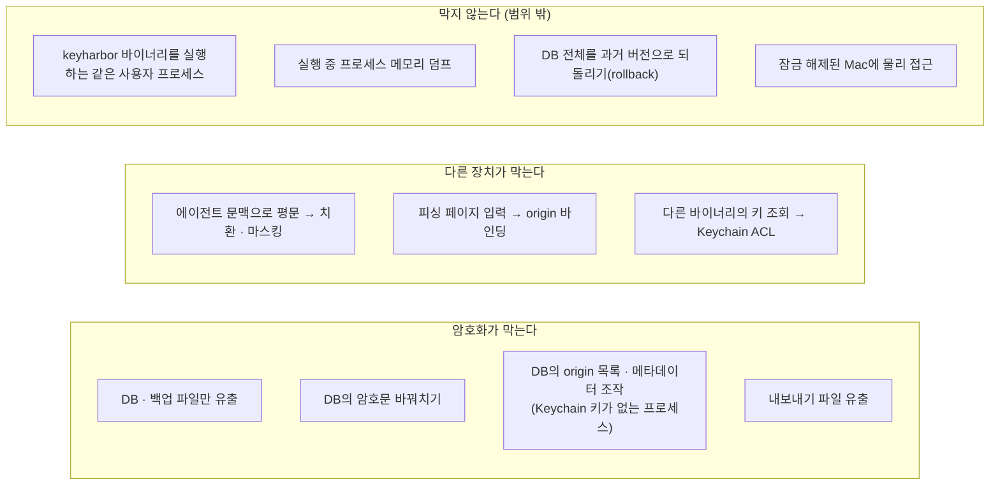
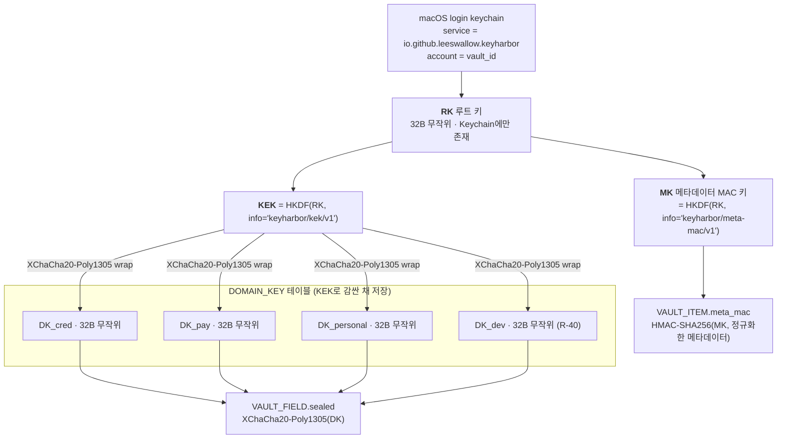
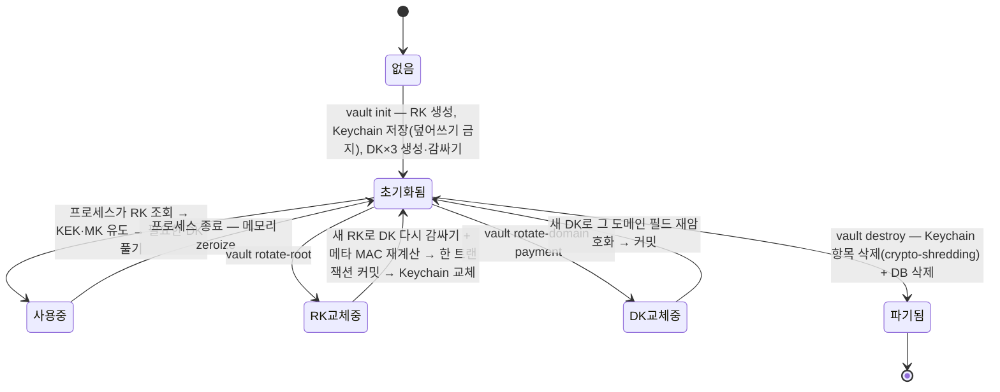
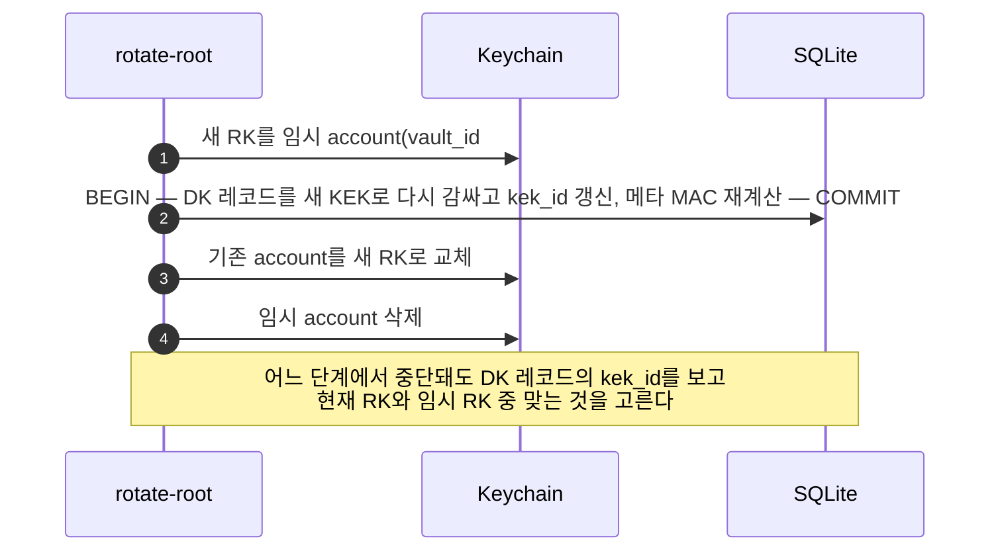

# 07. 암호화 설계 — 선행 사례 분석과 최종 명세

> 상태: Draft · 2026-10-28 · 양식: 1Password *Security Design*의 "How vault items are secured", Bitwarden *Security Whitepaper*의 "Encryption", KeePass *KDBX 4* 형식 문서를 참고했다.
>
> 원칙: **새로 발명하지 않는다** (R-26). 검증된 오픈소스와 표준이 이미 내린 결정을 비교하고, KeyHarbor의 조건(단일 사용자 · 단일 기기 · 에이전트 무중단 · 무료 직접 빌드)에 맞는 것을 고른다. 표준 형식이 있는 곳(내보내기 파일)은 그 형식을 그대로 쓴다.
>
> 이 문서는 [03 보안 화이트페이퍼](03-security-whitepaper.md)의 §3.3–§3.6을 자세히 풀고, 일부를 수정한다(§7.9).

## 7.1 KeyHarbor의 조건

| 조건 | 결과 |
|---|---|
| C1 단일 사용자 · 단일 기기, 공유·동기화 없음 | 공개키 암호와 서버 인증(SRP 등)이 필요 없다. 대칭 키만 쓴다 |
| C2 에이전트는 사용자 해제 없이 써야 한다 (P3) | 마스터 비밀번호에서 키를 유도하면 안 된다. 루트 키는 OS가 보관한다 |
| C3 무료 · 직접 빌드 (P1) | 유료 서명이 필요한 Data Protection Keychain·Secure Enclave entitlement에 의존하지 않는다 |
| C4 같은 OS 사용자 악성 프로세스는 범위 밖 (N1) | 하지만 **Keychain ACL이 다른 바이너리를 막는다**는 OS 기능은 활용한다 |
| C5 학습 목적 (R-15) · 알고리즘은 만들지 않음 (R-16) | 알고리즘은 라이브러리, **조합·포맷·수명**은 직접 설계하고 문서화한다 |

## 7.2 선행 사례 분석

### 7.2.1 비교표

| | **1Password** | **Bitwarden** | **KeePass / KeePassXC (KDBX 4)** | **age** | **SOPS** | **Google Tink** | **OpenKeylet** |
|---|---|---|---|---|---|---|---|
| 성격 | 상용 금고 (공유·동기화) | 오픈소스 금고 (공유·동기화) | 오픈소스 로컬 금고 파일 | 파일 암호화 도구·형식 | 설정 파일 비밀 암호화 | 암호 라이브러리 | 오픈소스 로컬 금고 |
| 루트 비밀 | 계정 비밀번호 + 128-bit Secret Key (2SKD) | 마스터 비밀번호 | 마스터 비밀번호 (+ 키 파일) | X25519 키 또는 passphrase | KMS · age · PGP 키 | KMS 등 외부 KEK | OS keyring / 로컬 키 파일 |
| KDF | PBKDF2-HMAC-SHA256 + Secret Key 혼합 | PBKDF2-SHA256 또는 Argon2id → HKDF로 늘림 | Argon2 (KDBX 4) / AES-KDF | scrypt (passphrase) · HKDF | — | HKDF (내부) | Argon2id (PIN 검증용) |
| 키 계층 | 계정 키 → **볼트 키** → 항목 | 마스터 키 → 사용자 대칭 키(암호화+MAC) → 조직 키 | 마스터 키 → 파일 하나 | file key (헤더 stanza에 감쌈) → payload key | **파일마다 data key** → 여러 KEK로 감쌈 | **keyset**(여러 키, primary 하나) → envelope | 마스터 키 → 항목 |
| 데이터 암호화 | AES-256-GCM | AES-256-CBC + HMAC-SHA256 (encrypt-then-MAC) | AES-256-CBC 또는 ChaCha20 + HMAC-SHA256 블록 | ChaCha20-Poly1305 STREAM (64 KiB 조각) | AES-256-GCM (값마다) | AES-GCM · XChaCha20-Poly1305 등 AEAD | XChaCha20-Poly1305 |
| 무결성 범위 | 항목 단위 AEAD | 값 단위 MAC | **헤더 HMAC** + 블록 HMAC | **헤더 MAC** + 조각 AEAD | 값 AEAD + **트리 전체 MAC** | 메시지 AEAD | 항목 AEAD |
| 형식 버전 · 키 식별 | 항목에 키 ID | 암호문 앞에 **type 번호** (`2.` = AES-CBC-HMAC) | 헤더에 cipher UUID · KDF 파라미터 | 헤더 버전 줄 · stanza 종류 | 메타데이터 블록 | **5바이트 key-id 접두사** · 출력 prefix 종류 | 포맷 버전 |
| KeyHarbor에 주는 교훈 | 볼트(=도메인) 단위 키 | 암호문에 알고리즘 type 붙이기, 키 늘리기(HKDF) | 헤더·메타데이터에도 MAC | **표준 형식 재사용**, 헤더 MAC | envelope, 메타데이터 MAC | 키 ID 접두사, keyset 회전 | 같은 스택(Rust · XChaCha · Keychain) |

출처는 §7.11. 1Password의 PBKDF2 반복 횟수 같은 세부 수치는 공식 문서에서 직접 확인하지 못해 표에서 뺐다 **[미검증]**.

### 7.2.2 모두가 합의한 것 (채택)

1. **인증 암호화(AEAD 또는 encrypt-then-MAC)만 쓴다.** 무인증 암호화(CBC 단독, CTR 단독)는 없다.
2. **키 계층(envelope)을 둔다.** 루트 비밀은 데이터 키를 감싸는 데만 쓰고, 데이터 키 교체와 루트 키 교체를 분리한다.
3. **암호문에 버전·알고리즘·키 ID를 붙인다.** 형식을 바꾸거나 키를 교체하는 동안에도 각 레코드를 해석할 수 있어야 한다 (Bitwarden type 번호, Tink key-id 접두사, KDBX 헤더).
4. **헤더·메타데이터에도 무결성을 건다.** 데이터만 보호하면 메타데이터 조작으로 우회된다 (KDBX 헤더 HMAC, age 헤더 MAC, SOPS 트리 MAC).
5. **비밀번호 기반 키에는 메모리 하드 KDF를 쓴다** (Argon2id 또는 scrypt). PBKDF2는 하위 호환을 위한 선택이다.
6. **검증된 구현을 쓴다.** 직접 구현하지 않는다.

### 7.2.3 KeyHarbor가 다르게 가는 것

| 사례의 방식 | KeyHarbor | 이유 |
|---|---|---|
| 마스터 비밀번호 → KDF → 루트 키 (1Password, Bitwarden, KeePass) | **OS Keychain이 무작위 루트 키를 보관** | C2. 해제 없이 에이전트가 써야 한다. OpenKeylet·SOPS(KMS)·Tink(KMS)처럼 "루트 키를 외부 키 저장소에 맡기는" 계열을 따른다 |
| 2SKD · SRP | 없음 | C1. 서버가 없다 |
| 공개키 공유 (Bitwarden 조직 키, age recipient) | 없음 | C1 |
| AES-256-GCM (1Password, SOPS) | **XChaCha20-Poly1305** | §7.4.1 |

## 7.3 위협과 암호화의 역할 분담

암호화가 해결하는 것과 해결하지 못하는 것을 먼저 나눈다. 해결하지 못하는 것은 다른 장치(마스킹·정책·OS)가 맡거나 범위 밖이다.



## 7.4 프리미티브 선택

### 7.4.1 AEAD: XChaCha20-Poly1305

| 후보 | nonce | 무작위 nonce 안전 한도 | 하드웨어 의존 | 판단 |
|---|---|---|---|---|
| AES-256-GCM | 96-bit | 같은 키로 **약 2³²개 메시지** (NIST SP 800-38D 권고) | AES-NI 없으면 느리고 상수 시간 구현이 어렵다 | 한도 관리 부담 |
| AES-256-GCM-SIV | 96-bit | nonce 재사용에도 기밀성 일부 유지 | 동일 | 좋은 선택지지만 Rust 생태계 성숙도 낮음 |
| ChaCha20-Poly1305 (RFC 8439) | 96-bit | GCM과 같은 문제 | 없음 | 한도 관리 부담 |
| **XChaCha20-Poly1305** | **192-bit** | 무작위 nonce 충돌을 사실상 무시할 수 있음 | 없음 | **채택** |

무작위 nonce를 쓰면 카운터 상태를 저장·동기화할 필요가 없다. CLI·MCP·감독자·관리 앱이 **서로 다른 프로세스에서 동시에 같은 키로 암호화**하는 KeyHarbor 구조에서는 이것이 결정적이다. OpenKeylet, libsodium(`crypto_aead_xchacha20poly1305_ietf`), Tink도 이 구성을 제공한다.

**알려진 성질 — key commitment 없음.** Poly1305 기반 AEAD는 서로 다른 두 키로 모두 복호화되는 암호문을 만들 수 있다("invisible salamanders"). KeyHarbor는 레코드의 `key_id`로 키를 하나만 골라 복호화하고, 사용자가 키를 고르는 경로가 없으므로 실질 위험이 낮다. 문서에 남긴다.

### 7.4.2 그 밖의 프리미티브

| 용도 | 선택 | 근거 |
|---|---|---|
| 키 유도 (루트 키 → 하위 키) | **HKDF-SHA256** (RFC 5869) | Bitwarden의 키 늘리기, age의 payload key 유도, Tink 내부와 같다 |
| 메타데이터 MAC | **HMAC-SHA256** | KDBX 4 헤더 HMAC과 같다 |
| 내보내기 파일 | **age 형식, passphrase(scrypt) recipient** | §7.7. 표준 형식 재사용 |
| 난수 | OS CSPRNG (`getrandom`) | |
| 비밀번호 생성 | 균등 무작위 + 엔트로피 표시 | |

### 7.4.3 라이브러리

| 후보 | XChaCha20-Poly1305 | 감사 | 의존성 | 판단 |
|---|---|---|---|---|
| **RustCrypto** (`chacha20poly1305`, `hkdf`, `hmac`, `sha2`) | ✅ | `aes-gcm`·`chacha20poly1305` — NCC Group 2020 공개 감사 | 순수 Rust | **채택** |
| `ring` | ❌ (XChaCha 없음) | BoringSSL 기반 | C/asm | 제외 |
| libsodium (`libsodium-sys`) | ✅ | 널리 검토됨 | C 라이브러리 | 빌드 의존성 증가 |
| Tink (Rust) | 공식 Rust 구현 없음 | — | — | 설계만 참고 |
| **`age` crate (rage)** | — | age 형식 참조 구현 중 하나 | 순수 Rust | 내보내기에 **채택** |
| `zeroize`, `secrecy` | — | — | — | 메모리 정리 |
| `security-framework` | — | — | Apple 프레임워크 바인딩 | Keychain |

## 7.5 키 계층 명세



| 키 | 생성 | 저장 | 용도 | 교체 시 영향 |
|---|---|---|---|---|
| RK | `vault init` 때 OS CSPRNG 32B | Keychain에만 | KEK·MK 유도 | DK 4개 다시 감싸기 + 메타 MAC 다시 계산 (필드 재암호화 없음) |
| KEK | RK에서 HKDF | 저장 안 함 (필요할 때 유도) | DK 감싸기 | — |
| MK | RK에서 HKDF | 저장 안 함 | 항목 메타데이터 MAC | — |
| DK_* | 도메인 생성 시 CSPRNG 32B (`DK_cred` 1 · `DK_pay` 2 · `DK_personal` 3 · `DK_dev` 4, 숫자는 AD의 domain 바이트) | `DOMAIN_KEY.wrapped` | 필드 암호화 | 그 도메인의 필드만 재암호화 |

`DK_dev`(R-40)는 다른 도메인 키와 똑같이 만든다. 새 HKDF 라벨은 없다(J-54). R-40 이전 금고에는 이 키가 없으므로, 처음 여는 프로세스가 `vault.lock`을 잡고 키를 만들어 감싼 뒤, 자격 증명 도메인에 있던 `secret`·`env` 항목의 필드를 `DK_dev`(AD domain = 4)로 다시 봉인하고 메타 MAC을 다시 계산해 **새 키 행과 함께 한 트랜잭션**으로 커밋한다. 중간에 실패하면 아무것도 바뀌지 않고, 키 행이 있으면 이전은 끝난 것이다.

**왜 RK를 직접 쓰지 않고 HKDF로 나누는가** — 한 키를 두 용도(감싸기, MAC)에 쓰지 않는다는 키 분리 원칙 때문이다. Bitwarden이 마스터 키를 HKDF로 암호화 키와 MAC 키로 늘리는 것과 같은 이유다.

**왜 DK를 RK에서 유도하지 않고 무작위로 만들어 감싸는가** — 유도하면 RK를 바꿀 때 모든 필드를 다시 암호화해야 한다. 무작위 DK를 감싸 두면 RK 교체는 DK 몇 개(지금은 4개)만 다시 감싸면 된다. SOPS·Tink의 envelope와 같다.

## 7.6 레코드 형식

### 7.6.1 필드 레코드 v1

```text
offset  size  내용
0       1     version = 0x01
1       1     suite   = 0x01 (XChaCha20-Poly1305)
2       16    key_id  (DK의 ID)
18      24    nonce   (OS CSPRNG)
42      n+16  ciphertext ‖ Poly1305 tag

AD = "keyharbor/field/v1" ‖ 0x00
   ‖ vault_id (16B) ‖ domain (1B) ‖ item_id (16B)
   ‖ u16be(len(field_name)) ‖ field_name (UTF-8)
   ‖ version ‖ suite ‖ key_id
```

- **`suite` 바이트**는 Bitwarden의 type 번호, Tink의 key-id 접두사와 같은 역할을 한다. 알고리즘을 바꿀 때 레코드마다 구분할 수 있다(crypto agility).
- **AD에 vault_id·domain·item_id·field_name을 넣는다.** 다른 금고, 다른 도메인, 다른 항목, 다른 필드로 옮긴 암호문은 복호화에 실패한다.
- **AD에 헤더(version·suite·key_id)를 넣는다.** 헤더만 바꿔치는 것도 실패한다 (age·KDBX의 "헤더도 인증" 원칙).
- 길이 접두사(`u16be`)로 연결한다. 이렇게 하면 `"ab" ‖ "c"`와 `"a" ‖ "bc"`가 같은 AD가 되는 모호성이 생기지 않는다.

### 7.6.2 도메인 키 레코드 v1

```text
version 0x01 ‖ suite 0x01 ‖ kek_id (16B) ‖ nonce (24B) ‖ wrap(DK) ‖ tag
AD = "keyharbor/dk/v1" ‖ 0x00 ‖ vault_id ‖ domain ‖ dk_id ‖ 헤더
```

`kek_id`는 RK가 바뀔 때마다 새로 정한다. RK 교체 중 중단돼도 어떤 DK 레코드가 어느 RK 세대로 감싸졌는지 알 수 있다.

### 7.6.3 메타데이터 MAC

```text
meta_mac = HMAC-SHA256(MK,
  "keyharbor/meta/v1" ‖ 0x00 ‖ vault_id ‖ item_id ‖ domain (1B) ‖ lp(kind)
  ‖ lp(name) ‖ origin_binding (1B) ‖ u16be(count) ‖ lp(origin_1) … (정렬·중복 제거)
  ‖ lp(status) ‖ lp(updated_at))
```

`lp(x)`는 `u16be(길이) ‖ x`다. origin 목록은 정렬하고 중복을 없앤 뒤 넣는다. `status`(draft·active·discarded)도 포함해 확정 상태를 몰래 바꾸지 못하게 한다. [구현 J-27] 감독자는 치환 입력 전에 이 MAC을 검증한다. **DB 쓰기 권한은 있지만 Keychain 키를 꺼낼 수 없는 프로세스**가 origin 목록을 바꿔 피싱 origin을 추가하면 검증에 실패한다. 03의 T6을 부분적으로 완화한다(§7.9).

## 7.7 내보내기·가져오기: age 형식

이전 판(03 §3.6.3)은 자체 형식(`KHEXPORT` + Argon2id)을 정의했다. **표준 형식이 있는 곳에서는 형식을 발명하지 않는다**는 원칙에 따라 [age](https://age-encryption.org/v1) 형식으로 바꾼다. [설계자 판단, R-26]

| 항목 | 자체 형식 (이전) | age (채택) |
|---|---|---|
| 명세 | 우리가 작성 | 공개 명세 v1, 여러 독립 구현 |
| 비밀번호 KDF | Argon2id | scrypt (age passphrase recipient 표준) |
| 큰 데이터 | 한 번에 AEAD | 64 KiB STREAM 조각 + 헤더 MAC |
| 다른 도구로 열기 | 불가 | `age -d`, `rage -d`로 열 수 있음 → **KeyHarbor가 사라져도 사용자가 데이터를 꺼낼 수 있다** (P1) |

평문 페이로드는 JSON `{ format: "keyharbor-export/v1", vault: {...}, domains: [...], items: [...], policies: [...] }`이다. 세션·프로필·기록은 넣지 않는다. 가져오기는 새 DK를 만들어 다시 암호화한다. 내보낸 파일의 키를 재사용하지 않는다.

## 7.8 키 수명 주기



**RK 교체의 중단 안전성** — Keychain과 SQLite는 하나의 트랜잭션으로 묶을 수 없다. 그래서 순서를 정한다.



**동시 실행 안전성** [구현, 리뷰 I1·I2] — 교체는 데이터 폴더의 `vault.lock`에 배타 잠금을 잡고, 시작할 때 읽은 `vault.version`이 커밋 시점에도 같을 때만 커밋한다(CAS). 다른 프로세스가 그사이 항목을 바꿨다면 교체는 아무것도 바꾸지 않고 "vault changed during rotation"으로 끝난다. 금고를 여는 쪽은 잠금을 얻을 수 있을 때만 남은 `#next` 키를 지우고, 주 키로 열리지 않으면 잠금을 기다린 뒤 다시 시도한다. 모든 쓰기(`add`·`edit`)는 자신이 쓴 KEK ID와 도메인 키 ID가 DB의 현재 값과 같은지 같은 트랜잭션 안에서 확인하고, 다르면 "vault changed; reopen"으로 거부한다. 그래서 교체 전에 연 오래된 프로세스가 죽은 키로 봉인하거나 낡은 MK로 서명하지 못한다.

**삭제** — 항목 삭제는 SQLite에서 `PRAGMA secure_delete = ON`으로 빈 페이지를 덮어쓴다. WAL 파일과 SSD 특성상 완전한 물리 삭제는 보장하지 않는다. 금고 전체 파기는 **Keychain의 RK를 지우는 것**으로 남은 암호문을 무의미하게 만든다(crypto-shredding).

## 7.9 03 화이트페이퍼에서 바뀌는 것

| 03의 내용 | 바뀐 내용 |
|---|---|
| §3.3 VK가 DK를 직접 감쌈 | RK → HKDF → KEK(감싸기)·MK(메타 MAC)로 분리 |
| §3.6.2 필드 레코드 (ver · key_id · nonce) | `suite` 바이트 추가, AD에 vault_id · domain · 헤더 포함, 길이 접두사 |
| §3.6.3 자체 내보내기 형식 + Argon2id | **age 형식 + scrypt** |
| T6 origin 목록 조작 — "보호하지 않음" | Keychain 키를 꺼낼 수 없는 프로세스에 대해서는 **메타 MAC으로 탐지** |
| (없음) | 키 수명 주기, RK 교체 순서, crypto-shredding, `secure_delete` |

## 7.10 메모리·프로세스 위생

| 조치 | 내용 | 참고 |
|---|---|---|
| zeroize | 키와 평문은 `Zeroizing<_>` / `SecretBox<_>`로 감싸 drop 시 덮어쓴다 | 1Password·Bitwarden 클라이언트 관행 |
| Debug 금지 | 비밀 타입은 `Debug`·`Display`를 구현하지 않거나 `[REDACTED]`를 출력 | |
| 코어 덤프 끄기 | 감독자와 `keyharbor run`은 시작 시 `RLIMIT_CORE = 0` | |
| 짧은 수명 | DK는 필요한 동안만 풀어 둔다. 감독자는 세션 동안 유지(마스킹 때문에) | |
| swap | macOS는 swap을 기본으로 암호화한다. `mlock`은 best-effort로만 시도한다 | |
| 상수 시간 비교 | MAC 검증은 라이브러리의 `verify_slice` 사용 | |

## 7.11 테스트 전략

| 종류 | 내용 |
|---|---|
| 알려진 답 테스트 (KAT) | 고정 키·nonce·AD로 만든 레코드 바이트를 저장소에 두고, 형식이 바뀌지 않았는지 확인 |
| 표준 벡터 | XChaCha20-Poly1305 IETF draft 벡터, HKDF RFC 5869 벡터로 라이브러리 연결 확인 |
| 부정 테스트 | AD의 각 요소(vault·domain·item·field·헤더)를 하나씩 바꿨을 때 모두 실패 |
| 퍼징 | 레코드 파서를 `cargo-fuzz`로 퍼징 — 패닉 없이 오류만 |
| 수명 주기 | RK·DK 교체의 각 단계 뒤에 프로세스를 강제 종료하고 복구 |
| 상호 운용 | 내보내기 파일을 `age -d`로 열 수 있는지 확인 |
| 누출 검사 | [05 §5.3](05-roadmap-and-verification.md#53-검증-게이트-모든-단계-공통)의 합성 비밀 스캔 |

### 부록: v1 KAT

`rebuild/crates/vault/tests/kat.rs`에 고정된 값이다. 바뀌면 기존 금고를 읽을 수 없다. HKDF 값은 Python 표준 라이브러리(`hmac`·`hashlib`)로 따로 계산해 일치를 확인했다.

| 입력 | 출력 (hex) |
|---|---|
| RK = `11`×32, vault_id = `22`×16 → KEK | `50e57b267060479352f0371205a95d6dfc95509d4ebc436c14a6cb170f826ffc` |
| 같은 입력 → MK | `dbbbe3429d5dcf75b555f8d134c8f28de6666f0790bff98a26f1f54fbbe06479` |
| DK = `33`×32, dk_id = `44`×16, item = `55`×16, field = `password`, domain = credentials, nonce = `66`×24, 평문 `KH-KAT` → 필드 레코드 | `0101` ‖ `44`×16 ‖ `66`×24 ‖ `f7159b83f760b5caa17a237a12585b8564417968cbf3` |
| 같은 키·nonce, field = `value`, domain = developer(4) → 필드 레코드 (암호문은 같고 태그만 다르다) | `0101` ‖ `44`×16 ‖ `66`×24 ‖ `f7159b83f76058b5257856d2797687e022dab9576615` |

## 7.12 출처

- [1Password Security Design (agilebits.github.io)](https://agilebits.github.io/security-design/1Password_Security_Design.pdf), [Account password and Secret Key](https://agilebits.github.io/security-design/apsk.html)
- [Bitwarden Security Whitepaper](https://bitwarden.com/help/bitwarden-security-white-paper.md), [What encryption is used](https://bitwarden.com/help/what-encryption-is-used/)
- [KeePass KDBX 형식](https://keepass.info/help/kb/kdbx.html), [KDBX 4](https://keepass.info/help/kb/kdbx_4.html), [Palant — Documenting KeePass KDBX4 file format](https://palant.info/2023/03/29/documenting-keepass-kdbx4-file-format/)
- [age 형식 명세 v1](https://age-encryption.org/v1)
- [SOPS](https://github.com/getsops/sops), [Google Tink](https://developers.google.com/tink)
- [NCC Group — RustCrypto AES-GCM and ChaCha20+Poly1305 Implementation Review (2020)](https://www.nccgroup.com/research/public-report-rustcrypto-aesgcm-and-chacha20pluspoly1305-implementation-review/)
- [OpenKeylet](https://github.com/omaekumiko2-create/OpenKeylet) (`src-tauri/src/crypto.rs`)
- RFC 8439 (ChaCha20-Poly1305), draft-irtf-cfrg-xchacha (XChaCha20), RFC 5869 (HKDF), RFC 2104 (HMAC), RFC 7914 (scrypt), RFC 9106 (Argon2), NIST SP 800-38D (GCM)
- [OWASP Cryptographic Storage Cheat Sheet](https://cheatsheetseries.owasp.org/cheatsheets/Cryptographic_Storage_Cheat_Sheet.html)
