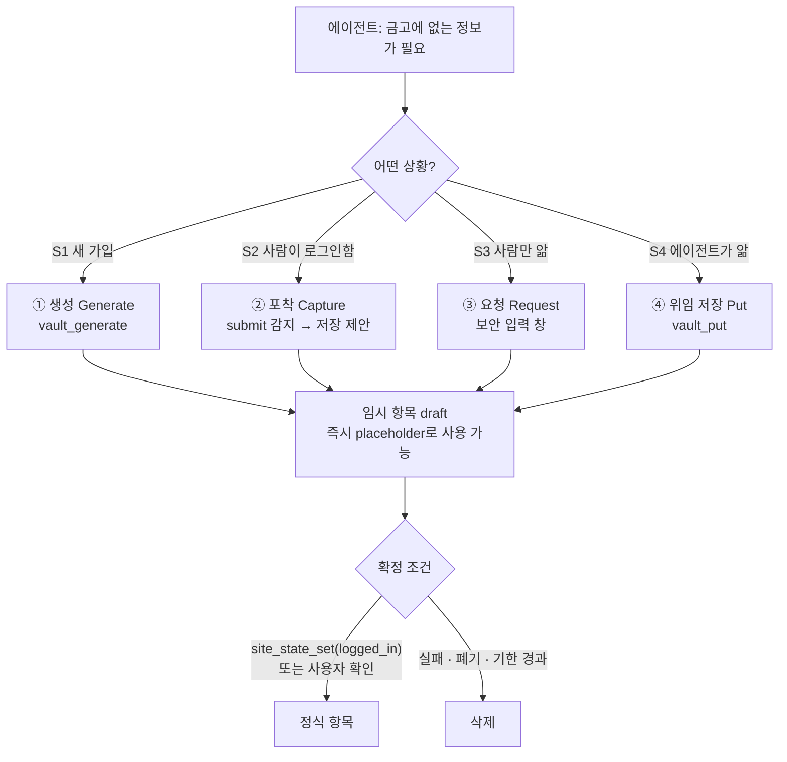
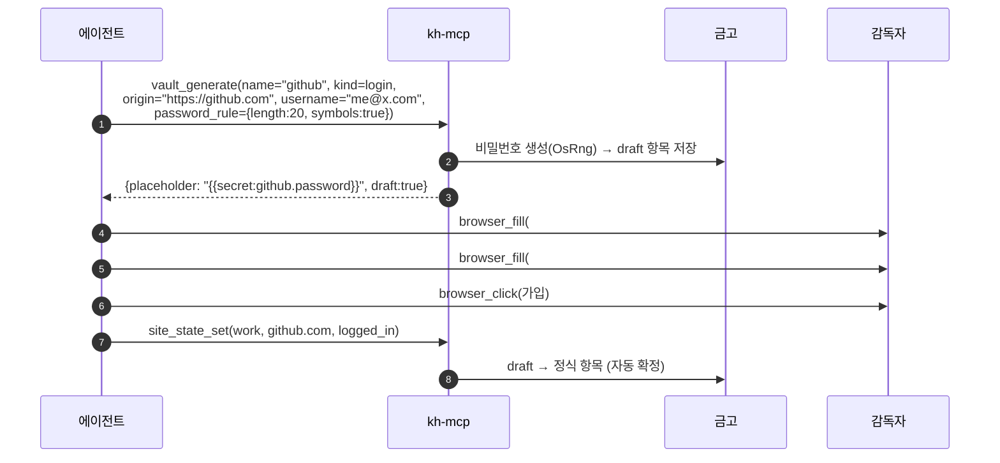
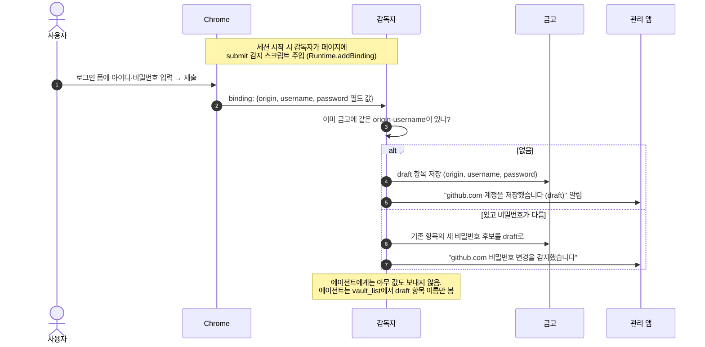
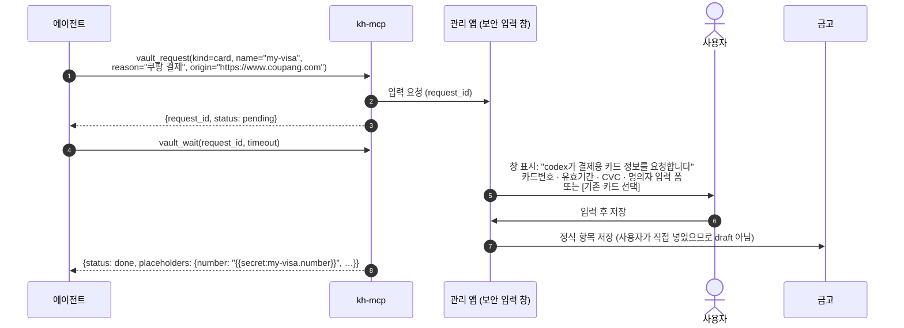
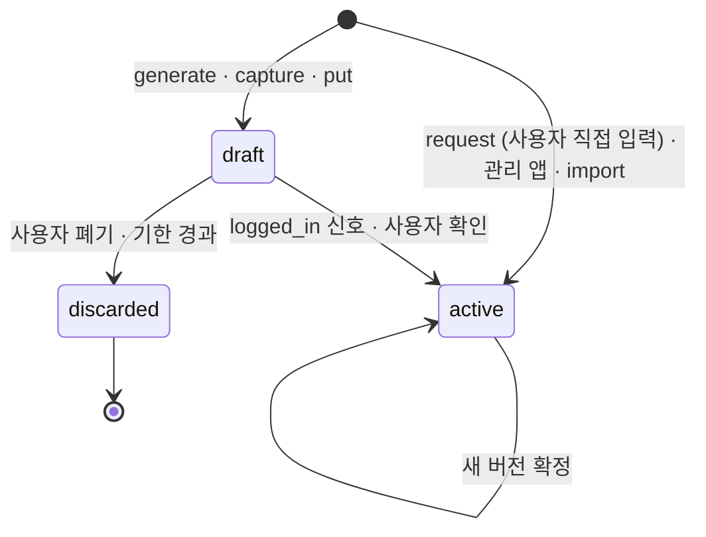

# 08. 미등록 정보의 등록 흐름

> 상태: Draft · 2026-10-28 · 관련 요구: R-27
>
> 참고한 실무 패턴: Chrome·Safari·1Password의 **"로그인 후 비밀번호 저장" 제안**(submit 감지 → 저장 확인), 1Password·Bitwarden의 **가입 폼 비밀번호 생성**, 1Password CLI의 **secret reference**(`op://…`), OS의 **보안 입력 창**(macOS 암호 입력 대화상자 — 앱이나 페이지가 내용을 읽지 못함).

## 8.1 문제

에이전트가 작업하다가 금고에 없는 정보가 필요해지는 경우는 네 가지다.

| # | 상황 | 예 | 값을 아는 사람 |
|---|---|---|---|
| S1 | **새 가입** — 아직 존재하지 않는 비밀번호 | 서비스 회원가입 | 아무도 없음 (만들어야 함) |
| S2 | **사람이 직접 로그인** — 인계 중 사용자가 입력 | CAPTCHA 때문에 넘겨받아 사용자가 로그인 | 사용자 (브라우저에 입력함) |
| S3 | **사람만 아는 정보가 필요** | 카드번호, 주소, 기존 계정 비밀번호 | 사용자 |
| S4 | **에이전트가 이미 받은 정보** | 사용자가 채팅에 붙여 넣은 API 키 | 에이전트 (이미 문맥에 있음) |

원칙 P4(에이전트는 평문을 받지 않는다) 때문에, S1–S3에서 **값이 에이전트를 거쳐 금고로 들어가면 안 된다**. S4는 이미 문맥에 있으므로 저장하는 것이 오히려 노출을 줄인다(이후에는 placeholder만 쓰게 됨).

## 8.2 추천: 네 가지 등록 경로



**핵심 아이디어 — "draft 후 확정".** 어떤 경로로 들어오든 먼저 **draft 항목**으로 저장하고, 바로 placeholder로 쓸 수 있게 한다. 그래서 에이전트는 멈추지 않는다(P3). 확정은 로그인 성공 신호나 사용자 확인으로 일어난다. 브라우저의 "비밀번호를 저장할까요?"를 에이전트 작업에 맞게 바꾼 것이다.

### ① 생성 (S1 · 새 가입)



- 사이트마다 비밀번호 규칙이 다르므로 `password_rule`(길이, 문자 종류, 금지 문자)을 받는다. 폼의 `minlength`·`pattern`·`passwordrules` 속성을 에이전트가 읽어 넘길 수 있다.
- 에이전트는 **값을 한 번도 보지 않는다**. username처럼 비밀이 아닌 값은 에이전트가 정해 줄 수 있다.

### ② 포착 (S2 · 사람이 직접 로그인한 뒤)

인계 중 사용자가 브라우저에 직접 입력한 아이디·비밀번호를 감독자가 **submit 순간에 포착**한다.



- 포착은 **감독자 안에서만** 일어나고, 값은 바로 암호화된다. 에이전트 응답 경로를 타지 않는다.
- 감지 규칙은 브라우저의 비밀번호 관리자와 같다. `form` submit, 또는 `input[type=password]`가 있는 폼에서 버튼 클릭이나 Enter를 감지하고, username은 password 앞의 text·email 입력란에서 찾는다.
- **기본값은 켜짐, 사용자가 끌 수 있다** (P2). [설계자 판단]
- **한계**: 주입한 스크립트는 페이지와 같은 세계에서 실행되지 않도록 **isolated world**(`Page.createIsolatedWorld`)에 넣는다. 그래도 페이지가 폼 구조를 비틀면 놓칠 수 있다. 놓친 경우에는 ③ 요청이나 관리 앱에서 직접 입력한다.

### ③ 요청 (S3 · 사람만 아는 정보)

에이전트가 정보를 **요청**하면, 사용자 화면에 **KeyHarbor의 보안 입력 창**(Tauri 창)이 뜬다. 웹 페이지 안의 폼이 아니므로 페이지 스크립트와 에이전트가 읽을 수 없다.



- 창에는 **누가, 왜, 어느 사이트용으로** 요청했는지 보인다. 1Password의 승인 창과 같은 정보다.
- 사용자는 **새로 입력**하거나, **기존 항목을 고르거나**, **거절**할 수 있다.
- 종류별 폼은 [02 §2.7.2](02-system-architecture.md#272-항목-종류와-필드-스키마)의 필드 스키마로 자동 생성한다.
- 관리 앱이 꺼져 있으면 `keyharbor`가 앱을 연다. 앱을 쓸 수 없는 환경에서는 CLI에서 `keyharbor vault fulfill <request_id>`로 터미널 입력(에코 없음)을 받는다.
- 이 흐름은 인계(`wait_auth` → `resume`)와 같은 **요청 ID + 대기** 모델을 재사용한다.

### ④ 위임 저장 (S4 · 에이전트가 이미 아는 값)

```text
vault_put(name="openai", kind=secret, fields={value: "sk-..."}, origin=null)
→ {placeholder: "{{secret:openai.value}}", draft: true, source: "agent"}
```

- 값이 이미 에이전트 문맥에 있으므로 저장해도 새로 노출되지 않는다. 저장한 뒤부터는 마스킹 대상에 들어가므로, 이후 응답에서는 값이 가려진다.
- `source: agent`로 표시한다. 관리 앱에서 "에이전트가 저장함"으로 구분해 보여 준다.
- **기존 항목을 덮어쓰지 못한다.** 같은 이름이 있으면 거부하거나, 새 버전을 draft로만 만든다. 인젝션된 에이전트가 정상 비밀번호를 공격자 값으로 바꿔치기하는 것을 막기 위해서다. [설계자 판단]

## 8.3 draft 항목

| 속성 | 값 |
|---|---|
| 상태 | `draft` → `active` 또는 `discarded` |
| 사용 | draft도 placeholder로 **즉시** 쓸 수 있다 (P3) |
| 자동 확정 | 같은 세션·origin에 `site_state_set(logged_in)`이 기록되면 `login` draft를 확정한다. 대상은 이름을 준 draft, 없으면 그 origin의 가장 최근 draft다. **생성(`generated`)이나 포착(`captured`)된 draft만** 저절로 확정된다. 에이전트가 `vault_put`으로 넣은 draft는 사람이 확정한다 [J-79] |
| 사용자 확정 | 관리 앱의 "확인 대기" 목록에서 확정·수정·폐기. 앱 전에는 CLI `keyharbor vault confirm|discard <이름>`, 번호 붙은 draft를 확정하면 원래 항목을 한 번에 대체한다 |
| 자동 폐기 | 기한(기본 7일) 동안 확정되지 않으면 폐기. 기한은 사용자가 바꿀 수 있다 [설계자 판단]. 설정 `draft_ttl`(기본 `7d`, `none`이면 두기), `keyharbor vault prune-drafts`가 지난 draft와 폐기된 항목을 지운다 |
| 기존 항목 변경 | 포착·위임 저장이 기존 항목의 값을 바꾸려 하면 항상 **새 버전 draft**로 남기고, 확정 전까지 기존 값을 유지한다. 새 버전의 이름은 `<이름>~draft-N`(빈 번호 중 가장 작은 것)이다. `~`는 사람·에이전트가 고르는 이름에 쓸 수 없어 draft만 갖는다. 한 이름의 draft는 20개까지다 [J-77] |
| 정책 | "draft 없이 바로 확정"을 사용자가 고를 수 있다 (P2) |



## 8.4 경로별 비교

| | ① 생성 | ② 포착 | ③ 요청 | ④ 위임 저장 |
|---|---|---|---|---|
| 에이전트가 값을 보는가 | 아니오 | 아니오 | 아니오 | 이미 봄 |
| 사람 개입 | 없음 | 사용자가 로그인할 때만 | 입력 창 1회 | 없음 |
| 에이전트 중단 | 없음 | 없음 | 입력할 때까지 대기 | 없음 |
| 주 대상 | 새 계정 비밀번호 | 기존 계정 비밀번호 | 카드 · 개인정보 · 기존 비밀번호 | API 키 · 토큰 |
| 결과 상태 | draft | draft | active | draft |
| 참고한 패턴 | 1Password·Bitwarden 생성기 | 브라우저 저장 제안 | OS 보안 입력·1Password 승인 | 1Password secret reference |

**추천 우선순위**: ①과 ②가 가장 자연스럽다. 사용자가 거의 아무것도 하지 않아도 금고가 채워지기 때문이다. ③은 사람만 아는 정보(특히 결제)를 위한 안전한 기본 경로다. ④는 편의 기능이다.

## 8.5 추가되는 MCP 도구

| 도구 | 인자 | 반환 |
|---|---|---|
| `vault_generate` | name, kind=login, origin, username?, password_rule? | placeholder, draft |
| `vault_request` | kind, name?, reason, origin?, fields? | request_id |
| `vault_wait` | request_id, timeout_seconds | status, placeholders |
| `vault_put` | name, kind, fields, origin? | placeholder, draft |

모든 반환값에는 값이 들어가지 않는다. `vault_list`는 draft 여부와 출처(`generated`·`captured`·`requested`·`agent`·`user`)를 함께 보여 준다.

## 8.6 열린 점

- ② 포착은 페이지에 스크립트를 넣는다. isolated world에서도 Chrome 확장·사이트 보안 정책과 충돌하지 않는지 1단계 브라우저 브로커에서 실험한다 **[미검증]**.
- 사이트마다 가입 성공 신호가 다르다. 자동 확정은 에이전트가 기록하는 `logged_in`에 의존한다. 이것은 KeyHarbor가 성공을 판정하지 않는다는 원칙(P5)과 맞는다.
