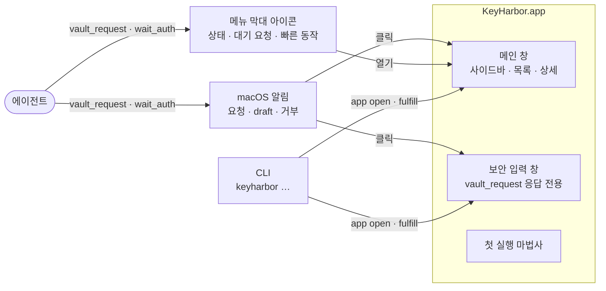
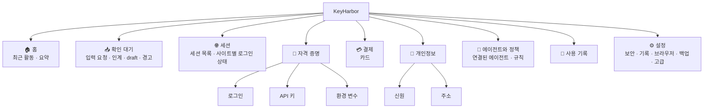
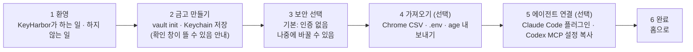

# 09. 관리 앱 UI·UX 설계

> 상태: Draft · 2026-10-28 · 관련 요구: R-11, R-28
>
> 참고: Google 비밀번호 관리자(passwords.google.com · Chrome 설정의 *비밀번호 / 결제 수단 / 주소 및 기타*), 1Password 8(사이드바·목록·상세 3단 구성, Watchtower), macOS 시스템 설정(사이드바 탐색), Apple Human Interface Guidelines(메뉴 막대 extra, 알림, 템플릿 이미지), Lucide 아이콘 세트.

## 9.1 UX 원칙

| # | 원칙 | 화면에서의 모습 |
|---|---|---|
| U1 | **에이전트가 한 일이 먼저 보인다** | 첫 화면은 "최근 활동"과 "확인 대기". 항목 목록이 아니다 |
| U2 | **막지 않고 알린다** (P2·P3) | 확인 창으로 에이전트를 세우지 않는다. 알림과 "확인 대기" 배지로만 알린다. 예외는 사용자가 직접 연 보안 입력 창 |
| U3 | **위험은 한 번, 분명하게** | "인증 없음", "origin 바인딩 끔", "raw CDP 켬"은 켜는 순간 한 번 설명하고, 이후 그 항목·설정 옆에 작은 표시만 남긴다 |
| U4 | **값은 기본으로 가린다** | 모든 비밀은 `••••`로 보이고, 보기·복사는 명시적 동작이다 |
| U5 | **도메인이 곧 탐색 구조** | 사이드바 = 세션 · 자격 증명 · 결제 · 개인정보 ([02 §2.7.1](02-system-architecture.md#271-도메인-분할-r-24-r-25)) |
| U6 | **키보드로 다 된다** | 모든 동작에 단축키나 명령 팔레트(⌘K) 진입점이 있다 |
| U7 | **한국어 우선, 시스템 따름** | 한국어 기본 · 영어 제공, 라이트/다크·글자 크기·동작 줄이기 설정을 시스템에서 따른다 |

## 9.2 화면 표면



| 표면 | 언제 | 비고 |
|---|---|---|
| 메인 창 | 사용자가 열 때 | 창을 닫아도 메뉴 막대에 남는다 |
| 메뉴 막대 아이콘 | 로그인 시 자동 실행(설정으로 끌 수 있음) | 템플릿 이미지, 상태 배지 |
| 보안 입력 창 | 에이전트가 `vault_request`를 보낸 뒤 사용자가 알림을 누르거나 앱을 열 때 | 항상 위·작은 창, 페이지 밖에서 입력 |
| 알림 | 입력 요청, 인계 요청, draft 생성, 정책 거부 | 각 종류를 설정에서 끌 수 있다 |

## 9.3 정보 구조



(이모지는 문서용 표기다. 실제 앱은 §9.6의 Lucide 아이콘을 쓴다.)

## 9.4 메인 창 레이아웃

```text
┌──────────────────────────────────────────────────────────────────────────────┐
│ ● ● ●   KeyHarbor                         [⌘K 검색 · 명령]          [+ 새 항목] │
├────────────────┬───────────────────────────────┬─────────────────────────────┤
│ 홈             │ 로그인 ▾  정렬: 최근 사용 ▾    │  github                      │
│ 확인 대기   3  │ ┌───────────────────────────┐ │  🔑 로그인 · 자격 증명        │
│ ───────────    │ │ 🔑 github        2분 전 ● │ │  ─────────────────────────── │
│ 세션        2  │ │    me@x.com · github.com  │ │  아이디   me@x.com      [복사]│
│ ───────────    │ ├───────────────────────────┤ │  비밀번호 ••••••••  [보기][복사]│
│ 자격 증명      │ │ 🔑 vercel   draft  1시간 전│ │  사이트   https://github.com  │
│   로그인   12  │ │    me@x.com · vercel.com  │ │           + 사이트 추가        │
│   API 키    4  │ ├───────────────────────────┤ │  origin 바인딩  [켜짐 ●]      │
│   환경 변수 3  │ │ 🔑 naver        3일 전     │ │  메모     —                   │
│ 결제        1  │ │    …                      │ │  ─────────────────────────── │
│ 개인정보    2  │ └───────────────────────────┘ │  placeholder                 │
│ ───────────    │                               │  {{secret:github.password}} ⧉│
│ 에이전트·정책  │                               │  ─────────────────────────── │
│ 사용 기록      │                               │  최근 사용                    │
│ 설정           │                               │  codex · work · 2분 전 · 성공 │
│                │                               │  claude · 어제 · 거부(origin) │
│ ● 인증 없음    │                               │  [편집] [비밀번호 변경] [삭제]│
└────────────────┴───────────────────────────────┴─────────────────────────────┘
```

- 3단 구성(사이드바 · 목록 · 상세)은 1Password 8, macOS 메일과 같다. 창이 좁으면 상세가 목록 위에 겹쳐 열린다.
- 사이드바 맨 아래에 **현재 보안 상태**(인증 방식)를 항상 보여 준다. 누르면 설정 → 보안으로 간다 (U3).
- 목록의 `●`는 "최근 1시간 안에 에이전트가 사용함", `draft` 배지는 확정 전 항목이다.
- placeholder 옆 ⧉로 **placeholder 문자열**을 복사한다. 사용자가 프롬프트나 `.env.keyharbor`에 붙여 넣을 때 쓴다. 값이 아니므로 안전하다.

### 9.4.1 홈

```text
┌─ 홈 ───────────────────────────────────────────────────────────────┐
│  확인 대기 3   ▸ 카드 입력 요청 (codex · 쿠팡 결제)     [입력하기]   │
│                ▸ 인계 대기 (work 세션 · github.com)     [재개]       │
│                ▸ draft 1개 (vercel)                     [확인]       │
│ ─────────────────────────────────────────────────────────────────── │
│  오늘          비밀 사용 24   거부 1   새 항목 2   실행 중 세션 2    │
│ ─────────────────────────────────────────────────────────────────── │
│  최근 활동                                                          │
│  14:02  codex   github.password   → github.com      성공            │
│  13:58  codex   myapp-dev (env)   → keyharbor run   성공            │
│  13:40  claude  bank.password     → evil.example    거부: origin    │
│  …                                              [사용 기록 전체 →]  │
│ ─────────────────────────────────────────────────────────────────── │
│  점검  ⚠ origin 바인딩이 꺼진 로그인 2개   ⚠ 90일 넘게 안 쓴 항목 5 │
└─────────────────────────────────────────────────────────────────────┘
```

"점검"은 1Password Watchtower에 해당한다. 바인딩 꺼짐, 중복 비밀번호, 오래 안 쓴 항목, 확정 안 된 draft, raw CDP 세션을 보여 준다. 알리기만 하고 막지 않는다 (U2).

### 9.4.2 항목 종류별 상세

| 종류 | 상세 화면에서 다른 점 |
|---|---|
| 로그인 | 비밀번호 강도 표시, "비밀번호 생성" 버튼, 연결된 세션의 로그인 상태(`logged_in`/`expired`) |
| API 키 | 값 한 줄, 허용 origin(선택) |
| 환경 변수 | 변수 표(이름 · 값 `••••` · 보기), `.env` 가져오기, **`.env.keyharbor` 템플릿 복사**, `keyharbor run` 예시 명령 복사 |
| 카드 | 카드 모양 미리보기(브랜드 · 끝 4자리만), 상점·결제사 origin 목록, 청구 주소 연결 |
| 신원 · 주소 | 필드 표, "이 주소를 카드 청구지로 쓰는 카드" 역참조 |

### 9.4.3 세션

```text
┌─ 세션 ─────────────────────────────────────────────────────────────┐
│  work      ● 실행 중    codex    generation 3f2a…    [창 보기][중지] │
│    github.com   logged_in   14:02 확인 · github 항목               │
│    vercel.com   expired     어제                                   │
│  shopping  ○ 중지됨                                   [열기][삭제] │
│  research  ⚠ 복구 필요  감독자 없음                   [복구…]       │
│  ⚠ raw CDP 켜짐 세션은 마스킹·정책이 적용되지 않습니다             │
└─────────────────────────────────────────────────────────────────────┘
```

"복구…"를 누르면 브라우저 창을 모두 닫았는지 확인하는 체크박스를 보여 준다. 체크한 뒤에만 `recover --confirm-browser-closed`와 같은 동작을 한다. 막는 게 아니라 데이터 충돌을 막는 확인이다.

### 9.4.4 에이전트와 정책

```text
┌─ 에이전트와 정책 ──────────────────────────────────────────────────┐
│  연결된 에이전트                                                   │
│   codex    마지막 활동 2분 전    규칙 2개                [편집]    │
│   claude   마지막 활동 어제      규칙 없음 (모두 허용)   [편집]    │
│   [+ 에이전트 연결]  → MCP 설정 생성 · Claude Code 플러그인 설치    │
│ ─────────────────────────────────────────────────────────────────── │
│  규칙 (위가 더 구체적)                                             │
│   codex  · 결제 도메인 전체      거부                    [⋯]       │
│   codex  · 세션 work, research   허용                    [⋯]       │
│   모든 에이전트 · raw CDP        거부                    [⋯]       │
│   [+ 규칙]          미리보기: "codex가 my-visa를 쓰면 → 거부"      │
└─────────────────────────────────────────────────────────────────────┘
```

**규칙 미리보기**: 에이전트·동작·대상을 고르면 [02 §2.8](02-system-architecture.md#28-정책-판정)의 판정 결과와 그 결과를 만든 규칙을 즉시 보여 준다.

### 9.4.5 보안 입력 창 (`vault_request`)

```text
┌──────────────── KeyHarbor · 정보 요청 ────────────────┐
│ 🤖 codex 가 카드 정보를 요청합니다                    │
│    이유: "쿠팡 결제"   사이트: https://www.coupang.com │
│ ───────────────────────────────────────────────────── │
│  ○ 저장된 카드 사용   [ my-visa  •••• 4242 ▾ ]       │
│  ● 새 카드 입력                                       │
│     카드번호   [                    ]                 │
│     유효기간   [MM] / [YY]     CVC [   ]              │
│     명의자     [                    ]                 │
│     이름       [ coupang-card       ]                 │
│     사용할 사이트  ☑ coupang.com  ☐ 결제사 origin 추가 │
│ ───────────────────────────────────────────────────── │
│  이 값은 에이전트에게 보이지 않습니다.                │
│                          [거절]      [저장하고 보내기] │
└───────────────────────────────────────────────────────┘
```

- 창 제목과 첫 줄에 **누가 · 무엇을 · 왜 · 어디에**를 보여 준다.
- 입력란은 붙여넣기를 허용한다. 자동 완성·맞춤법 검사·기록은 끈다.
- "보내기"는 값이 아니라 placeholder를 에이전트에게 돌려준다는 뜻이다.

### 9.4.6 메뉴 막대

```text
 [⚓︎●]  ┌───────────────────────────────┐
        │ KeyHarbor · 세션 2 실행 중     │
        │ ───────────────────────────── │
        │ 📥 확인 대기 3                 │
        │    카드 입력 요청 (codex)  ▸   │
        │    인계 대기 (work)        ▸   │
        │ ───────────────────────────── │
        │ 최근: codex → github.com 성공  │
        │ ───────────────────────────── │
        │ 모든 세션 중지                 │
        │ KeyHarbor 열기          ⌘O    │
        │ 설정…                   ⌘,    │
        │ 종료                    ⌘Q    │
        └───────────────────────────────┘
```

메뉴 막대 아이콘 상태: 기본(아이콘만) · 실행 중 세션 있음(점) · 확인 대기 있음(숫자 배지) · 오류(느낌표).

### 9.4.7 설정 → 보안

```text
 인증 방식      ( ● 없음 ) ( ○ macOS 인증 · 준비 중 ) ( ○ 마스터 비밀번호 · 준비 중 ) ( ○ 2FA · 준비 중 )
                ⓘ 인증 없음: 이 Mac 사용자 계정으로 접근할 수 있는 누구나 금고를 볼 수 있습니다.
 인증 적용 범위  ☐ 앱 열기  ☐ 값 보기  ☐ 편집  ☐ 내보내기  ☐ 정책 변경     (인증 방식이 '없음'이면 비활성)
 새 로그인 기본  origin 바인딩 [켜짐]     로그인 포착 [켜짐]     draft 자동 폐기 [7일]
 클립보드       복사한 값 자동 지우기 [30초]
 고급           raw CDP 허용 [꺼짐]
```

"준비 중" 선택지는 이번 구현에서 보이기만 하고 고를 수 없다 (R-21).

## 9.5 첫 실행



2단계 다음에 **"이 Mac을 잃어버리면 금고도 잃습니다. 설정 → 백업에서 내보내기를 만들어 두세요"**를 한 번 보여 준다 (P6). 건너뛸 수 있다.

## 9.6 아이콘 체계

### 9.6.1 앱 아이콘


- **콘셉트**: 열쇠가 항구의 물결 위에 서 있다. 열쇠 고리는 등대의 불빛을, 물결은 항구(Harbor)를 뜻한다. 이름의 두 단어를 그대로 그렸다.
- 색: 밤바다 남색 바탕 `#1E3A5F → #0B1B2E`, 열쇠 금색 `#F5C451`, 물결 `#2F80ED`.
- macOS 아이콘 그리드: 1024px 캔버스, 824px squircle, 사방 100px 여백. 16·32px에서도 열쇠 모양이 읽히도록 선 굵기를 56px로 잡았다.
- 원본: [`assets/app-icon.svg`](assets/app-icon.svg). Tauri의 `tauri icon` 명령으로 `.icns`를 만든다.

### 9.6.2 메뉴 막대 아이콘


검은색 단색 **템플릿 이미지**(22×22pt)다. macOS가 라이트·다크 모드에 맞게 색을 바꾼다. 상태 배지는 아이콘 오른쪽 아래에 그린다. 원본: [`assets/menubar-icon.svg`](assets/menubar-icon.svg).

### 9.6.3 UI 아이콘 매핑 (Lucide)

오픈소스 [Lucide](https://lucide.dev) 세트(ISC 라이선스)를 쓴다. 선 굵기 1.75, 크기 16/20px.

| 대상 | Lucide 이름 | | 대상 | Lucide 이름 |
|---|---|---|---|---|
| 홈 | `house` | | 로그인 | `key-round` |
| 확인 대기 | `inbox` | | API 키 | `key-square` |
| 세션 | `app-window` | | 환경 변수 | `square-terminal` |
| 자격 증명 도메인 | `key` | | 카드 | `credit-card` |
| 결제 도메인 | `wallet` | | 신원 | `id-card` |
| 개인정보 도메인 | `user-round` | | 주소 | `map-pin` |
| 에이전트 | `bot` | | 정책 규칙 | `shield-check` |
| 사용 기록 | `scroll-text` | | 설정 | `settings` |
| 값 보기 / 가리기 | `eye` / `eye-off` | | 복사 | `copy` |
| placeholder 복사 | `braces` | | 비밀번호 생성 | `wand-sparkles` |
| draft | `file-pen-line` | | 인계 | `hand` |
| 실행 중 | `circle-play` | | 중지 | `circle-stop` |
| 복구 필요 | `life-buoy` | | 거부 | `shield-x` |
| 경고 | `triangle-alert` | | raw CDP | `plug-zap` |
| 내보내기 / 가져오기 | `upload` / `download` | | 키 교체 | `refresh-ccw-dot` |

### 9.6.4 도메인 색

| 도메인 | 라이트 | 다크 | 쓰임 |
|---|---|---|---|
| 세션 | `#0E7490` | `#22D3EE` | 사이드바 아이콘, 배지 |
| 자격 증명 | `#B45309` | `#F5C451` | |
| 결제 | `#7C3AED` | `#A78BFA` | |
| 개인정보 | `#047857` | `#34D399` | |
| 상태: 성공 · 경고 · 거부 | `#15803D` · `#B45309` · `#B91C1C` | `#4ADE80` · `#FBBF24` · `#F87171` | 기록·알림 |

색만으로 의미를 전달하지 않는다. 항상 아이콘이나 글자를 함께 쓴다 (WCAG 1.4.1).

## 9.7 디자인 토큰

| 토큰 | 값 |
|---|---|
| 글꼴 | `system-ui` (한글은 Apple SD Gothic Neo), 고정폭은 `ui-monospace` (placeholder · env 이름) |
| 크기 | 11 · 13(본문) · 15 · 20 · 26 |
| 간격 | 4pt 격자: 4 · 8 · 12 · 16 · 24 · 32 |
| 모서리 | 6(입력) · 10(카드) · 14(창 안 패널) |
| 대비 | 본문 4.5:1 이상 |
| 동작 | 150ms ease-out. "동작 줄이기"면 0ms |

## 9.8 전체 동작 목록

**인증 범위** 열은 §9.4.7의 범위 중 어디에 속하는지를 뜻한다. 이번 구현은 인증 없음이므로 모두 즉시 실행되지만, 나중에 인증을 붙일 자리를 미리 정해 둔다. **기록** 열은 사용 기록 이벤트([03 §3.6](03-security-whitepaper.md)·[02 §2.7](02-system-architecture.md#27-데이터-모델))다.

### 금고 항목

| 동작 | 진입점 | 인증 범위 | 기록 | 단축키 |
|---|---|---|---|---|
| 새 항목 (종류 선택) | 상단 + · ⌘K | 편집 | `vault_item_changed` | ⌘N |
| 항목 편집 · 저장 | 상세 | 편집 | `vault_item_changed` | ⌘E · ⌘S |
| 항목 삭제 (실행 취소 10초) | 상세 · 목록 우클릭 | 편집 | `vault_item_changed` | ⌘⌫ |
| 값 보기 / 가리기 | 필드의 눈 아이콘 | 값 보기 | `secret_revealed` | ⌥ 누르는 동안 보기 |
| 값 복사 (30초 뒤 클립보드 지움) | 필드의 복사 | 값 보기 | `secret_revealed` | ⌘C (필드 선택 시) |
| placeholder 복사 | 필드의 `{}` | 없음 | — | ⇧⌘C |
| 비밀번호 생성 | 로그인 편집 | 편집 | — | ⌘G |
| 사이트(origin) 추가 · 제거 | 상세 | 편집 | `vault_item_changed` | |
| origin 바인딩 켜기 · 끄기 (끌 때 1회 설명) | 상세 | 편집 | `vault_item_changed` | |
| 항목 이동 · 이름 변경 (placeholder 바뀜 경고) | 상세 ⋯ | 편집 | `vault_item_changed` | |
| 즐겨찾기 | 목록 별표 | 없음 | — | ⌘D |
| 검색 · 필터(도메인 · 종류 · draft · 최근 사용) | 목록 상단 · ⌘K | 없음 | — | ⌘F |
| 최근 사용 기록 보기 | 상세 하단 | 없음 | — | |

### 확인 대기

| 동작 | 진입점 | 인증 범위 | 기록 |
|---|---|---|---|
| 입력 요청 응답 (새로 입력 · 기존 선택 · 거절) | 보안 입력 창 · 알림 | 편집 | `vault_request_fulfilled` / `_declined` |
| draft 확정 · 수정 후 확정 · 폐기 | 확인 대기 · 상세 | 편집 | `vault_item_changed` |
| 비밀번호 변경 후보 적용 · 무시 | 확인 대기 | 편집 | `vault_item_changed` |
| 인계 재개 | 확인 대기 · 메뉴 막대 · 알림 | 없음 | `handoff_resumed` |
| 거부 기록에서 origin 바로 추가 | 확인 대기 · 기록 | 편집 | `vault_item_changed` |

### 세션

| 동작 | 진입점 | 기록 |
|---|---|---|
| 세션 만들기 · 이름 변경 · 삭제(프로필 삭제 확인) | 세션 | `session_*` |
| 열기 (시작 URL 선택) · 중지 · 모든 세션 중지 | 세션 · 메뉴 막대 | `session_opened` / `_stopped` |
| 브라우저 창 앞으로 가져오기 | 세션 | — |
| 복구 (브라우저 종료 확인 체크) | 세션 | `session_recovered` |
| 사이트 로그인 상태 수정 · 지우기 | 세션 상세 | `site_state_changed` |
| raw CDP로 다시 열기 (1회 설명) | 세션 ⋯ | `session_opened(cdp)` |

### 에이전트와 정책

| 동작 | 진입점 | 인증 범위 | 기록 |
|---|---|---|---|
| 에이전트 연결 (Claude Code 플러그인 설치 안내 · MCP 설정 JSON 복사) | 에이전트 | 정책 변경 | `agent_registered` |
| 에이전트 이름 변경 · 연결 해제 | 에이전트 ⋯ | 정책 변경 | `policy_changed` |
| 규칙 추가 · 편집 · 삭제 · 순서 보기 | 규칙 표 | 정책 변경 | `policy_changed` |
| 규칙 미리보기 (판정 시뮬레이션) | 규칙 편집 | 없음 | — |

### 사용 기록

| 동작 | 진입점 |
|---|---|
| 필터 (에이전트 · 세션 · 항목 · 도메인 · 결과 · 기간) | 기록 상단 |
| 이벤트에서 항목 · 세션 · 정책으로 이동 | 행 클릭 |
| 기록 내보내기 (CSV, 값 없음) | 기록 ⋯ |
| 기록 지우기 (기간 선택) · 기록 끄기 | 기록 ⋯ · 설정 |

### 설정 · 백업 · 키

| 동작 | 인증 범위 | 기록 |
|---|---|---|
| 인증 방식 · 적용 범위 선택 | 정책 변경 | `settings_changed` |
| 기본값 (바인딩 · 포착 · draft 기한 · 클립보드) | 정책 변경 | `settings_changed` |
| 내보내기 (age, 비밀번호 입력 두 번) | 내보내기 | `vault_exported` |
| 가져오기 (age · Chrome/Safari CSV · `.env`) — 미리보기 후 확정 | 편집 | `vault_imported` |
| 루트 키 교체 · 도메인 키 교체 (진행 표시, 중단 안전) | 정책 변경 | `key_rotated` |
| 금고 파기 (이름을 직접 입력해 확인) | 정책 변경 | — (기록도 함께 사라짐) |
| 데이터 폴더 열기 · 진단 정보 복사 (값 없음) | 없음 | — |

### 앱 전역

| 동작 | 단축키 |
|---|---|
| 명령 팔레트 (모든 동작 검색) | ⌘K |
| 사이드바 이동 | ⌘1 … ⌘9 |
| 확인 대기로 이동 | ⇧⌘I |
| 메인 창 열기 (메뉴 막대) | ⌘O |
| 설정 | ⌘, |

## 9.9 클립보드 처리

복사는 **사용자 동작**이지만, 클립보드는 같은 사용자의 모든 프로세스(에이전트의 `pbpaste` 포함)가 읽을 수 있다. 그래서 다음을 따른다. 1Password·Bitwarden의 관행과 같다.

- 값을 복사하면 `org.nspasteboard.ConcealedType` 표시를 붙인다. 이 표시를 존중하는 클립보드 관리자는 기록하지 않는다.
- 기본 30초 뒤, 클립보드가 여전히 그 값이면 지운다.
- 가능한 경우 값 복사보다 **placeholder 복사**를 먼저 보여 준다.

## 9.10 상태 화면

| 상태 | 화면 |
|---|---|
| 빈 금고 | 종류별 "첫 항목 만들기"와 가져오기 버튼 |
| 금고 키 없음 (Keychain 항목이 사라짐) | 전면 안내: "금고 키를 찾을 수 없습니다. 새 키를 만들지 않습니다." → [내보내기 파일로 복원] [진단 정보] |
| Keychain 확인 창 대기 | "macOS가 키체인 접근을 묻고 있습니다. '항상 허용'을 누르면 다시 묻지 않습니다." |
| 감독자 없음 | 세션 행에 `⚠ 복구 필요`와 [복구…] |
| 메타데이터 MAC 불일치 | 항목에 `⚠ 변조 의심 — 이 항목은 입력에 쓰이지 않습니다` + [확인 후 다시 서명] |
| 오류 | 짧은 이유 + [자세히](진단 코드). 값은 절대 표시하지 않음 |

## 9.11 접근성 · 국제화

- VoiceOver 레이블은 값을 읽지 않는다("비밀번호, 가려짐").
- 모든 대화형 요소는 Tab으로 도달하고, 초점 표시가 보인다.
- 한국어·영어 문자열 파일을 분리한다. 날짜와 시각은 시스템 로캘을 따른다.

## 9.12 프런트엔드 구성 (추천)

| 층 | 선택 | 이유 |
|---|---|---|
| 셸 | Tauri v2 | [ADR-0006](adr/0006-tauri-admin-app.md) |
| UI | React + TypeScript | 생태계, 접근성 컴포넌트 |
| 컴포넌트 | Radix 기반 shadcn/ui | 접근성(키보드·스크린 리더)을 갖춘 기본 부품 |
| 스타일 | Tailwind CSS + §9.7 토큰 | |
| 아이콘 | `lucide-react` | §9.6.3 |
| 상태 | Tauri 명령 호출 + TanStack Query | 서버 없음. 모든 데이터는 `kh-core` 명령으로 |

프런트엔드는 **값을 상태에 오래 두지 않는다**. "값 보기"를 누를 때만 받아 오고, 가리거나 화면을 떠나면 버린다.
