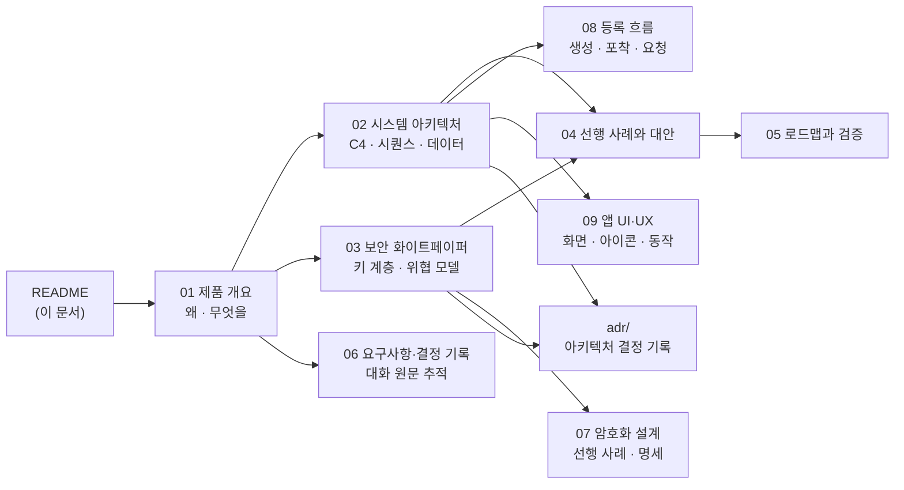

# KeyHarbor 기술 문서

| 항목 | 내용 |
|---|---|
| 문서 상태 | **Draft** — 설계 승인 전 |
| 최종 갱신 | 2026-10-28 |
| 대상 독자 | KeyHarbor 기여자, 구현자, 보안 검토자, 학습 목적의 독자 |
| 대체 문서 | [`../architecture-proposal.md`](../history/architecture-proposal.md)의 "비밀은 외부 금고가 소유한다" 결정 ([ADR-0002](adr/0002-own-local-vault.md)) |

KeyHarbor는 개인이 AI 에이전트를 **자신이 정한 권한 정책에 따라, 중단 없이** 쓰도록 브라우저 세션·인증 상태·비밀·권한을 **로컬에서** 관리하는 무료 오픈소스 기반 도구다.

## 문서 구성

| # | 문서 | 내용 | 참고한 양식 |
|---|---|---|---|
| 01 | [제품 개요](01-product-overview.md) | 의도, 원칙, 목표·비목표·반목표, 사용 장면, 범위 | Google Design Doc의 *Context and Scope / Goals and Non-Goals* |
| 02 | [시스템 아키텍처](02-system-architecture.md) | 컨텍스트·컨테이너·컴포넌트 다이어그램, 핵심 시퀀스, 상태 기계, 데이터 모델, crate 구조 | C4 Model + arc42 (Building Block / Runtime / Deployment View) |
| 03 | [보안 화이트페이퍼](03-security-whitepaper.md) | 신뢰 모델, 키 계층, 암호 프리미티브, 암호문 포맷, 치환·마스킹 알고리즘, STRIDE 위협 모델, 알려진 한계 | 1Password *Security Design White Paper*, Bitwarden *Security Whitepaper* |
| 04 | [선행 사례와 대안](04-landscape-and-alternatives.md) | 오픈소스·상용 사례 비교, 검토했으나 채택하지 않은 대안 | Google Design Doc의 *Alternatives Considered* |
| 05 | [로드맵과 검증](05-roadmap-and-verification.md) | 단계별 범위, 완료 조건, 검증 게이트 | 기술 리포트의 *Evaluation* 절 |
| 07 | [암호화 설계](07-cryptography-design.md) | 1Password·Bitwarden·KeePass·age·SOPS·Tink·OpenKeylet 비교, 프리미티브·라이브러리 선택, 키 계층·레코드 형식·수명 주기 명세 | 1Password *Security Design*, KeePass *KDBX 4* 형식 문서 |
| 08 | [미등록 정보의 등록 흐름](08-registration-flows.md) | 생성 · 포착 · 요청 · 위임 저장의 4경로, draft 후 확정 모델, 추가 MCP 도구 | 브라우저 비밀번호 저장 제안, 1Password 생성기·승인 창 |
| 09 | [관리 앱 UI·UX](09-app-ux.md) | 화면 표면, 정보 구조, 와이어프레임, 앱·메뉴 막대·UI 아이콘, 디자인 토큰, 전체 동작 목록 | Google 비밀번호 관리자, 1Password 8, Apple HIG |
| 06 | [요구사항·결정 기록](06-requirements-log.md) | 사용자가 말한 요구를 시간순으로 정리하고 결정으로 연결 | Requirements Traceability Matrix |
| — | [ADR 목록](adr/README.md) | 되돌리기 어려운 결정 하나당 문서 하나 | Michael Nygard, *Documenting Architecture Decisions* |

## 표기 규칙

- **[사용자 결정]**: 사용자가 대화에서 직접 정한 것. 근거는 [06](06-requirements-log.md)의 요구 ID(`R-nn`)로 연결한다.
- **[설계자 판단]**: 사용자가 맡긴 영역에서 설계자가 정한 것. 사용자가 뒤집을 수 있다.
- **[미검증]**: 문서·소스로만 확인했고 실제로 실행하거나 측정하지 않은 사실.
- 다이어그램은 Mermaid로 작성한다. GitHub, VS Code, 대부분의 Markdown 뷰어에서 렌더링된다.

## 이전 문서와의 관계

| 기존 문서 | 상태 |
|---|---|
| [`architecture-proposal.md`](../history/architecture-proposal.md) | 세션·잠금·SQLite 부분은 유효. 금고·암호화 부분은 [03](03-security-whitepaper.md)로 대체 |
| [`implementation-roadmap.md`](../history/implementation-roadmap.md) | 1~3단계 증거는 유효. 4단계(외부 금고 연동)는 [05](05-roadmap-and-verification.md)로 대체 |
| [`open-source-research.md`](../history/open-source-research.md) | 유효. [04](04-landscape-and-alternatives.md)가 확장 |
| [`openkeylet-integration.md`](../history/openkeylet-integration.md) | 참고 자료로 유지 |
