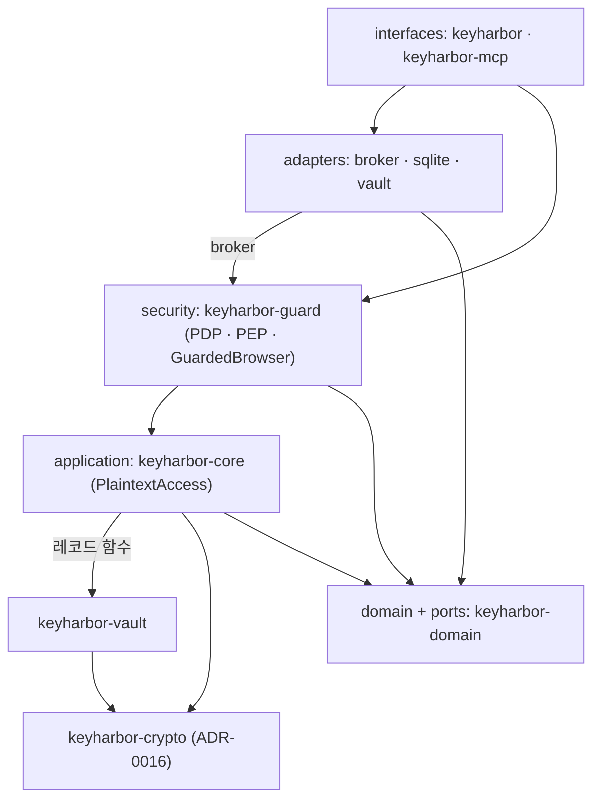
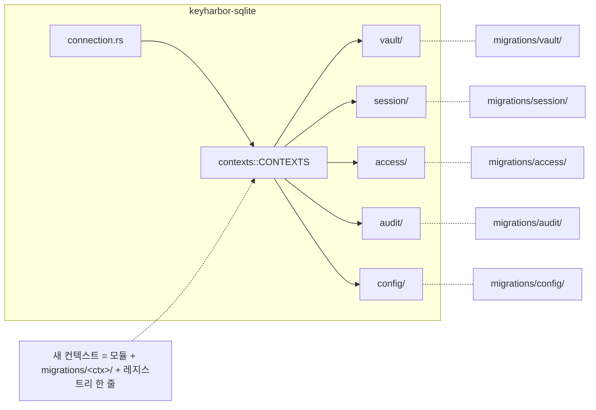

# ADR-0014. 헥사고날 구조로 나누고, 평문은 보안 계층(guard) 하나만 다룬다

| 항목 | 값 |
|---|---|
| 상태 | Accepted |
| 날짜 | 2026-10-29 |
| 관련 요구 | R-30, R-31, R-32, R-33, R-34 |

## 맥락

3단계까지의 `rebuild/`는 crate 수는 일곱 개였지만 경계가 흐렸다. `keyharbor-core`가 `SqliteStore`를 직접 썼고, broker의 `ops.rs`(1,000줄 남짓)에 CDP 조작·placeholder 치환·정책 판정 호출·마스킹·사용 기록이 한데 있었으며, `keyharbor run`의 같은 검사는 CLI에 따로 있었다. 평문을 꺼내는 `Vault::resolve`는 누구나 부를 수 있었다. 사용자는 기능별 모듈화와 보안 계층 분리(R-30), 아키텍처 패턴 추천(R-31), ORM이나 계층을 둔 쿼리(R-32), 확장 가능한 스키마(R-33)를 요구했다.

## 결정

1. **헥사고날(Ports & Adapters) + Clean Architecture 의존 규칙.** 포트(trait)는 `keyharbor-domain::ports`에 둔다: `VaultStore`, `SessionStore`, `PolicyStore`, `AuditStore`, `SettingsStore`, `KeyStore`, `BrowserPort`, `PageInput`, `FrameInspector`, `SessionRuntime`, `StoreFactory`. 어댑터(sqlite, vault, broker)가 구현하고, core는 포트만 쓰며, 인터페이스(CLI, MCP)가 조립한다(composition root).
2. **보안 계층 `keyharbor-guard`.** PDP(`pdp::decide`)와 PEP(`pep::substitute`, `pep::mask`, `pep::origin`), `audit`, `run`을 모은다.
3. **데코레이터 `GuardedBrowser`.** `BrowserPort`를 구현하며 raw 브라우저를 감싼다. 입력의 placeholder는 PEP를 거쳐서만 풀리고, 결과와 오류는 정확히 한 번 마스킹된다. broker는 raw CDP 어댑터를 crate 밖에 공개하지 않으므로 제어 요청이 브라우저에 닿는 길은 이것 하나다.
4. **Capability `PlaintextAccess`.** `Vault::resolve`·`Vault::mask_values`가 요구한다. core가 guard를 알 수 없으므로 생성자는 숨긴 `pub`이고, 호출 위치(guard, core의 age 내보내기, 테스트)를 `scripts/check-layers.sh`가 제한한다.
5. **영속성은 Diesel 2.3**(동기, `sqlite` + `returning_clauses_for_sqlite_3_35`, `diesel_migrations` 내장 마이그레이션, `libsqlite3-sys` bundled). rusqlite는 워크스페이스에서 없앤다(libsqlite3-sys는 하나만 링크된다). Repository/Data Mapper로 저장 형태(models)와 도메인 타입을 분리한다.
6. **스키마는 바운디드 컨텍스트로 나눈다**(R-33): vault · session · access · audit · config. 컨텍스트마다 schema · models · mappers · repo · 마이그레이션 디렉터리를 갖고, `contexts::CONTEXTS` 레지스트리 순서대로 마이그레이션한다. 컨텍스트끼리 models·mappers·repo를 공유하지 않는다.
7. **항목 종류는 데이터로 정의한다**(R-33): `KINDS: &[KindSpec]`(`FieldSpec { secret, maskable }`). 스키마·도메인·origin 바인딩 기본값·CLI의 비밀 필드 판정·마스킹 대상이 모두 이 표를 읽는다.
8. **SQLite를 유지한다**(R-34). PGlite는 JS/WASM 런타임과 npm이 필요하고, 연결이 하나이며, socket 서버에 SSL이 없다([architecture-proposal](../../architecture-proposal.md) DB 선택). 나중에 Postgres 계열 어댑터가 필요하면 `domain::ports`를 구현하는 crate 하나를 더하면 된다.

| crate | 정상 의존 |
|---|---|
| domain | 없음 |
| crypto | domain ([ADR-0016](0016-crypto-crate.md)) |
| vault | domain, crypto |
| core | domain, vault, crypto |
| guard | domain, core |
| sqlite | domain |
| broker | domain, guard |
| mcp | domain, core, guard, broker, sqlite, vault |
| cli | 전부 |

## 결과

- 평문 경로가 `PlaintextAccess`를 받는 두 함수로 줄었고, 그 발급 지점이 검사 가능하다. 브라우저 입력의 검사 순서(포커스 frame origin → 정책 → 비우기 → 포커스 재확인 → 입력 → origin 재확인)는 `GuardedBrowser` 한 곳에만 있다.
- 동작·CLI 출력·MCP 도구·DB 스키마·암호문 형식은 바뀌지 않았다. 기존 테스트 125개가 단언 변경 없이 통과한다(테스트 위치와 모듈 경로만 옮겼다).
- 규칙은 `scripts/check-layers.sh`가 CI(repo-checks)에서 강제한다: 의존 표, 암호 원시 crate는 vault만, rusqlite 금지, 운영 코드의 원시 SQL 금지(마이그레이션과 테스트만), `PlaintextAccess::issue` 호출 위치, broker의 raw CDP 비공개, 컨텍스트 간 models 공유 금지.
- `PlaintextAccess`는 컴파일러가 아니라 스크립트가 지킨다. 같은 OS 사용자의 악의적 코드를 막는 경계가 아니라 실수를 막는 경계다.
- 도메인 crate가 `anyhow`·`serde_json`·`zeroize`·`getrandom`에 의존한다(포트의 오류·응답 타입과 `SecretKey`). I/O는 없다.
- 데이터 경로·포트 추가만으로 4단계 컨텍스트(`site_states`, `vault_requests`)와 5단계 앱 인터페이스를 붙일 수 있다.
