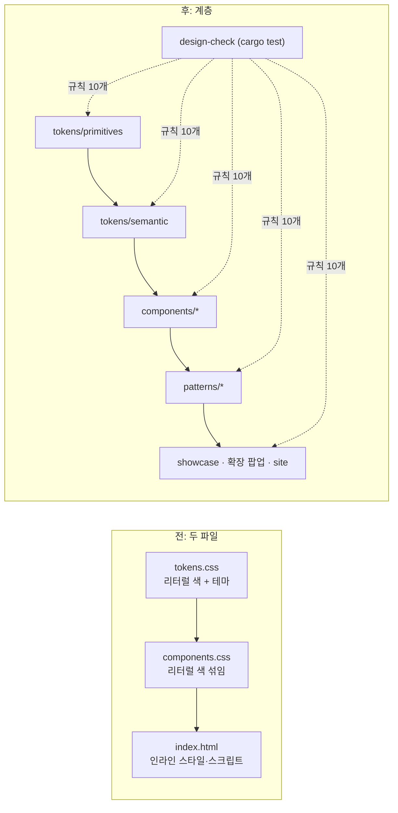

# ADR-0015. 디자인 시스템을 토큰·컴포넌트·패턴 계층으로 나누고 Rust 테스트로 지킨다

| 항목 | 값 |
|---|---|
| 상태 | Accepted |
| 날짜 | 2026-10-29 |
| 관련 | [ADR-0014](0014-hexagonal-guard-layer.md)(같은 생각을 Rust 쪽에), [design/README](../../../design/README.md) |

## 맥락

`design/`은 `tokens.css`와 `components.css` 두 파일이었다. 색 리터럴이 컴포넌트에도 있었고(토글 손잡이 `#fff`, 신호등 색, 봉인 표면 hover), 라이트·다크 블록 세 개(라이트, 시스템 다크, 명시 다크)가 같다는 보장이 없었으며, 주 버튼(흰 글자, `#05a8a8`)은 대비가 2.93:1이었다. 관리 앱, `site/`, 브라우저 확장이 같은 파일을 쓰게 되면서 사용자는 시각화 모듈도 계층에 맞게 나누고 테스트를 넣어 달라고 했고, 저장소 도구는 Python이 아닌 Rust 테스트나 npm으로 쓰라고 했다.

## 결정

1. **폴더가 계층이다.** `tokens/primitives.css` → `tokens/semantic.css` → `components/<이름>.css`(파일 하나에 컴포넌트 하나) → `patterns/<이름>.css` → 페이지. 각 계층은 아래 계층만 읽는다. 입구는 `keyharbor.css` 하나이고 `@import`만 한다.
2. **색 리터럴은 primitives에만.** semantic은 `var(--primitive)`로 용도 이름(`--c-accent-fill`)을 붙이고, 컴포넌트는 semantic만 읽는다. 컴포넌트에는 `0`과 `1px` 말고 px 리터럴도 쓰지 않는다(크기 토큰 `--size-*`).
3. **훅으로 확장한다.** 컴포넌트는 파일 이름으로 시작하는 사용자 정의 속성(`--button-bg`, `--panel-pad`)을 연다. 패턴은 컴포넌트 CSS를 고치지 않고 훅만 덮어쓴다. 새 토큰은 정의하지 않는다.
4. **이름 규칙**: 블록 `kh-<이름>`, 요소는 블록 아래 짧은 자식 클래스(`.kh-row .title`), 변형은 수식 클래스(`primary`), 상태는 `is-*`.
5. **규칙은 Rust 테스트가 강제한다.** dev 전용 crate `rebuild/crates/design-check`(`publish = false`, 의존성 없음, 어떤 crate도 의존하지 않음)가 `cargo test --workspace`에서 돈다. 검사 하나가 파일 하나이고 `trait Rule`을 구현해 `RULES`에 한 줄로 등록한다(Strategy + Registry). 계층이 무엇을 할 수 있는지는 `layers::LAYERS` 표 하나, 대비를 볼 색 쌍은 `CONTRAST_PAIRS` 표 하나다.
6. **대비 기준**: WCAG 2.x 상대 휘도. 본문·배지·칩·버튼 글자 4.5:1, 보조 글자 `--c-ink-3` 3:1(라벨·메타·시각, 11px semibold 이상, 행동에 필요한 정보는 ink-3 혼자 두지 않음), `--c-ink-4`(placeholder, 비활성)는 약속하지 않는다.
7. **쇼케이스는 데이터로 그린다.** `showcase/sections/*.js`의 정의를 `render.js`가 그린다. 새 섹션은 정의 하나와 등록 한 줄.

| 규칙 (`rules/`) | 지키는 것 |
|---|---|
| `layer-references` | 계층 표가 허락한 계층만 `var()`로 읽는다 |
| `literal-colours` | 색 리터럴은 primitives에만 |
| `px-literals` | 컴포넌트 크기는 토큰에서 |
| `token-definitions` | 토큰은 토큰 파일만, 훅은 자기 파일 이름으로, 패턴은 훅만 덮어쓴다 |
| `defined-vars` | 쓰는 `var(--x)`는 모두 정의돼 있다(CSS, 인라인 스타일, 스크립트) |
| `component-files` | 모든 CSS가 계층 안에 있고 입구가 가져오며, 컴포넌트·패턴 파일은 실제로 쓰인다 |
| `theme-parity` | 라이트의 테마 토큰이 두 다크 블록에 다 있고 두 블록이 같다 |
| `contrast` | `CONTRAST_PAIRS`의 쌍이 두 테마에서 기준을 넘는다 |
| `icons` | 쓰는 아이콘이 있고, 24×24 `currentColor` 선이며, 라이선스가 있고, 쇼케이스 목록과 폴더가 같다 |
| `classes` | 쇼케이스와 확장이 쓰는 `kh-*` 클래스가 모두 스타일을 갖는다 |

`KEYHARBOR_TEST_CHROME`이 있으면 `tests/render_chrome.rs`가 쇼케이스를 headless Chrome으로 라이트·다크 렌더링해 섹션(아이콘 41개 이상, 버튼 4×6, 개발자 도메인 색, 패턴 견본 4개)이 그려졌는지 본다.

## 결과

- 주 버튼과 개수 배지는 `--c-accent-fill`(라이트 teal-700 `#047a7a`, 5.16:1)을 칠한다. 강조색 `#05a8a8`은 포커스·토글·탭에 그대로 남는다. 라이트의 호박색(자격 증명·곧 만료)은 `#ab4f08`(4.84:1), 초록(사용 중)은 `#137a3a`(4.80:1)로 한 단계 짙어졌다. 다크는 바뀌지 않았다.
- 아이콘 이미지는 인라인 `mask-image`로 준다. 사용자 정의 속성 안의 상대 `url()`은 그것을 *쓰는* 스타일시트 기준으로 풀려 `components/` 아래를 가리키기 때문이다.
- CSS는 파서 없이 손으로 쓴 작은 스캐너로 읽는다. 디자인 시스템이 쓰는 문법(블록, at-rule, 주석, 괄호, 문자열)만 안다. 중첩 CSS나 `@layer`를 쓰기 시작하면 스캐너를 넓히거나 파서 crate를 검토한다.
- `scripts/check-design.sh`는 `cargo test -p keyharbor-design-check`만 부르는 얇은 스크립트이고 `scripts/test-scripts.sh`와 CI repo-checks가 부른다. `scripts/check-layers.sh`의 crate 표에 `design-check`(의존 없음)를 더했다.
