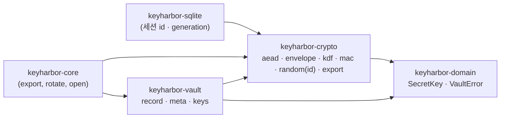

# ADR-0016. 모든 암호 원시 연산은 `keyharbor-crypto` 한 곳에 둔다

| 항목 | 값 |
|---|---|
| 상태 | Accepted |
| 날짜 | 2026-10-29 |
| 관련 요구 | 사용자 지시("공통 모듈로 암호화·복호화하면 매번 같은 걸 구현 안 해도 되잖아"), R-40 |

## 맥락

3단계 강화 전까지 암호 호출이 세 crate에 흩어져 있었다. `keyharbor-vault`가 XChaCha20-Poly1305·HKDF·HMAC를 직접 불렀고, `keyharbor-domain`의 `SecretKey::generate`가 `getrandom`을, `keyharbor-core`의 내보내기가 `age`를 직접 불렀다. 새 도메인 키(R-40, `DK_dev`)를 더하면서 같은 호출을 또 쓸 뻔했다.

## 결정

1. 새 crate **`keyharbor-crypto`**(의존: domain만, I/O 없음)가 원시 연산을 모두 갖는다. 모듈은 용도별로 나눈다.

   | 모듈 | 공개 API | 들어 있는 것 |
   |---|---|---|
   | `aead` | `Suite::{encrypt, decrypt, as_byte, from_byte}` | suite 표(지금은 `0x01` XChaCha20-Poly1305 하나). 새 suite는 변형 하나 |
   | `envelope` | `seal`, `open`, `key_id` | 레코드 v1 형식 `version ‖ suite ‖ key_id ‖ nonce ‖ ciphertext ‖ tag`, 헤더를 포함한 AD 결합 |
   | `kdf` | `derive(root, salt, KeyPurpose)` | HKDF-SHA256, 용도 enum `KeyPurpose { Kek, MetaMac }`과 info 라벨 표 |
   | `mac` | `mac`, `verify_mac` | HMAC-SHA256, 상수 시간 검증 |
   | `random` | `key`, `nonce`, `fill`, `uuid_v4`, `id` | OS 난수. 세션·실행 generation·요청·키 ID도 여기서 만든 v4 바이트로 만든다(#19) |
   | `export` | `Passphrase`, `encrypt_age`, `decrypt_age` | age scrypt 수신자 |

2. **형식 정의는 그 형식을 가진 crate에 남는다.** 필드 레코드와 도메인 키 레코드의 AD 내용(`keyharbor/field/v1 ‖ vault ‖ domain ‖ item ‖ field`, `keyharbor/dk/v1 …`)과 메타 MAC 입력(07 §7.6.3)은 금고의 형식이라 `keyharbor-vault`(`record`, `meta`)에 있고, 이 crate의 `envelope`·`mac`만 부른다.
3. `SecretKey`·`VaultError`는 domain에 그대로 두고(KeyStore 포트가 쓴다) crypto가 다시 내보낸다. 새 키는 `random::key()`로만 만든다. domain은 `getrandom`에 더는 의존하지 않는다.
4. `scripts/check-layers.sh`: `chacha20poly1305`·`hkdf`·`hmac`·`sha2`·`age`·`getrandom`은 crypto만 의존(Cargo.toml)하고 이름을 쓸 수 있다(`use`·경로). 의존 표: crypto ← domain, vault ← domain·crypto, core ← domain·vault·crypto, sqlite ← domain·crypto(id 난수만).
5. **ID도 난수다(#19).** `Uuid::new_v4`·`OsRng`·`rand::`는 crypto 밖에서 부르지 않고 uuid의 `v4` 기능은 켜지 않는다(규칙 F). crypto `random::uuid_v4()`가 `fill`로 16바이트를 뽑아 `uuid::Builder::from_random_bytes`로 v4 배치를 하고, `random::id::<SessionId>()`처럼 `From<[u8; 16]>`인 타입을 만든다. domain의 id 타입은 `from_bytes`만 갖고 스스로 만들지 않는다. 세션 행·generation·인계 요청을 만드는 sqlite는 이 때문에 crypto에 의존한다. 비밀은 아니지만 generation은 펜싱 토큰이라 예측되지 않아야 하고, 키 ID(vault·KEK·도메인 키)는 레코드 AD에 들어간다.

## 결과

- 저장 형식·바이트는 바뀌지 않았다. HKDF KAT는 `crates/crypto/tests/kat.rs`로 옮겼고(기대값 그대로), 필드 레코드·메타 MAC KAT는 형식이 있는 vault에 남았다. "이전 금고 열기"(R-40) 테스트가 그대로 통과한다.
- 새 키 용도는 `KeyPurpose`에 한 줄, 새 알고리즘은 `Suite`에 한 변형, 새 레코드 버전은 `envelope`에 한 버전이다.
- 도메인 키는 RK에서 유도하지 않는다(07 §7.5): `KeyPurpose`에 도메인별 항목이 없는 이유다.
