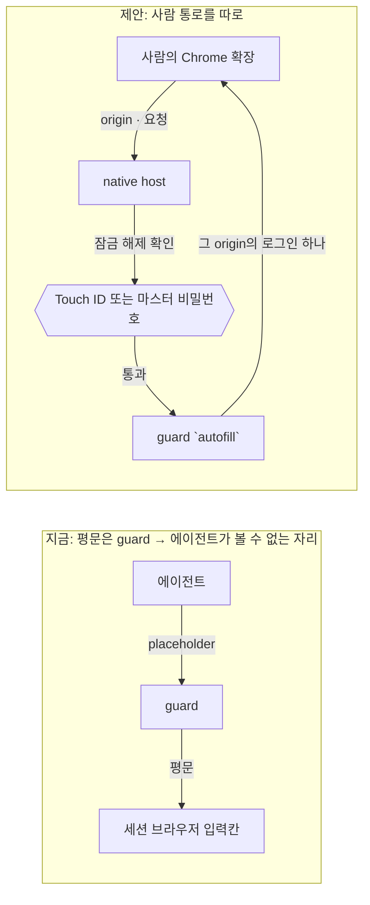

# ADR-0017. 사람용 자동 완성은 잠금 해제 뒤에만 여는 별도 통로로 둔다

| 항목 | 값 |
|---|---|
| 상태 | Accepted (R-46: 통로를 연다, Touch ID, 채울 때마다 확인) |
| 날짜 | 2026-10-30 |
| 관련 | [사이트 넘기기 spec](../../superpowers/specs/2026-10-29-site-handoff-and-grants-design.md) "7단계", R-21(인증 없음), [ADR-0014](0014-hexagonal-guard-layer.md), J-99, R-46 |

## 맥락

7단계는 사람이 평소 Chrome에서 금고의 로그인을 쓰게 하는 것이다: 자동 완성, 새 로그인 저장, CSV 가져오기. 가져오기는 사람이 내보낸 파일을 금고에 넣을 뿐이라 원칙을 바꾸지 않아 먼저 구현했다(`vault import-chrome`, J-99).

자동 완성은 다르다. 지금 원칙은 "평문은 guard를 거쳐 에이전트가 볼 수 없는 자리(브라우저 입력칸, 자식 프로세스)로만 간다"이고, 사람에게 보이는 길(앱의 값 보기·복사)은 앱 창 안에 있다. 자동 완성은 평문을 **확장과 사람의 페이지**로 보낸다. 그 페이지에는 에이전트가 아닌 다른 스크립트도 있고, 같은 사용자 계정의 다른 프로세스가 native messaging 호스트를 흉내 낼 수 있다.

## 결정 (제안)

1. **별도 통로**: guard에 사람용 `autofill` 경로를 새로 둔다. 에이전트 경로(MCP·`run`)와 코드·정책을 나누고, 사용 기록 종류도 따로 둔다(`value_autofilled`).
2. **잠금 해제 필수**: 채울 때마다 Touch ID(LocalAuthentication `deviceOwnerAuthentication`, 지문이 없으면 로그인 암호)로 확인한다. 잠금 해제 상태를 저장하지 않으므로 "다시 잠기는 시간"이 없다.
3. **origin 하나에 하나**: 확장이 알려 준 최상위 origin에 묶인 로그인만 준다. 다른 사이트 iframe에는 채우지 않는다.
4. **에이전트 세션 브라우저와 섞지 않는다**: 감독자가 띄운 전용 프로필에는 확장이 없다.

## 사용자가 정한 것 (R-46, 위임)

Touch ID로 정했다. 아래는 비교했던 선택지다.

| 선택지 | 장점 | 단점 |
|---|---|---|
| Touch ID (macOS LocalAuthentication) — **추천** | 새로 외울 것 없음, Keychain 접근 제어와 맞음 | Touch ID 없는 Mac은 로그인 암호로 대체 |
| 마스터 비밀번호 | 기기와 무관 | 외울 것이 하나 늘고, 잊으면 이 통로를 못 쓴다 |
| 통로를 열지 않는다 | 원칙 그대로 | 사람은 앱에서 복사해 붙여 넣어야 한다 |

## 결과

- 03 백서 §3.12의 평문 경로 표에 한 줄이 늘고, check-layers에 `autofill` 경로 규칙이 생긴다.
- 09 §9.4.7의 인증 방식은 앱 잠금이라 따로다. 이 확인은 자동 완성 통로에만 쓴다(R-21은 앱에 대해 그대로).
- 저장(사람이 누를 때 그 탭의 로그인 폼을 읽어 draft로)은 평문이 금고 밖으로 나가지 않으므로 이 통로의 잠금 해제를 요구하지 않는다. draft는 사람이 앱에서 확정한다.
