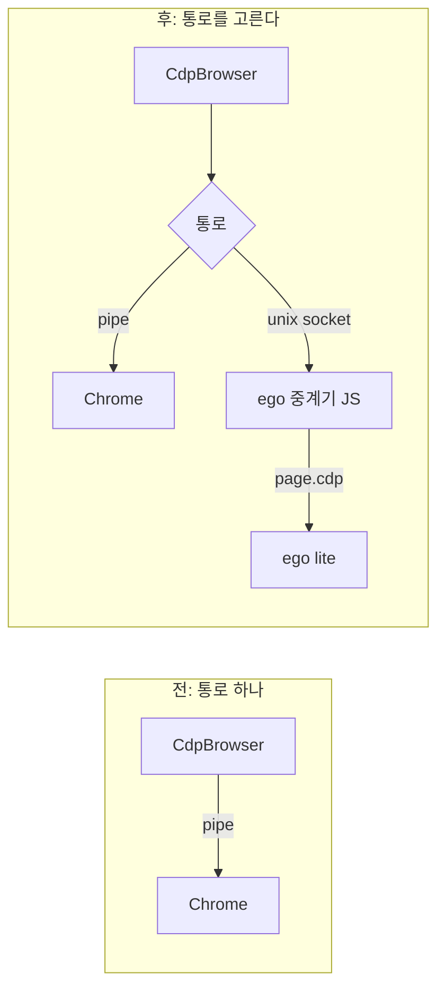

# ADR-0018. ego lite는 CDP 통로만 바꿔 붙이고, 보호가 낮은 세션으로 표시한다

| 항목 | 값 |
|---|---|
| 상태 | Accepted (R-47(1)–(3)) |
| 날짜 | 2026-11-02 |
| 관련 | [spec](../../superpowers/specs/2026-11-02-job-applications-and-ego-lite-design.md) §8, [ADR-0004](0004-supervisor-owns-cdp.md), [ADR-0014](0014-hexagonal-guard-layer.md), [03 §3.13](../03-security-whitepaper.md#313-ego-lite-세션-adr-0018) |

## 맥락

ADR-0004는 감독자가 Chrome을 `--remote-debugging-pipe`로 띄워 CDP를 **혼자** 쥐게 했다. 에이전트는 raw CDP를 받지 않으므로 입력칸에 넣은 값을 다시 읽을 길이 없다.

사람은 ego lite(Citro Labs의 에이전트용 Chromium)를 쓴다. ego는 자기 서비스가 띄우는 브라우저이고, 바깥에서는 SDK(`ego-browser nodejs`의 `taskSpace`·`page.cdp()`)로만 조작한다. 실행 파일을 직접 띄우면 시작 URL을 무시하고 30초 뒤 꺼진다(spec §8.1). 사람의 로그인 상태가 ego 프로필에 있고, ego는 사이트가 자동화를 알아채지 못하게 한다.

## 결정

1. **통로만 바꾼다.** `CdpBrowser`·guard·페이지 감시는 그대로 두고, `Cdp::new`에 넘기는 읽기·쓰기 끝만 고른다. ego 쪽 끝은 감독자가 띄우는 중계기(`ego-browser nodejs -e`, Rust 바이너리에 든 JS)의 unix socket이다. 중계기는 판단하지 않는다.
2. **고르는 규칙**: `--browser auto`(기본, 설정 `browser`)는 ego가 쓸 수 있으면 ego, 아니면 Chrome이다(R-47(1)).
3. **ego 세션은 보호가 낮다고 표시한다.** 같은 ego를 다른 SDK 스크립트가 만질 수 있으므로 S1(에이전트는 평문을 보지 않는다)을 ego 세션에서는 약속하지 않는다. 사람이 받아들였다(R-47(2)). `session_list`·앱·사용 기록에 `protection: shared`로 보이고, 정책 `--resource browser --target ego-lite`로 막을 수 있다.

## 대안

| 대안 | 버린 이유 |
|---|---|
| ego 실행 파일을 Chrome처럼 직접 띄운다 | 30초 뒤 꺼지고 시작 URL을 무시한다. ego가 지원하는 길이 아니다 |
| ego 서비스의 IPC(`ego_cli bootstrap`)에 Rust로 바로 붙는다 | 공개 프로토콜이 아니다. ego가 바뀔 때마다 깨진다 |
| ego 전용 `BrowserPort` 어댑터를 SDK 수준(`page.fill` 등)으로 만든다 | guard가 쓰는 `PageInput`·`FrameInspector`(frame origin, 포커스 요소, 가린 snapshot)를 다시 만들어야 하고, 두 구현이 어긋난다 |
| 호출마다 `ego-browser nodejs`를 띄운다 | 호출마다 Node 시작 비용이 들고 이벤트를 받을 수 없다 |
| ego 세션에서 값을 넣은 뒤 칸을 지워 읽지 못하게 한다 | 제출 전까지 값이 칸에 있어야 하므로 의미가 없다 |

## 결과

- 좋아지는 것: 사람의 ego 로그인 상태와 자동화 숨김을 그대로 쓰고, 업로드·드롭다운·치환·마스킹은 Chrome과 같은 코드다.
- 나빠지는 것: ego 세션에서는 셸을 가진 에이전트가 넣은 값을 읽을 수 있다. grant 밖 문서는 막지 못하고 열린 뒤 `about:blank`로 바꾼다: ego가 한 Page의 명령을 하나씩만 처리해 Fetch 가로채기가 교착된다(J-116, 약속하지 않는다).
- 되돌리는 조건: ego가 CDP를 한 클라이언트에만 주는 방법(예: 소유권이 있는 TaskSpace)을 내놓으면 보호 수준을 Chrome과 같게 올린다.
