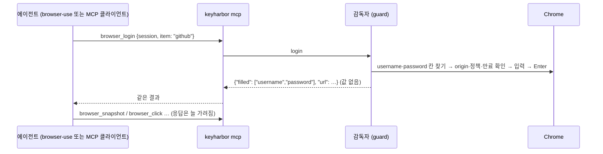

# browser-use와 함께 쓰기

[browser-use](https://github.com/browser-use/browser-use)는 LLM이 브라우저를 조작하게 하는 Python 라이브러리다. 비밀번호를 넘기는 기본 방법은 `sensitive_data`로, 프롬프트에는 자리표시자만 보이고 값은 browser-use 프로세스 메모리에 있다. KeyHarbor와 함께 쓰는 방법은 두 가지다. 어느 쪽이든 **KeyHarbor 코드 의존성은 추가하지 않는다**(문서만 둔다, 06 J-63).

## 1. API 키는 `keyharbor run`으로 주입한다

browser-use 에이전트가 쓰는 LLM API 키를 `.env`나 셸 설정에 두지 않는다.

```sh
keyharbor vault import-env openai .env          # OPENAI_API_KEY=… 를 developer 도메인 항목으로
rm .env
keyharbor run --env openai -- python agent.py   # 자식 프로세스 환경에만 들어가고, 출력은 가려진다
```

`secret`·`env` 항목은 기본으로 `run` 주입이 허용된다(R-36). 막으려면 `keyharbor vault edit openai --run-allowed off`.

## 2. 사이트 비밀번호는 KeyHarbor 세션에 맡긴다

browser-use가 브라우저를 직접 띄우면 `sensitive_data` 값이 그 프로세스와 페이지 사이를 오간다. KeyHarbor는 값을 감독자 안에서만 풀고, 입력할 frame의 origin·정책·만료·필드 종류를 확인한 뒤에만 넣는다([03 §3.8](../design/03-security-whitepaper.md#38-치환-입력의-origin-확인)). 그래서 로그인 단계는 KeyHarbor MCP 도구로 하고, 나머지 탐색을 browser-use에 맡기는 방식을 권한다.



- 로그인 항목은 사이트 origin을 등록해 둔다: `keyharbor vault add github --kind login --origin https://github.com`.
- 에이전트 프롬프트에는 placeholder만 쓴다: `{{secret:github.password}}`. browser-use의 `sensitive_data`에 값을 넣지 않는다.
- 다른 도구가 같은 브라우저를 raw CDP로 붙잡아야 한다면(`keyharbor open … --cdp`) 그 세션은 KeyHarbor의 마스킹·확인을 우회한다(N5). 로그인은 CDP 없는 세션에서 끝내고 쿠키가 있는 상태를 넘기는 편이 낫다.

## MCP 서버 설정에 평문 키를 두지 않기

MCP 서버 설정 파일의 `env`에 API 키를 적는 대신 서버 명령을 `keyharbor run`으로 감싼다.

```json
{
  "mcpServers": {
    "search": {
      "command": "keyharbor",
      "args": ["run", "--agent", "search-mcp", "--env", "brave", "--", "npx", "-y", "@brave/brave-search-mcp-server"]
    }
  }
}
```

`--agent`를 정하면 `keyharbor policy`로 그 서버가 쓸 수 있는 항목을 좁힐 수 있다. 자식 프로세스가 값을 밖으로 보내는 것은 막지 못한다(T13).
