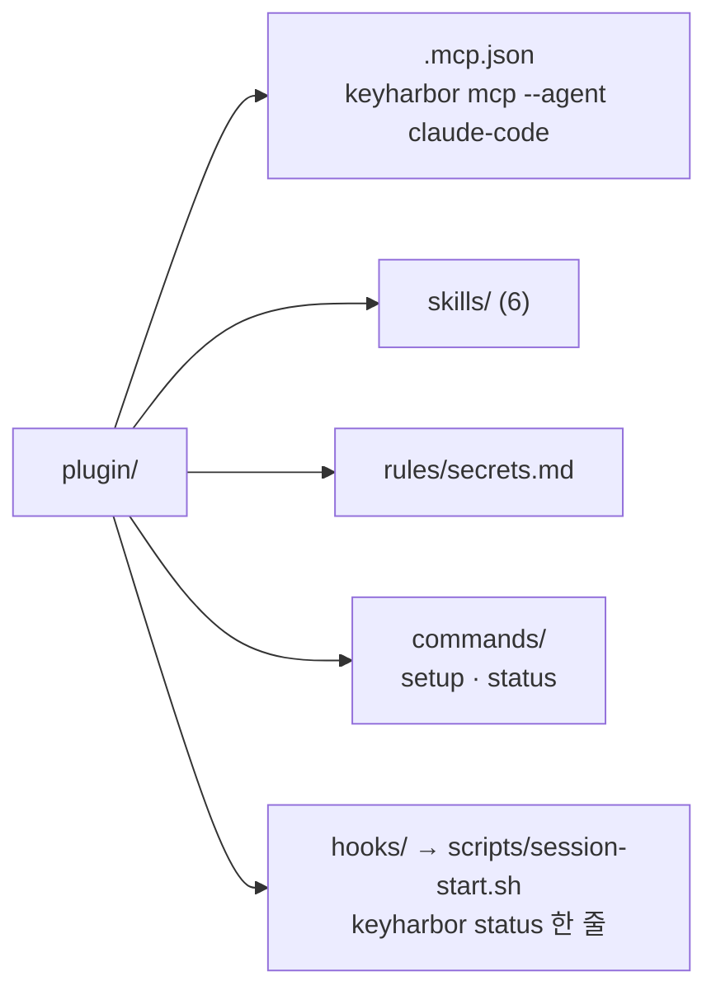

# Claude Code · Codex 플러그인

KeyHarbor를 Claude Code나 Codex 플러그인으로 설치하면 MCP 서버가 등록되고, 에이전트가 로그인·가입·`.env`·인계 흐름을 스킬로 배웁니다. 플러그인은 `keyharbor` 바이너리를 부르기만 하므로 먼저 [소스에서 빌드](../README.md#소스에서-빌드)해 PATH에 두어야 합니다.

## 설치

```text
/plugin marketplace add LeeSwallow/KeyHarbor
/plugin install keyharbor@keyharbor
/keyharbor:setup
```

Codex에서는 MCP 서버를 따로 등록합니다.

```sh
codex mcp add keyharbor -- keyharbor mcp --agent codex
```

`/keyharbor:setup`은 `keyharbor status`로 설치와 금고 상태를 확인합니다. 금고가 없으면 사람이 직접 `keyharbor vault init`을 실행하라고 안내합니다. 이 명령은 macOS 키체인에 루트 키를 저장하므로 에이전트가 대신 실행하지 않습니다.

## 들어 있는 것



| 스킬 | 언제 |
|---|---|
| `using-keyharbor` | 로그인·비밀·브라우저 세션이 필요할 때의 입구, 도구 지도 |
| `logging-in-to-a-site` | 금고에 있는 로그인으로 사이트에 들어갈 때 |
| `signing-up-for-a-site` | 새 계정이 필요할 때 (`vault_generate`, 로그인 기록으로 확정) |
| `using-env-secrets` | 셸 명령에 API 키·`.env`·키 파일이 필요할 때 (`keyharbor run`) |
| `handing-off-to-the-user` | CAPTCHA·2FA·약관·결제 확인 |
| `asking-for-a-secret` | 금고에 없는 카드·주소·비밀번호 (`vault_request`) |

세션 시작 훅은 `keyharbor`가 없으면 아무것도 출력하지 않습니다(컨텍스트 비용 0). 있으면 `keyharbor status`의 개수만 한 줄로 알립니다. 금고 준비 여부, 열린 세션, 기다리는 요청, draft 수이고, 이름이나 값은 없습니다.

## 검사

`crates/cli/tests/plugin.rs`가 `cargo test`에서 함께 돕니다.

- 매니페스트 다섯 개가 파싱되고, 이름은 `keyharbor`, 버전은 crate 버전과 같습니다.
- 스킬은 front matter의 `name`이 디렉터리와 같고, `description`이 "Use when"으로 시작하며, 80줄 이하입니다.
- 스킬·명령·규칙에서 백틱 안의 도구 이름(`session_*`, `browser_*`, `site_state_*`, `vault_*`)은 `keyharbor mcp --list-tools`에 있어야 하고, `keyharbor <명령>`은 `--help`가 성공해야 합니다. 없는 도구를 가르치는 스킬은 테스트가 실패합니다.
- `.mcp.json`의 명령으로 서버를 띄워 도구 목록을 받습니다.
- 훅은 `keyharbor`가 없으면 조용하고, 있으면 한 줄입니다.
