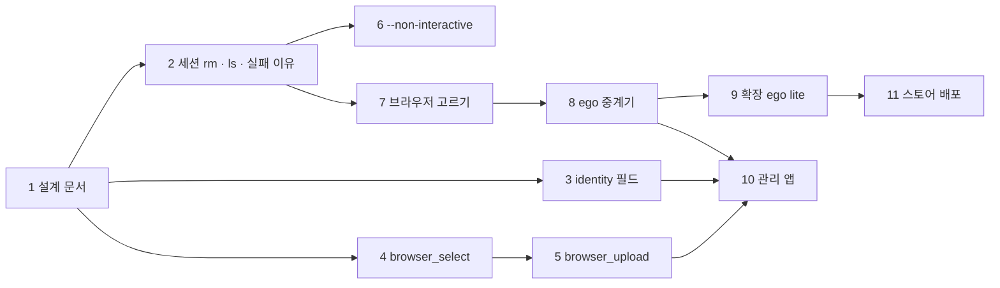

# 채용 지원 사용 사례와 ego lite 지원 — 구현 계획

> **For agentic workers:** REQUIRED SUB-SKILL: Use superpowers:subagent-driven-development (recommended) or superpowers:executing-plans to implement this plan task-by-task. Steps use checkbox (`- [ ]`) syntax for tracking.

**Goal:** 채용 지원서를 금고 값으로 채우고(업로드·드롭다운 포함) 무인으로 공고를 확인하며, ego lite가 있으면 그것을, 없으면 Chrome을 쓴다.

**Architecture:** 새 브라우저 도구는 기존 층(MCP → wire → 감독자 ops → guard → `BrowserPort` → `CdpBrowser`)을 한 칸씩 지난다. ego는 `Cdp::new`에 넘기는 통로만 바꾼다(ADR-0018). 판단은 domain·core·guard, 바깥 형식은 어댑터.

**Tech Stack:** Rust(edition 2024, tokio, clap, rmcp, diesel), TypeScript(앱 UI·확장, vitest, esbuild), ego-browser SDK v2.2.0의 Node 런타임(중계기 JS만).

**Spec:** [docs/superpowers/specs/2026-11-02-job-applications-and-ego-lite-design.md](../specs/2026-11-02-job-applications-and-ego-lite-design.md)

## Global Constraints

- 평문 비밀은 CLI 출력·로그·오류·SQLite 평문 컬럼·MCP 응답에 쓰지 않는다. 새 출력 경로마다 누출 테스트를 같이 만든다(AGENTS.md).
- 새 CLI 이름은 관용어: `rm`, `ls`, `--browser auto|chrome|ego-lite|<경로>`, `--headless`, `--non-interactive`, `--force`, `--json` (R-47(4)).
- 바꿀 여지가 있는 값은 설정: `browser`(기본 `auto`), `upload_dirs`(기본 빈 목록), `upload_max_files`(기본 10), `ego_poll_ms`(기본 20), `ego_probe_seconds`(기본 5).
- `MAX_SOCKET_PATH` = 103바이트. 초과 오류 문구: `data directory path is too long for a socket (<n> > 103 bytes); use a shorter --data-dir`.
- 이슈 하나 = 브랜치 하나 = PR 하나, Conventional 제목, `Closes #N`, 종류 라벨 하나. 동작이 바뀌면 README·`crates/README.md`·design 절·06을 같은 PR에서.
- 끝내기 전 검사: `cargo fmt --all --check && cargo clippy --workspace --all-targets -- -D warnings && cargo test --workspace --locked && sh scripts/check-docs.sh && sh scripts/test-scripts.sh && sh scripts/check-layers.sh`, UI·확장은 `npm run check`.

## Review Focus

1. 업로드 경로가 심볼릭 링크로 허용 폴더 밖을 가리킬 때 → 거절(`upload_outside_allowed_dirs`). Task 5에 `symlink_out_of_allowed_dir_is_refused`.
2. `browser_select`의 placeholder가 옵션 어디에도 없을 때 → 값을 말하지 않는 오류 `no option matches`. Task 4에 `unmatched_placeholder_does_not_echo_value`.
3. `keyharbor rm`에 열린 세션을 `--force` 없이 줄 때 → 거절하고 아무것도 지우지 않음. Task 2에 `rm_refuses_a_running_session`.
4. ego가 설치됐지만 서비스가 응답하지 않을 때 `auto` → 5초 뒤 Chrome으로. Task 7에 `auto_falls_back_when_probe_times_out`.
5. 사용자 정의 필드 이름이 정해진 secret 필드와 같은 철자일 때(예: identity에 `password`) → 정해진 규칙이 이긴다(`is_secret_field`). Task 3에 `custom_field_cannot_shadow_a_declared_secret`.

---

## 작업 순서

### Task 1: 설계 문서 (#114)

**Files:** 이 계획, spec, `docs/design/adr/0018-ego-lite-browser.md`, `docs/design/03-security-whitepaper.md`(§3.11 11–12, §3.13, §3.14), `docs/design/adr/README.md`, `docs/design/06-requirements-log.md`(R-47)

- [ ] `sh scripts/check-docs.sh` 통과
- [ ] 커밋 `docs: design job applications and ego lite support`

### Task 2: 세션 지우기, `ls`, 실패 이유 (#115)

**Files:**
- Modify: `crates/domain/src/ports/runtime.rs` — `fn remove_profile(&self, id: SessionId) -> anyhow::Result<()>`
- Create: `crates/core/src/session/remove.rs` — `pub fn remove(store, runtime, id, force: Force) -> Result<Removed>`; `enum Force { No, CloseFirst }`
- Modify: `crates/supervisor/src/runtime.rs`(remove_profile = `remove_dir_all(profile_dir)`, 없으면 Ok), `crates/core/src/session/lifecycle.rs`(open 전에 `paths::socket_path` 길이 검사), `crates/core/src/session/supervision.rs`(`mark_failed(reason: FailureReason)`), sqlite session 마이그레이션 `failure TEXT NULL`
- Modify: `crates/cli/src/session_cmd.rs` — `Rm { sessions: Vec<String>, #[arg(long)] force: bool }`, `List`에 `visible_alias = "ls"`; top-level에도 `rm`·`ls`
- Test: `crates/cli/tests/session_rm.rs`

**Interfaces:** Produces `keyharbor_core::session::remove::{remove, Force, Removed}`, `FailureReason::{SocketPathTooLong, BrowserMissing, BrowserExited, Grant, Other}` with `as_str()`.

- [ ] 테스트: `rm_deletes_a_stopped_session_and_its_profile`, `rm_refuses_a_running_session`(exit≠0, 세션 남음), `rm_force_stops_then_deletes`, `ls_is_list`, `long_data_dir_is_refused_before_spawn`(문구 Global Constraints 그대로)
- [ ] 실패 확인 → 구현 → 통과 → `crates/README.md` 세션 표 갱신 → 커밋 `feat(session): remove sessions and say why one did not start`

### Task 3: identity 지원서 필드와 사용자 정의 필드 (#116)

**Files:** `crates/domain/src/vault.rs`(KindSpec `custom_fields: bool`, `CUSTOM_FIELD`, identity 8필드, address `custom_fields: true`), `crates/core/src/vault/mod.rs:215 check_fields`, `crates/cli/src/vault_cmd/input.rs`(숨김 프롬프트에 새 secret 필드), `app/src/commands/manage.rs`(KindForm에 `custom_fields`), docs `crates/README.md`·02 §2.7.2

- [ ] 테스트(domain): `identity_has_korean_application_fields`(english_name, hanja_name, gender, nationality, emergency_phone = plain; military_service, disability, veterans = secret), `custom_field_is_secret_and_masked`, `custom_field_cannot_shadow_a_declared_secret`
- [ ] 테스트(core): `identity_accepts_a_custom_field`, `login_still_rejects_an_unknown_field`
- [ ] 테스트(cli): `no_command_prints_plaintext`에 identity 사용자 정의 필드 값 추가
- [ ] 구현 → 통과 → 커밋 `feat(vault): Korean application fields and custom fields for identity`

### Task 4: `browser_select` (#117)

**Files:** `crates/domain/src/ports/browser.rs`(`fn select(&mut self, target: &Target, choice: &Choice) -> Future<Result<Value>>`, `enum Choice { Value(String), Label(String), Index(u32) }`), `crates/broker/src/browser/select.rs`(새, `Runtime.callFunctionOn`로 고르고 `input`·`change`), `crates/guard/src/browser.rs`(placeholder 풀기·origin 확인·결과 가리기, password 필드 거절), `crates/supervisor/src/control/wire.rs`(`ControlRequest::Select`), `crates/supervisor/src/ops.rs`(`is_input` 포함), `crates/mcp/src/tools/browser.rs`(`browser_select`), plugin 스킬, `crates/README.md`, 02 도구 표

- [ ] 테스트(guard fake): `select_by_label`, `select_placeholder_is_resolved_and_masked`, `select_refuses_a_password_field_value`, `unmatched_placeholder_does_not_echo_value`, `select_is_refused_while_awaiting_user`(ops)
- [ ] 테스트(mcp_stdio): 목록에 `browser_select`
- [ ] Chrome 테스트(`KEYHARBOR_TEST_CHROME`): `substitution_chrome.rs`에 `<select>` 하나
- [ ] 구현 → 통과 → 커밋 `feat(browser): choose a dropdown option with browser_select`

### Task 5: `browser_upload` (#118)

**Files:** `crates/domain/src/settings.rs`(`upload_dirs`, `upload_max_files`), `crates/domain/src/upload.rs`(새: `UploadPolicy::check(paths, canonical) -> Result<Vec<PathBuf>, UploadRefusal>`, 순수), `crates/core/src/weaken.rs`(`WeakeningOp::AddUploadDir`), broker `browser/upload.rs`(`DOM.setFileInputFiles`), guard·wire·ops·mcp 층(Task 4와 같은 자리), `AuditKind::FileUploaded`, 03 §3.14

- [ ] 테스트(domain): `empty_upload_dirs_refuse`, `file_inside_allowed_dir_passes`, `symlink_out_of_allowed_dir_is_refused`, `directory_is_refused`, `more_than_max_files_is_refused`
- [ ] 테스트(guard): `upload_needs_a_file_input`, `upload_outside_grant_origin_is_refused`, `upload_records_file_names_only`
- [ ] 테스트(cli): `settings set upload_dirs`는 확인 필요(터미널 아님 → 거절)
- [ ] 구현 → 통과 → 커밋 `feat(browser): upload files from allowed folders with browser_upload`

### Task 6: `--non-interactive` (#119)

**Files:** `crates/mcp/src/lib.rs`(`Options.interaction: Interaction { Interactive, NonInteractive }`), `crates/mcp/src/tools/session.rs`·`vault.rs`의 wait 도구, `crates/cli/src/main.rs`(`--non-interactive`), plugin 스킬 `handing-off-to-the-user`

- [ ] 테스트(mcp_stdio): `non_interactive_wait_auth_returns_needs_user`(request_id 있음, 즉시), `non_interactive_wait_for_resume_does_not_block`(1초 안)
- [ ] 구현 → 통과 → 커밋 `feat(mcp): --non-interactive returns needs_user instead of waiting`

### Task 7: 브라우저 고르기 (#120)

**Files:** `crates/domain/src/browser_choice.rs`(새: `enum BrowserChoice { Auto, Chrome, EgoLite, Path(PathBuf) }`, `parse`, `enum BrowserKind { Chrome, EgoLite }`, `fn protection(self) -> Protection { Owned, Shared }`), `crates/supervisor/src/argv.rs`·`process/mod.rs`(kind 전달), cli `--browser`·`--headless`, mcp `session_open {browser?}`, `session_list`에 `browser`·`protection`, sqlite `sessions.browser TEXT NOT NULL DEFAULT 'chrome'`, settings `browser`, policy `Resource::Browser`

- [ ] 테스트: `parse_browser_choice`(auto/chrome/ego-lite/경로), `auto_falls_back_when_probe_times_out`(probe port 가짜), `session_list_shows_browser_and_protection`, `policy_can_deny_ego_lite`
- [ ] 구현 → 통과 → 커밋 `feat(session): choose the browser with --browser auto|chrome|ego-lite`

### Task 8: ego 중계기 (#121)

**Files:** `crates/broker/src/ego/{mod.rs, relay.js, probe.rs}`(새), `crates/broker/src/chrome.rs` 옆에 `ego::spawn(launch) -> CdpLink`, supervisor가 kind로 고름, 03 §3.13은 Task 1에서

**Interfaces:** Consumes `BrowserKind` (Task 7). Produces `keyharbor_broker::ego::{spawn, EgoLaunch, probe}`.

- [ ] 테스트(단위): 중계기 프레이밍 — 가짜 socket 쪽에서 `{id,method}` 보내면 응답 `id`가 맞는다(`relay_frames_round_trip`, Node 없이 Rust 쪽 코덱만)
- [ ] 테스트(실제 ego, `KEYHARBOR_TEST_EGO`가 있을 때만): `ego_session_navigates_and_snapshots`, `ego_fill_substitutes_and_masks`
- [ ] 구현 → 통과 → 커밋 `feat(broker): drive ego lite through a CDP relay`

### Task 9: 확장을 ego lite에서 (#122)

**Files:** `crates/cli/src/browser_cmd/{mod.rs, install.rs, host/caller.rs}`, `integrations/browser-extension/README.md`

- [ ] 테스트: `ego_lite_manifest_path`, `ego_lite_is_a_browser_caller`
- [ ] 실제 확인: ego lite에서 확장 로드, host 연결 여부를 README에 기록
- [ ] 커밋 `feat(extension): connect the extension in ego lite`

### Task 10: 관리 앱 (#123)

**Files:** `app/src/commands/{sessions.rs, admin.rs, manage.rs}`, `app/ui/src/{view.ts, views/editor.ts, views/settings.ts, words.ts}`, `app/ui/scripts/shots.mjs`(새), `docs/design/09-app-ux.md` §9.4.2·§9.4.3·§9.4.7, 스크린샷 `docs/assets/screenshots/`

- [ ] 테스트(vitest): `session_card_shows_browser_and_protection`, `stopped_session_can_be_removed_with_undo`, `identity_editor_groups_fields_and_adds_custom`, `settings_lists_upload_dirs_and_default_browser`
- [ ] 라이트·다크 스크린샷 확인
- [ ] 커밋 `feat(app): sessions, identity fields and browser settings for job applications`

### Task 11: 스토어 배포 (#124)

**Files:** `integrations/browser-extension/scripts/package.mjs`(새, key 없는 zip), `integrations/browser-extension/store/{listing.ko.md, listing.en.md, permissions.md, amo-metadata.json}`, `site/privacy.html`, `.github/workflows/extension-release.yml`, `crates/cli/src/browser_cmd/install.rs`(`CHROME_EXTENSION_IDS`), `integrations/browser-extension/README.md`

- [ ] 테스트: `package_drops_the_key_field`(vitest), `manifest_allows_both_extension_ids`(cargo)
- [ ] 사람에게 남길 단계 목록을 README "스토어에 올리기"에
- [ ] 커밋 `ci(extension): package and publish to Chrome Web Store and AMO`
