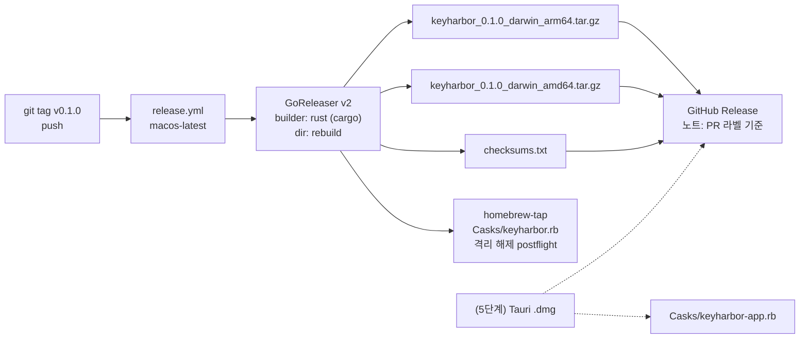
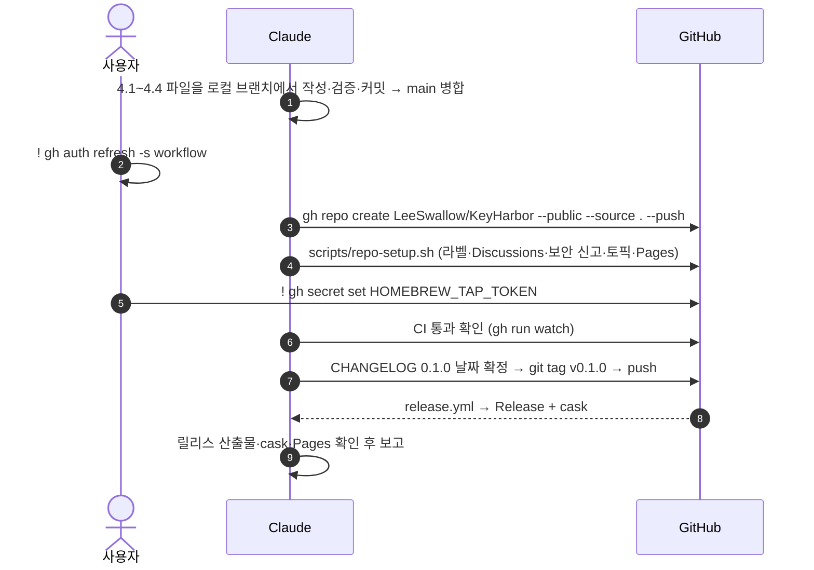

# 협업 저장소 구성과 릴리스 설계

상태: 설계 · 2026-10-28. 사용자가 정한 것은 **[사용자 결정]**, 설계자가 정한 것은 **[설계자 판단]**으로 표시한다.

## 1. 의도

KeyHarbor를 stickypane과 같은 방식으로 공개하고, 사람과 에이전트가 함께 기여할 수 있게 만든다. 그리고 관리 앱과 웹 페이지를 배포하는 경로를 처음부터 끝까지 마련한다. [사용자 결정: "stickypane의 자산을 활용", "그대로 ㄱㄱ"]

웹 페이지와 데모가 보여 줄 대표 장면은 **에이전트가 블로그나 마케팅 플랫폼에 스스로 로그인해, 사람이 비밀번호를 넣어 주지 않아도 글을 끝까지 써서 올리는 흐름**이다. [사용자 결정]

## 2. 목표 · 비목표 · 반목표

**목표**

1. stickypane의 협업 자산을 KeyHarbor(Rust, 보안 도구)에 맞게 옮긴다. 대상은 에이전트 안내, 기여 안내, 정책 문서, 이슈와 PR 흐름, 라벨, 커밋 훅, CI, 릴리스, `.sticky` 보드다.
2. 공개 GitHub 저장소 `LeeSwallow/KeyHarbor`를 만들고 push한 뒤, 라벨과 저장소 설정, GitHub Pages까지 적용한다. [사용자 결정]
3. `v*` 태그를 붙이면 GitHub Release와 Homebrew 배포가 자동으로 만들어지는 파이프라인을 만든다. [사용자 결정]
4. CI를 통과하면 첫 릴리스 `v0.1.0`을 실제로 낸다. 범위는 CLI와 금고다. [사용자 결정]
5. 다운로드 중심의 정적 웹 페이지 한 장을 GitHub Pages로 공개한다. [사용자 결정: "적당히", 구성은 설계자 판단]
6. 관리 앱(5단계)과 플러그인(6단계)이 나중에 같은 파이프라인에 올라탈 수 있게 자리를 만들어 둔다.

**비목표**

- Apple 서명과 공증. 서명하지 않고 배포한다. 인증서를 넣으면 서명으로 바뀔 수 있는 자리만 남긴다. [사용자 결정]
- 관리 앱과 플러그인 자체의 구현. 각각 5단계와 6단계의 일이다.
- 데모 영상 촬영. 웹 페이지에는 터미널 예시를 텍스트로 넣고, 영상은 앱이 생긴 뒤에 만든다. [설계자 판단]
- Linux·Windows 배포. KeyHarbor는 macOS만 지원한다(J-11). [설계자 판단]
- npm 등 Node 도구. 로컬 권한에서 제외됐으므로 웹 페이지는 순수 HTML과 CSS로 만든다. [사용자 결정에서 도출]

**반목표**

- 커밋이나 PR에 AI 도구를 공동 저자로 적는다(stickypane 정책과 같다).
- 사용자가 허용하지 않은 권한이 필요한 작업을 진행한다. 실제 Keychain 쓰기와 npm이 여기에 해당한다.
- 릴리스 산출물에 테스트 전용 기능(`insecure-test-keystore`)이 들어간다.

## 3. 제약

| 항목 | 값 |
|---|---|
| 허용된 로컬 명령 | cargo(build·test·fmt·clippy·run·install·deny·fetch·tree·check), rustup, gh(repo·pr·label·release·api·run·workflow·issue·secret list), git push. `.claude/settings.local.json`에 들어 있다 |
| 사용자가 직접 할 일 | `! gh auth refresh -s workflow` — workflow 파일을 push하는 데 필요하다. 현재 토큰 권한은 `repo, gist, read:org`다 |
| 사용자가 직접 할 일 | `! gh secret set HOMEBREW_TAP_TOKEN -R LeeSwallow/KeyHarbor` — `LeeSwallow/homebrew-tap`에 쓸 수 있는 토큰이다 |
| 툴체인 | `~/.rustup/toolchains/stable-aarch64-apple-darwin/bin`(PATH에 없음), cargo 1.97 |
| 제품 코드 위치 | `rebuild/` 워크스페이스가 릴리스 대상이다. 루트 프로토타입 crate는 CI에서 테스트만 하고 배포하지 않는다 [설계자 판단] |
| 라이선스 | `MIT OR Apache-2.0`. `rebuild/Cargo.toml`에 이미 선언돼 있다 |

## 4. 구성

### 4.1 저장소에 추가하는 파일 (stickypane에서 가져와 고친 것)

| 파일 | stickypane에서 | KeyHarbor에서 바꾸는 점 |
|---|---|---|
| `AGENTS.md`, `CLAUDE.md`(`@AGENTS.md` 한 줄) | AGENTS.md | 빌드·검증 명령을 PATH 포함으로 적는다. 규칙: 평문 비밀 출력 금지, 암호 알고리즘 직접 구현 금지, 설계 문서와 ADR을 함께 갱신, Conventional Commits, AI 공동 저자 금지, push·병합·태그 전에 확인 |
| `CONTRIBUTING.md` | 같음 | 한국어로 쓴다. 이슈 → `accepted` → 브랜치(`scripts/issue.sh`) → PR(`scripts/pr.sh`) → squash 병합 → `v*` 태그. 설계 변경은 proposal을 거쳐 ADR로 남긴다 |
| `VISION.md` | 같음 | docs/design/01의 원칙 P1–P7을 요약한다 |
| `ROADMAP.md` | 같음 | docs/design/05의 1–6단계와 현재 상태 |
| `CHANGELOG.md` | Keep a Changelog | `## [0.1.0] - <릴리스 날짜>`: 2단계 금고 |
| `SECURITY.md` | 같음 | KeyHarbor가 약속하는 것(03 §3.1 S1–S5)과 약속하지 않는 것(N1–N6), 비공개 신고 경로, 최신 릴리스만 지원 |
| `SUPPORT.md`, `CODE_OF_CONDUCT.md` | 같음 | 이름과 링크만 바꾼다 |
| `LICENSE-MIT`, `LICENSE-APACHE` | LICENSE(MIT) | 두 라이선스를 함께 둔다. 저작권자는 `LeeSwallow`, 연도는 2026 [설계자 판단] |
| `.gitattributes` | 같음 | `* text=auto eol=lf` |
| `.githooks/commit-msg`, `scripts/ai-trailers.txt`, `scripts/check-commit-trailers.sh` | 같음 | 그대로 쓴다 |
| `scripts/check-pr.sh`, `scripts/issue.sh`, `scripts/pr.sh`, `scripts/sync-labels.sh`, `scripts/repo-setup.sh` | 같음 | 기본 저장소를 `LeeSwallow/KeyHarbor`로, 설명과 토픽을 KeyHarbor에 맞게 |
| `.github/ISSUE_TEMPLATE/{bug,feature,proposal,config}.yml` | 같음 | 버그 템플릿에 `keyharbor --version`, macOS 버전, 쓴 에이전트를 묻는다. design_feedback은 뺀다. 보안 문제는 config.yml에서 비공개 신고로 보낸다 |
| `.github/pull_request_template.md` | 같음 | 체크리스트를 Rust 명령으로 바꾸고 "평문 비밀 누출 검사를 통과했다" 항목을 넣는다 |
| `.github/labels.txt` | 같음 | 종류 라벨에서 `plugin`을 그대로 두고, 영역 라벨 `area: vault`, `area: session`, `area: mcp`, `area: app`, `area: site`, 그리고 `security`를 더한다 |
| `.github/release.yml`, `.github/CODEOWNERS`(`* @LeeSwallow`), `.github/dependabot.yml` | 같음 | dependabot은 `cargo`를 `/`와 `/rebuild` 두 곳, 그리고 `github-actions` |
| `.sticky/` | 보드 | `stickypane init --no-agent-docs`로 만들고, 단계별 로드맵 체크리스트 노트 하나를 둔다 [설계자 판단] |

### 4.2 CI (`.github/workflows/`)

| 워크플로 | 내용 |
|---|---|
| `ci.yml` | push(main)와 PR에서 실행한다. **macOS와 Ubuntu**에서 `rebuild/`의 `cargo fmt --check`, `clippy -D warnings`, `cargo test --workspace --locked`를 돌린다. Ubuntu에서도 돌리는 이유는 Keychain 코드가 macOS 전용 cfg 뒤에 있어서, 다른 OS에서 컴파일이 깨지지 않는지 지키기 위해서다. 루트 프로토타입은 macOS에서 `cargo test --locked`. `cargo-deny`로 라이선스·취약점·출처를 검사하고, PR에서는 커밋 trailer를 검사한다 |
| `pr.yml` | stickypane과 같다. `check-pr.sh`로 PR 제목 형식, 닫는 이슈, 종류 라벨을 확인한다 |
| `release.yml` | `v*` 태그에서 **macos-latest**로 GoReleaser v2를 실행한다(§4.3) |
| `pages.yml` | main의 `site/`가 바뀌면 `actions/deploy-pages`로 배포한다 |

`rebuild/deny.toml`에는 허용할 라이선스(MIT, Apache-2.0, BSD-2/3, ISC, Unicode-3.0, Zlib, MPL-2.0 등)를 둔다. 정확한 목록은 실제로 `cargo deny check licenses`를 돌려 보고 정한다.

### 4.3 릴리스 파이프라인

- **빌드**: Apple 프레임워크(`security-framework`)를 링크해야 해서 macOS 러너에서 빌드한다. 대상은 `aarch64-apple-darwin`과 `x86_64-apple-darwin`이다. GoReleaser의 Rust builder 설정 문법은 구현 시 공식 문서로 확인한다.
- **아카이브 내용**: `keyharbor` 바이너리, `LICENSE-MIT`, `LICENSE-APACHE`, `README.md`(제품 기준으로 다시 쓴 루트 README), `CHANGELOG.md`, `THIRD_PARTY_LICENSES.html`. 마지막 파일은 `cargo-about`이 GoReleaser `before` 훅에서 만든다. stickypane의 `scripts/licenses.sh`와 같은 역할이다. [설계자 판단]
- **Homebrew**: stickypane과 같은 `homebrew_casks` 방식이다. 서명하지 않은 바이너리이므로 postflight에서 `xattr -dr com.apple.quarantine`을 실행한다. `HOMEBREW_TAP_TOKEN`이 없으면 cask 업로드를 건너뛴다. 설치 명령은 `brew install --cask leeswallow/tap/keyharbor`다.
- **서명으로 바꿀 자리**: `release.yml`에 `APPLE_*` secret이 있을 때만 실행되는 서명·공증 단계를 주석으로 남긴다. 지금은 실행하지 않는다.
- **테스트 기능 제외**: 릴리스 빌드에는 `insecure-test-keystore`가 들어가지 않는다. CI에서 `cargo tree -e features`로 확인한다.
- **앱(5단계)**: 나중에 `tauri-action`으로 `.dmg`를 만들어 같은 Release에 붙이고, cask `keyharbor-app`을 추가한다. 이번에는 문서에만 적는다.

### 4.4 웹 페이지 (`site/`)

- 정적 파일 `site/index.html`, `site/style.css`, `site/icon.svg`(앱 아이콘 복사본). npm과 빌드 단계는 없다.
- 위에서부터 이렇게 구성한다.
  1. 헤더: 아이콘과 KeyHarbor 이름, 한 줄 소개("에이전트가 로그인에서 멈추지 않게, 비밀번호는 내 Mac에")
  2. 설치: `brew install --cask leeswallow/tap/keyharbor`, 그리고 최신 릴리스로 가는 링크(`/releases/latest`)
  3. 터미널 예시 두 개를 나란히 둔다. **"지금 되는 것"**은 `vault init / add / list / export`이고, **"예정 — 1·3단계"**는 에이전트가 블로그에 로그인해 글을 발행하는 흐름이다. 예정 쪽에는 로드맵 링크를 붙여 지금 쓸 수 없다는 것을 분명히 한다. [설계자 판단: 과장 광고 방지]
  4. 세 가지 약속: 로컬·무료·오픈소스 / CLI는 평문을 출력하지 않는다 / 사이트(origin) 바인딩과 메타데이터 변조 감지. 앞의 두 가지는 v0.1.0에 이미 구현돼 있다. 바인딩은 금고에 저장은 되지만, 실제로 입력에 적용되는 것은 3단계부터라고 적는다
  5. 링크: GitHub, 문서(`docs/design`), 보안 정책
- 청록·흰색 팔레트(`#05A8A8`)를 쓰고, 다크 모드와 모바일 폭에 대응한다. 한국어 페이지 하나만 만든다. [설계자 판단]
- 주소는 `https://leeswallow.github.io/KeyHarbor/`다.
- 앱이 생기면 `.dmg` 다운로드 버튼을 추가한다.

### 4.5 공개와 첫 릴리스 순서

## 5. 남는 위험

- 서명하지 않은 바이너리라서 업데이트할 때마다 Keychain이 접근 허용을 다시 물을 수 있다(03 §3.4). README와 웹 페이지에 적는다.
- GoReleaser의 Rust 지원은 Go보다 새로운 기능이라, 설정이 실패하면 `cargo build` 후 업로드하는 방식으로 대체할 수 있다. 대체하면 그 결정을 기록한다.
- 공개한 뒤 되돌리려면 저장소를 비공개로 바꾸거나 릴리스·태그를 지워야 한다. 첫 공개와 태그는 사용자가 이미 승인했다.

## 6. 빌더에게 맡기는 것

- 각 문서의 문장, 라벨 색, 웹 페이지 디자인 세부
- `deny.toml`의 정확한 허용 목록
- GoReleaser·Pages 워크플로의 세부 문법(공식 문서 기준)
- `.sticky` 보드 노트 구성

## 7. 리뷰 이후 결정

| # | 질문 | 결정 |
|---|---|---|
| B1 | v0.1.0에 없는 기능을 웹 페이지에 어떻게 보여 줄지 | "지금 되는 것"과 "예정"으로 나눠 보여 준다(§4.4) [설계자 판단] |
| B2 | README | 루트 `README.md`를 제품(v0.1.0 CLI 금고) 기준으로 다시 쓴다. 기존 프로토타입 설명은 `docs/prototype.md`로 옮기고 루트 README에서 링크한다. `rebuild/README.md`는 개발자용으로 둔다 [설계자 판단] |
| B3 | 데이터 경로와 Keychain 이름 | **macOS 표준 위치로 바꾼다.** 기본 데이터 폴더는 `~/Library/Application Support/KeyHarbor`, Keychain 서비스는 `io.github.leeswallow.keyharbor`다. `--data-dir`과 `KEYHARBOR_HOME` 덮어쓰기는 그대로 둔다. 코드(`rebuild/crates/cli/src/main.rs`, `crates/vault/src/keystore.rs`)와 문서(03 §3.4, 02 §2.10, rebuild/README, ADR-0003)를 함께 고친다. 프로토타입 데이터는 이전하지 않는다(J-19) [사용자 결정] |
| B4 | 공개 범위 | 커밋 이력 전체, `docs/superpowers`(stickypane도 공개함), 루트 프로토타입 crate를 모두 공개한다. 커밋하지 않은 아이콘 수정분은 커밋한다. `.superpowers/`와 `.claude/settings.local.json`은 무시 목록에 둔다 [설계자 판단] |
| B5 | CI 강제 | `release.yml`이 GoReleaser를 돌리기 전에 `fmt`·`clippy`·`test`·`cargo deny`를 한 번 더 실행한다. main 브랜치 보호(필수 체크 `ci`)는 `repo-setup.sh`에 넣되, 관리자는 예외로 둔다. 혼자 관리하는 저장소라 직접 push를 막지 않기 위해서다. `cargo-deny`에서 취약점이 나오면, 버전만 올려서 해결되는 경우 고친다. 그렇지 않으면 `deny.toml`에 사유와 함께 예외로 적고 사용자에게 보고한다 [설계자 판단] |
| B6 | 서드파티 라이선스 고지 | 아카이브에 넣는다(§4.3) [설계자 판단] |
