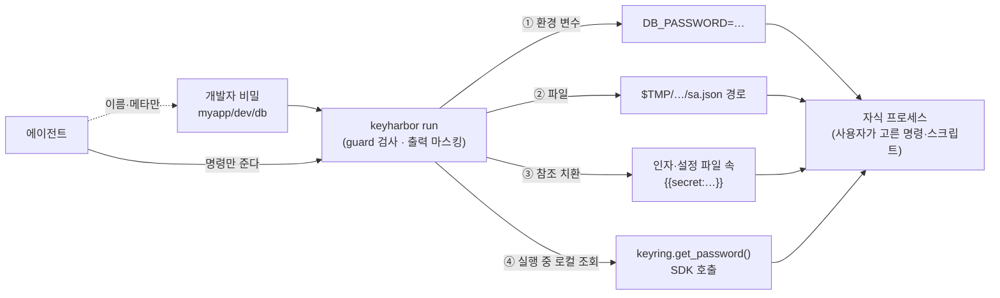

# 개발자 비밀 도메인 설계 (R-40)

> 상태: 초안 2판, 사용자 검토 대기. 도메인 분리(`secret`·`env` → `developer`, 키 `DK_dev`, 기존 금고 이전)는 사용자가 결정했고 3단계 강화 브랜치에서 구현 중이다.
> 1판은 Spring Boot 프로필 파일, Spring 설정 가져오기처럼 쓰는 방법까지 정해 두었다. 사용자 지적: "환경 변수를 어떻게 쓸지(실행 스크립트에 넣을지, 명령에 붙일지)는 쓰는 사람 나름이다." 그래서 2판은 **값을 맡기고 꺼내는 범용 저장소**로 다시 잡았다. Python keyring과 AWS Secrets Manager를 기준으로 삼았다.

## 1. 참고한 것

| | Python keyring | AWS Secrets Manager | KeyHarbor 개발자 비밀 |
|---|---|---|---|
| 식별 | `(service, username)` 쌍 | 경로 같은 이름 `prod/myapp/db` | 경로 같은 이름 `myapp/prod/db` |
| 값 | 문자열 하나 | `SecretString`(문자열 또는 JSON 키-값), `SecretBinary` | 키-값 묶음. 값 하나면 키 `value` |
| 메타 | 없음 | 설명, 태그, 버전·스테이지 라벨 | 설명, 태그, 직전 값 1개 |
| 목록 | 백엔드마다 다름 | `ListSecrets`는 값 없이 메타만 | 값 없이 메타만 (지금도 그렇다) |
| 꺼내기 | `get_password()`가 평문 반환, CLI `keyring get`이 평문 출력 | `GetSecretValue`, ECS 환경 변수 주입, CSI 드라이버 파일 마운트, CloudFormation 참조 `{{resolve:secretsmanager:…}}`, Lambda 확장의 로컬 HTTP 엔드포인트 | 아래 §3의 네 가지 |
| 쓰는 법 | 프로그램이 정한다 | 프로그램과 배포 설정이 정한다 | **쓰는 사람이 정한다.** KeyHarbor는 전달 방법만 준다 |

배울 점: 저장소는 **이름·메타·값**만 알고, 값이 어디에 어떻게 쓰이는지는 모른다. 대신 꺼내는 통로를 여러 개 준다.
다른 점: 둘 다 평문을 호출한 쪽에 그대로 돌려준다. KeyHarbor의 호출자는 AI 에이전트이고, 에이전트의 대화 맥락에 평문이 들어가지 않는 것이 제품의 존재 이유다(S1). 그래서 `keyring get` 같은 **평문 출력 명령은 만들지 않는다**(Q-01 A안 유지). 평문은 에이전트가 시킨 *프로세스*까지만 가고, 그 프로세스의 출력은 마스킹한다.

## 2. 데이터 모델

- **항목** = 이름 + 설명 + 태그 + 키-값 필드들. `secret`(키 하나)과 `env`(키 여럿)는 같은 모양이고 기본값만 다르다. 종류 이름은 남겨 두되 저장 형식은 하나로 둔다.
- **이름**: `myapp/prod/db`처럼 `/`로 나눈 경로를 허용한다. 계층 기능은 없고, 목록에서 접두사로 거르는 데만 쓴다(`vault list --prefix myapp/`). Secrets Manager와 같은 방식이다. placeholder는 `{{secret:myapp/prod/db.password}}`.
- **필드 속성** `sensitive` (기본 true): false면 비밀이 아닌 설정값이다(`SPRING_PROFILES_ACTIVE=dev`, `PORT=8081`). 목록에 값이 보이고 마스킹에서 빠진다. 짧고 흔한 값 때문에 로그가 가려지는 일을 막는다.
- **직전 값 1개**: 값을 바꾸면 이전 값을 `previous`로 남긴다(Secrets Manager의 `AWSPREVIOUS`). 되돌리기는 `vault revert`. 자동 교체(rotation)는 하지 않는다.
- 3단계 강화의 `run_allowed`, `expires_at`, `description`, 정책은 그대로 적용된다.

## 3. 꺼내는 통로 (쓰는 법은 사용자 몫)

| 통로 | 비슷한 것 | 쓰는 예 | 상태 |
|---|---|---|---|
| ① 환경 변수 `run --env <item>` | ECS secrets → env | `./gradlew bootRun`, `pytest`, MCP 서버 감싸기 | 있음. 키 이름 바꾸기 `--env item:KEY=NEWNAME` 추가 |
| ② 파일 `run --file VAR=<item>.<key>` | EKS CSI 파일 마운트 | `GOOGLE_APPLICATION_CREDENTIALS`, keystore, kubeconfig | 새로. 0700 임시 폴더 안 0600 파일, 끝나면 삭제 |
| ③ 참조 치환 | CloudFormation `{{resolve:…}}` | `run -- curl -H 'Authorization: Bearer {{secret:openai.value}}' …`, `run --template app.yml:/tmp/app.yml` | `--env-file`에는 있음. 인자와 임의 템플릿 파일로 넓힌다 |
| ④ 실행 중 로컬 조회 | Lambda 확장 로컬 엔드포인트, keyring 백엔드 | 프로그램 코드에서 `keyring.get_password("myapp/dev/db", "password")` | 새로. `run`이 자식에게만 보이는 일회용 Unix socket과 토큰을 연다. Python keyring 백엔드(`keyrings.keyharbor`)는 그 socket에 묻는다. `run` 밖에서는 socket이 없으니 실패한다 |

- 넷 모두 `run` 안에서만 열리므로 guard 검사(정책·`run_allowed`·만료·origin 바인딩 없음)와 출력 마스킹을 똑같이 거친다. 새 평문 경로가 생기지 않는다.
- ④에서 묻는 이름도 guard가 검사하고 사용 기록을 남긴다. 미리 `run --allow myapp/dev/*`로 범위를 정해 둘 수 있다(기본은 `run`에 준 항목만).
- ③의 인자 치환은 다른 프로세스가 `ps`로 인자를 볼 수 있다. 쓸 수는 있게 하되 경고를 한 줄 출력하고 03에 적는다.
- 장기 실행 프로세스를 위해 `run`에 신호 전달(새 프로세스 그룹, SIGINT·SIGTERM·SIGHUP 전달)과 줄바꿈 없는 출력의 조각 단위 마스킹을 넣는다. 서버를 띄우든 한 번 돌리든 같다.

## 4. 에이전트가 보는 것

- MCP `vault_list`(이미 있음)에 developer 항목의 이름, 설명, 태그, 키 이름, 비밀 아닌 값, `run_allowed`, 만료를 싣는다. 값은 없다.
- 프로세스를 띄우는 MCP 도구는 두지 않는다. 에이전트는 자기 셸로 `keyharbor run …`을 쓴다.
- 6단계 스킬에 통로 ①–④를 어떤 경우에 고르는지 예시로 적는다. 정해진 방식은 없다.

## 5. 로그인은 어느 페이지 것인지 어떻게 아는가 (질문에 대한 답)

- `login` 항목에는 **origin 목록**이 있다(`vault add github --origin https://github.com`). login은 origin 바인딩이 기본으로 켜져 있다.
- 에이전트가 `{{secret:github.password}}`를 입력하려 하면 guard가 **포커스된 입력칸이 들어 있는 frame의 origin**을 CDP로 읽는다. 이 값이 목록 중 하나와 정확히 같을 때만 치환한다. 하위 도메인은 와일드카드로 보지 않고, 다르면 `denied: github (origin)`과 사용 기록이 남는다(`keyharbor-guard` `pep/origin.rs`).
- 3단계 강화에서 shadow DOM·`<object>`를 통한 우회(C2)와, 확인 뒤 페이지가 바뀌는 경우(I4)를 막는다. origin을 넣는 일은 약화 작업이라 사람 확인을 받는다.
- 4단계에서 사람이 그 사이트에 직접 로그인할 때 origin을 자동으로 채워 등록하는 흐름을 만든다.
- 개발자 비밀에는 origin 바인딩이 해당하지 않는다. 브라우저 입력은 origin 목록이 있을 때만 허용한다(R-36).

## 6. 한계 (03에 적는다)

- 자식 프로세스는 평문을 받는다. 마스킹은 정확한 값과 알려진 변형만 잡고, 네트워크로 보내거나 변형해 찍는 것은 막지 못한다. 에이전트가 `run -- python -c 'print(…)'`를 시켜도 출력은 마스킹되지만, `base64`처럼 변형하면 새어 나간다. 이 위험은 `run_allowed`와 정책(어느 에이전트에게 어떤 항목)으로 줄인다.
- ④의 socket은 `run`이 도는 동안 같은 사용자의 다른 프로세스가 토큰을 알면 쓸 수 있다. 토큰은 자식 환경 변수에만 있다.

## 7. 하지 않는 것

- 평문 출력 명령(`keyring get`, `aws secretsmanager get-secret-value`에 해당하는 것)
- 자동 교체(rotation), 버전 여러 개, 리소스 정책
- 프로젝트 프로필 파일, Spring 설정 가져오기 같은 특정 도구 전용 기능: 1판에서 제안했다가 뺐다. 필요하면 위 통로로 사용자가 스크립트로 만든다.

## 8. 구현 순서

3단계 강화(도메인 분리 포함)가 끝난 뒤 별도 계획으로 구현한다.
① 경로 이름·태그·`sensitive`·직전 값
② `run` 신호 전달·조각 마스킹
③ 통로 ② 파일
④ 통로 ③ 인자·템플릿 치환
⑤ 통로 ④ 로컬 조회 socket과 Python keyring 백엔드(저장소 안 `integrations/python-keyring/`, 배포는 하지 않는다)
⑥ 문서
