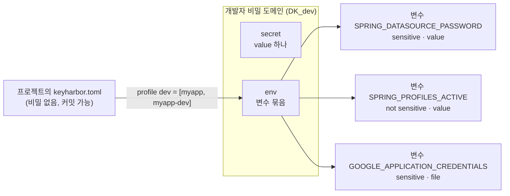
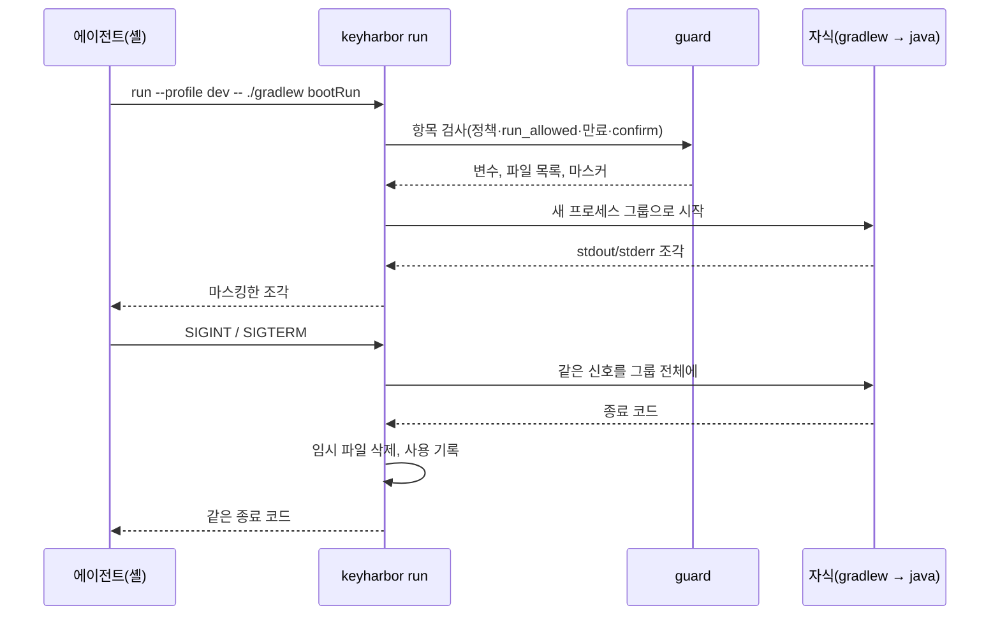

# 개발자 비밀 도메인 설계 (R-40)

> 상태: 초안, 사용자 검토 대기. 도메인 분리 자체(`secret`·`env` → `developer`, 키 `DK_dev`, 기존 금고 이전)는 사용자가 결정했고 3단계 강화 브랜치에서 구현 중이다. 이 문서는 그 도메인이 **무엇을 할 수 있어야 하는지**를 사용 장면에서 출발해 정한다.

## 1. 왜 따로 두는가

자격 증명(`login`)은 **허용된 사이트의 입력칸**으로 간다. 값은 브라우저 밖으로 나가지 않고, origin 확인이 경계다.
개발자 비밀(`secret`·`env`)은 **프로세스와 도구**로 간다. 자식 프로세스는 평문을 그대로 받고, 경계는 "어느 명령에 어떤 값을 줄지"와 "그 출력을 가리는 것"이다. 쓰는 사람·실패 방식·필요한 기능이 다르므로 도메인을 나눈다. [사용자 결정 R-40]

## 2. 사용 장면

| # | 사람이 에이전트에게 하는 말 | 필요한 것 |
|---|---|---|
| U1 | "myapp을 dev 설정으로 띄워 줘" (Spring Boot `./gradlew bootRun`) | 여러 변수 묶음, 오래 도는 프로세스, 로그 마스킹, 종료 신호 전달 |
| U2 | "prod 읽기 전용 DB로 마이그레이션 dry-run 해 줘" | prod 값은 매번 사람 확인 |
| U3 | "S3 버킷 목록 보여 줘", "이 PR 머지해 줘" (`aws`, `gh`) | 단일 토큰을 짧은 명령에 |
| U4 | MCP 서버 설정에 키를 평문으로 두지 않기 | 설정의 `command`를 `keyharbor run …`으로 감싸기 |
| U5 | GCP 서비스 계정 JSON, `.p12` keystore, kubeconfig | 값이 아니라 **파일**로 줘야 하는 비밀 |
| U6 | "이 프로젝트에 쓸 수 있는 환경이 뭐가 있지?" | 이름·설명·변수 이름·비밀 아닌 값만 보여 주는 목록 |

## 3. 데이터 모델



- **env 변수마다 두 속성**을 둔다.
  - `sensitive` (기본 true): false면 값이 비밀이 아니다(`SPRING_PROFILES_ACTIVE=dev`, `SERVER_PORT=8081`). 목록과 MCP에 값이 보이고 마스킹 대상에서 빠진다. 짧고 흔한 값을 마스킹해 로그가 `[redacted]` 투성이가 되는 일을 막는다. 저장은 똑같이 암호화한다.
  - `delivery`: `value`(기본) 또는 `file`. `file`이면 실행할 때 값을 0700 임시 폴더 안 0600 파일로 쓰고, 변수에는 그 **경로**를 넣는다. 자식이 끝나면 지운다. 비정상 종료로 남은 폴더는 다음 `run`이 지운다. (U5)
- **계층은 만들지 않는다.** 묶음을 겹쳐 쓴다: `--env myapp --env myapp-dev`에서 뒤가 앞을 덮는다. 덮인 변수 이름은 사용 기록에 남긴다. 이름 규칙 `<앱>`, `<앱>-<환경>`을 문서와 스킬에서 권한다. (앞선 결정 유지)
- **`confirm_each_run`** 항목 속성 (기본 false): 켜진 항목을 쓰는 `run`은 실행마다 터미널의 사람 확인(3단계 C3와 같은 방식, 5단계부터는 관리 앱 알림)을 받는다. prod 값에 쓴다. 켜는 것은 강화라 확인이 필요 없고, 끄는 것은 약화 작업이다. (U2)
- 3단계 강화의 `run_allowed`(secret·env 기본 true), `expires_at`, `description`은 그대로 쓴다. 변수별 `description`도 둔다.

## 4. 프로젝트 프로필 `keyharbor.toml`

에이전트가 "dev로 띄워 줘"를 항목 이름 조합으로 바꾸려면 프로젝트마다 정해 둔 이름이 있어야 한다. 프로젝트 루트에 비밀 없는 파일을 둔다.

```toml
# keyharbor.toml — 커밋해도 된다. 항목 이름만 있고 값은 없다.
[profiles.dev]
env = ["myapp", "myapp-dev"]
description = "로컬 Postgres와 테스트 OAuth 앱으로 서버를 띄운다"

[profiles.prod-ro]
env = ["myapp", "myapp-prod-ro"]
description = "prod 읽기 전용 DB. 마이그레이션 dry-run 용"
```

- `keyharbor run --profile dev -- ./gradlew bootRun`. 현재 폴더에서 위로 올라가며 처음 만나는 `keyharbor.toml`을 쓴다.
- `keyharbor profile list [--json]`: 프로필 이름, 설명, 들어가는 항목, 각 변수 이름과 비밀 아닌 값. 값 자체는 없다. (U6)
- 파일은 저장소 안에 있으니 에이전트가 고칠 수 있다. 그래도 새 권한은 생기지 않는다: `--env`로 직접 이름을 줄 수 있는 것과 같고, 정책·`run_allowed`·`confirm_each_run`·만료 검사는 항목 쪽에서 한다.

## 5. `run`을 오래 도는 서버에 맞게



- **신호 전달**: 자식을 새 프로세스 그룹으로 띄우고 SIGINT·SIGTERM·SIGHUP·SIGQUIT를 그룹 전체에 보낸다. Gradle 데몬 아래 java까지 내려가야 한다. keyharbor가 죽으면 그룹에 SIGTERM, 5초 뒤 SIGKILL.
- **줄바꿈 없는 출력**: 지금은 줄 단위라 진행 표시나 프롬프트가 늦게 나온다. 조각 단위로 바꾸고, 비밀 하나가 조각 경계에 걸릴 수 있으니 (가장 긴 마스킹 패턴 − 1)바이트를 넘겨 두었다가 다음 조각과 함께 검사한다. 30ms 동안 새 조각이 없으면 남은 부분을 검사해 내보낸다.
- **부모 환경**: 기본은 물려준다. `--clean-env`면 `PATH`, `HOME`, `USER`, `LANG`, `TERM`, `TMPDIR`만 남긴다. `KEYHARBOR_*` 변수는 언제나 뺀다.
- **백그라운드**: keyharbor가 데몬이 되지 않는다. 에이전트가 자기 백그라운드 기능(Claude Code의 백그라운드 실행 등)으로 띄우고, 마스킹은 keyharbor의 stdout에서 이미 끝났으므로 파일로 돌려도 안전하다.
- **헬스 체크, 포트 대기**는 하지 않는다. 에이전트의 일이다.

## 6. 에이전트 쪽 표면

| 표면 | 내용 |
|---|---|
| CLI | `run --env/--env-file/--profile`, `profile list`, `vault list --domain developer` |
| MCP | `env_list`: developer 도메인 항목의 이름·설명·변수 이름·비밀 아닌 값·`confirm_each_run`. **프로세스를 띄우는 MCP 도구는 두지 않는다**(셸 없는 클라이언트에 임의 명령 실행 통로를 새로 여는 일이라서) |
| 스킬(6단계) | "서버를 띄워 달라" → `profile list` → `run --profile …`; MCP 서버 설정을 `keyharbor run`으로 감싸는 법 |
| 가져오기 | `vault import-env <item> .env` (있음) + `--from-spring application-dev.yml`: Spring 키를 relaxed binding 규칙으로 변수 이름으로 바꾸고(`spring.datasource.password` → `SPRING_DATASOURCE_PASSWORD`) 이름에 `password|secret|token|key|credential`이 들어가면 sensitive로 표시한다. 가져온 뒤 원본 파일을 지울지 사람에게 묻는다 |

## 7. Spring Boot 따라 하기

```sh
keyharbor vault import-env myapp-dev --from-spring src/main/resources/application-dev.yml
keyharbor vault edit myapp-dev --var SPRING_PROFILES_ACTIVE --not-sensitive
keyharbor vault add-file gcp-sa --var GOOGLE_APPLICATION_CREDENTIALS < sa.json   # file로 전달
printf '[profiles.dev]\nenv = ["myapp-dev", "gcp-sa"]\n' > keyharbor.toml
keyharbor run --profile dev -- ./gradlew bootRun    # 에이전트는 이 한 줄만 안다
```

## 8. 한계 (03에 적는다)

- 자식은 평문을 받는다. 출력 마스킹은 정확한 값과 알려진 변형만 잡고, 자식이 값을 네트워크로 보내거나 변형해 찍는 것은 막지 못한다.
- `confirm_each_run`의 터미널 확인은 pty를 흉내 내면 우회할 수 있는 약한 경계다(3단계 C3와 같음).
- `file` 전달 파일은 실행하는 동안 같은 사용자의 다른 프로세스가 읽을 수 있다.

## 9. 하지 않는 것

- 명령별 허용 목록(`allowed_commands`): `sh -c`로 감싸면 무력해서 경계처럼 보이게만 한다.
- env 계층(부모·자식 상속): 겹쳐 쓰기와 프로필로 충분하다. 필요가 확인되면 다시 본다.
- 클라우드 비밀 관리자 연동(Vault, AWS Secrets Manager): 로컬 원칙.

## 10. 구현 순서

3단계 강화(도메인 분리 포함)가 끝난 뒤 별도 계획으로 구현한다: ① 변수 속성(`sensitive`, `delivery`)과 `confirm_each_run` ② `run` 신호·조각 마스킹·`--clean-env`·임시 파일 ③ `keyharbor.toml`과 `profile list` ④ MCP `env_list` ⑤ Spring 가져오기 ⑥ 문서. 각 단계 실제 프로세스로 테스트(`sh` 스크립트로 Spring 같은 장기 실행·신호·부분 출력 흉내).
