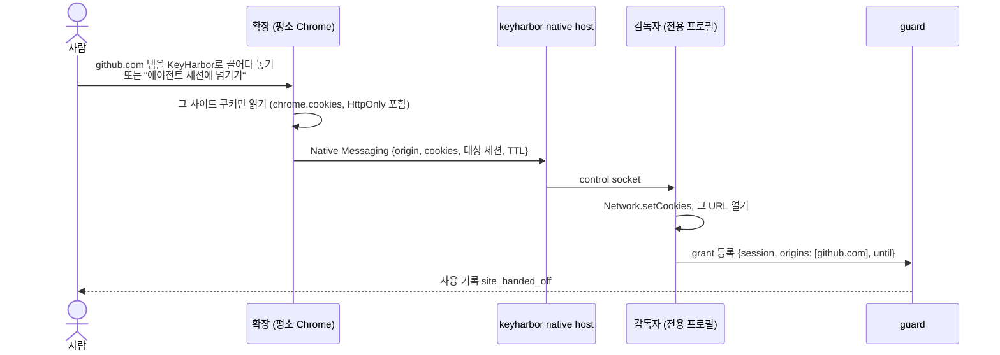

# 사이트 넘기기와 권한 범위(grant) 설계

> 상태: 사용자 결정(2026-10-29). 결정 기록 06에는 3단계 강화 브랜치가 병합된 뒤 R-41~R-43으로 옮긴다(그 브랜치가 R-35~R-40을 쓰고 있다).

## 1. 결정

| 번호 | 결정 | 사용자 말 |
|---|---|---|
| R-41 | 개발자 비밀은 **범용 저장소**다. 이름·메타·값만 알고, 쓰는 방법은 사용자 몫이다. 꺼내는 통로(환경 변수, 파일, 참조 치환, 실행 중 로컬 조회)를 준다. 설계: [개발자 비밀 2판](2026-10-29-developer-secrets-design.md). 통로 ④(로컬 조회 socket·Python keyring 백엔드)를 넣을지는 미정 | "환경변수를 어떻게 쓸지는 사용하기 나름", "python keyring이나 aws secretmanager를 확인해봐" |
| R-42 | 에이전트는 **전용 프로필에만** 있다. 평소 Chrome의 로그인은 사람이 사이트 단위로 **넘겨 준다**(끌어다 놓기). 에이전트가 평소 Chrome을 직접 조작하는 방식은 만들지 않는다 | "전용 프로필에서 드래그 같은 걸로 쓸 수 있는 권한 복사 가능한 느낌" |
| R-43 | 권한은 **grant** 하나로 다룬다: 누구에게(에이전트·세션), 어디까지(origin 또는 항목 접두사), 언제까지(TTL). 브라우저 사이트와 개발자 비밀에 같이 쓴다 | "해당 도메인/환경변수 안에서 수행하면 되니까" |
| 로드맵 | 쿠키 넘기기만 하는 작은 확장을 4단계에 넣는다. 사람용 자동 완성·저장은 7단계 | — |

## 2. 사이트 넘기기



- **무엇을 옮기나**: 그 사이트(등록 가능한 도메인과 하위 도메인)의 쿠키. 사람이 고르면 그 origin의 `localStorage`도 옮긴다(토큰을 거기 두는 사이트용).
- **어디에 남나**: KeyHarbor는 쿠키를 따로 저장하지 않는다. 감독자가 곧바로 전용 프로필에 넣고, 이후는 Chrome 프로필이 지금처럼 보관한다. 로그와 응답에 쿠키 값은 나오지 않는다.
- **확장이 하는 일**: 사람이 누르거나 끌어다 놓을 때 사이트 하나의 쿠키를 읽어 보낸다. 그것뿐이다. 에이전트는 평소 Chrome에 닿지 않는다. Native Messaging 매니페스트의 `allowed_origins`에 확장 ID만 넣는다.
- **끌어다 놓기 대상**: 관리 앱 창 또는 메뉴 막대 아이콘(5단계). 그 전에는 확장 팝업의 버튼과 `keyharbor session receive` 대기 명령으로 한다.
- **확장 구현**: [integrations/browser-extension](../../../integrations/browser-extension/README.md). 프로토콜 v1, Chrome·Firefox 어댑터, 팝업이 있다. 받는 쪽 native host는 4단계에서 Rust로 더한다.
- **안 되는 사이트**: 쿠키를 기기 키에 묶는 사이트(Google DBSC 등)와 브라우저 지문·IP를 보는 사이트는 넘겨도 로그인이 유지되지 않을 수 있다. 이때는 전용 프로필에서 직접 로그인한다(사람 넘기기 handoff). 결과는 `site_state`에 `expired`로 남는다.
- 두 브라우저가 같은 로그인 세션을 쓰므로 한쪽 로그아웃이 다른 쪽을 끊을 수 있다. 문서에 적는다.

## 3. grant

```
Grant { id, subject: Agent(name) | Session(id),
        scope: Origins([origin…]) | Items(prefix),   // 예: github.com / myapp/dev/*
        until: Option<시각>, created_by: 사람, reason }
```

- **브라우저**: 세션에 Origins grant가 하나라도 있으면 그 세션의 최상위 탐색과 frame 탐색은 grant 안의 origin으로만 허용한다. 밖으로 가려 하면 guard가 탐색을 멈추고 `denied: navigation (out-of-grant)`를 남긴다. 하위 리소스(이미지·스크립트)는 막지 않는다. grant가 없는 세션은 지금처럼 제한이 없다.
- **개발자 비밀**: Items grant는 에이전트가 `run`으로 쓸 수 있는 항목을 접두사로 정한다. 3단계의 `run_allowed`·정책·만료와 겹치는 부분은 구현할 때 정리한다(정책은 거부 규칙, grant는 기간 있는 허용).
- **만료·회수**: `until`이 지나거나 사람이 거두면(`keyharbor grant revoke`, 관리 앱) 브라우저 grant는 해당 쿠키를 전용 프로필에서 지우고, 둘 다 사용 기록을 남긴다.
- **grant를 주는 것은 약화 작업**이라 사람 확인을 받는다(3단계 C3와 같은 방식). 끌어다 놓기는 그 자체가 사람의 확인이다.

## 4. 단계 배치

- **4단계**에 더한다: grant 모델과 탐색 제한, `session receive`, 쿠키 넘기기 확장(압축 해제 설치, 스토어 배포 안 함), native host 등록 명령 `keyharbor browser install-host`.
- **5단계** 관리 앱: 끌어다 놓기 대상, grant 목록·회수 화면.
- **7단계**: 사람용 자동 완성·저장·CSV 가져오기. 그때 "평문은 에이전트에게만 막는다"와 "사람 통로는 잠금 해제 필수" 원칙 변경을 ADR로 정한다.
