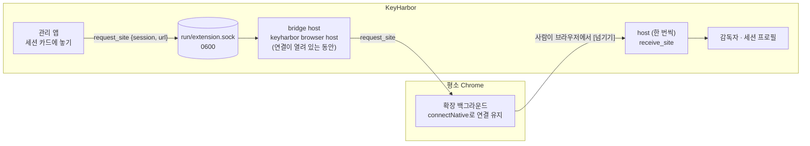
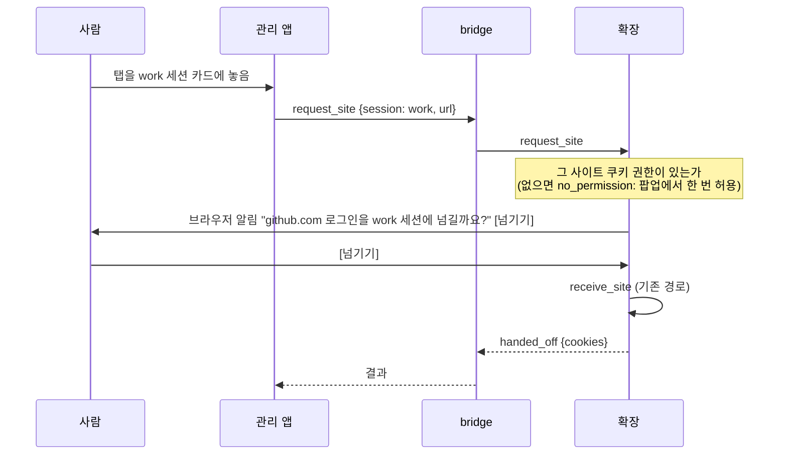

# 끌어다 놓아 사이트 넘기기 — 설계

| 항목 | 값 |
|---|---|
| 날짜 | 2026-10-31 |
| 근거 | R-46(4): 끌어다 놓기를 넣는다. 사이트 넘기기 spec(2026-10-29) "끌어다 놓기 대상" |
| 결정 표시 | 사용자가 정한 것은 R-46, 나머지는 [설계자 판단] |

## 1. 무엇을

사람이 평소 Chrome의 탭(주소창의 자물쇠나 탭 자체)을 관리 앱의 세션 카드에 끌어다 놓으면, 그 사이트의 로그인이 그 세션으로 넘어간다. 지금 확장 팝업의 [에이전트 세션에 넘기기]와 결과가 같다(grant, 사용 기록 `site_handed_off`).

## 2. 구조

앱이 받는 것은 끌어 온 URL뿐이고 쿠키는 확장만 읽는다. Native Messaging은 확장이 먼저 연결하는 길이라, 확장이 host와의 연결을 열어 두고 앱의 청을 그 연결로 받는다.

- **bridge**: 확장이 `connectNative`로 띄운 host가 첫 메시지 `bridge`를 받으면 `run/extension.sock`을 열고 연결이 끝날 때까지 산다. 앱의 청을 확장에 전하고 답을 돌려준다. 확장이 끊기면 socket을 지운다.
- **넘기기 자체**는 지금과 같은 `receive_site` 경로다(확장이 쿠키를 읽어 host에 보낸다). bridge는 값을 나르지 않는다: 청에는 세션 이름과 URL만, 답에는 결과 코드만 있다.

## 3. 사람의 동의

**[설계자 판단] 브라우저 쪽에서 한 번 더 누르게 한다.** socket은 같은 사용자의 다른 프로세스, 곧 셸을 가진 에이전트도 쓸 수 있다. 확장이 청을 받자마자 넘기면 에이전트가 사람의 은행 로그인을 자기 세션으로 가져갈 수 있다. 지금 팝업 넘기기는 사람이 누르는 것이 동의인데, 그 동의가 사라진다. 그래서 확장이 브라우저 알림(`notifications`)으로 사이트와 세션을 보여 주고 사람이 [넘기기]를 눌러야 보낸다. 에이전트는 사람의 브라우저 알림을 누를 수 없다(같은 사용자의 GUI 자동화는 N1).

| 대안 | 버린 이유 |
|---|---|
| 앱에서 놓는 것을 동의로 본다 | socket 너머에서는 앱이 보냈는지 에이전트가 보냈는지 알 수 없다 |
| 앱이 Touch ID를 묻는다 | 이 역시 앱 쪽 확인이라, socket에 바로 쓰는 에이전트를 막지 못한다 |
| 확장 팝업을 연다 | `action.openPopup`은 사람의 동작 안에서만 열린다 |

## 4. 권한·제약

- 확장에 `notifications` 권한이 는다. 사이트 쿠키 권한(`optional_host_permissions`)은 사람의 동작 안에서만 청할 수 있으므로, 처음 넘기는 사이트는 팝업에서 한 번 허용해야 한다. 그 전에는 `no_permission`으로 답하고 앱이 그렇게 알린다.
- bridge도 부모 프로세스가 브라우저일 때만 연다(J-107의 `caller`). 다른 프로세스가 가짜 bridge를 열어 앱의 청(세션 이름·URL)을 가로채는 것을 줄인다.
- 앱 창은 HTML 끌어다 놓기를 받아야 하므로 Tauri의 파일 끌어다 놓기 가로채기를 끈다(`dragDropEnabled: false`). 앱이 받는 것은 `text/uri-list`·`text/plain`의 첫 http(s) URL이다.
- Chrome MV3 서비스 워커는 native 연결이 열려 있는 동안 살아 있다. 끊기면 다음 깨어날 때 다시 연결한다.

## 5. 범위 밖

- Firefox 알림 버튼(Firefox는 알림에 버튼이 없다): 알림을 누르면 넘기는 것으로 같은 동의를 받는다.
- 메뉴 막대 아이콘에 놓기: 메뉴 막대 항목은 끌어다 놓기를 받지 않는다. 창의 세션 카드만.
