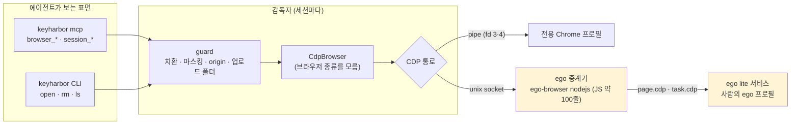
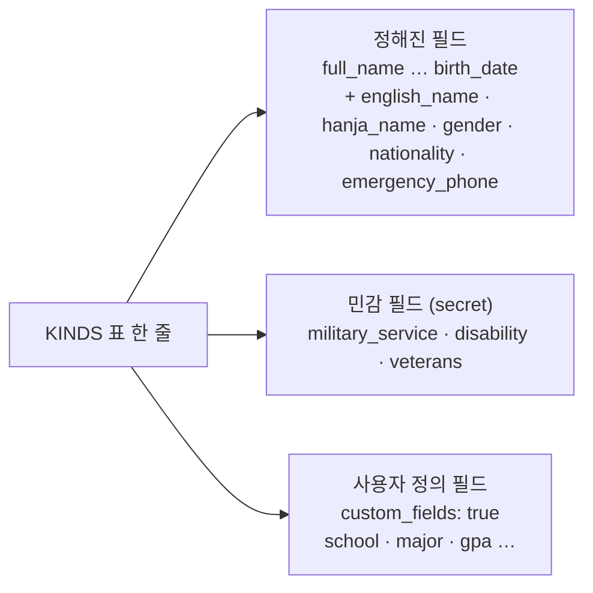
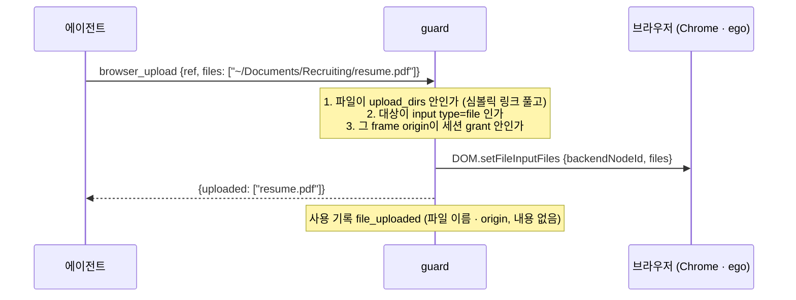
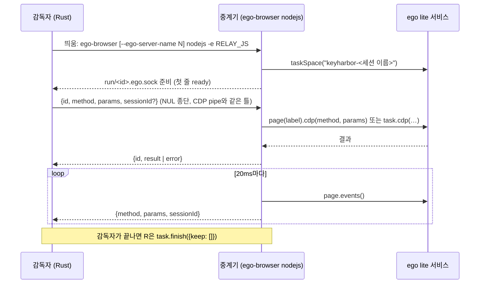
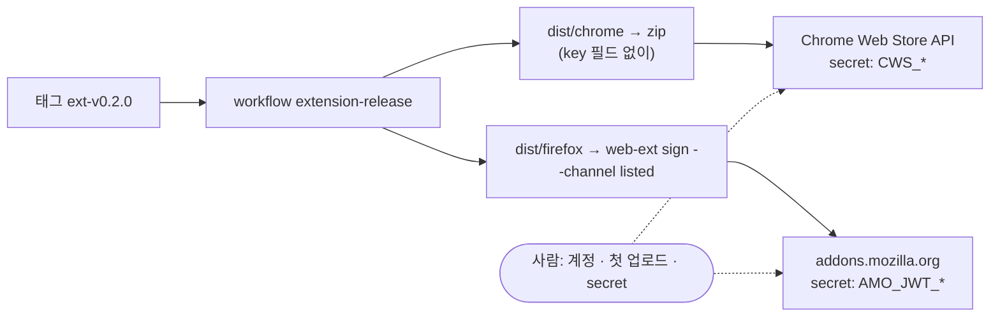
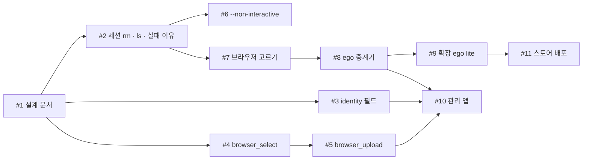

# 채용 지원 사용 사례와 ego lite 지원 — 설계

| 항목 | 값 |
|---|---|
| 날짜 | 2026-11-02 |
| 근거 | R-47(이 문서의 사용자 결정 다섯 가지), ego lite 연결 시험(아래 §8.1) |
| 결정 표시 | 사용자가 정한 것은 R-47, 나머지는 [설계자 판단] |
| 관련 | [ADR-0018](../../design/adr/0018-ego-lite-browser.md), [ADR-0014](../../design/adr/0014-hexagonal-guard-layer.md), [ADR-0017](../../design/adr/0017-human-autofill-channel.md), [09 앱 UX](../../design/09-app-ux.md) |

## 1. 무엇을, 왜

사람이 채용 지원 폴더(이력서·자기소개서 마크다운이 있는 곳)에서 에이전트에게 이렇게 맡긴다.

1. 매일 자소설닷컴 같은 채용 포털에 이메일로 로그인해 새 공고를 모은다.
2. 지원서의 기본정보란(이름·연락처·주소·병역·보훈 등)을 금고의 값으로 채운다. 에이전트는 값을 보지 않는다.
3. 이력서 PDF와 증명사진을 올리고, 학교·병역 구분 같은 드롭다운을 고른다.
4. 사람이 자리에 없을 때 돌다가 인증이 필요하면 멈추고 알린다.

오늘 KeyHarbor는 1의 로그인만 된다. 2는 `identity`에 필드가 모자라고, 3은 도구가 없고, 4는 기다리기만 한다. 사람은 이미 ego lite(에이전트용 Chromium)를 쓰고 있어서, 있으면 그것을 쓰고 없으면 Chrome으로 같은 일을 하기를 원한다.

| 목표 | 비목표 | 실패로 칠 것 |
|---|---|---|
| 한국 지원서 기본정보를 금고에 담는다 | 학력·경력을 구조화된 이력서 모델로 만든다 | 병역·장애·보훈 값이 CLI 인자나 출력으로 지나간다 |
| 업로드·드롭다운을 두 브라우저에서 같은 도구로 | 사이트별 지원서 자동 작성기 | 에이전트가 허용하지 않은 폴더의 파일을 사이트에 올린다 |
| ego lite가 있으면 ego lite, 없으면 Chrome | ego의 자동화 숨김 기능을 Chrome에 흉내 낸다 | Chrome 세션의 보호가 ego 때문에 약해진다 |
| 사람 없이 돌다가 멈추고 알린다 | 이메일 인증 코드를 읽는다 | 무인 실행이 인증 앞에서 영원히 기다린다 |
| 확장을 ego lite에서도 쓰고, 스토어로 배포한다 | 스토어 계정을 대신 만든다 | 스토어 빌드의 확장 ID가 native host와 어긋나 연결이 끊긴다 |

## 2. 사용자가 정한 것 (R-47)

| 번호 | 사용자 말 | 결정 |
|---|---|---|
| R-47(1) | "ego lite browser를 쓴다면 그걸 쓰고 없다면 chrome으로도 ego lite처럼 가능하도록" | 브라우저는 자동 선택: ego lite가 있으면 ego lite, 없으면 Chrome. 업로드·드롭다운은 두 쪽에서 같은 도구 |
| R-47(2) | "받아들일 수 있어" | ego 세션은 에이전트가 ego SDK로 창을 직접 만질 수 있어 보호가 약하다. 비밀번호를 포함해 받아들인다 |
| R-47(3) | "ego-browser nodejs 라기 보다는 ego-browser server가 낫지 않아? 최대한 언어 최적화" | Node는 세션당 한 번 띄우는 얇은 중계기로만 쓰고, 판단은 모두 Rust에 둔다(§8) |
| R-47(4) | "우리만 알수 있는 언어보다는 관용어 위주의 cli 명령어" | 새 명령·옵션은 git·docker·gh의 관용어로(§4) |
| R-47(5) | "chrome, firefox 익스텐션 배포 방법을 찾아보고 가능하면 배포" | 스토어 배포 파이프라인을 만든다. 계정·첫 업로드·키 등록은 사람이 한다(§10) |

## 3. 구조

**[설계자 판단] 갈아 끼우는 것은 CDP 통로 하나다.** `Cdp::new`는 이미 아무 `AsyncRead`/`AsyncWrite`나 받는다. Chrome은 지금처럼 pipe를, ego는 중계기의 unix socket을 준다. 치환·마스킹·origin 확인·페이지 감시는 두 브라우저가 같은 코드를 쓴다. ego 전용 `BrowserPort`를 따로 만들면 guard가 의존하는 `PageInput`·`FrameInspector`를 두 벌 구현해야 하고, 두 벌은 언젠가 어긋난다.

## 4. CLI와 MCP 표면

| 하는 일 | CLI | MCP | 관례 |
|---|---|---|---|
| 세션 지우기 | `keyharbor rm <세션>… [--force]` | 없음(사람의 일) | `docker rm`, `git rm` |
| 세션 목록 | `keyharbor ls` (= `list`) | `session_list` (`browser`·`protection` 추가) | `docker ps`·`ls` |
| 브라우저 고르기 | `keyharbor open <세션> --browser auto\|chrome\|ego-lite\|<경로>` | `session_open {browser?}` | 이미 있는 `--browser` |
| 화면 없이 | `--headless` | — | Chrome·Playwright |
| 기본 브라우저 | `keyharbor settings set browser ego-lite` | — | `git config` |
| 업로드 허용 폴더 | `keyharbor settings set upload_dirs ~/Documents/Recruiting` | — | 위와 같음 |
| 무인 실행 | `keyharbor mcp --non-interactive` | 기다리는 도구가 곧바로 `needs_user` | `gh --no-prompt`, `apt -y` |
| 파일 올리기 | — | `browser_upload {session, ref\|selector, files[]}` | Playwright `setInputFiles` |
| 드롭다운 고르기 | — | `browser_select {session, ref\|selector, value\|label\|index}` | Playwright `selectOption` |
| 확장 연결 | `keyharbor browser install-host --browser ego-lite` | — | 이미 있는 `--browser` |

`receive`·`grant` 같은 기존 이름은 바꾸지 않는다(범위 밖). 나중에 바꾸면 옛 이름을 숨은 별칭으로 남긴다.

## 5. 지원서 기본정보 (`identity`)

- **정해진 필드를 더한다** `[설계자 판단]`: 한국 지원서가 거의 모두 묻는 `english_name`, `hanja_name`, `gender`, `nationality`, `emergency_phone`는 다른 identity 필드처럼 비밀이 아닌(`plain()`, 마스킹은 함) 필드다. `military_service`, `disability`, `veterans`는 민감정보라 `secret()`이다: 숨김 프롬프트나 `--stdin`으로만 받는다.
- **사용자 정의 필드를 연다** `[설계자 판단]`: `KindSpec`에 `custom_fields: bool`을 더한다. 참이면 선언하지 않은 이름도 받는다(`FieldName::parse`, 소문자·숫자·`_`). 그런 필드는 `CUSTOM_FIELD`(비밀, 마스킹, Text 입력, 설명 "Custom field")로 다룬다. identity와 address에 켠다. env의 `free_fields`(대문자 환경 변수 이름만)와는 다른 규칙이라 따로 둔다.
- 사람이 필드마다 `--field-description school="졸업한 대학교"`로 설명을 달면 에이전트가 placeholder를 고를 때 쓴다(이미 있는 기능).
- **짧은 값은 가리지 않는다**(3.7, `MIN_MASKED_CHARS = 4`). 세 글자 한국 이름은 페이지가 다시 보여 줄 때 결과에 보일 수 있다. KeyHarbor가 채운 입력칸은 `redacted_snapshot`이 길이와 상관없이 가린다. 페이지가 이름을 다른 곳(인사말 등)에 다시 쓰면 보인다. 03 §3.11에 적는다.

## 6. 업로드와 드롭다운

- **업로드 허용 폴더** `[설계자 판단]`: 기본은 비어 있고, 비어 있으면 거절한다(`upload_dirs is not set`). 에이전트가 `~/.ssh`를 아무 사이트에나 올리지 못하게 하려는 것이다. 폴더를 더하는 것은 약화 작업이라 사람이 확인한다(`WeakeningOp::AddUploadDir`). 경로는 정규화(`canonicalize`)한 뒤 비교하고, 파일은 정규 파일이어야 하며 한 번에 10개(설정 `upload_max_files`)까지다.
- **드롭다운**: 대상이 `<select>`여야 한다. `value`·`label`·`index` 중 하나로 고르고 `input`·`change` 이벤트를 낸다(프레임워크가 알아듣게). `value`·`label`에 placeholder(`{{secret:me.military_service}}`)를 주면 guard가 값을 풀어 고르고, 결과에서는 다시 가린다. 이때도 origin 확인은 `browser_fill`과 같다. 비밀번호 필드는 받지 않는다.
- 두 도구 모두 CDP로 만든다: 같은 코드가 Chrome과 ego에서 돈다.

## 7. 무인 실행과 세션 정리

- **`--non-interactive`** `[설계자 판단]`: 이 옵션으로 띄운 MCP 서버에서는 `session_wait_auth`가 인계 요청을 남기고 곧바로 `{status: "needs_user", request_id}`를 돌려준다. `session_wait_for_resume`·`session_wait_site`·`vault_wait`는 기다리지 않고 지금 상태를 돌려준다. 관리 앱은 이미 10초마다 대기 중인 인계·요청을 읽어 macOS 알림을 띄우므로(tray `notify`), 사람은 알림을 보고 나중에 푼다. 플러그인 스킬에 "`needs_user`를 받으면 기록하고 끝내라"를 적는다.
- **`keyharbor rm`**: 멈춘 세션의 DB 행(인계·사이트 상태는 FK로 함께)과 Chrome 프로필 폴더를 지운다. `--force`는 열린 세션을 먼저 닫는다. 이름이나 id를 받는다. 새 core 유스케이스 `session::remove`와 port `SessionRuntime::remove_profile`. ego 세션은 프로필 폴더가 없다(사람의 ego 프로필은 지우지 않는다).
- **실패 이유를 알린다**: `open`이 `session did not start (failed)`만 말하던 것을, 감독자가 실패할 때 이유 코드를 남기고(`sessions.failure`) CLI가 그대로 보여 주게 한다. 데이터 폴더가 길어 socket 경로가 103바이트를 넘는 경우는 감독자를 띄우기 전에 core가 먼저 검사해 "data directory path is too long for a socket (163 > 103 bytes); use a shorter --data-dir"로 거절한다.

## 8. ego lite 연결

### 8.1 시험으로 확인한 것 (2026-11-02, ego lite 0.6.2.5, SDK 안내서 v2.2.0)

| 시험 | 결과 |
|---|---|
| `--browser "…/ego lite"`로 실행 파일 직접 실행 | 세션은 뜨지만 시작 URL을 무시하고, KeyHarbor 없이 띄워도 **30초 뒤 스스로 꺼진다**. ego는 자기 서비스가 관리하는 브라우저라 이 길은 쓰지 않는다 |
| `ego-browser nodejs -e`에 stdin으로 명령 | `-e`는 stdin을 읽지 않는다 |
| 중계 스크립트가 unix socket을 열고 `page.cdp()`로 넘기기 | `Page.navigate`·`Runtime.evaluate`·`DOM.getDocument`·`Page.getFrameTree`·`Input.insertText` 모두 됨 |
| 이벤트 | `page.events()`로 꺼내 가는 방식(밀어 주지 않음). 23개 이벤트(`frameNavigated`, `Network.*` 등)를 받음 |
| `ego-browser server` 같은 하위 명령 | 없음. CLI는 `ego_cli bootstrap`(Chromium 내부 IPC)로 서비스에 붙는다. 공개 프로토콜이 아니다 |

### 8.2 중계기

- 중계기는 판단하지 않는다: 받은 CDP 명령을 넘기고, 이벤트를 꺼내 밀어 줄 뿐이다. 스크립트는 Rust 바이너리에 `include_str!`로 들어간다(`crates/broker/src/ego/relay.js`).
- **세션 id 사상**: KeyHarbor는 `Target.setAutoAttach {flatten}`으로 탭마다 CDP 세션을 받는다. 중계기는 ego Page마다 가짜 `Target.attachedToTarget`(sessionId = Page 라벨)을 만들어 보내고, sessionId가 붙은 명령은 그 Page의 `page.cdp()`로, 없는 명령(`Target.*`·`Browser.*`)은 `task.cdp()`로 보낸다. 새 탭은 `task.newPage()`가 만든다.
- **ego가 없을 때**: `auto`는 `ego-browser`가 PATH(또는 `~/.local/bin`)에 있고 `ego-browser nodejs -e "1"`이 5초 안에 끝나면 ego, 아니면 Chrome이다. 확인 결과는 감독자 시작 때마다 다시 본다(캐시하지 않는다).

### 8.3 보호 수준 (R-47(2))

| | Chrome 세션 | ego 세션 |
|---|---|---|
| CDP를 누가 쥐나 | 감독자만 (pipe, 포트 없음) | 감독자 **와** 같은 ego를 쓰는 다른 SDK 스크립트 |
| 에이전트가 입력칸 값을 읽을 수 있나 | 없음 | **있음**: 셸이 있는 에이전트는 `ego-browser nodejs`로 `page.evaluate()`를 부를 수 있다 |
| grant 밖 문서 막기 | Fetch 가로채기로 막음 | 이벤트를 늦게 받아 **늦게 막거나 놓칠 수 있다**. 막는다고 약속하지 않는다 |
| 로그인 포착 | 됨 | 됨(늦게 반응) |
| 프로필 | 세션마다 새 프로필 | 사람의 ego 프로필(로그인 상태가 그대로) |

`session_list`와 앱 세션 카드에 `protection: "shared"`를 보인다. 사용 기록 `session_opened`에 브라우저 종류를 적는다. 정책으로 막을 수 있다: `keyharbor policy deny --agent '*' --resource browser --target ego-lite`(새 Resource `browser`). 결정과 대안은 ADR-0018.

## 9. 평소 쓰는 브라우저 확장을 ego lite에서

| 할 일 | 어디 |
|---|---|
| `HostBrowser::EgoLite`: manifest를 `~/Library/Application Support/Citro Labs/ego lite/NativeMessagingHosts/`에 쓴다 | `cli/src/browser_cmd/install.rs` |
| host가 받아 주는 앱에 `ego lite.app` | `cli/src/browser_cmd/host/caller.rs` |
| 확장 설치는 ego lite의 확장 관리 화면에서 `dist/chrome`을 불러오거나, 스토어에서 | 확장 README |

ego lite가 데이터 폴더의 `NativeMessagingHosts`를 읽는지는 구현할 때 실제로 확인하고, 안 읽으면 그 사실을 README에 적고 이 항목을 닫는다.

## 10. 확장 스토어 배포

- **확장 ID** `[설계자 판단]`: 지금 Chrome ID(`fimjc…`)는 개인 키가 없는 공개 키로 고정한 것이라 스토어에서 쓸 수 없다. 첫 업로드 때 스토어가 새 키를 만든다. 사람이 대시보드의 "공개 키 보기"를 manifest `key`로 옮기면 개발용 빌드도 스토어 ID가 된다. 그 전까지 `install-host`는 두 ID(개발용, 스토어)를 모두 `allowed_origins`에 넣는다. 스토어 ID는 상수 하나다.
- 스토어 빌드는 `key` 필드를 뺀 zip을 만든다(`npm run package`). Firefox는 번들된 빌드라 소스 zip도 올린다(`--upload-source-code`).
- 리스팅 문구(한국어·영어), 권한마다 쓰는 이유(`nativeMessaging`, `cookies`, `notifications`, `scripting`, `activeTab`), 개인정보 처리방침(`site/privacy.html`, GitHub Pages)을 저장소에 둔다.
- 사람이 할 일: Chrome 개발자 등록($5), 첫 zip 업로드와 심사 제출, OAuth 클라이언트·refresh token 발급, AMO API 키, GitHub secret 다섯 개(`CWS_EXTENSION_ID`, `CWS_CLIENT_ID`, `CWS_CLIENT_SECRET`, `CWS_REFRESH_TOKEN`, `AMO_JWT_ISSUER`, `AMO_JWT_SECRET`).

## 11. 관리 앱

| 화면 | 바뀌는 것 |
|---|---|
| 세션 | 카드에 브라우저 표시(Chrome · ego lite)와 ego일 때 "보호 낮음" 배지. 멈춘 세션에 [지우기](10초 실행 취소, J-105와 같은 틀). 실패한 세션에 실패 이유 |
| 세션 열기 | 기본 브라우저 설정을 따른다. 카드의 [열기] 옆 메뉴에서 이번만 다른 브라우저 |
| 항목 편집 (identity) | 필드를 "기본 · 연락처 · 병역·보훈 · 사용자 정의" 묶음으로. 사용자 정의 필드 [필드 추가](이름 + 값 + 설명), 지우기 |
| 설정 → 브라우저 (새 묶음) | 기본 브라우저(자동 · Chrome · ego lite, ego가 없으면 "설치되지 않음"), 업로드 허용 폴더 목록([폴더 추가]는 확인 창, 약화 작업) |
| 확인 대기 | 무인 실행이 남긴 인계에 "무인 실행에서 멈춤" 표시 |

화면은 헤드리스 Chrome으로 라이트·다크 스크린샷을 찍어 확인한다. 지금 앱에는 화면을 찍는 장치가 없어서 `app/ui/scripts/shots.mjs`(가짜 `__TAURI__`로 `dist/index.html`을 그리고 `--screenshot`)를 더한다.

## 12. 구현 순서

## 13. 만드는 사람에게 남긴 것

- 중계기의 이벤트 간격(20ms)과 ego 확인 시간(5초)은 설정으로 뺀다(`ego_poll_ms`, `ego_probe_seconds`).
- ego가 `Target.setAutoAttach`를 `task.cdp`로 받는지는 구현 중에 확인한다. 받으면 가짜 attach 대신 그것을 쓴다.
- 앱 화면의 정확한 배치와 문구는 09와 디자인 시스템을 따른다.
