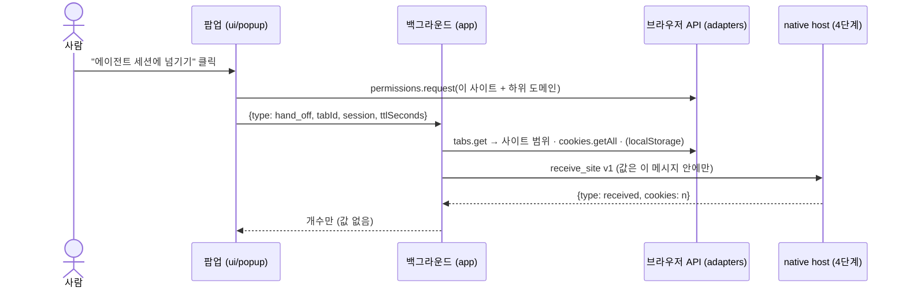
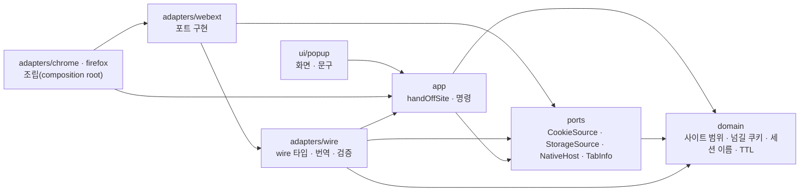

# KeyHarbor 브라우저 확장 (Chrome · Firefox)

평소 쓰는 브라우저에서 **사이트 하나의 로그인**(쿠키, 고르면 그 origin의 `localStorage`)을 KeyHarbor 에이전트 세션으로 넘긴다. 그것뿐이다([R-42](../../docs/superpowers/specs/2026-10-29-site-handoff-and-grants-design.md)). 자동 완성·저장은 7단계 일이고 여기에는 없다. 에이전트는 이 확장에도, 평소 브라우저에도 닿지 않는다.

> 받는 쪽(native host, `keyharbor session receive`, 감독자의 `Network.setCookies`, grant 등록)은 4단계에서 Rust로 만든다. 지금 확장은 아래 프로토콜대로 보내고, 테스트는 가짜 host로 한다.



## 구조

Rust 쪽 [ADR-0014](../../docs/design/adr/0014-hexagonal-guard-layer.md)와 같은 헥사고날이다. 의존은 안쪽으로만 간다.



안쪽(`domain`, `ports`, `app`)은 우리 말(`SiteCookie`, `SiteHandoff`, `SessionName`, `HostReply`)만 쓴다. 바깥 형식(Native Messaging 메시지, CDP `Network.CookieParam`, 팝업 → 백그라운드 메시지)은 `adapters/wire/`에만 있고 이름이 `*Wire`(CDP는 `CdpCookieParam`)로 끝난다. `test/architecture.test.ts`가 이 방향을 검사한다: domain·ports는 브라우저 API(`chrome.`·`browser.`·`globalThis`)와 바깥 계층을 import하지 않고, app은 adapters·ui를 import하지 않으며, wire 타입은 `src/adapters/` 밖에 선언되지 않는다.

| 폴더 | 책임 | 브라우저 API |
|---|---|---|
| `src/domain/` | `scope.ts`(등록 가능 도메인 + 하위 도메인, 허용 스킴), `cookie.ts`(`SiteCookie`와 넘길 쿠키 고르기: 범위·파티션·first-party), `session-name.ts`(Rust `SessionName::parse`와 같은 규칙), `handoff.ts`(TTL 검사, `SiteHandoff`, `HostReply`), `result.ts`(오류는 코드뿐) | 없음 |
| `src/ports/` | 유스케이스가 쓰는 인터페이스 넷. `NativeHost.receiveSite(SiteHandoff)`는 우리 말로 주고받는다 | 없음 |
| `src/app/` | `makeHandOffSite(ports)` 유스케이스, 검사를 마친 `Command`와 팝업이 묻는 `HandOffAsk` | 없음 |
| `src/adapters/wire/` | `protocol.ts`(Native Messaging v1 판별 유니온, 만들기·읽기는 여기서만), `cdp-cookie.ts`(`SiteCookie` → CDP `Network.CookieParam`), `native-host.ts`(전송 위의 `NativeHost`: 번역만), `command.ts`(팝업 → 백그라운드 메시지와 그 검증 한 곳) | 없음 |
| `src/adapters/webext/` | 두 브라우저에 공통인 포트 구현. 손으로 쓴 API 부분 타입 `WebExtApi` | 있음 |
| `src/adapters/chrome/`, `firefox/` | 브라우저마다 다른 쿠키 조회와 진입점(백그라운드, 팝업) | 있음 |
| `src/ui/popup/` | 디자인 시스템 클래스로만 그리는 팝업. 상태 → HTML은 순수 함수 | 진입점이 준 deps만 |
| `manifest/` | `base.json` + 브라우저 오버레이, 빌드가 병합 | — |
| `native-host/` | native messaging host 매니페스트 틀 | — |
| `scripts/` | 빌드(esbuild), 매니페스트 병합, 디자인 자산 고르기, 빌드 대상 표 | — |
| `test/` | `src/`·`scripts/`와 같은 모양. `support/`에 가짜 포트와 가짜 브라우저, `architecture.test.ts`에 계층 규칙 | — |

### 확장 지점

| 더할 것 | 하는 일 |
|---|---|
| 브라우저 (예: Edge) | `src/adapters/edge/`(쿠키 조회 + 진입점 둘), `manifest/edge.json`, `scripts/targets.mjs`에 한 줄 |
| 프로토콜 요청 | `adapters/wire/protocol.ts`의 `HostRequestWire` 유니온에 한 형태 + 만드는 함수, `NativeHost` 포트에 메서드 하나 |
| 팝업 명령 | `app/commands.ts`의 `Command` 유니온, `adapters/wire/command.ts`의 `parseCommand` |

유스케이스는 포트를 인자로 받고(DI 라이브러리 없음), 전역은 각 진입점이 `chrome`/`browser`를 한 번 읽는 것뿐이다.

## 프로토콜 v1 (Native Messaging)

host 이름은 `dev.keyharbor.host`. 요청 하나에 응답 하나.

```json
{ "v": 1, "type": "receive_site", "origin": "https://github.com",
  "cookies": [{ "name": "…", "value": "…", "url": "https://github.com/", "domain": ".github.com",
                "path": "/", "secure": true, "httpOnly": true, "sameSite": "Lax", "expires": 1893456000 }],
  "local_storage": { "…": "…" }, "ttl_seconds": 3600, "session": "work" }
```

응답: `{"v":1,"type":"received","session":"work","cookies":3}` 또는 `{"v":1,"type":"error","code":"no_session"}`. 응답에 쿠키 값은 없다.

자동 완성과 저장(7단계, [ADR-0017](../../docs/design/adr/0017-human-autofill-channel.md)):

| 요청 | 응답 | 값 |
|---|---|---|
| `{"v":1,"type":"autofill_list","origin":"https://github.com"}` | `{"type":"logins","items":["github"]}` | 없음 |
| `{"v":1,"type":"autofill_fill","origin":…,"item":"github"}` | Touch ID 뒤 `{"type":"filled","username":…,"password":…}` | **있음**: 평문이 나가는 유일한 답. 부모가 브라우저가 아니면 `not_browser`, 확인하지 않으면 `not_confirmed`, 그 origin의 로그인이 아니면 `refused` |
| `{"v":1,"type":"save_login","origin":…,"username":…,"password":…}` | `{"type":"saved","item":"github~draft-1"}` 또는 `{"type":"known","item":"github"}` | 응답에는 없음 |

`session`은 Rust `SessionName::parse`(`crates/domain`)와 같은 규칙이다: 앞뒤 Unicode 공백을 지우고, 1–120 UTF-8 바이트, 제어 문자(Cc) 없음. 판정 기준은 Rust이고 확장은 같은 규칙으로 미리 검사한다(`domain/session-name.ts`). 두 쪽 테스트가 저장소 루트의 [`contracts/session-names.json`](../../contracts/session-names.json)을 함께 읽는다(`contracts/`: 언어 사이의 계약 fixture).

쿠키 변환 규칙(`adapters/wire/cdp-cookie.ts`, 어느 쿠키를 넘길지는 `domain/cookie.ts`):

| WebExtension | CDP `CookieParam` | 이유 |
|---|---|---|
| `hostOnly: true` | `url`만, `domain` 없음 | CDP는 `domain`을 주면 도메인 쿠키(`.github.com`)로 넓힌다 |
| `hostOnly: false` | `domain`(앞의 점 유지) + `url` | |
| `sameSite` `no_restriction`/`lax`/`strict` | `None`/`Lax`/`Strict` | `None`인데 `secure`가 아니면 뺀다(Chrome이 거부) |
| `unspecified` | 없음 | 브라우저 기본값 |
| `expirationDate` | `expires`(초, 내림) | 세션 쿠키는 없음 |
| `partitionKey.topLevelSite` (CHIPS, Firefox Total Cookie Protection) | `partitionKey {topLevelSite, hasCrossSiteAncestor}` | 이 사이트가 최상위인 파티션만. 다른 사이트 파티션은 남긴다 |
| `firstPartyDomain` (Firefox first-party isolation) | — | 이 사이트로 격리된 것만 |

사이트 범위는 [`tldts`](https://github.com/remusao/tldts)(MIT, 의존성 없음)가 내장한 Public Suffix List로 정한다. `bbc.co.uk`, `foo.github.io` 같은 경우를 바르게 하려면 PSL이 필요하고, 직접 넣어 두면 목록이 낡는다. IP와 `localhost`는 호스트 그대로다.

## 권한

| 권한 | 왜 |
|---|---|
| `cookies` | 그 사이트의 쿠키 읽기(HttpOnly 포함) |
| `nativeMessaging` | KeyHarbor host에 보내기 |
| `activeTab` | 누른 탭의 URL |
| `scripting` | 사람이 고를 때만 그 탭의 `localStorage` 읽기 |
| `storage` | 마지막 세션 이름 기억(값 아님) |
| `optional_host_permissions` `http(s)://*/*` | 설치 때는 아무 사이트도 받지 않는다. 넘길 때 그 사이트와 하위 도메인만 `permissions.request`로 묻는다 |

## 만들기와 검사

```sh
cd integrations/browser-extension
npm ci
npm run build     # dist/chrome, dist/firefox
npm test          # vitest
npm run lint      # tsc + build + web-ext lint (경고도 실패)
npm run check     # lint + test (CI가 이것을 돈다)
```

- `KEYHARBOR_TEST_CHROME`에 Chrome 실행 파일을 주면 `test/smoke/chrome.test.ts`가 빌드한 확장을 headless Chrome에 올리고(CDP `Extensions.loadUnpacked`, 정식 Chrome은 `--load-extension`을 무시한다) 팝업을 열어 본다.
- 의존성은 정확한 버전으로 고정하고 `package-lock.json`을 커밋한다. vitest는 4.0.18이다: 4.1 이후는 npm 10.9의 peer 해석 버그(`Cannot read properties of null (reading 'edgesOut')`)로 설치가 깨진다.
- 팝업 CSS와 아이콘은 빌드가 `design-system/`에서 복사한다(`scripts/design-assets.mjs`). 소스 트리에 사본을 두지 않는다. 팝업이 쓰는 `kh-*` 클래스와 아이콘은 Rust `design-check`가 디자인 시스템과 대조한다([ADR-0015](../../docs/design/adr/0015-design-system-layers.md)).

## 설치 (개발용, 압축 해제)

- **Chrome**: `chrome://extensions` → 개발자 모드 → "압축해제된 확장 프로그램 로드" → `dist/chrome`. 매니페스트의 `key` 덕분에 ID는 항상 `fimjcgdlhnkdmjnhcccnkpcnmcecgjoc`다(공개 키만 커밋, 개인 키는 만들지 않았다).
- **Firefox**: `about:debugging#/runtime/this-firefox` → "임시 부가 기능 로드" → `dist/firefox/manifest.json`. 또는 `npx web-ext run --source-dir dist/firefox`. ID는 `browser-extension@keyharbor.dev`. Firefox 팝업 화면은 자동 검사가 없어서 이 방법으로 눈으로 확인한다(`web-ext run --arg=--headless`로 설치까지는 된다).

### native host 매니페스트 (4단계)

`native-host/`의 두 파일은 모양을 보여 주는 예시다. 실제 매니페스트는 `keyharbor browser install-host [--browser chrome|chromium|firefox|all]`가 아래 위치에 쓴다. `path`는 데이터 폴더의 `native-host` 스크립트(0700)이고, 이 스크립트가 `keyharbor --data-dir <데이터 폴더> browser host`를 실행한다(브라우저는 매니페스트의 실행 파일에 우리 인자를 넘기지 않는다).

| 브라우저 | macOS 위치 | 허용 |
|---|---|---|
| Chrome | `~/Library/Application Support/Google/Chrome/NativeMessagingHosts/dev.keyharbor.host.json` | `allowed_origins: ["chrome-extension://fimjcgdlhnkdmjnhcccnkpcnmcecgjoc/"]` |
| Chromium | `~/Library/Application Support/Chromium/NativeMessagingHosts/` | 같음 |
| Firefox | `~/Library/Application Support/Mozilla/NativeMessagingHosts/dev.keyharbor.host.json` | `allowed_extensions: ["browser-extension@keyharbor.dev"]` |

## 받는 쪽 (4단계, Rust)

- native host는 `keyharbor browser host`다. stdin/stdout의 길이 접두 JSON 하나를 받고, `receive_site` v1과 쿠키가 그 사이트 것인지 검사한 뒤 실행 중인 세션의 감독자에게 넘긴다. 응답의 오류 코드는 `bad_request`·`no_session`·`not_running`·`refused`(다른 사이트 쿠키, TTL 범위 밖)·`failed`이고, 값은 응답·오류·사용 기록·DB에 없다(`crates/cli/tests/browser_host.rs`).
- 감독자가 grant(`created_by = handoff`, `ttl_seconds` 동안)를 먼저 기록하고 쿠키를 넣은 뒤(`Storage.setCookies`), `localStorage`가 있으면 그 origin에 넣고 origin을 연다. 사용 기록은 `site_handed_off`. 이 세션은 그때부터 grant 안의 사이트만 연다([J-81](../../docs/design/06-requirements-log.md)).
- 남은 것: `keyharbor session receive` 대기 명령과 관리 앱의 끌어다 놓기 대상(5단계).
