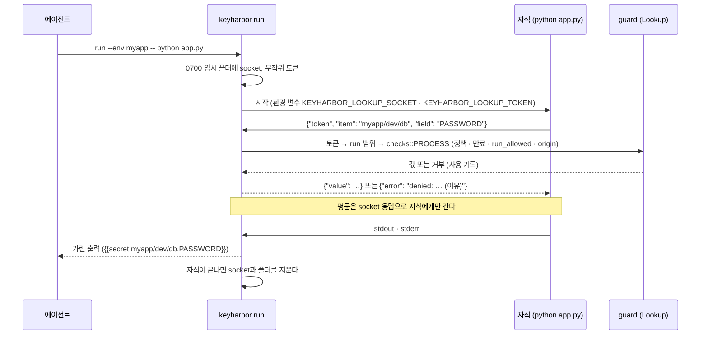

# KeyHarbor keyring 백엔드 (Python)

`keyharbor run` 아래에서 도는 Python 프로그램이 `keyring.get_password("myapp/dev/db", "PASSWORD")`처럼 **실행 중에 이름으로** 값을 묻게 해 주는 읽기 전용 [keyring](https://github.com/jaraco/keyring) 백엔드다. 개발자 비밀 설계 [§3 통로 ④](../../docs/superpowers/specs/2026-10-29-developer-secrets-design.md)이고, 판단 기록은 [J-122](../../docs/design/06-requirements-log.md)에 있다. 배포하지 않는다. 쓰려면 이 폴더에서 설치한다.

```sh
pip install ./integrations/python-keyring
keyharbor run --env myapp -- python app.py                     # run에 준 항목만 물을 수 있다
keyharbor run --allow 'myapp/dev/*' -- python app.py           # 이름 범위를 넓힌다
```

`run` 밖에서는 socket이 없어 이 백엔드가 viable하지 않으므로, keyring은 평소 백엔드(macOS Keychain 등)를 쓴다.

## 흐름



## 대응

| keyring | KeyHarbor |
|---|---|
| `service` | 항목 이름 (`myapp/dev/db`) |
| `username` | 필드 이름 (`PASSWORD`). 빈 문자열이면 `value`(값 하나짜리 secret 항목) |
| 없는 항목·필드 (`not_found`) | `None` |
| 다른 거부 (`bad-token`, `outside-run`, `policy`, `run-not-allowed`, `origin`, `expired` …) | `keyring.errors.KeyringError("denied: <항목> (<이유>)")` |
| `set_password`, `delete_password` | 항상 실패. 값은 `keyharbor` CLI나 관리 앱으로 넣는다 |

priority는 9로, `run` 안에서는 OS 키체인보다 먼저 묻는다.

## socket 프로토콜

연결 하나에 요청 하나, JSON 한 줄씩이다. 요청 줄은 4096바이트까지, 읽기·쓰기는 2초 안에 끝나야 한다.

```text
→ {"token": "<64자 hex>", "item": "myapp/dev/db", "field": "PASSWORD"}
← {"value": "…"}                                  또는
← {"error": "denied: myapp/dev/db (outside-run)"}
```

keyring 없이 쓰려면 `keyrings.keyharbor.lookup(item, field)`(표준 라이브러리만 쓴다)를 부른다.

## 한계

- `run`이 도는 동안 토큰을 아는 같은 사용자 프로세스는 이 socket에 물을 수 있다. 토큰은 자식의 환경 변수에만 있지만, 같은 사용자는 자식의 환경을 읽을 수 있고 자식이 토큰을 찍으면 출력에 보인다(토큰은 금고 값이 아니어서 가리지 않는다). 범위는 `run`에 준 항목과 `--allow`뿐이다([03 T13b](../../docs/design/03-security-whitepaper.md)).
- 자식이 받은 값을 밖으로 보내는 것은 다른 통로처럼 막지 못한다(T13).

## 테스트

실제 socket은 Rust 테스트 `crates/cli/tests/run_lookup_cli.rs`가 검사한다. 이 폴더의 테스트는 가짜 socket에 묻고, CI에는 넣지 않았다.

```sh
cd integrations/python-keyring && python3 -m unittest discover -s tests   # keyring이 없으면 백엔드 테스트는 건너뛴다
```
